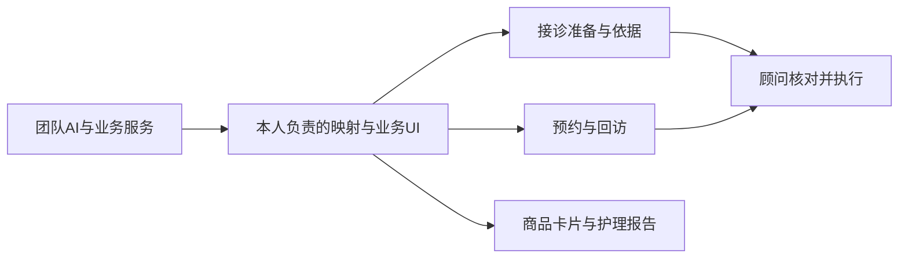
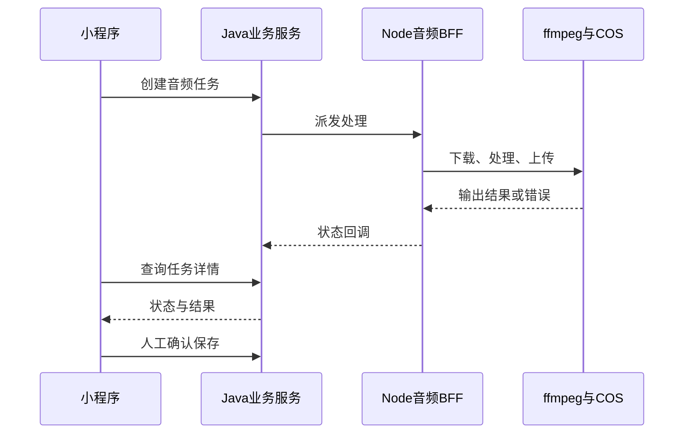
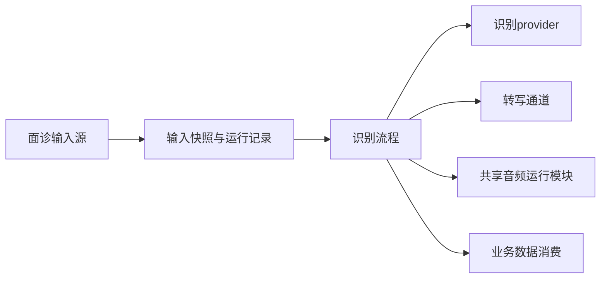
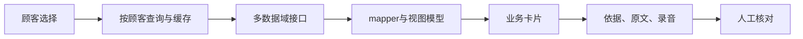
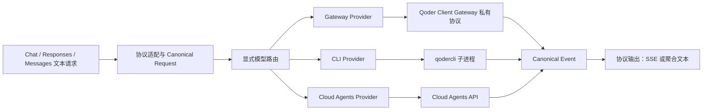
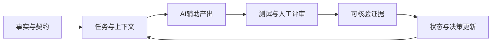
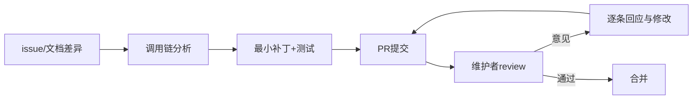
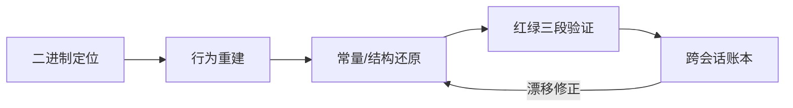

# 项目图表集

用途：辅助已选案例的白板走读，按需查图；不逐图日练，也不把关系图作为本人实现证据。

图中展示资料支持的组件关系，不声明全部组件由本人实现。具体接口名、状态枚举与重试语义以源码/契约为准。

## 1. 平台职责

## 2. 音频任务

## 3. 识别服务

## 4. 接诊准备

## 5. qoder文本协议网关

此图吸收旧图片的三条路线，并按 `47b1af6` 源码校正：`npm start` 默认 Gateway（experimental），`npm run start:cli` / `start:cloud-agents` 显式选择另两条；模型别名也可指定 Provider，上游失败不自动换链路。CLI 当前收完 stdout 才输出，不是真正首 token 流式；“官方 API”不自动证明更稳定或风险更低。下游仅声明文本兼容，验证范围与待核验项见[P05 长稿](../06-三旗舰作品集加固/01-qoder-proxy-api-叙事与十问.md)和 E03/T04。

## 6. Context Engineering验证环

## 7. Maka贡献与review闭环

归属图例：🟢 本人独立 / 🔵 本人主导（有协作）/ ⚪ 团队或同事主笔。下两图按此标注。

## 8. 客户端行为研究管线（P09候选）

历史快照口径：1326函数分母、435件分层验证（32.8%）、113份账本、27轮连续会话、13包回归；候选讲述材料，不写生产指标。

图表由当前项目卡重新梳理；更细的历史图见证据登记所指取证底稿，不将其中旧数字自动升级为当前事实。

## 依据与延伸

- [证据登记快照数字表](../00-事实与简历/05-项目归属与量化证据.md)

## 白板图怎样用于解释，而不是装饰

先标输入与状态拥有者，再画调用方向，最后插入一条失败路径。框表示模块职责，不表示每个模块都由本人开发；箭头表示调用、事件或数据消费，必须说清是哪一种。时序图中的“返回”也不等于业务完成，例如创建任务返回ID和产物可用是两个时刻。

| 图 | 先解释的因果关系 | 面试官可以改变的条件 | 回到哪份正文 |
|---|---|---|---|
| 1 平台职责 | 本人业务UI消费团队能力 | AI结果缺字段、团队接口变化 | P01与事实归属 |
| 2 音频任务 | 创建、执行、查询与确认分阶段 | 页面离开、处理超时、回调重复 | P02，生产保护以原合同为准 |
| 3 识别编排 | 输入快照与外部Provider解耦 | Provider失败或输入不完整 | P03，算法归外部能力 |
| 4 接诊准备 | 顾客身份→远端数据→ViewModel→人工核对 | 快速切客、空数据、低可信度 | P04，学习推演与实绩分开 |
| 5 协议网关 | Provider差异收敛为统一事件后输出文本 | 非文本事件、CLI缓冲、私有协议漂移 | P05及E03/T04 |
| 6 Context循环 | 输入约束、验证反馈和记录互相校准 | 旧规则、缺失证据、失败测试被跳过 | P07，循环图不证明已自动执行 |
| 7 开源review | 补丁行为和维护者审查分别产生证据 | PR尚未接受、基准不再覆盖生产 | P06及E04快照 |
| 8 行为研究 | 重建假设必须由观测校正 | 版本漂移、样本不充分 | P09候选，不转换成生产业绩 |

### 练习推演：在图4上加入乱序

画顾客A与B两条请求，标出发起和到达顺序。如果B先到、A后到，仅按到达时间更新UI会把页面切回A。可设计以顾客/报告条件构造缓存key，并在提交结果时核对当前请求代次；abort用于减少无用工作，结果归属保护负责拒绝过期提交。哪一种保护实际存在，要回P04证据核验，此图不作为已经修过该bug的证明。

### 练习推演：在图2上加入中断

依次区分“前端停止查询”“用户请求取消”“后台收到取消并停止”“服务进程重启”。四种事件分别改变不同状态和资源，不能用同一条删除箭头表示。假设回调重复时，还应确认接收方的请求身份与状态转移；这些是系统设计检查点，未核验的幂等合同仍是待核验。

### 可公开演示与公司图的区别

公司图只用于解释既有职责，内部接口、客户信息与素材不搬进个人主页。公开项目图只声明源代码能够支持的行为：fixture分数不画成评分算法；读取任务快照不画成worker续跑；有限一致性不画成五语言全行为等价。增加箭头前先找到物证，找不到则标设计假设或不画。
