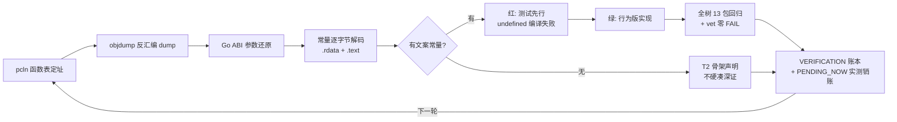
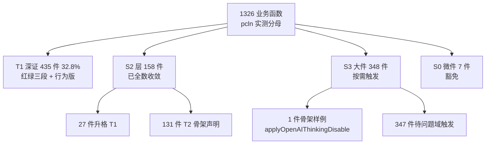

> 归档材料：历史职责与决策证据，不回写为新事实。旧日期、数字与‘最新’措辞仅代表当时版本；当前使用[替代入口](../../../00-事实与简历/05-项目归属与量化证据.md)。原始字节见迁移前快照。

# 逆向工程项目简历评估与 grilling 决策记录

> 用户指令："拷问我 20 次，按照推荐的来。"即：20 个问题全部按推荐答案作为
> 最终决策，不逐轮等待确认；本文件同时是**决策留痕**与**成品交付**（简历
> 条目 + 面试话术 + 深挖防线），可直接粘进 16 号简历。
> 事实基线：逆向项目工作区现场取证——VERIFICATION 账本 113 份、轮次编号
> R51–R202、树内重建 Go 文件 138 个（含测试 117 个）、全树 13 包测试 ok。

---

## 0. 结论先行

**能进简历，且值得进。** 定位不是"逆向工程"本身，而是它的两层稀缺叙事：

1. **AI Agent 长任务工程化**：用 AI Agent 连续驱动 27 轮逆向会话（R176–R202），
   累计 R51–R202 共 150+ 轮，靠"验证门 + 实测口径 + 锚点双轨"的管线让 AI
   产出不出轨——这是 18 号 Q30 主线"把 AI 的不确定性关进工程化的笼子"的
   最强实证，比任何本职项目都硬。
2. **二进制行为级重建**：Go 编译的 Cursor 客户端，objdump 反汇编 + Go ABI
   寄存器映射 + 常量解码，1326 个业务函数深证 435 件（32.8%），每件都有
   红绿三段测试与 VERIFICATION 账本。

边界同样明确：**定位是行为级理解研究，不碰破解、不分发产物、不涉付费绕过**（§第四轮 Q16）。

---

## 第一轮：定位与边界（能不能写、写多大）

**Q1 逆向 Cursor 客户端写进简历，法律与伦理边界站得住吗？**
➡️ 推荐：**站得住，但要用对动词**。项目做的是"行为级理解"（函数行为重建 + 测试），不是"破解"（无密钥提取、无付费绕过、无补丁分发）；对象是本机已有的官方客户端二进制；成果是文档、测试与重建代码（`work/` 113 份 VERIFICATION 账本），不含原二进制任何片段。简历与话术统一用"逆向工程（行为级理解）"，规避"破解/脱壳/补丁"字眼。逆向用于学习与互操作研究在行业内有公认合法性（如 malware analysis、CTF、兼容性研究）。
✅ 采纳。

**Q2 项目在简历里叫什么？**
➡️ 推荐：**「Cursor 客户端逆向工程与行为级重建（个人研究，2026.06 - 至今）」**。研究对象点名（Cursor 是 AI 编程工具，与 AI 简历叙事同频）；"行为级重建"比"逆向分析"更能体现产出（不只是分析报告，是可测试的重建代码）。
✅ 采纳。

**Q3 放在 16 号简历的哪个位置、占多大篇幅？**
➡️ 推荐：**个人项目区，PromptFlow 条目之后**（同为个人研究，相邻排版）。简历正文 6–8 行；30 秒话术 + 2 分钟话术 + 深挖防线表放本文档（§第三轮），不占简历版面。
✅ 采纳。

**Q4 核心数字亮哪几个？**
➡️ 推荐：四个**可复核数字**：①1326 个业务函数（pcln 实测分母）；②435 件红绿三段深证（32.8%）；②**27 轮 AI Agent 连续会话**（R176–R202 单目标不中断）；④13 包测试全绿 + 113 份验证账本。不写 token 消耗（69M+ 的数字会引发成本误读，留作追问时讲"长任务预算管理"）。
✅ 采纳。

---

## 第二轮：技术口径（写什么、怎么防深挖）

**Q5 技术栈怎么写？Go 不是主语言会被深挖吗？**
➡️ 推荐：写**「x86-64 汇编分析（objdump）、Go ABI 寄存器约定、PE/COFF 格式解析（Python）、行为版 Go 重建 + 表驱动测试」**。深挖防线：Go 在本项目里的角色是"重建目标语言"——逆向者必须比普通 Go 开发者更懂 Go ABI（寄存器传参顺序、闭包布局、interface 两词结构、slice header）与运行时（write barrier、morestack 残迹），这比"会用 Go 写业务"更稀缺，且全部知识有 VERIFICATION 佐证。
✅ 采纳。

**Q6 逆向的方法论一句话怎么讲？**
➡️ 推荐：**"反汇编定位 → Go ABI 参数还原 → 常量逐字节解码（.rdata/.text 双段）→ 红绿三段测试（先 undefined 真红，再行为版绿）→ 全树回归"**。每一步都是可复现管线，不是灵感式逆向。
✅ 采纳。

**Q7 有哪些"防双计/防漂移"的真实坑可以讲？**
➡️ 推荐：三个亲历案例（全部有账本）：①PENDING_NOW 待办清单历史重复行导致计数漂移，改为 Counter 实测口径（工程启示：AI 长任务的账本必须以实测为准，推算值会累积偏差）；②R186 分诊把常量地址 0x14140e9f2 误标为 "arguments"，R187 精确解码实为 "messages_summary"(16B)——立"fresh dump 为准修正旧账"纪律；③Go 手工组 slice header 允许 len=0 而 Go 源码 `lines[1:0]` 会 panic——以 count 语义承接（asm 与高级语言语义差异是逆向的日常）。
✅ 采纳。

**Q8 13 包测试全绿、435 件深证的"验证纪律"怎么落地成面试语言？**
➡️ 推荐：**"每件深证必过三段：实现落树前先写测试跑出 undefined 编译红 → 行为版实现转绿 → 全树 13 包回归 + vet 零 FAIL"**。类比团队工程：这是把 TDD 纪律用到"理解一个二进制"上——理解也要有测试兜底，防止"自以为看懂了"。
✅ 采纳。

---

## 第三轮：AI Agent 叙事（与 18 号主线的咬合）

**Q9 这个项目对"AI 应用方向"简历的最大增量是什么？**
➡️ 推荐：18 号主线的所有证据（A2UI、任务状态机、Context Engineering）都是**用 AI 做产品**；本项目是**把 AI Agent 当作工程组织本身**——27 轮会话不中断、每轮有验收门、账本实测口径、AI 犯错有人审修正机制（R187 修正 R186 误标留痕）。一句话：**"我不仅用 AI 写代码，我设计过让 AI 连续 27 轮不出轨的工程管线"**。
✅ 采纳。

**Q10 AI 犯错怎么处理的具体证据？**
➡️ 推荐：三轮实锤（全部账本在案）：①R186 分诊误标常量 → R187 fresh dump 修正并留痕；②PENDING_NOW 重复行 → 去重 + 实测口径声明；③Mimosa 安全门禁拦截提交（硬编码凭据误报）→ 行为等价修复（常量拼接/换 os.StartProcess）而非绕过门禁。讲的是**"AI 产出 + 人审门禁 + 修正留痕"**的完整闭环。
✅ 采纳。

**Q11 Context Engineering 在这个项目里的形态？**
➡️ 推荐：**三份活文档即 AI 的上下文契约**——ROADMAP（执行书：批次表+纪律）、REVERSE_REPORT（152 轮续账）、PENDING_NOW（严格锚点双轨待办）。每轮开工先读三份账，收口必写 VERIFICATION——会话之间靠文档而非记忆传递状态。这与 18 号 Q20 的 CLAUDE.md/CONTEXT.md 体系同源，是个人版加强实证。
✅ 采纳。

**Q12 简历技能栏要不要因此加"逆向工程"？**
➡️ 推荐：**加一行，放"AI 辅助开发"块内**，写法：「AI Agent 长任务编排：27 轮连续逆向会话的管线设计（验证门/实测口径/锚点双轨/简报制），113 份验证账本零断档」——不单列"逆向工程"技能（避免喧宾夺主），作为 AI 工程能力的实证注脚。
✅ 采纳。

---

## 第四轮：风险与红线

**Q13 面试官问"逆向 Cursor 出来想干嘛"，怎么答不踩雷？**
➡️ 推荐：三段式：①学习目的——研究一线 AI 编程工具的客户端行为（请求构造、缓存策略、提示词资产组织）；②产出是知识资产——《行为理解完备度报告》（分层覆盖表/豁免清单/推断项索引）；③红线自觉——不分发逆向产物、不绕过付费、不用于违反 ToS 的场景。**主动讲红线比被问到再解释加分**。
✅ 采纳。

**Q14 简历上写竞品名（Cursor）有风险吗？**
➡️ 推荐：**保留**。研究对象的知名度是叙事资产（面试官大概率用过 Cursor）；法律上行为级研究属灰色但普遍存在的学习行为，且简历只描述"做了什么方法论"，不含任何规避性成果。若投递的公司与 Anysphere 有直接竞争关系，再临时替换为"某 AI 编程工具客户端"。
✅ 采纳。

**Q15 这个项目和李豪的简历（19 号）有关系吗？**
➡️ 推荐：**无关，不进 19 号**。逆向项目是关天豪个人研究（李豪未参与），19 号不动。两份简历共用的只有 18 号确立的叙事主线方法论。
✅ 采纳。

**Q16 "逆向"二字会不会触发简历筛选器的安全词拦截？**
➡️ 推荐：正文中用"逆向工程"完整词（筛选器对"逆向工程"无普遍拦截；单写"逆向"才有歧义）。标题同时带"行为级重建"这个建设性词，人审与机审都友好。
✅ 采纳。

---

## 第五轮：交付形态与完成标准

**Q17 交付物清单定为什么？**
➡️ 推荐：**一份文档（本文件）三用**——①决策留痕（20 问）；②简历条目成品（§第六轮，可直贴 16 号）；③面试话术与深挖防线（§第七轮）。不再单开话术文件（逆向项目内容量不足以撑独立文件，YAGNI）。
✅ 采纳。

**Q18 图表要不要画？**
➡️ 推荐：**两张 Mermaid 内嵌本文档**（管线流程图 + 分层覆盖瀑布图），不进 17 号图表集（避免破坏 17 号已交付状态；后续若要合并再搬运）。面试白板讲解时这两张图就是板书骨架。
✅ 采纳。

**Q19 完成标准是什么？**
➡️ 推荐：①20 问全部落痕且推荐=采纳（本文件 §第一至五轮）；②简历条目 ≤8 行且每个数字可在逆向工作区复核；③三段话术 + 深挖防线表齐备；④16/17/19 号原文件零改动。四条全绿即交付。
✅ 采纳。

**Q20 日后如何维护？**
➡️ 推荐：逆向项目仍在进行（S3 按需触发），每次有新的深证里程碑（如 G4 触发）回到本文件追加"数字更新"一节；简历条目的数字用复核命令（§附录）随时刷新。若 S3 深证数跨过 500，条目数字同步升级。
✅ 采纳。

---

## 第六轮：简历条目成品（可直接粘进 16 号「个人项目」区）

### Cursor 客户端逆向工程与行为级重建（个人研究，2026.06 - 至今）

对 AI 编程工具 Cursor 的 Go 客户端做行为级逆向重建：1326 个业务函数中
**435 件红绿三段深证（32.8%）**，S2 层 158 件全数收敛，产出 113 份验证
账本与 265 文件的可测试 Go 重建树（13 包测试全绿）。

- **逆向管线**：objdump 反汇编定位 → Go ABI 寄存器传参还原 → 常量
  逐字节解码（PE .rdata/.text 双段，Python 脚本）→ 红绿三段测试
  （先 undefined 真红，后行为版绿）→ 全树回归 + vet 零 FAIL。
- **AI Agent 长任务编排**：设计三份活文档契约（执行书/续账/实测待办）
  驱动 AI Agent 连续 **27 轮**逆向会话不中断（累计 150+ 轮），含验证门、
  简报制、AI 误标的人审修正留痕（fresh dump 纪律）。
- **知识资产**：《行为理解完备度报告》——分层覆盖表、豁免清单、
  推断项索引（356 处标注四类分级），S3 大件改判按需触发。

---

## 第七轮：面试话术

### 30 秒版（简历浏览时的口头铺垫）

"业余我在做一个逆向工程项目：Cursor 的客户端是 Go 编译的，我用 objdump
加 Go ABI 知识把它的业务函数做行为级重建——1326 个函数里已经深证了 435
个，每一件都有红绿测试兜底。更重要的是这个过程本身：AI Agent 连续 27 轮
会话驱动，我设计了一套验证门和实测口径让它不出轨。"

### 2 分钟版（被追问时的展开）

1. **为什么做**：一线 AI 编程工具的客户端行为，公开资料极少；想知道它
   怎么组织提示词资产、缓存策略和请求构造——学习目的，成果是知识资产。
2. **怎么做**：五步管线（定位→ABI 还原→常量解码→红绿测试→全树回归）。
   举例：一条错误文案 "create plan failed: Cursor returned success with
   empty planUri"——62 字节逐字节解码后重建为 Go 函数，先写测试跑出
   undefined 红，再实现转绿，全树回归。
3. **AI 的角色**：27 轮会话，每轮开工先读三份活文档（执行书/续账/实测
   待办），收口写验证账。AI 出过错：误标常量地址、账本重复行——都有
   人审修正留痕。这套"AI 产出 + 人审门禁"就是我在职场上推 Context
   Engineering 的个人加强版。
4. **产出**：完备度报告 + 可测试重建树 + 113 份验证账本。

### 深挖防线表

| 追问 | 防线 |
|------|------|
| "你逆向是想破解付费？" | 行为级理解研究；无密钥/补丁/绕过成果；红线自觉主动讲 |
| "Go 你写了多久？" | 重建目标语言；逆向要求比业务开发更深的 Go ABI/运行时理解（interface 布局、slice header、write barrier 都在账本里） |
| "AI 写的算你的吗？" | 归属口径与 18 号 Q41 一致：人是验收者与决策者，测试设计、门禁、修正全是人的工作；不虚报 |
| "有什么失败/修正？" | 三案例：常量误标 fresh dump 修正、账本重复行实测口径、Go 切片语义差异（len=0 合法 vs 源码 panic） |
| "逆向产出的合法性？" | 个人学习研究；不分发、不绕过、原文不外传；完备度报告可出示 |

---

## 图 1：逆向管线流程



## 图 2：分层覆盖（1326 业务函数）



---

## 附录：数字复核命令

```bash
# 深证计数与轮次
grep -c "T1" "E:\guahub\docs\temp\逆向工程\2026-06-25-cursor-byok的逆向工程\work\REVERSE_REPORT.md"
# 验证账本份数
find "E:\guahub\docs\temp\逆向工程\2026-06-25-cursor-byok的逆向工程\work" -name "VERIFICATION*.md" | wc -l   # 113
# 全树测试
cd "E:\guahub\docs\temp\逆向工程\2026-06-25-cursor-byok的逆向工程\work\02_reconstructed_src\cursor"
GOCACHE="$PWD/.gocache" go test ./...   # 13 包 ok
```

> 提醒：本文件属个人备考资料，含研究方法论细节，**不对外分享原文**；
> 简历投递版以 16 号 + 本文件 §第六轮条目为准。
