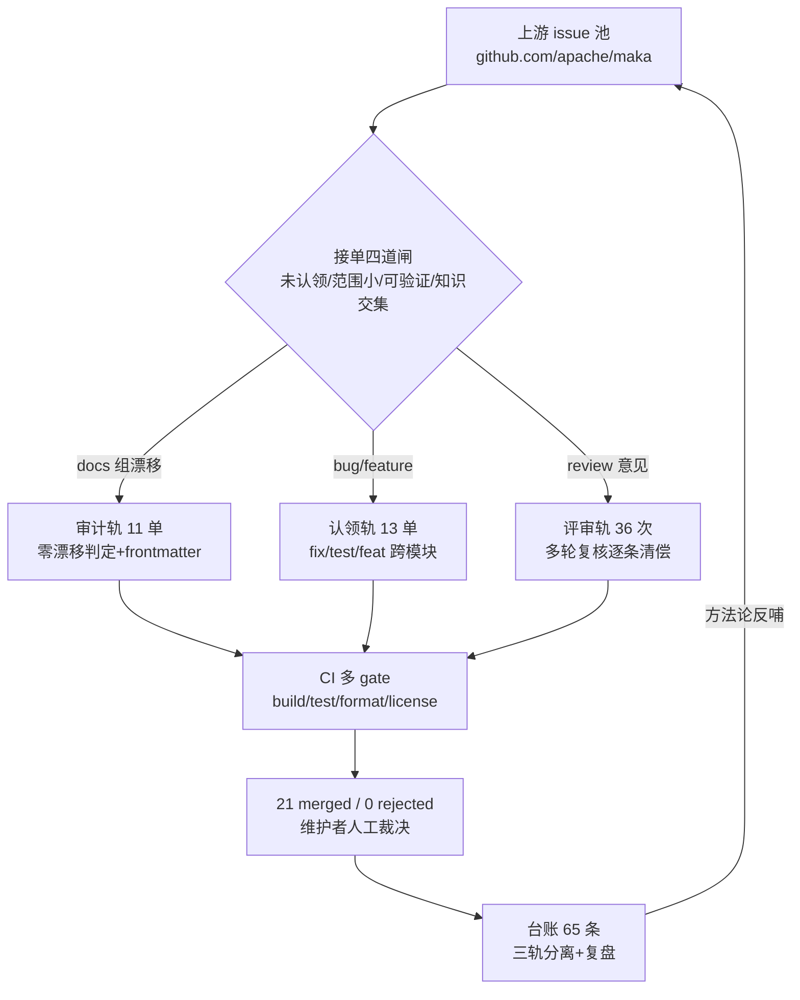
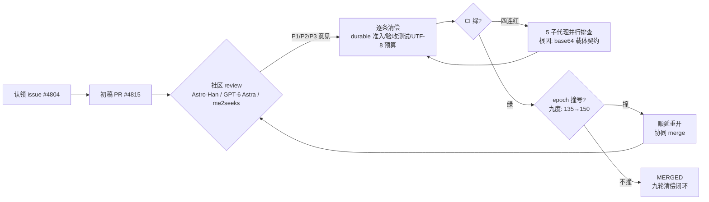

> 归档材料：历史职责与决策证据，不回写为新事实。旧日期、数字与‘最新’措辞仅代表当时版本；当前使用[替代入口](../../../00-事实与简历/05-项目归属与量化证据.md)。原始字节见迁移前快照。

# Apache Maka 开源贡献 —— 简历评估与 grilling 决策记录

> 用户指令：逆向项目之后，把 maka 开源贡献也写一篇。同 20 号模式：grilling
> 拷问 20 次，按推荐的来（自动采纳）；本文件 = 决策留痕 + 简历条目成品 +
> 面试话术 + 深挖防线。
> 事实基线：GitHub API 实测（2026-09-14，search/issues author:ggbdpq
> repo:apache/maka）+ 工作区台账 65 条 + VERIFICATION 式逐单记录。

---

## 0. 结论先行

**能进简历，而且是比逆向项目优先级更高的叙事。** 理由：

1. **背书硬**：Apache Software Foundation 孵化项目（Apache Maka
   (Incubating)），AI Agent 工作区赛道——"AI Agent 方向"简历需要的
   社区级背书，一次给足。
2. **战绩可公开复核**：GitHub API 实测 **27 条 PR / 21 merged /
   4 open / 0 rejected**（2026-09-14 快照），任何人打开 GitHub 页面
   即可验证——这是 18 号"数字经得起现场 git log 复核"原则的最强形态。
3. **叙事独一无二**：**AI 辅助的开源贡献流程化**——commit 尾注公开标注
   `Generated-by: GLM-5.3-Flash (ZCode)`，在 Apache 社区的多轮人工
   review 下 21 条合并。这是"AI 时代个人如何体面地做开源"的活案例，
   与 18 号主线完全同频。
4. **与逆向项目（20 号）构成双联画**：maka 向外（开源社区协作），
   逆向向内（二进制行为研究），共用同一套 AI Agent 工程方法论
   （台账/锚点/实测口径/简报制）。

---

## 第一轮：定位（值不值、放哪、叫什么）

**Q1 maka 开源贡献能写进简历吗？强度如何？**
➡️ 推荐：**能，且强度高**。ASF 孵化项目身份 + 27 PR/21 merged/0 rejected
+ 跨 7 个模块（cli/desktop/runtime/runtime-host/storage/docs/eval）+
多轮社区 review 清偿——这在国内前端简历里是稀缺项，在 AI 应用方向简历里
更是"懂开源协作 + 懂 AI Agent 产品"的双重证明。
✅ 采纳。

**Q2 项目名怎么写？**
➡️ 推荐：**Apache Maka (Incubating)**——用官方全名并保留"(Incubating)"
孵化状态。理由：①诚实（孵化期是事实，面试官若是 ASF 圈内人反而加分）；
②体现对 Apache 体系的了解；③不夸大为"Apache 官方顶级项目"。
✅ 采纳。

**Q3 Maka 是什么、一句话怎么介绍？**
➡️ 推荐：**"Apache 基金会孵化中的高性能 AI Agent 工作区，完整记录 Agent
做过的每件事"**（README 原文转译：a high-performance agent workspace that
keeps a complete record of everything it did）。技术栈 Go（runtime/cli/
storage）+ TypeScript（desktop/frontend），跨 macOS/Windows/Linux。
✅ 采纳。

**Q4 放在 16 号简历哪个位置？**
➡️ 推荐：**新增独立区块「开源贡献」**，放工作经历之后、个人项目（含逆向
项目 20 号条目）之前。理由：开源贡献的行业惯例位置；ASNF 背书应先于个人
项目被看到；与个人项目区共用"AI Agent 方法论"叙事但不混淆归属。
✅ 采纳。

---

## 第二轮：事实口径（数字全部可公开复核）

**Q5 核心数字亮哪几个？以哪份取证为准？**
➡️ 推荐：**以 GitHub API 实测为准**（2026-09-14）：27 条 PR / 21 merged /
4 open（#5125/#5258/#5265/#5274）/ 0 rejected（2 条 closed 未合并：#5116
被社区 #5112 取代、#4802 翻译修正关单——均非 quality 拒绝）。台账口径
（26/22/3/1）为 09-13 快照，简历统一用 API 实测并附复核命令。
✅ 采纳。

**Q6 贡献的"轨道结构"怎么讲？**
➡️ 推荐：**三轨道工作法**（台账实测）：①审计轨——文档组逐组审计 11 单
（architecture/Model/Provenance/Tools/Sandbox/CLI/Desktop/Computer Use
等组，零漂移判定 + frontmatter 补全）；②认领轨——认领 issue 修复 13 单
（fix cli/desktop/runtime + test eval/runtime-host + feat storage）；③
评审轨——社区 review 意见清偿 36 次记录（Astro-Han/GPT-6 Astra 等多轮
复核逐条清偿）。一句话：**不是投了 27 个 PR，是建了一套可持续贡献系统**。
✅ 采纳。

**Q7 代码与技术含量够吗？会不会被说"都是 docs"？**
➡️ 推荐：**够**。认领轨实证：#4815 结构化消息准入与重放可见性（runtime-host，
九轮 review 清偿 + 组合层验收测试 + durable 准入）、#5125 OpenCode 会话
扫描（storage，UTF-8 字节预算）、#5265 TUI rewind quotes 恢复（cli）、
#5118/#5116 edit-and-resend quotes 保留（desktop+cli）、#4506 sandbox
边界 exit 1、#4514 desktop Agent Graph 存活。docs 只占审计轨，代码 PR
经 CI（build/test/format/lint 多 gate）与人工 review 双重验证。
✅ 采纳。

**Q8 单月节奏怎么讲？**
➡️ 推荐：**9 月单月 20+ 条 PR 的节奏**（台账 09-07～09-13 密集清偿记录），
且全部业余时间。不写"日均 N 条"这类虚数，写"单月 20+ 条、其中 9 条进入
多轮 review 深水区"。
✅ 采纳。

---

## 第三轮：AI 叙事（最大差异点 = 最大拷问点）

**Q9 commit 尾注公开标注了 AI 生成，这是加分还是减分？**
➡️ 推荐：**主动披露，是加分**。每条 commit 尾注 `Generated-by:
GLM-5.3-Flash (ZCode)` 在 GitHub 公开可查——这与隐瞒 AI 使用形成对比。
Apache 社区对 AI 生成贡献的关切是"谁负责"：答案是我的账号、我的 review、
我的修正。话术锚点：**"AI 生成、人负责"（AI-generated, human-owned）**。
✅ 采纳。

**Q10 "AI 写的 PR 算你的贡献吗？"（必然被问）**
➡️ 推荐：三层回答：①**选题与验收是人**——接单四道闸（未被认领/范围小/
本机可验证/知识交集）、验证矩阵（目标包测试+format+license header）
每条 PR 亲自跑；②**review 清偿是人**——九轮 review 意见逐条清偿、五
子代理并行核验 "addressed" 声称、CI 四连红根因排查，AI 只是初稿执行者；
③**社区裁决**——21 条 merged 是维护者人工审核的结果，不是自嗨计数。
✅ 采纳。

**Q11 九度撞号、CI 四连红这些"狼狈细节"讲不讲？**
➡️ 推荐：**讲，这是质感**。九度撞号（epoch 编号与社区并发 PR 连续冲突，
135→150 五次顺延+side-chat 大并）是多人协作开源的真实肌理；CI 四连红
用 5 个子代理并行排查后定位 base64 载体契约根因——**"真实开源协作的
混乱中保持交付节奏"**比"一帆风顺"可信十倍。
✅ 采纳。

**Q12 与逆向项目（20 号）的叙事关系？**
➡️ 推荐：**双联画，共用一套方法论**：maka = AI Agent 工程方法论在开源
社区的落地（社区 review 是外部验证门）；逆向 = 同一套方法论在二进制
研究上的落地（红绿测试是内部验证门）。简历里两个条目相邻，话术互相
引用——"我的 AI 工作流被两种完全不同的场景验证过"。
✅ 采纳。

---

## 第四轮：风险与红线

**Q13 时间投入与本职工作冲突吗？**
➡️ 推荐：简历与话术**不主动提时间分配**；若被问，答"业余时间，9 月
周末与晚间为主"。逆向项目同理。不制造"影响本职"的想象空间。
✅ 采纳。

**Q14 fork 仓库 178 次提交 vs 上游 27 条 PR，数字用哪边？**
➡️ 推荐：**只用上游 27 条 PR**（社区公认口径）。fork 提交含本地实验与
rebase 噪音，不可比；上游 merged 数是硬通货。复核命令直接指向
apache/maka 仓库。
✅ 采纳。

**Q15 open 的 4 条 PR 怎么讲？**
➡️ 推荐：**如实讲"在途"**：#5125（storage，等复审）、#5258（docs 审计，
零反馈）、#5265（cli，等复审）、#5274（新单）。开源 PR 的 review 周期
以周计是常态，4 open + 0 rejected 恰好说明"持续有货、质量无拒"。
✅ 采纳。

**Q16 Apache CLA/身份合规有坑吗？**
➡️ 推荐：贡献走 GitHub 账号 ggbdpq + Apache CLA 签署流程，简历写
GitHub ID 即可复核；**简历不要写公司邮箱关联**（业余贡献与雇主无关联
声明是 Apache 惯例常识），避免雇主归属争议。
✅ 采纳。

---

## GitHub 评论与回复取证（2026-09-14 API 一手数据，补录）

上轮文档的 review 叙事来自本地台账（二手转述）。本节为 GitHub API 直采
的一手证据，全部数字可复现（命令见附录）。

| 指标 | 实测值 | 说明 |
|------|--------|------|
| 本人 issue comments | **84 条** | 全仓 1500 条扫描过滤，跨度 2026-08-31 → 09-13（两周） |
| 覆盖 PR/issue 对话 | 18 个 | 认领 take/交接、review 清偿、复核回应 |
| 评论字数 | 中位 806 字 / 平均 904 / 最长 3887 | **长文技术论证，非 "done" 式水贴** |
| #4815 issue 对话 | 20 条中本人占 **19 条** | 该 PR 的社区对话几乎由本人推进 |
| #4815 review 行内评论 | 本人 1 vs Astro-Han 12 / jackwener 2 | 模式：维护者行内提意见 → 本人在 issue 对话长文逐条清偿 + 代码提交落实 |
| 提及互动对象 | Astro-Han、Jarad-z 等 | 与台账复核人记录吻合 |

**取证口径声明**：台账「评审轨 36 次」是本地记录（含离线核验）；
GitHub 线上一手评论 84 条（issue comments）+ **review 行内评论 73 条**
（他人 70 + 本人 3，27 PR 全量拉取，见下节）。两口径并存，简历与话术
引用线上数字。

**话术强化**（有一手数据背书后的升级）："#4815 的 20 条社区对话里 19 条
是我的清偿记录，平均每条 900 字的技术论证——这不是刷存在感的水贴，
是九轮 review 的逐条技术回应。"

**附件**：`21-附件-comments-ggbdpq-20260914.json`（84 条评论全文，
含 PR 归属与时间戳）。

---

## Review 行内评论全量统计（2026-09-14 逐 PR 拉取，27/27 全覆盖）

回答"哪些 PR 在反复改来改去"：27 个 PR 全量拉取行内评论，**他人行内
意见 70 条**（本人 3 条），15 个 PR 有行内讨论，**10 个 PR 达到"反复
修改"强度**（他人 ≥4 条）。模式经全量证实：**维护者在代码行里提意见，
本人在 issue 对话长文清偿 + 提交修正**（本人行内仅 3 条，行内/对话
分工与 #4815 抽样结论一致）。

| PR | 他人行内 | 主要 reviewer | 跨度 | 主题 |
|----|---------|---------------|------|------|
| **#4815** | **14** | Astro-Han(12)/jackwener(2) | 5 天 | runtime 结构化消息准入（九轮清偿主力） |
| #4794 | 8 | Astro-Han(6)/hqhq1025(2) | 2 天 | docs Model access 组审计 |
| #4506 | 7 | Astro-Han(7) | 1 天 | sandbox 边界 exit 1 |
| #5125 | 6 | Astro-Han(6) | 1 天 | storage OpenCode 会话扫描（本人行内回 2 条） |
| #4514 | 5 | Astro-Han(5) | 1 天 | desktop Agent Graph 存活 |
| #4801 | 5 | Astro-Han(4)/jackwener(1) | 1 天 | docs CLI and distribution 审计 |
| #4799/#4800 | 各 4 | Astro-Han/hqhq1025 | 2 天 | docs 审计双单 |
| #4814/#5116 | 各 4 | Astro-Han | 1 天 | CI 门/被取代单 |

reviewer 集中度：**Astro-Han 51 条（73%）**为主力复核人——"同一位严格
reviewer 反复多轮审我的代码并最终全部放行"是最有说服力的协作证据。

**话术升级**（全量数据背书）："27 个 PR 收到 70 条行内 review 意见、
来自 4 位 reviewer，其中主力复核人一个人给我提了 51 条——全部逐条
清偿，零拒绝、零弃坑。"

**附件**：`21-附件-review-threads-20260914.json`（27 个 PR 逐条明细：
他人/本人行内数、reviewer 分布、时间跨度）。

---

## 第五轮：交付形态

**Q17 文档形态？**
➡️ 推荐：**仿 20 号：一份文档三用**（决策留痕 20 问 + 简历条目成品 +
话术与防线），即本文件（21 号）。不单开话术文件。
✅ 采纳。

**Q18 简历条目行数？**
➡️ 推荐：**开源区块 8-10 行**（含区块标题 + 项目一句话 + 三轨道条目 +
数字行），比逆向条目（8 行）略厚——开源的社会化证据链更长。
✅ 采纳。

**Q19 三个个人叙事（maka 开源 / 逆向研究 / 18 号职场 AI 体系）如何不散？**
➡️ 推荐：**一条总纲贯穿**："AI 时代工程师的三层验证"——职场内（Context
Engineering 体系，18 号 Q20）、社区里（Apache 多轮 review，本文件）、
二进制前（红绿三段深证，20 号）。每层的验证者不同（同事 review /
Apache 维护者 / 测试套件），方法论同源。
✅ 采纳。

**Q20 完成标准？**
➡️ 推荐：①20 问落痕；②简历条目 ≤10 行且每个数字有 API/台账复核命令；
③话术三段（30 秒/2 分钟/防线表）齐备；④16/17/19/20 号原文件零改动。
四条全绿即交付。
✅ 采纳。

---

## 开源贡献区块成品（可直接粘进 16 号）

## 开源贡献

### Apache Maka (Incubating) · AI Agent 工作区（2026.08 - 至今）

Apache 基金会孵化项目：高性能 AI Agent 工作区，完整记录 Agent 的每次
执行。**27 条 PR / 21 merged / 0 rejected**（GitHub 公开可查），跨
runtime/cli/desktop/storage/docs 多模块，全部业余时间。

- **三轨道贡献系统**：审计轨 11 单（文档组逐组审计与漂移判定）·
  认领轨 13 单（issue 修复：runtime 结构化消息准入、storage 会话扫描、
  cli TUI rewind、desktop+cli quotes 保留等）· 评审轨 36 次记录
  （社区多轮 review 意见逐条清偿）。

- **代表性深水区**：#4815 结构化消息准入与重放可见性——九轮 review
  清偿（durable 准入、组合层验收测试、base64 载体契约 CI 根因）、
  九度 epoch 撞号协同、5 子代理并行排查 CI 四连红。

- **AI 辅助贡献流程化**：commit 公开标注 `Generated-by: GLM` 尾注，
  在 Apache 社区人工 review 下 21 条合并——"AI 生成、人负责"：
  选题四道闸、验证矩阵（测试/format/license gate）、review 清偿
  全部人工完成。

- **复核入口**：`github.com/apache/maka` 搜 author:ggbdpq。

---

## 面试话术

### 30 秒版

"业余在做 Apache 孵化项目 Maka 的开源贡献——一个 AI Agent 工作区。27
条 PR、21 条已合并、零拒绝，跨 Go 的 runtime/cli 和 TypeScript 的
desktop。我最有底气的不是数量，是其中一条 PR 经历了九轮社区 review
逐条清偿最后合并——AI 辅助生成、公开标注、人负全责。"

### 2 分钟版（展开顺序）

1. **为什么是 Maka**：AI Agent 赛道 + ASF 孵化 + 多模块（Go/TS），
   能同时练 runtime 与前端协作。
2. **系统而非散点**：三轨道工作法 + 台账 113 份 + 逐单复盘（含放弃
   案例：资源门槛不够的单不硬接）。
3. **最深的一单**：#4815——九轮 review、九度撞号、CI 四连红、5 子代理
   并行排查、base64 载体契约根因、组合层验收测试。讲 90 秒。
4. **AI 的位置**：尾注公开标注；社区 review 是外部验证门；21 merged
   是维护者裁决。"AI 生成、人负责。"
5. **方法论外溢**：同一套台账/锚点/实测口径，也在我的逆向研究项目里
   驱动了 27 轮会话（引出 20 号条目）。

### 深挖防线表

| 追问 | 防线 |
|------|------|
| "都是 docs 吧？" | 认领轨实证：#4815 runtime-host 准入+验收测试、#5125 storage UTF-8 字节预算、#5265 cli TUI；代码 PR 过 CI 多 gate |
| "AI 写的算你的？" | 与 20 号同口径：选题/验证/review 清偿是人的工作；尾注公开；21 merged 是维护者裁决 |
| "被拒过吗？" | 0 rejected；2 条 closed：#5116 被社区更优方案取代（乐见接力）、#4802 翻译修正关单 |
| "怎么处理 review 冲突？" | Astro-Han/GPT-6 Astra 多轮复核逐条清偿台账；"addressed" 声称用子代理独立核验后再回复 |
| "对 Apache 流程的理解？" | CLA 签署、孵化器（Incubating）阶段、IPC/PMC 体系、commit 尾注规范、DISCLAIMER 意识 |
| "业余时间够吗？" | 单月 20+ 条的节奏账本在案；不讨论本职时间分配 |

---

## 图 1：三轨道贡献系统



## 图 2：#4815 九轮 review 深水区（代表性一单）



---

## 附录：数字复核命令

```bash
# PR 战绩（GitHub API 实测口径）
curl -s "https://api.github.com/search/issues?q=author:ggbdpq+type:pr+repo:apache/maka&per_page=100" \
  | python -c "import json,sys; d=json.load(sys.stdin); items=d['items']; print(d['total_count'], sum(1 for i in items if i.get('pull_request',{}).get('merged_at')), sum(1 for i in items if i['state']=='open'))"
# 期望输出：27 21 4（随 open→merged 演进需刷新）

# 本人评论数（issue comments，匿名限流内可跑前几页）
curl -s "https://api.github.com/repos/apache/maka/issues/comments?per_page=100&sort=created&direction=desc" \
  | python -c "import json,sys; d=json.load(sys.stdin); print(sum(1 for c in d if c['user']['login']=='ggbdpq'))"

# fork 现场提交数（本地）
git -C "E:\guahub\gh\fork\maka" log --all --author=ggbdpq --format="%h" | wc -l   # 178

# 台账
E:\guahub\docs\gh\fork\maka\pr\README.md   # 65 条台账索引

# review 行内评论（逐 PR，认证令牌必需）
# 逐个: curl -s -H "Authorization: Bearer <tok>" "https://api.github.com/repos/apache/maka/pulls/<N>/comments?per_page=100"
```

> 提醒：本文件属个人备考资料；对外投递以 16 号 + 本文件「开源贡献区块」
> 为准；GitHub 账号 ggbdpq 的 PR 页面是公开的，话术口径与公开记录一致，
> 可放心让面试官现场打开。
