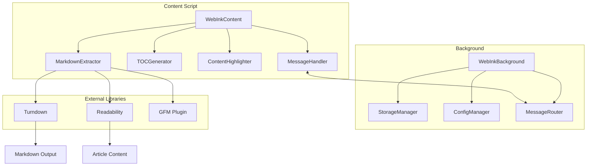
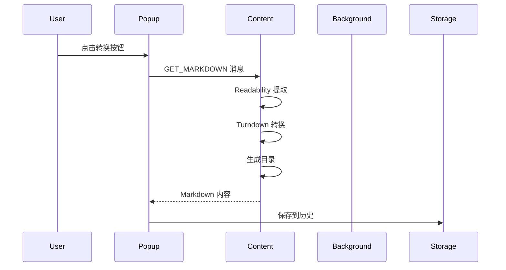

# WebInk 架构文档

## 概述

WebInk 是一个智能网页转 Markdown 工具，使用 Chrome 扩展为用户提供网页内容提取和转换功能。

## 技术栈

### 核心框架
- **Plasmo** - Chrome 扩展开发框架
- **Parcel** - 模块打包工具
- **TypeScript** - 类型安全的 JavaScript

### 核心库
- **Turndown** - HTML 转 Markdown 转换器
- **Readability** - Mozilla 的文章内容提取库
- **GFM Plugin** - GitHub Flavored Markdown 支持

## 架构图



## 模块说明

### Content Script

#### WebInkContent (index.ts)
主入口类，负责：
- 初始化所有子模块
- 设置消息监听器
- 协调各模块交互

#### MarkdownExtractor (extractor.ts)
Markdown 提取器，负责：
- 使用 Readability 提取文章正文
- 使用 Turndown 转换 HTML 为 Markdown
- 生成文章元数据（标题、作者等）
- 统计字数

#### TOCGenerator (toc.ts)
目录生成器，负责：
- 从 DOM 中提取标题结构
- 生成 Markdown 格式的目录
- 追踪当前可见标题
- 处理目录点击跳转

#### ContentHighlighter (highlight.ts)
内容高亮器，负责：
- 高亮 DOM 元素
- 注入高亮样式
- 自动清除高亮

#### MessageHandler (messages.ts)
消息处理器，负责：
- 处理来自 background/popup 的消息
- 调用相应的功能模块
- 返回处理结果

### Background

#### WebInkBackground (index.ts)
Background 主类，负责：
- 初始化存储和配置管理器
- 设置消息路由
- 管理侧边栏

#### StorageManager (storage.ts)
存储管理器，负责：
- 管理配置存储
- 管理内容缓存
- 管理历史记录
- 提供清除功能

#### ConfigManager (config.ts)
配置管理器，负责：
- 加载和保存配置
- 提供配置更新接口
- 重置为默认配置

#### MessageRouter (messages.ts)
消息路由器，负责：
- 处理 background 级别的消息
- 转发消息到相应处理器

## 数据流

### 网页转换流程



### 消息类型

| 消息 | 方向 | 说明 |
|------|------|------|
| GET_MARKDOWN | Popup → Content | 获取页面 Markdown |
| EXTRACT_CONTENT | Popup → Content | 提取文章内容 |
| GENERATE_TOC | Popup → Content | 生成目录 |
| SAVE_CONFIG | Popup → Background | 保存配置 |
| GET_CONFIG | Popup → Background | 获取配置 |
| COPY_TO_CLIPBOARD | Popup → Content | 复制到剪贴板 |

## 存储结构

### chrome.storage.local

```typescript
{
  webink_config: WebInkConfig,      // 用户配置
  webink_cache: {                   // 内容缓存
    [url: string]: ExtractedContent
  },
  webink_history: ExtractedContent[] // 历史记录
}
```

## 配置选项

### WebInkConfig

```typescript
interface WebInkConfig {
  enableHighlight?: boolean;         // 启用高亮
  tocPosition?: 'top' | 'bottom' | 'custom';  // 目录位置
  autoExtract?: boolean;             // 自动提取
  markdownOptions?: MarkdownOptions; // Markdown 选项
  translationOptions?: TranslationOptions;  // 翻译选项
}
```

### MarkdownOptions

```typescript
interface MarkdownOptions {
  gfm?: boolean;                     // GFM 支持
  headingStyle?: 'setext' | 'atx';   // 标题样式
  codeBlockStyle?: 'fenced' | 'indented';  // 代码块样式
  taskListItems?: boolean;           // 任务列表
  strikethrough?: boolean;           // 删除线
  tables?: boolean;                  // 表格
}
```

## 扩展点

### 添加自定义 Turndown 规则

```typescript
// 在 MarkdownExtractor 中
this.turndownService.addRule('customRule', {
  filter: 'div.custom',
  replacement: (content) => {
    return `CUSTOM: ${content}`;
  }
});
```

### 自定义高亮样式

```typescript
const highlighter = new ContentHighlighter({
  duration: 3000,
  className: 'my-highlight',
  color: '#00ff00'
});
```
