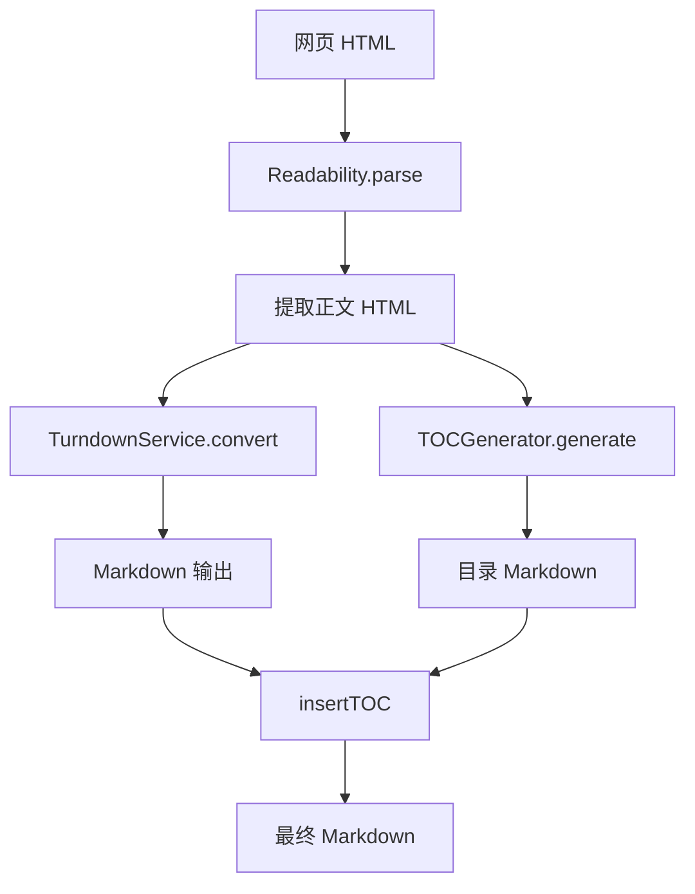
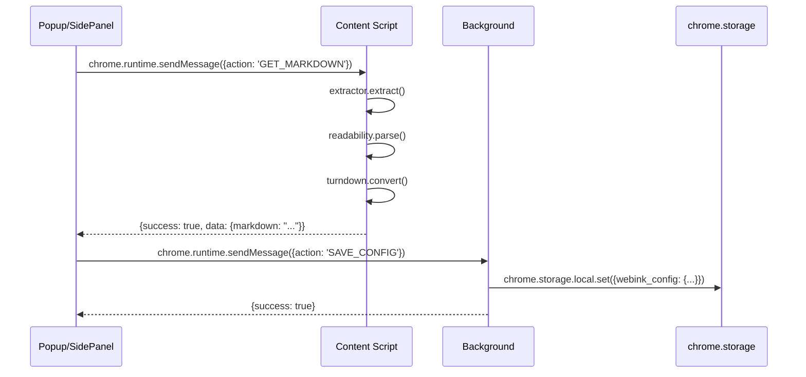
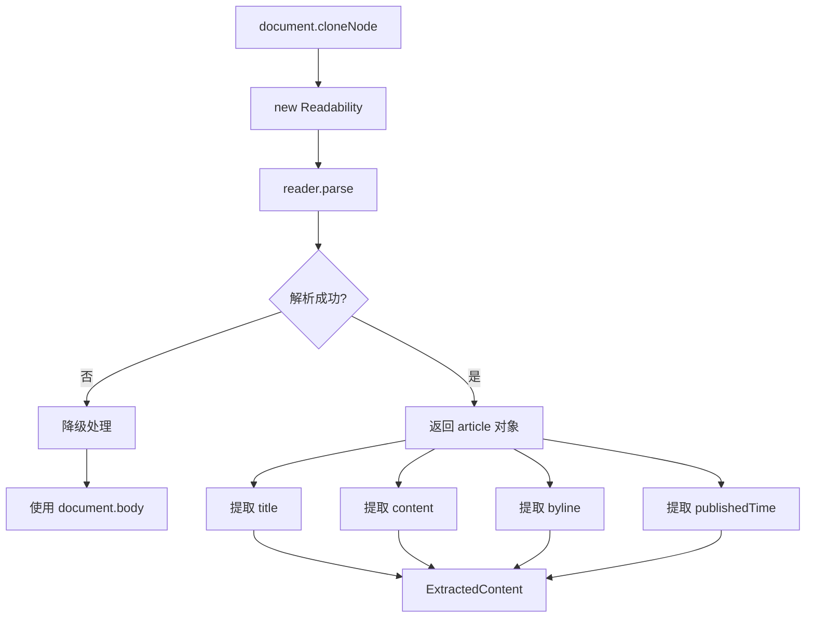
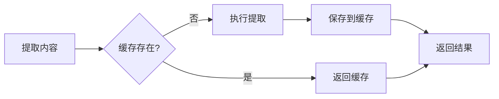
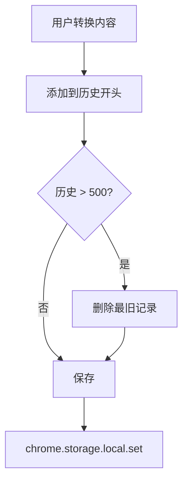

# WebInk 数据流文档

## 数据流概述

WebInk 的核心功能是将网页 HTML 内容转换为 Markdown 格式。以下是详细的数据流分析。

## 主要数据流

### 1. 网页到 Markdown 转换



### 2. 消息通信流



### 3. 内容提取详细流程



## 数据结构转换

### HTML → Article

```typescript
// 输入: HTML
const html = `
  <article>
    <h1>文章标题</h1>
    <p>文章内容...</p>
  </article>
`;

// Readability 处理
const article = new Readability(documentClone).parse();

// 输出: Article 对象
interface Article {
  title: string;           // "文章标题"
  content: string;         // 清理后的 HTML
  textContent: string;     // 纯文本
  length: number;          // 字符数
  excerpt: string;         // 摘要
  byline: string;          // 作者
  publishedTime?: string;  // 发布时间
  dir: string;             // 文本方向
  leadImageUrl?: string;   // 主图 URL
}
```

### Article → Markdown

```typescript
// 输入: Article.content (HTML)
const html = '<h1>标题</h1><p>内容</p>';

// Turndown 处理
const turndownService = new TurndownService(options);
const markdown = turndownService.turndown(html);

// 输出: Markdown
const markdown = '# 标题\n\n内容';
```

## 存储数据流

### 缓存流程



### 历史记录流程



## 配置数据流


## 消息数据结构

### GET_MARKDOWN 请求

```typescript
interface GetMarkdownRequest {
  includeTOC?: boolean;      // 是否包含目录
  tocPosition?: 'top' | 'bottom' | 'custom';  // 目录位置
  useReadability?: boolean;  // 是否使用 Readability
}
```

### GET_MARKDOWN 响应

```typescript
interface GetMarkdownResponse {
  success: boolean;
  data?: {
    markdown: string;         // Markdown 内容
    title: string;            // 页面标题
    sourceUrl: string;        // 源 URL
    domain: string;           // 域名
    extractedAt: string;      // 提取时间
  };
  error?: string;
}
```

## 性能优化

### 缓存策略

1. **URL 级别缓存**: 每个 URL 的提取结果独立缓存
2. **LRU 淘汰**: 缓存满时删除最旧的条目
3. **缓存大小限制**: 最多 100 个 URL

### Readability 优化

1. **文档克隆**: 使用 `cloneNode(true)` 避免修改原 DOM
2. **并行处理**: 多个标签页可以并行提取
3. **降级策略**: Readability 失败时降级到简单提取

### TOC 生成优化

1. **懒生成**: 只在需要时生成目录
2. **IntersectionObserver**: 高效追踪可见标题
3. **缓存结果**: DOM 未变化时复用结果
