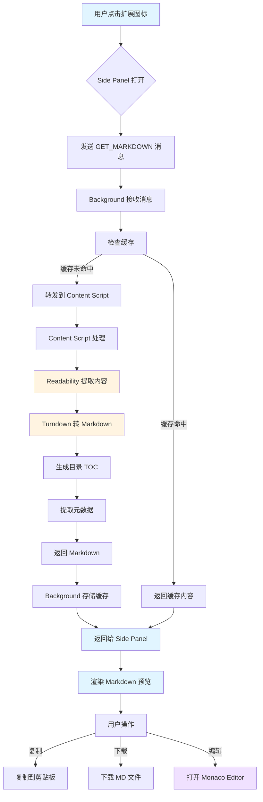

# WebInk v0.4.9 - 数据流图

## 数据流图



## 详细数据流

### 1. 页面转换流程

```
┌────────────────────────────────────────────────────────────┐
│ 1. 用户点击扩展图标                                         │
├────────────────────────────────────────────────────────────┤
│ → Side Panel 打开                                           │
│ → 发送 GET_MARKDOWN 消息到 Background                      │
└────────────────────────────────────────────────────────────┘
                          ↓
┌────────────────────────────────────────────────────────────┐
│ 2. Background 处理                                          │
├────────────────────────────────────────────────────────────┤
│ → 检查 chrome.storage.local 缓存                           │
│ → 如果缓存命中 → 直接返回                                  │
│ → 如果缓存未命中 → 转发到 Content Script                  │
└────────────────────────────────────────────────────────────┘
                          ↓
┌────────────────────────────────────────────────────────────┐
│ 3. Content Script 提取                                     │
├────────────────────────────────────────────────────────────┤
│ → 使用 Readability 提取文章正文                           │
│ → 使用 Turndown 转换为 Markdown                            │
│ → 生成目录 (TOC)                                           │
│ → 提取元数据 (作者、时间、描述等)                          │
│ → 返回 MarkdownContent 对象                                │
└────────────────────────────────────────────────────────────┘
                          ↓
┌────────────────────────────────────────────────────────────┐
│ 4. Background 存储                                         │
├────────────────────────────────────────────────────────────┤
│ → 存储到缓存 (chrome.storage.local)                        │
│ → 添加到历史记录                                           │
│ → 返回给 Side Panel                                        │
└────────────────────────────────────────────────────────────┘
                          ↓
┌────────────────────────────────────────────────────────────┐
│ 5. UI 渲染                                                 │
├────────────────────────────────────────────────────────────┤
│ → 渲染 Markdown 预览                                       │
│ → 渲染目录树                                               │
│ → 显示元数据                                               │
└────────────────────────────────────────────────────────────┘
```

### 2. 存储数据结构

```typescript
// chrome.storage.local 结构
{
  "webink_config": {
    "defaultTitle": "Untitled",
    "maxHeadingDepth": 6,
    "enableGFM": true,
    "enableCodeHighlight": true,
    "enableDiagram": true,
    "enableEditor": false,
    "translateLanguage": "en"
  },
  "webink_history": [
    {
      "id": "history-1234567890",
      "url": "https://example.com/article",
      "title": "Article Title",
      "content": "# Article Title\n...",
      "createdAt": 1709107200000,
      "tags": ["markdown", "example"]
    }
  ],
  "webink_cache": {
    "https://example.com/article": {
      "title": "Article Title",
      "content": "# Article Title\n...",
      "url": "https://example.com/article",
      "createdAt": 1709107200000,
      "toc": [...],
      "metadata": {...}
    }
  },
  "webink_editor_state": {
    "language": "markdown",
    "theme": "vs-dark",
    "fontSize": 14,
    "readOnly": false,
    "wordWrap": true
  }
}
```

### 3. 消息通信协议

```typescript
// Background ↔ Content Script
interface Message {
  type: "GET_MARKDOWN" | "SET_MARKDOWN" | ...;
  data?: any;
}

// 响应
interface Response {
  success: boolean;
  data?: any;
  error?: string;
}
```

## 性能优化

1. **缓存策略**: URL 级别缓存，避免重复转换
2. **增量更新**: 仅处理变化的内容
3. **懒加载**: Monaco Editor 和 Mermaid 按需加载
4. **历史记录限制**: 最多保存 100 条记录
