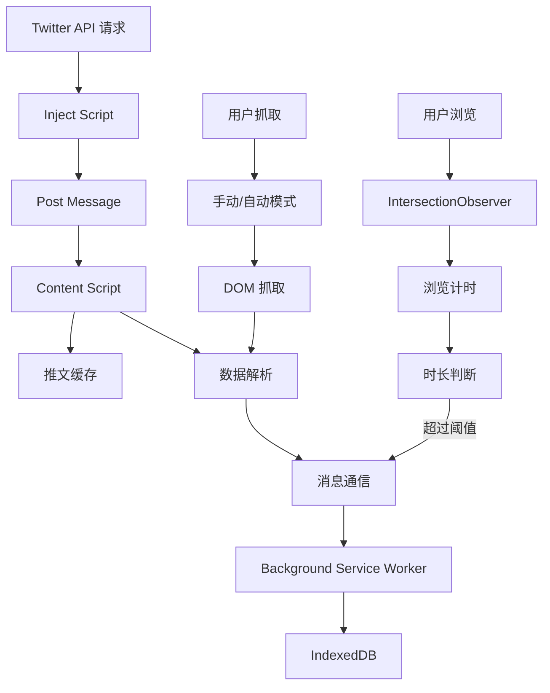
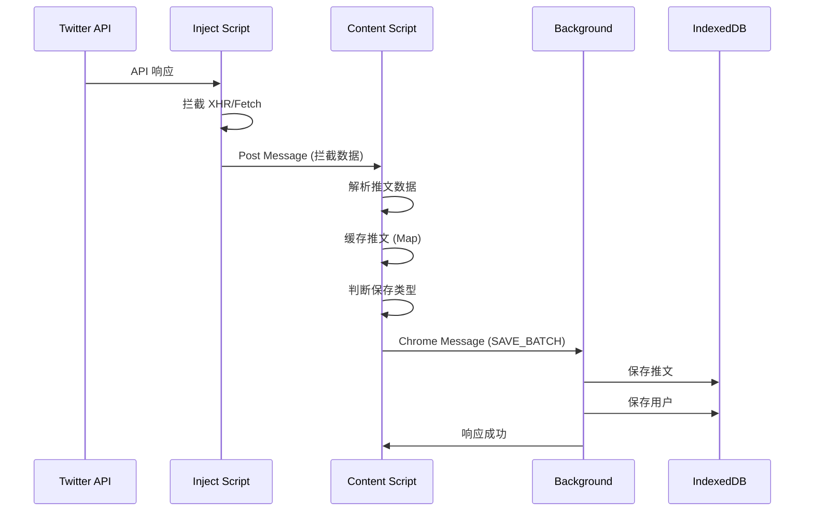
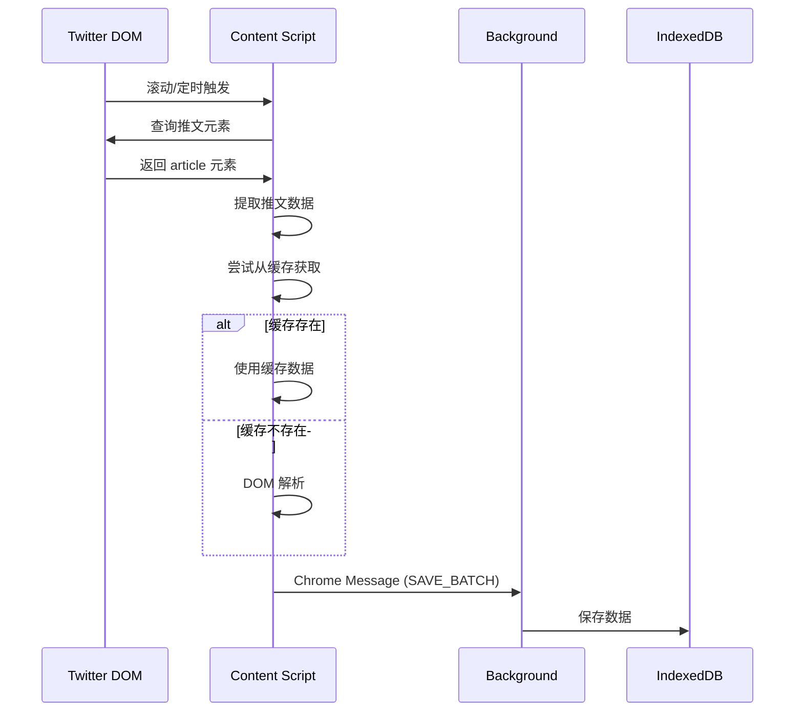
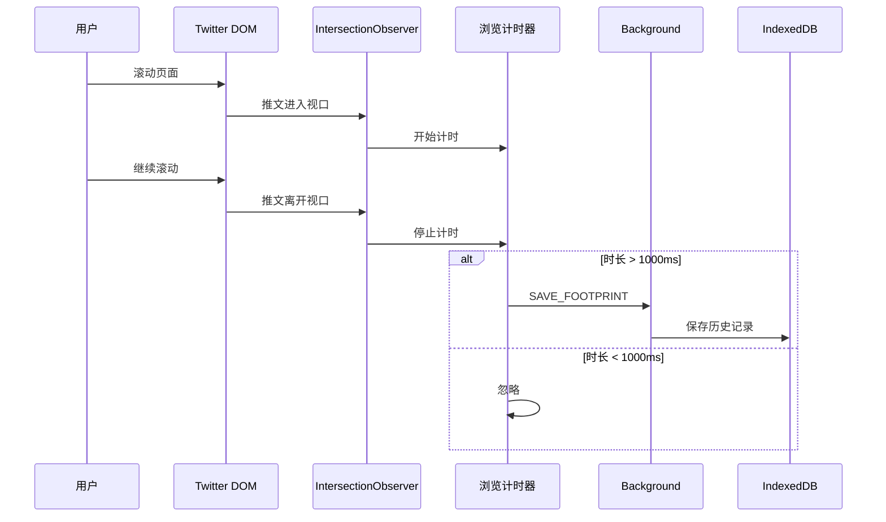
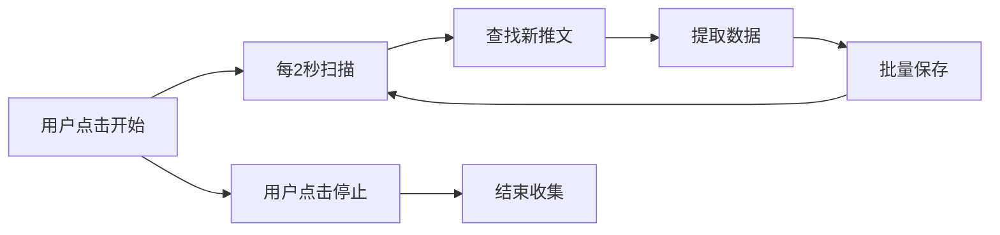
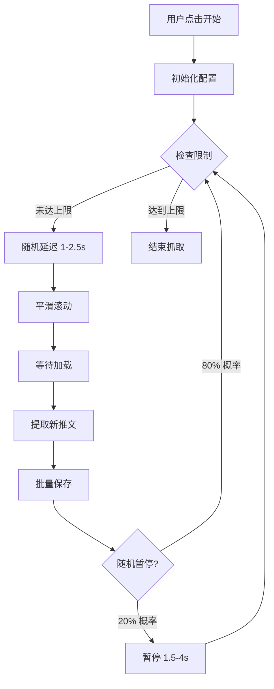
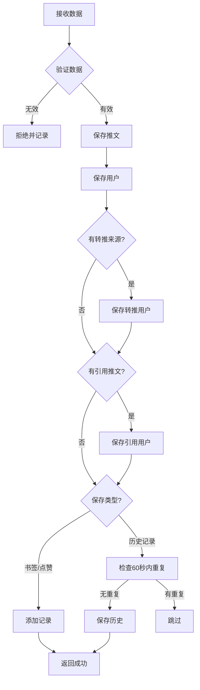
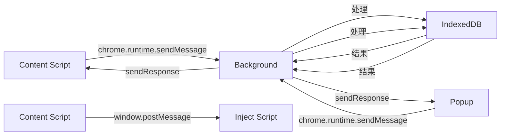

# X-Track Chrome 扩展 - 数据流文档

## 数据流概览图



## 详细数据流

### 1. 推文数据收集流程

#### 1.1 网络拦截（主要方式）



**关键代码路径**:
1. `inject/interceptor.ts`: 拦截网络请求
2. `content/interceptor.ts`: 处理拦截数据
3. `content/parser.ts`: 解析 API 响应
4. `content/cache.ts`: 缓存推文
5. `background/messages.ts`: 保存到数据库

#### 1.2 DOM 抓取（备用方式）



**关键代码路径**:
1. `content/scraper.ts`: DOM 数据提取
2. `content/cache.ts`: 检查缓存
3. `content/parser.ts`: 回退到 DOM 解析

### 2. 浏览追踪流程



**配置参数**:
- `DWELL_THRESHOLD`: 1000ms（浏览阈值）
- `THRESHOLD`: 0.1（10% 可见性）
- `ROOT_MARGIN`: '100px 0px'（提前检测）

### 3. 智能抓取流程

#### 3.1 手动模式（被动收集）



**特点**:
- 零自动化
- 依赖用户自然滚动
- 2秒扫描间隔
- 适合正常浏览时使用

#### 3.2 自动模式（主动抓取）



**人类化行为模拟**:
- 随机滚动延迟
- 随机滚动距离
- 5% 反向滚动
- 20% 暂停概率
- 随机暂停时长

### 4. 数据存储流程



### 5. 消息通信流程



## 数据转换

### API 响应 → 内部格式

```typescript
// Twitter API 响应
{
  rest_id: "1234567890",
  legacy: {
    full_text: "Hello world",
    created_at: "Wed Oct 01 00:00:00 +0000 2024",
    favorite_count: 100,
    retweet_count: 50,
    ...
  },
  core: {
    user_results: {
      result: {
        legacy: {
          screen_name: "user",
          name: "User Name",
          ...
        }
      }
    }
  }
}

// 转换为内部 Tweet 类型
{
  id: "1234567890",
  authorId: "user",
  author: {
    id: "user",
    screenName: "user",
    name: "User Name"
  },
  content: "Hello world",
  createdAt: "2024-10-01T00:00:00.000Z",
  stats: {
    likes: 100,
    retweets: 50,
    replies: 0,
    views: 0
  },
  tweetType: "ORIGINAL"
}
```

### DOM 数据 → 内部格式

```typescript
// DOM 提取
const tweetData = {
  id: extractTweetId(article),
  handle: extractHandle(userElement),
  author: extractAuthor(userElement),
  content: await extractFullTweetText(article),
  likes: extractStat(article, 'like'),
  ...
}
```

## 数据同步策略

### 自动同步触发条件

| 页面类型 | 保存类型 | 触发条件 |
|---------|---------|---------|
| Bookmarks | BOOKMARK | URL 包含 /Bookmarks |
| Likes | LIKE | URL 包含 /Likes |
| 用户主页 | MYTWEET | 当前用户 = 主页用户 |

### 去重策略

1. **同步 ID 集合**: 跟踪已同步的推文
2. **历史记录去重**: 60秒内相同推文只记录一次
3. **书签去重**: 过滤当前用户自己的推文

## 缓存策略

### 推文缓存

```typescript
// 缓存结构
Map<tweetId, {
  raw: TwitterTweet,
  timestamp: number
}>

// 缓存策略
- 最大容量: 1000 条
- TTL: 5 分钟
- LRU 淘汰
- 自动清理过期
```

### 用户信息缓存

```typescript
// 配置文件页缓存
let cachedProfileUserInfo: {
  handle: string,
  name: string,
  avatarUrl: string
} | null = null
let cachedProfilePath: string | null = null

// 缓存失效条件
- URL 路径变化
- 手动清空
```

## 性能指标

### 关键操作性能

| 操作 | 平均耗时 | 优化措施 |
|-----|---------|---------|
| 网络拦截 | < 10ms | 零拷贝传递 |
| 推文解析 | < 5ms | 预编译正则 |
| 缓存查询 | < 1ms | HashMap O(1) |
| DOM 抓取 | < 50ms/条 | 批量处理 |
| 数据库写入 | < 100ms/批 | 事务批量 |
| 浏览追踪 | < 1ms | 观察器优化 |

### 内存使用

| 组件 | 内存占用 | 限制 |
|-----|---------|-----|
| 推文缓存 | ~10MB | 1000 条 |
| 同步 ID 集 | ~1MB | 无限制 |
| 观察器 | ~100KB | 视口内元素 |
| 总计 | ~15-20MB | - |
