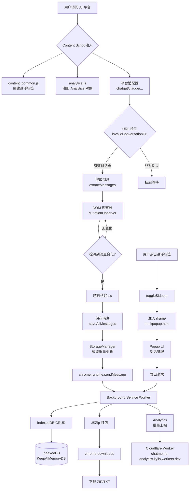

# Chat Memo v1.3.3 — 数据流图



## 消息流

```
┌──────────────┐     ┌──────────────┐     ┌──────────────┐
│   Content     │     │  Background   │     │   IndexedDB   │
│   Script      │     │  Worker       │     │               │
├──────────────┤     ├──────────────┤     ├──────────────┤
│              │     │              │     │              │
│ connectDB ────────►              │     │              │
│              │     │      ───────► open │              │
│              │◄──────── status:ok      │              │
│              │     │              │     │              │
│ findConvByUrl──────►              │     │              │
│              │     │      ───────► get │              │
│              │◄──── conversation       │              │
│              │     │              │     │              │
│ createConv ────────►              │     │              │
│              │     │      ───────► add │              │
│              │◄── conversationId       │              │
│              │     │              │     │              │
│ updateConv ────────►              │     │              │
│              │     │      ───────► put │              │
│              │◄──── status:ok          │              │
│              │     │              │     │              │
│ (sidebar)    │     │              │     │              │
│ toggleSidebar│◄────── sendMessage │     │              │
│              │     │              │     │              │
└──────────────┘     └──────────────┘     └──────────────┘
```
