# Clearly Reader 数据流文档

## 总体数据流概览

```mermaid
flowchart TB
    subgraph Browser["Chrome 浏览器"]
        subgraph Background["Service Worker (background.bundle.js)"]
            MBus["Message Bus (MBus)"]
            Settings["Settings Manager"]
            Auth["Auth Manager"]
            API["API Client"]
            Translator["Translation Service"]
        end

        subgraph Page["目标网页"]
            CS["Content Script (content.bundle.js)"]
            Parser["Page Parser"]
            Highlighter["Page Highlighter"]
            TipUI["Content Tip UI"]
        end

        subgraph ReaderFrame["阅读器 iframe"]
            App["App UI (app.bundle.js)"]
            Renderer["Article Renderer"]
            Speech["Speech Controller"]
            ThemeMgr["Theme Manager"]
            ExportH["Export Handler"]
        end

        subgraph SkimFrame["Skim iframe"]
            Skim["Skim Panel (skim.bundle.js)"]
        end
    end

    subgraph External["外部服务"]
        ClearlyAPI["api.clearlyreader.com"]
        GoogleTL["Google Translate API"]
    end

    User["用户"] -->|点击图标 / Alt+R| Background
    User -->|Alt+S| Background
    Background -->|tabs.sendMessage| CS
    CS -->|postMessage| ReaderFrame
    CS -->|postMessage| SkimFrame
    ReaderFrame -->|chrome.runtime.sendMessage| Background
    Background -->|HTTP| ClearlyAPI
    Background -->|HTTP| GoogleTL

    CS -->|DOM 解析| Page
    CS -->|提取内容| Parser
    Parser -->|ArticleContent| CS
    CS -->|发送内容| ReaderFrame
```

---

## 1. 阅读模式激活流程

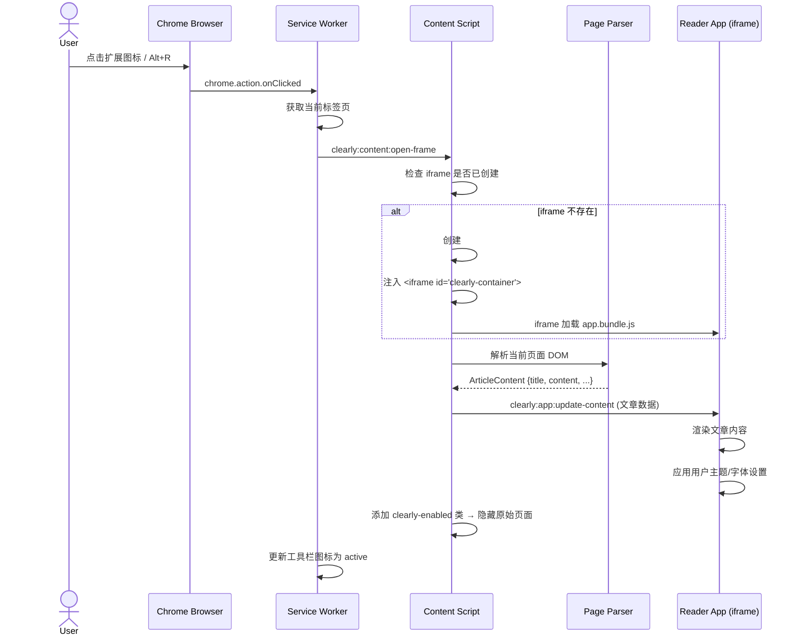

---

## 2. 配置读写流程

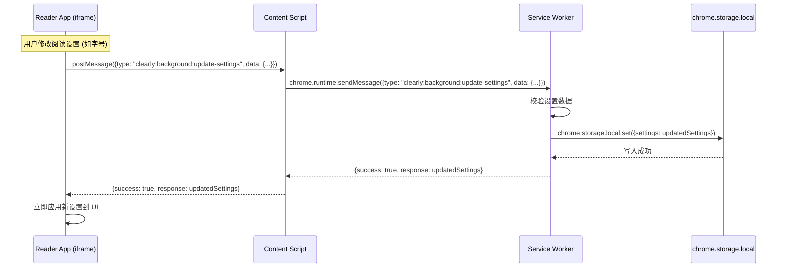

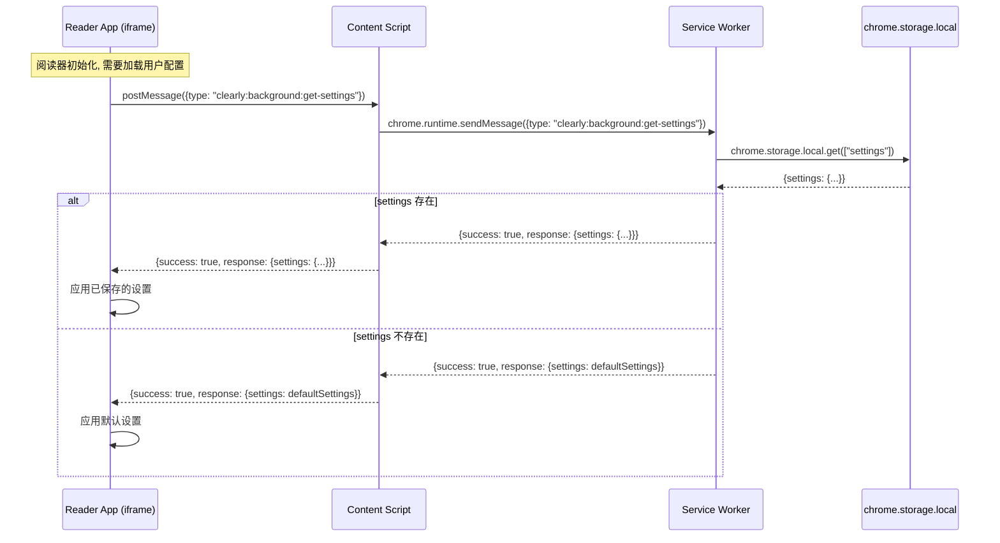

---

## 3. 翻译流程

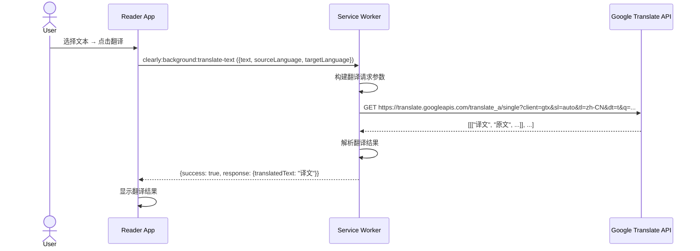

---

## 4. AI 功能流程 (摘要/助手)

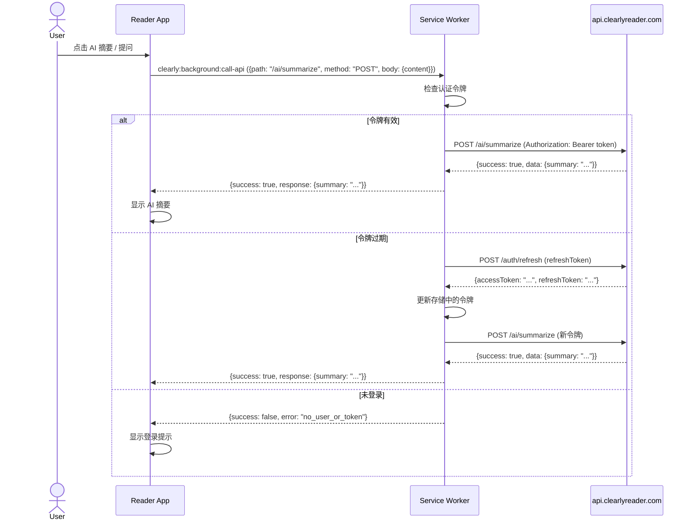

---

## 5. 语音朗读流程

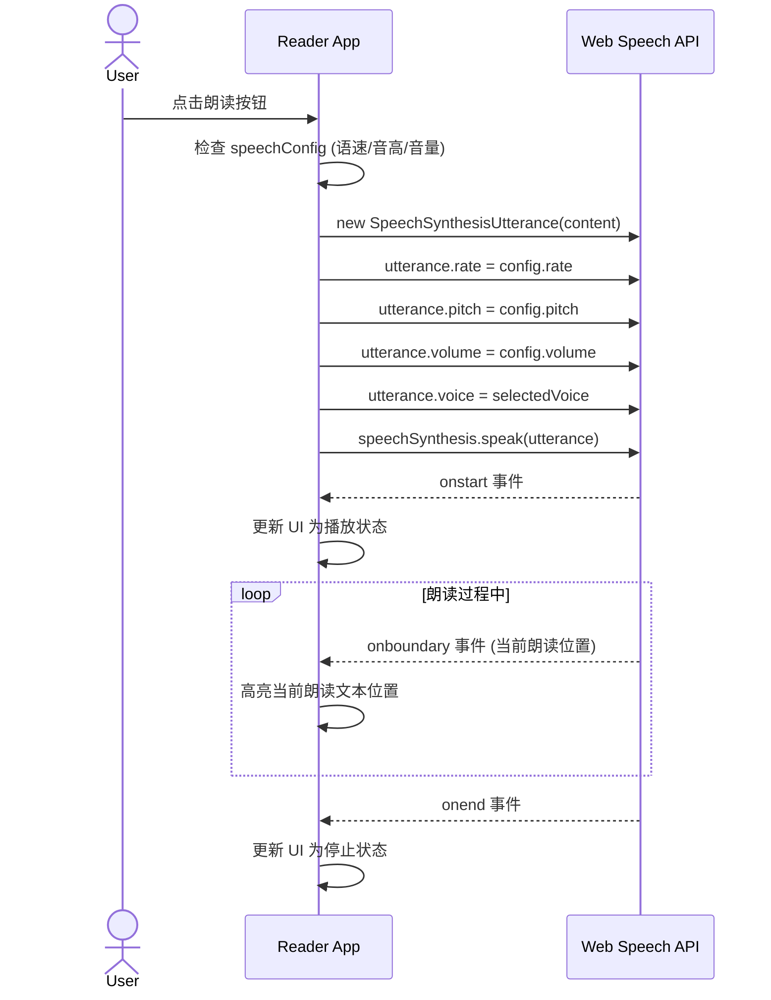

---

## 6. 导出流程 (PDF/Markdown)

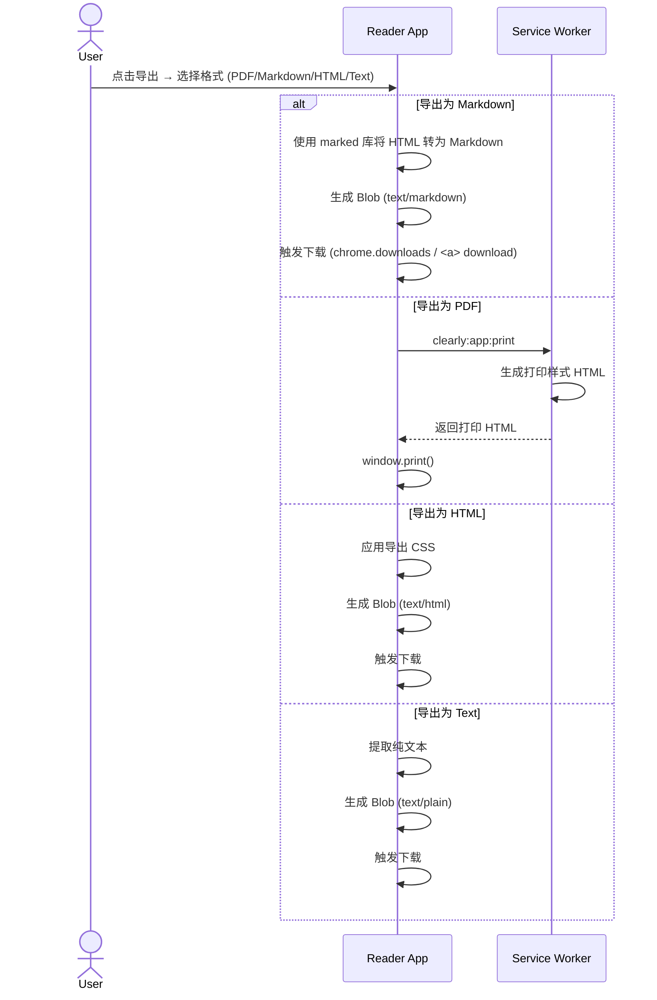

---

## 7. Skim 速览面板流程

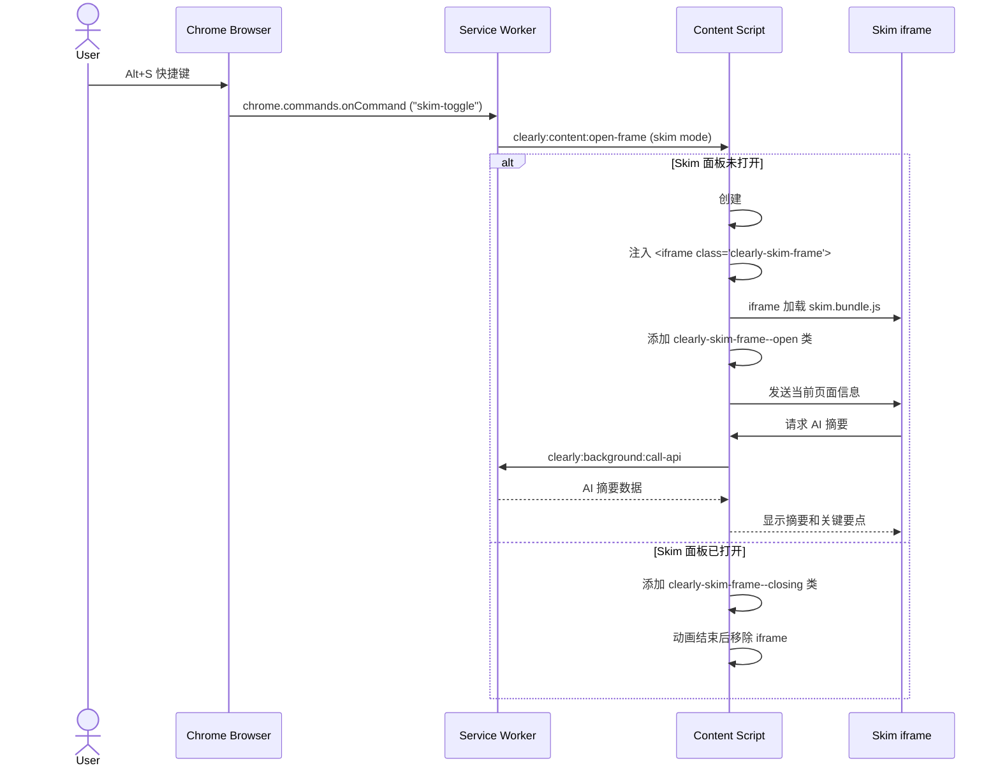

---

## 8. 用户认证流程

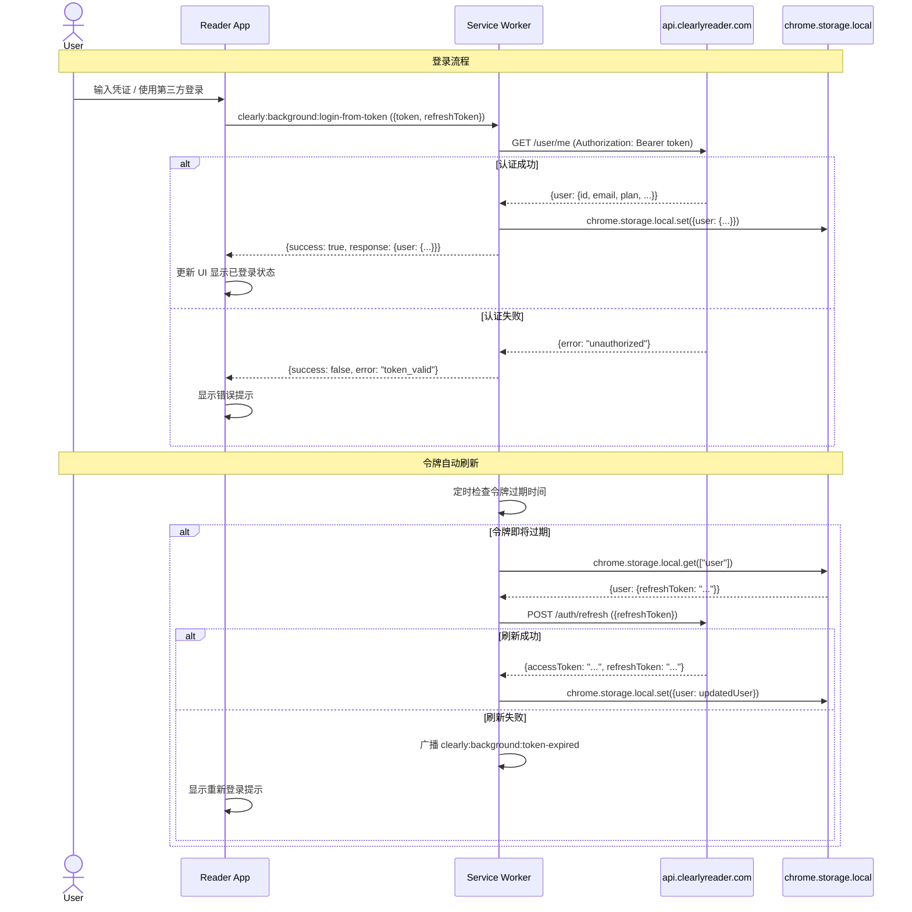

---

## 9. 页面高亮流程

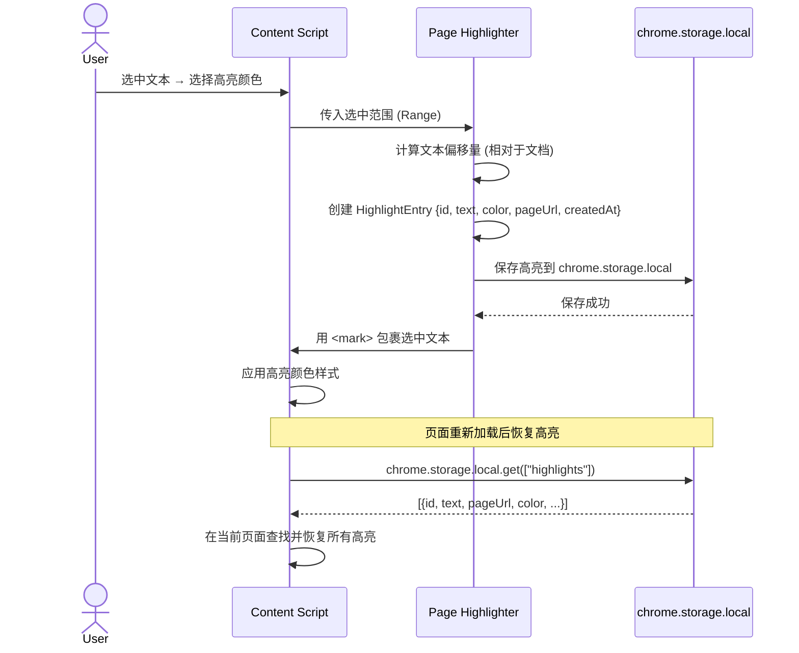

---

## 10. 右键菜单流程

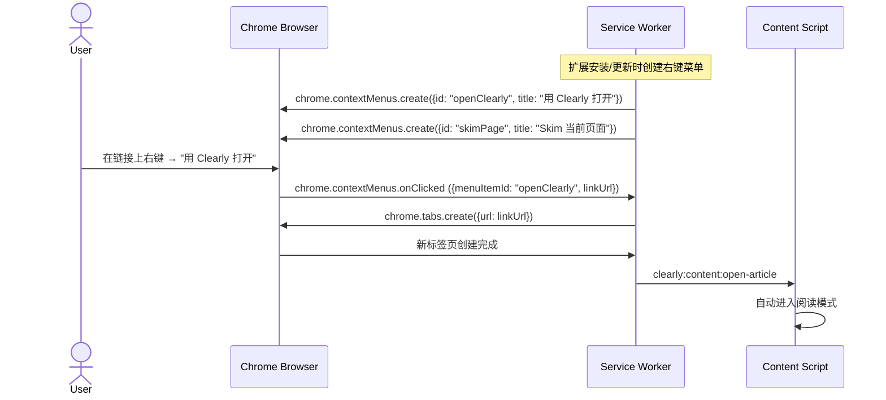

---

## 数据存储结构

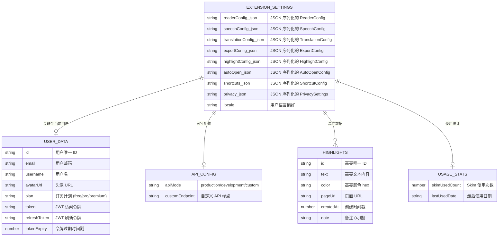
