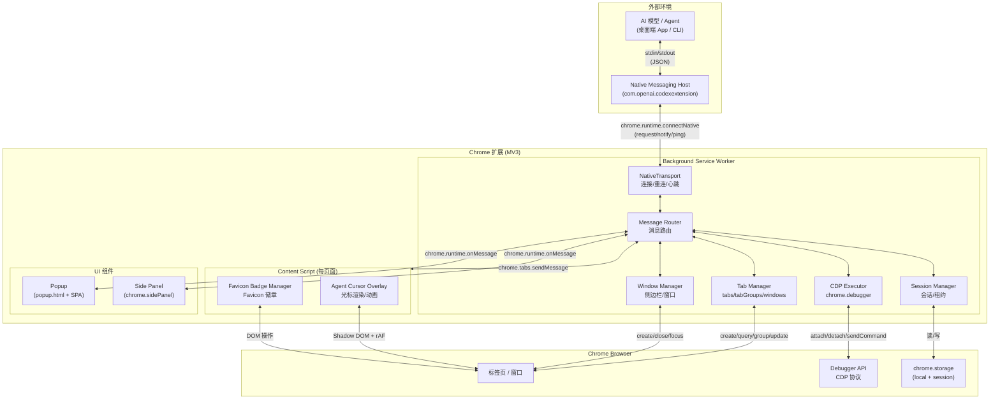
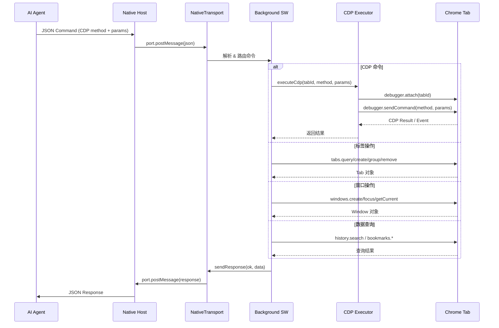
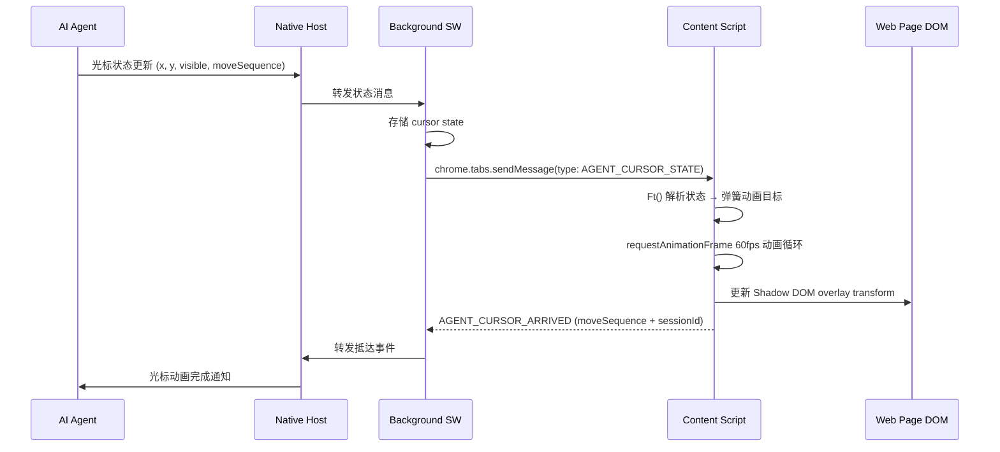
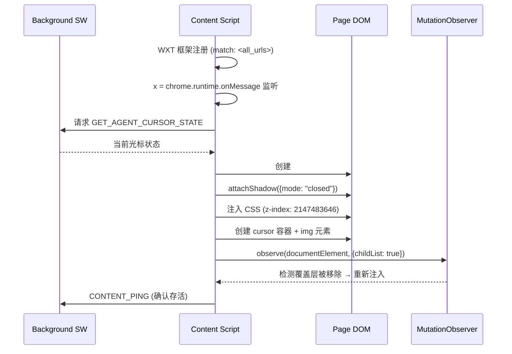
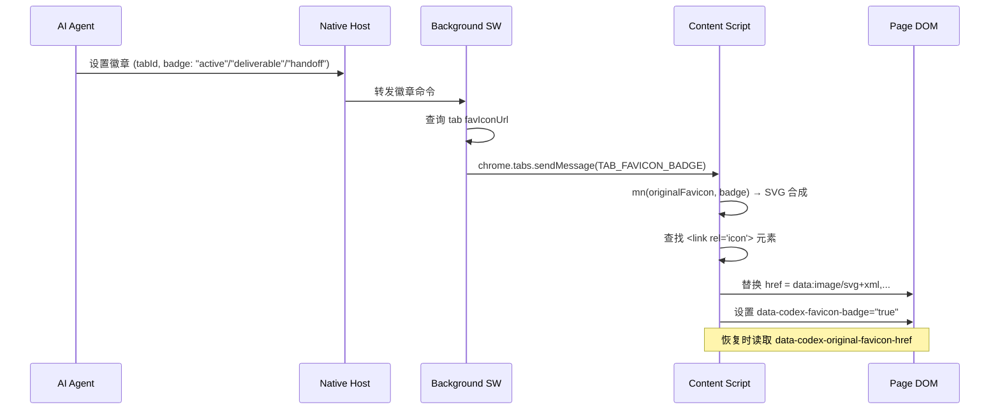
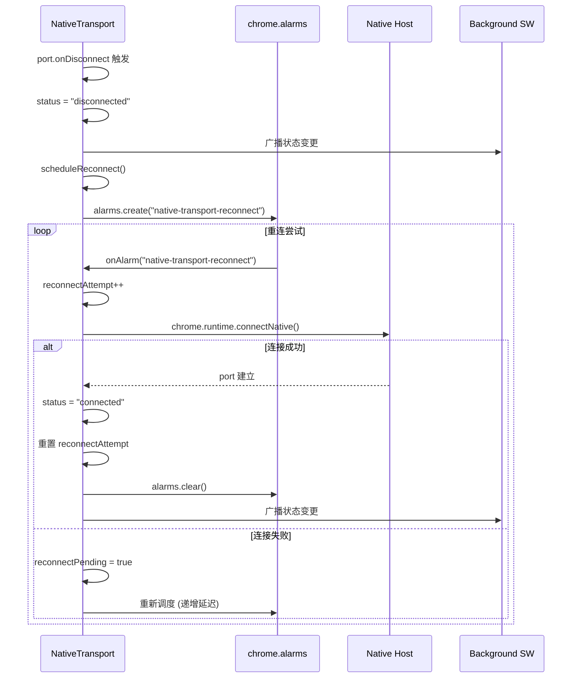
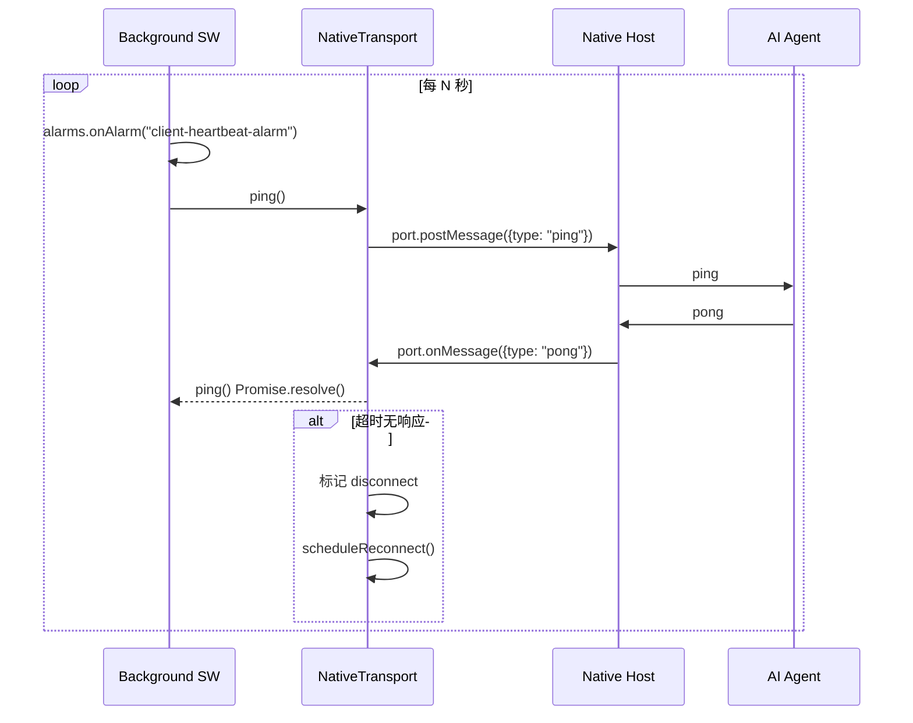
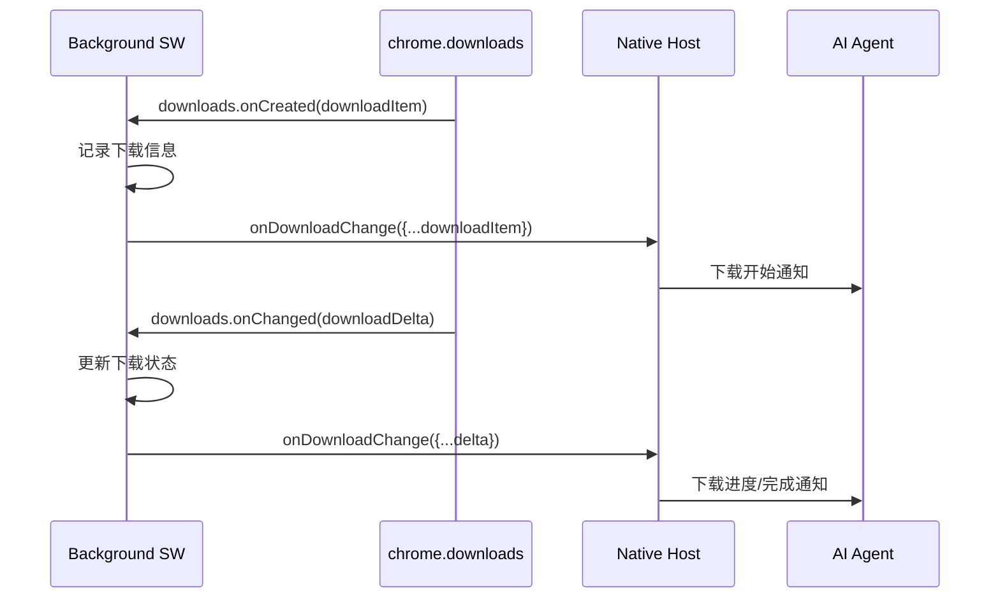
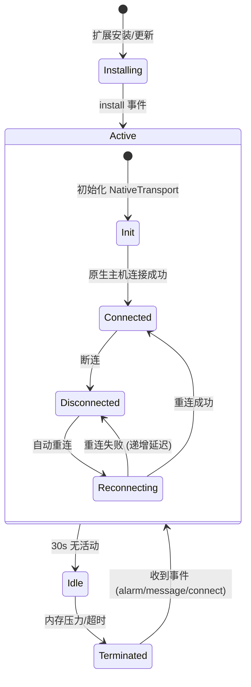

# Codex 数据流分析文档

> 基于 Codex v1.1.5 源码逆向 | 输出目录: `dsv4` | 2026-07-06

---

## 一、总体数据流概览



---

## 二、核心数据流详解

### 2.1 AI 命令执行流



### 2.2 Agent 光标状态同步流



### 2.3 内容脚本启动流



### 2.4 Favicon 徽章更新流



### 2.5 原生传输重连流



### 2.6 心跳/保活流



### 2.7 下载监控流



---

## 三、消息格式规范

### 3.1 Native Messaging 消息格式

**请求**:
```json
{
  "type": "command_type",
  "tabId": 123,
  "sessionId": "abc...",
  "turnId": "def...",
  "params": {}
}
```

**响应**:
```json
{
  "ok": true,
  "type": "command_type",
  "data": {}
}
```

**通知** (无响应期望):
```json
{
  "type": "notification_type",
  "params": {}
}
```

### 3.2 内容脚本消息格式

参见 `src/types/index.ts` 中的 `AgentCursorEvent`、`FaviconBadgeMessage` 等类型定义。

---

## 四、Service Worker 生命周期



---

## 五、关键时序参数

| 参数 | 估计值 | 说明 |
|------|--------|------|
| 光标动画帧率 | 60fps (~16.67ms) | requestAnimationFrame |
| 弹簧仿真步长 | 1/240s (~4.17ms) | 物理仿真精度 |
| 心跳间隔 | ~30s | alarms.create 周期 |
| 重连延迟 | 递增 (1s, 2s, 4s, ...) | 指数退避 |
| Service Worker 空闲超时 | 30s | Chrome 默认 |
| 内容脚本重注入延迟 | 1s | 覆盖率检测间隔 |
