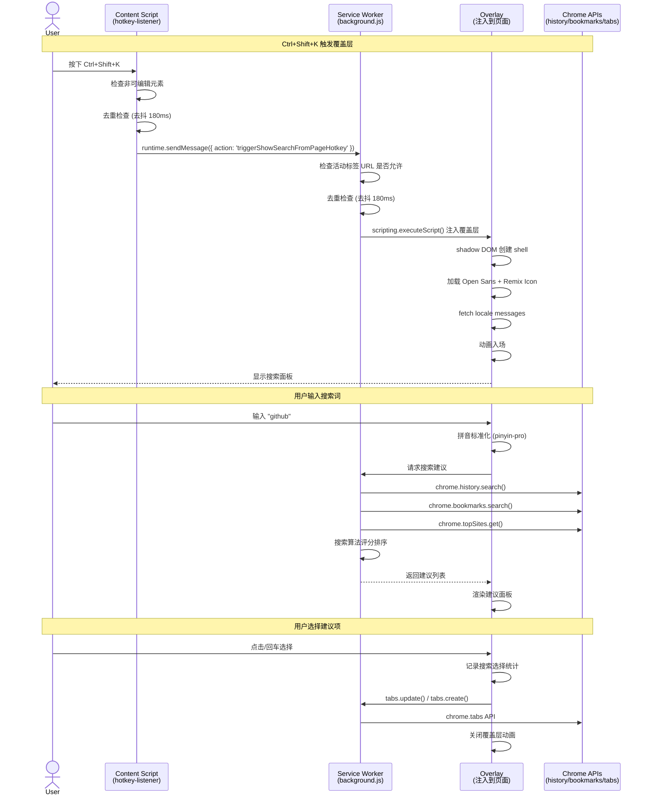
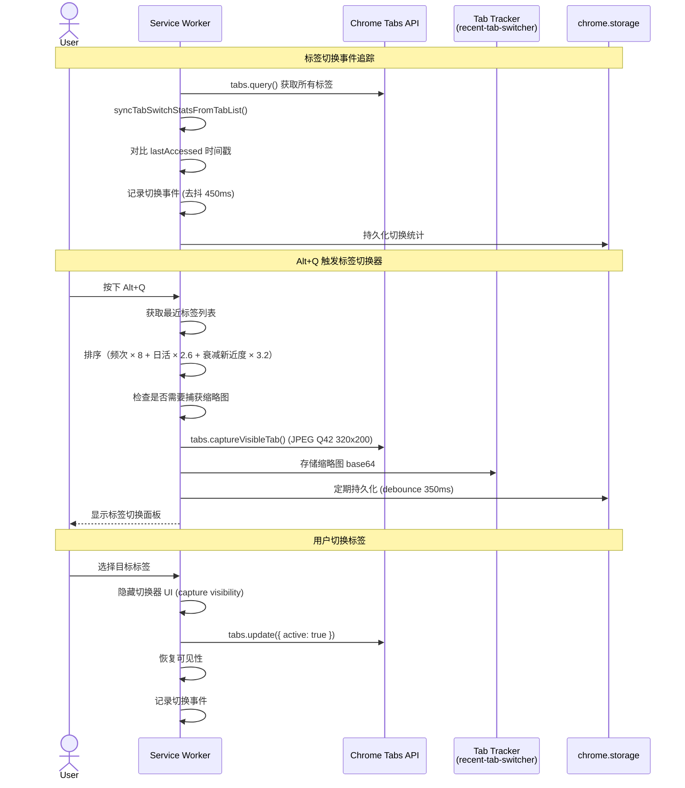
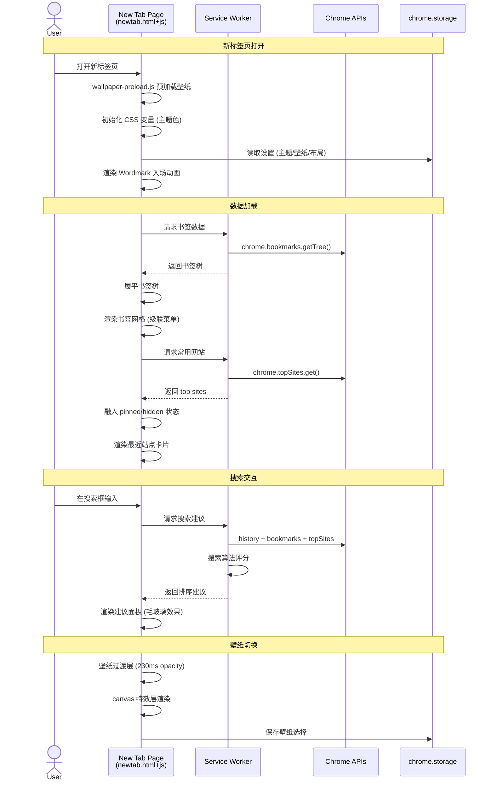
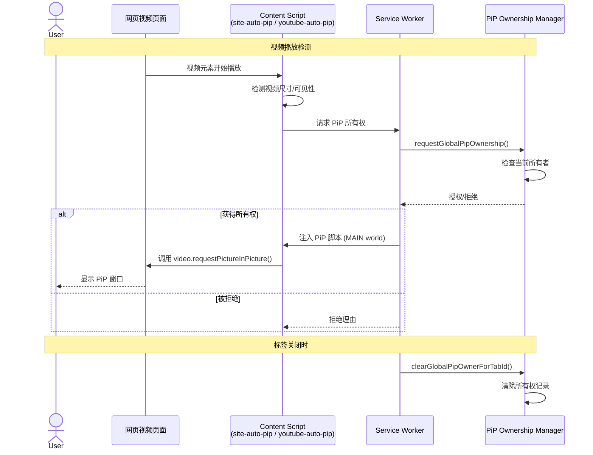
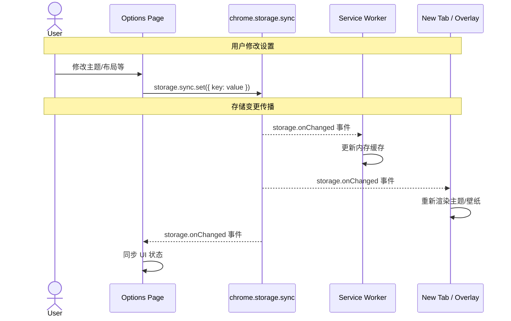
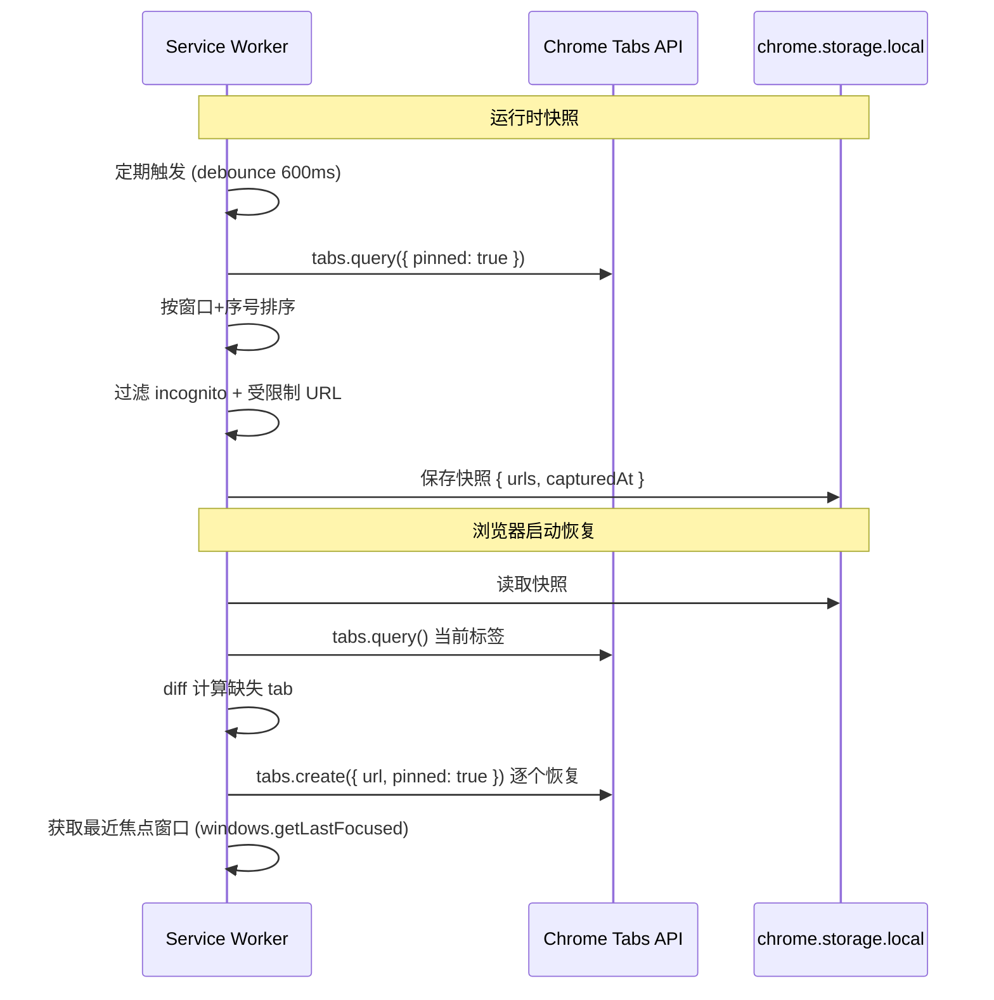
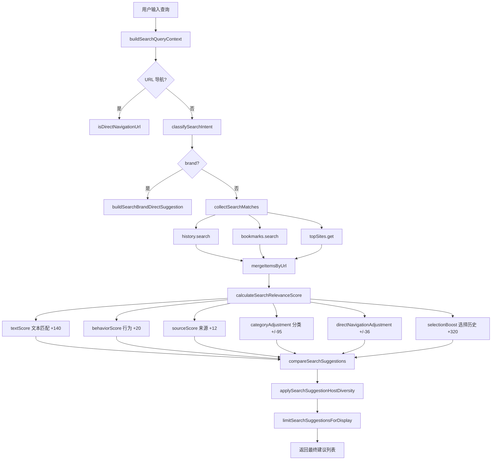

# Lumno - 数据流文档

> 版本: 0.9.14 | 描述扩展内部主要数据流程

## 一、覆盖层搜索数据流



## 二、标签页切换器数据流



## 三、新标签页数据流



## 四、PiP 自动检测数据流



## 五、设置同步数据流



## 六、固定标签恢复数据流



## 七、搜索算法核心流程



## 八、标签切换评分公式

```
score = (shortCount × 8) + (dayCount × 2.6) + (recencyBoost × 3.2)

其中:
  shortCount  = 近 30 分钟切换次数
  dayCount    = 近 24 小时切换次数
  recencyBoost = exp(-max(0, 距上次切换分钟数) / 16)

高频标记:
  highFreq = shortCount >= 2 || dayCount >= 5

最终排序 = score + accessBoost
  accessBoost = exp(-max(0, idleMinutes) / 30)
```
