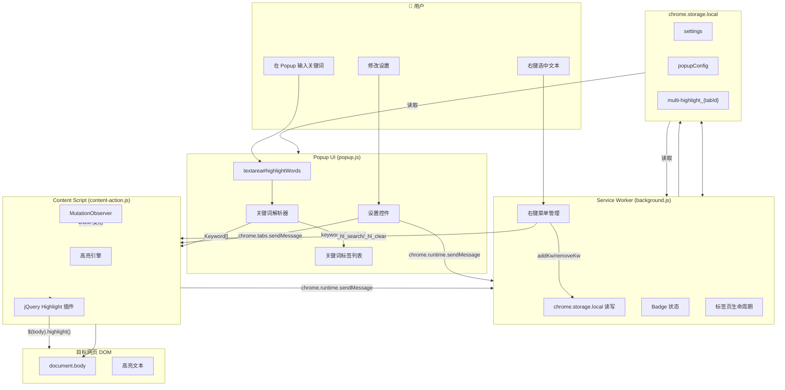
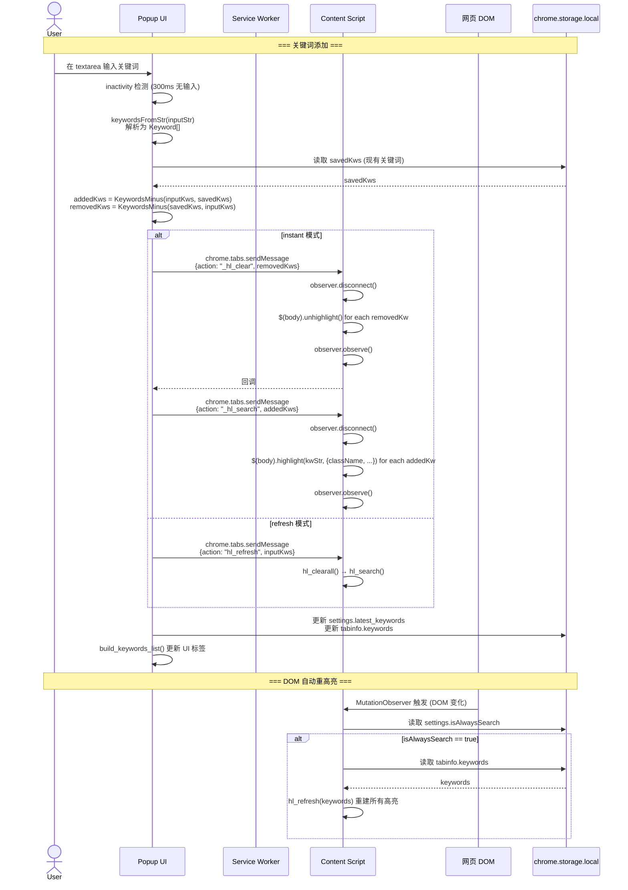
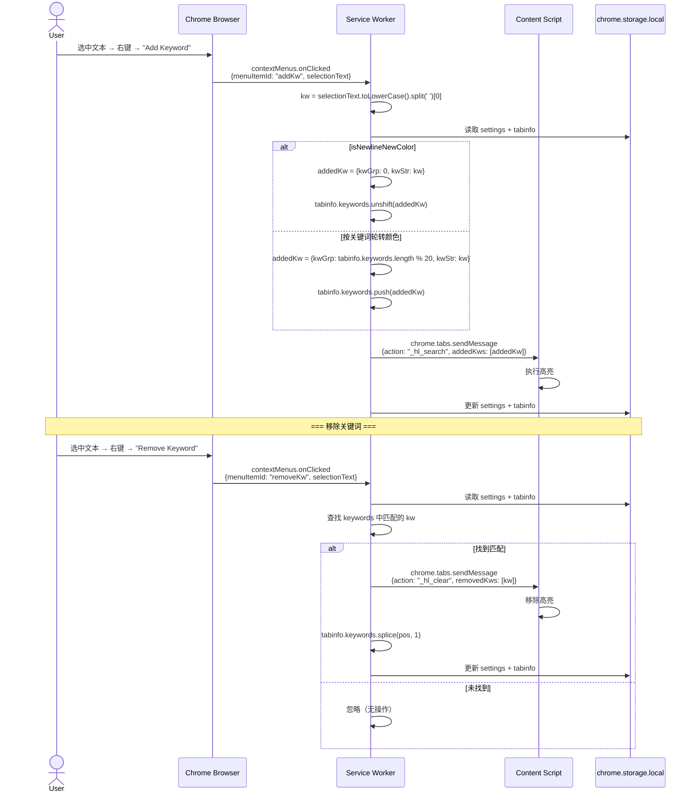
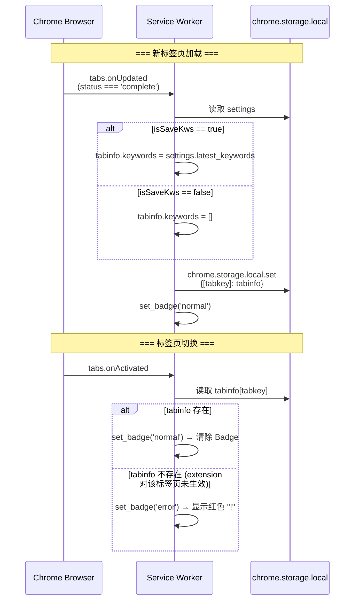
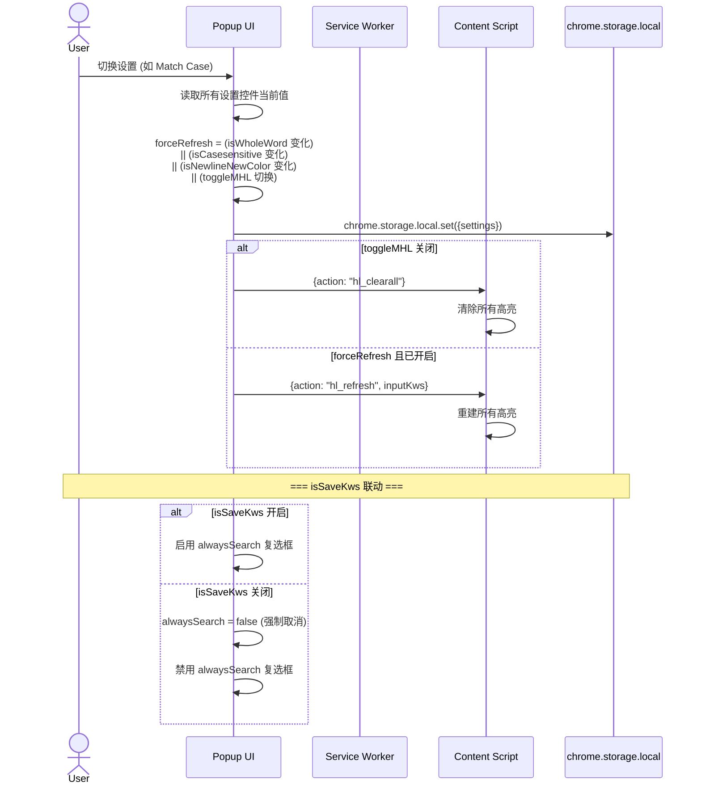
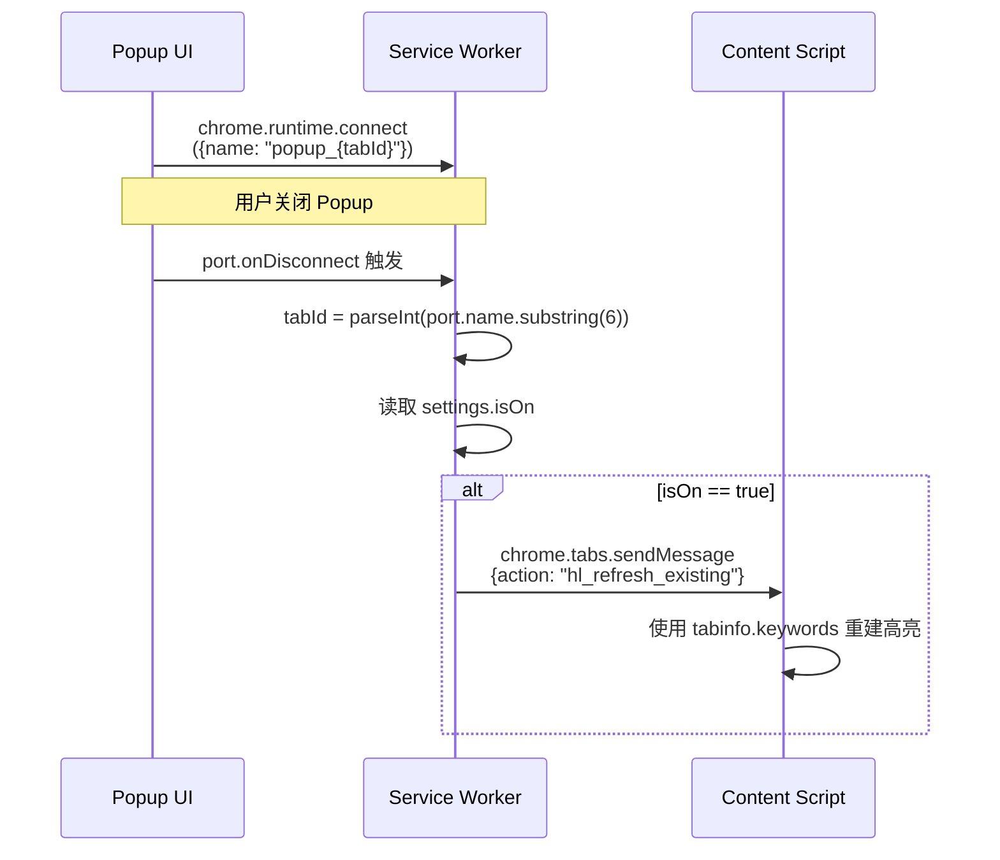
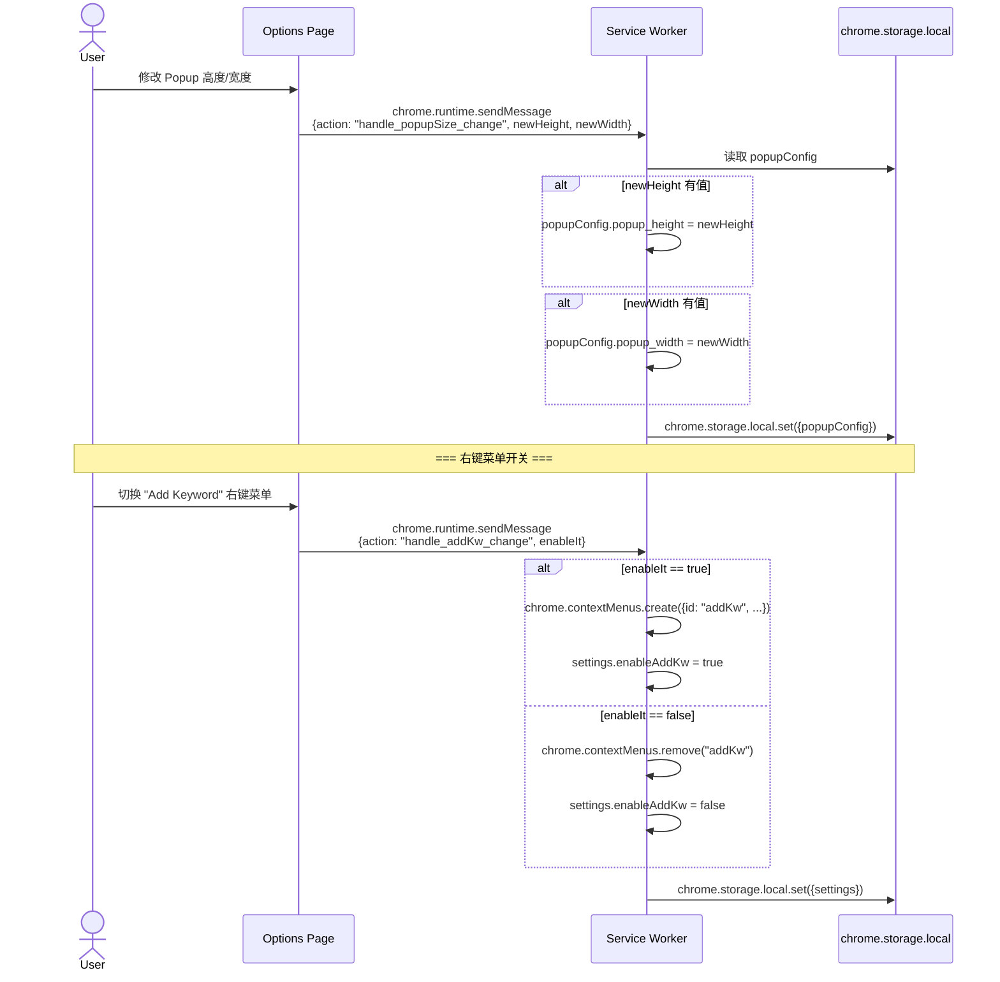
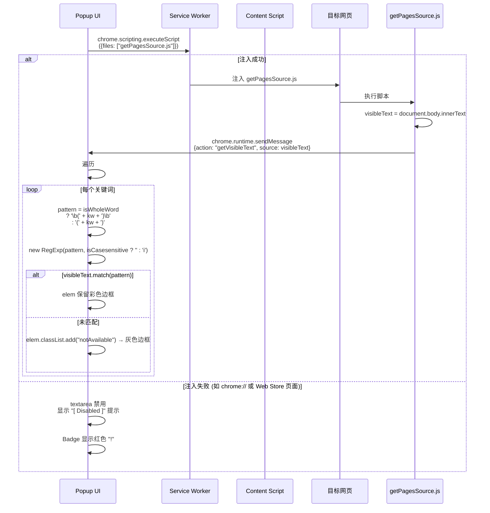
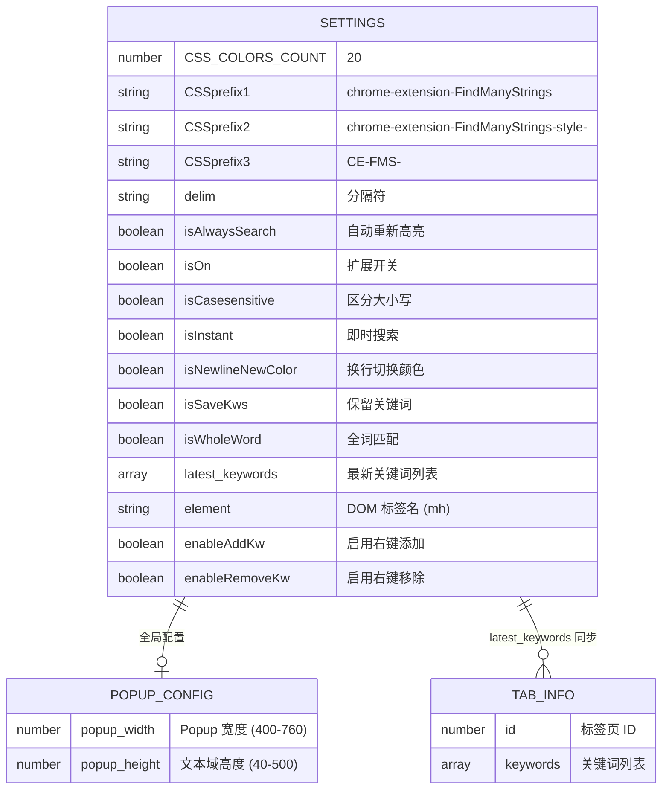
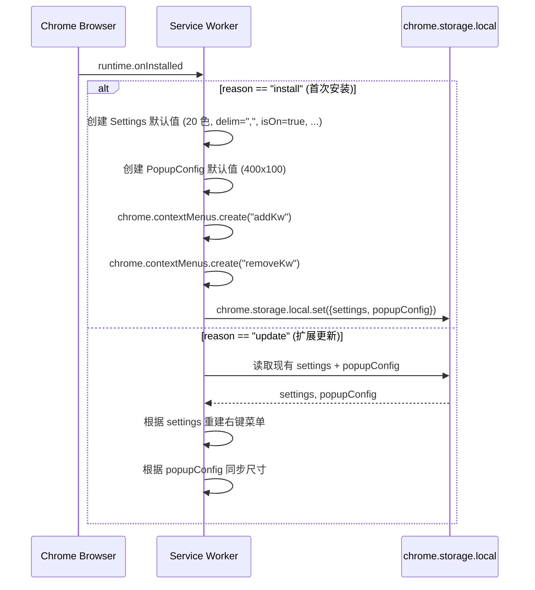

# Multi Highlight 数据流文档

## 总体数据流概览



---

## 1. 关键词高亮完整流程



---

## 2. 右键菜单添/删关键词流程



---

## 3. 标签页生命周期管理



---

## 4. Popup 设置变更流程



---

## 5. Popup 关闭时刷新流程



---

## 6. 选项页配置变更流程



---

## 7. 关键词可用性检查流程



---

## 8. 数据存储结构



---

## 9. 关键词数据结构转换

```
输入文本 (textarea.value)
    │
    ▼
keywordsFromStr(str, settings)
    │
    ├── isNewlineNewColor == true
    │   │ 按 "\n" 分行 → 每行内按 delim 分隔
    │   │ kwGrp = lineIndex % 20 (同行的关键词同色)
    │   └── [{kwGrp: 0, kwStr: "hello"}, {kwGrp: 0, kwStr: "world"}, ...]
    │
    └── isNewlineNewColor == false
        │ 按 delim 分隔
        │ kwGrp = index % 20 (每个关键词不同色轮转)
        └── [{kwGrp: 0, kwStr: "hello"}, {kwGrp: 1, kwStr: "world"}, ...]

Keyword[] → 文本:
    │
    ▼
keywordsToStr(kws, settings)
    │
    ├── isNewlineNewColor == true
    │   │ 同 kwGrp 用 delim 连接，不同 kwGrp 用 "\n" 分隔
    │   └── "hello,world\nfoo"
    │
    └── isNewlineNewColor == false
        │ 按顺序用 delim 连接，末尾追加 delim
        └── "hello,world,"
```

---

## 10. 扩展安装/更新初始化流程


