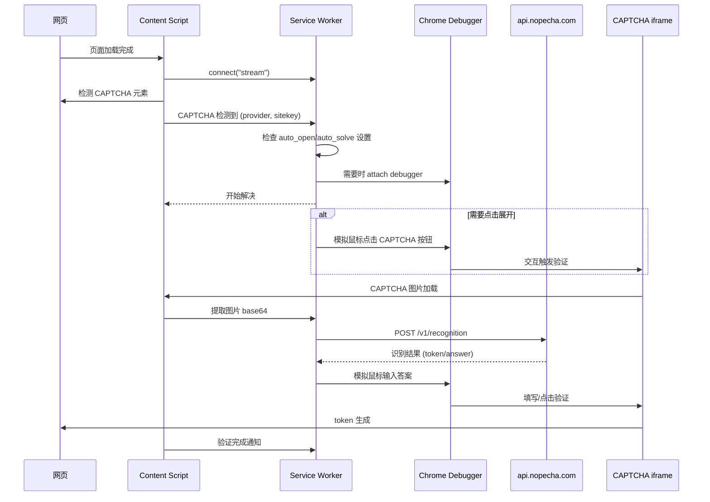
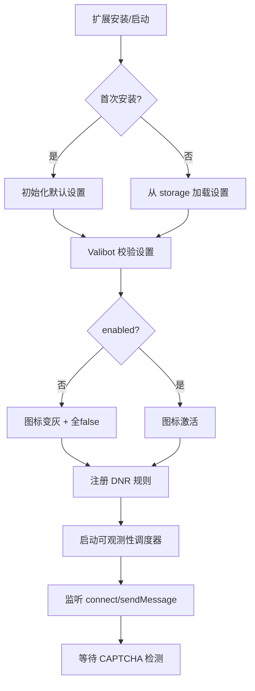
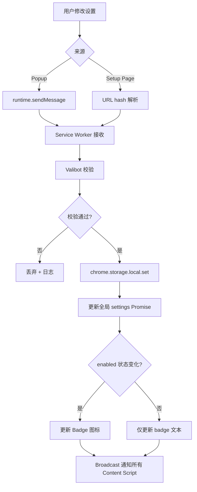
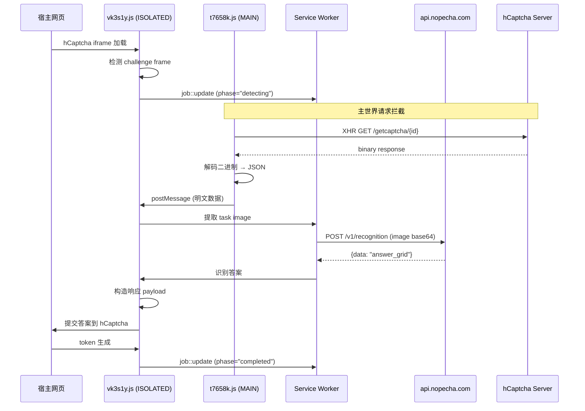
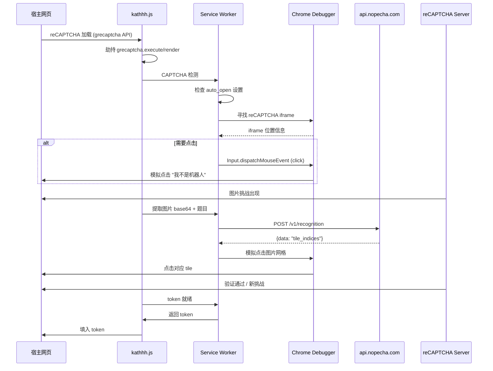
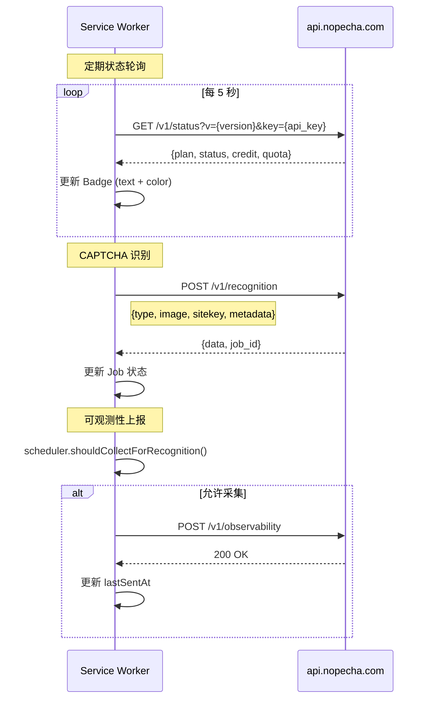
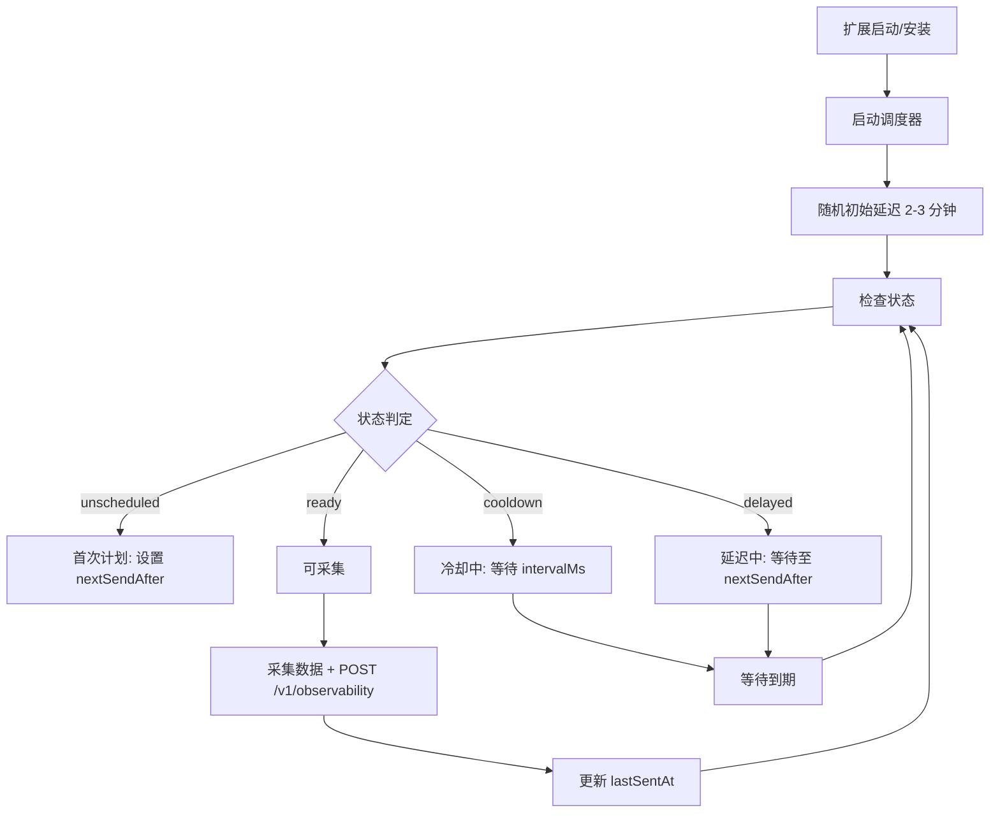

# NopeCHA: CAPTCHA Solver v0.6.1 — 数据流文档

## 1. 总体流程概览



---

## 2. 核心业务流程

### 2.1 安装/启动流程



### 2.2 设置更新流程



### 2.3 hCAPTCHA 自动化解决流程



### 2.4 reCAPTCHA 自动化解决流程



### 2.5 鼠标模拟流程 (Human-Like Movement)

```mermaid
flowchart TD
    A[目标坐标 (x,y)] --> B[获取当前 Pointer Session]
    B --> C[生成种子 + Profile 参数]
    C --> D[计算贝塞尔曲线路径]
    D --> E[路径细化]:
    E --> F[震颤 (tremor)]
    E --> G[微调 (microAdjustment)]
    E --> H[暂停 (pause)]
    E --> I[抖动 (jitter)]
    F & G & H & I --> J[生成 Waypoint 序列]
    J --> K[逐点执行]
    K --> L{下一个 waypoint}
    L -->|继续| M[Input.dispatchMouseEvent(mouseMoved)]
    M --> N[sleep(delayMs)]
    N --> L
    L -->|最后一个| O[Input.dispatchMouseEvent(mousePressed)]
    O --> P[sleep(clickHoldDelay)]
    P --> Q[Input.dispatchMouseEvent(mouseReleased)]
    Q --> R[完成]
```

### 2.6 API 通信流程



### 2.7 可观测性调度流程



### 2.8 Message 校验流程

每个 `runtime.sendMessage` 消息都经过完整性校验：

```mermaid
flowchart LR
    A[发送消息] --> B[构造 meta = timestamp,random]
    B --> C[计算 CRC-32 checksum]
    C --> D[发送 [meta, event, ...args]]
    D --> E[SW 接收]
    E --> F[验证 checksum]
    F --> G{校验通过?}
    G -->|是| H[处理事件]
    G -->|否| I[丢弃消息]
```

---

## 3. 数据存储

| Key | 类型 | 用途 |
|-----|------|------|
| `settings` | `NopechaSettings` | 全量用户设置 (Valibot validated) |
| `observability:last-sent-at` | `number` | 上次可观测性上报时间戳 |
| `observability:next-send-after` | `number` | 下次可观测性上报最早时间 |

---

## 4. 关键依赖

| 依赖 | 来源 | 用途 |
|------|------|------|
| Valibot | 内置裁剪版 | Schema 验证 (设置/API 响应) |
| CRC-32 | 内置 | 消息完整性校验 |
| Mersenne Twister PRNG | 内置 | 鼠标模拟确定性随机数 |
| chrome.debugger API | Chrome 内置 | CDP 鼠标事件注入 |
| chrome.declarativeNetRequest | Chrome 内置 | HTTP 参数注入 |
