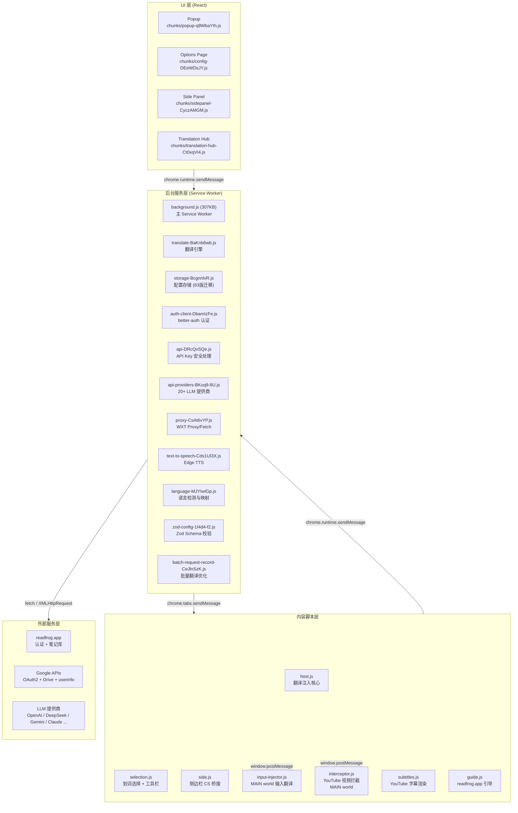

# 陪读蛙 (Read Frog - Translate & Learn) v1.37.2 — 架构文档

## 1. 项目概览

陪读蛙（Read Frog）是一款基于 Chrome Manifest V3 的网页翻译与语言学习扩展，支持**划词翻译、整页翻译、输入框翻译、YouTube 双语字幕**四大核心场景。内置 **20+ 大语言模型提供商**（OpenAI、DeepSeek、Gemini、Claude 等）与 **Google / Microsoft 传统翻译引擎**，通过 WXT 框架以 React + Vite 技术栈构建，提供 Popup、Options、Side Panel 三种 UI 入口，并支持 Google OAuth 登录与 Google Drive 配置同步。

- **版本**: 1.37.2
- **平台**: Chrome MV3
- **本地化**: 9 种语言 (en, zh_CN, zh_TW, ja, ko, es, ru, tr, vi)
- **安全等级**: 待评定（见 SECURITY_AUDIT.md）

---

## 2. 技术栈

| 层次 | 技术选型 |
|------|----------|
| 扩展框架 | **WXT** (Web eXtension Toolkit) — Chrome 扩展开发框架，提供模块化入口、HMR、自动构建 |
| 前端框架 | **React 18+** + react-dom |
| 构建工具 | **Vite** + Rollup（WXT 内置） |
| 语言 | TypeScript / JavaScript 混合 |
| UI 组件 | **@shadcn/ui** 模式（Tailwind CSS 组件） |
| 状态管理 | **nanostores**（轻量原子状态） |
| 数据校验 | **zod**（配置 schema 校验，含 83 版迁移逻辑） |
| 认证 | **better-auth** client + Google OAuth 2.0 |
| 翻译引擎 | Google Translate、Microsoft Translator、OpenAI、DeepSeek、Gemini、Claude、Grok 等 20+ LLM |
| TTS | **Edge TTS**（浏览器内置语音合成） |
| 外部服务 | readfrog.app 后端、Google Drive API、Google Identity API |

---

## 3. 分层架构

---

## 4. 模块职责表

### 4.1 后台模块 (Service Worker Chunks)

| 模块 (文件名) | 职责 |
|---------------|------|
| `background.js` (307KB) | 主 Service Worker，协调所有后台任务：消息路由、生命周期管理、Tab/Alarm 调度、上下文菜单注册、Offscreen 文档管理、Side Panel 控制、Content Script 注入调度 |
| `translate-BaKnb6wb.js` | 翻译引擎核心：统一翻译接口、Provider 调度、缓存管理、回退策略、批量翻译合并 |
| `storage-BcgnnlvR.js` | 配置持久化存储层：含 83 个版本的向前兼容迁移逻辑，处理 chrome.storage 读写与变更监听 |
| `auth-client-DbamIzFe.js` | better-auth 客户端：Google OAuth 2.0 登录流程、Token 刷新、会话管理、用户信息获取 |
| `api-DRcQvSQe.js` | API Key 安全处理工具：Key 的脱敏、加密存储、Provider 匹配校验 |
| `api-providers-BKuq9-8U.js` | LLM 提供商集成层：统一 20+ 提供商的请求格式、流式响应处理、错误处理。支持：OpenAI / DeepSeek / Google Gemini / Anthropic Claude / xAI Grok / Azure / OpenRouter / Ollama / Groq / Mistral / Cohere / together.ai / Fireworks / Cerebras / Replicate / Perplexity / Vercel AI / DeepInfra / DeepLX / Volcengine (豆包) / MiniMax / Alibaba (通义千问) / Moonshot (Kimi) / HuggingFace / SiliconFlow / Atlas Cloud / Tensdaq |
| `proxy-CsAt6vYP.js` | WXT Proxy/Fetch 系统：封装网络请求、better-auth 会话 Token 注入、请求拦截与重试 |
| `config-DEeWDsJY.js` | Options 页面配置 UI：API Key 管理、翻译引擎选择、Google Drive 同步开关、主题与语言设置 |
| `selection-toolbar-CbrOMLjS.js` | 划词工具栏：选中文本后弹出的翻译/朗读操作按钮组 |
| `floating-button-CHRlsDDW.js` | 浮动按钮：页面右下角的快速翻译入口 |
| `video-subtitles-DmSBpheE.js` | YouTube 字幕处理：字幕文本提取、时间轴解析、双语渲染 |
| `text-to-speech-Cds1UI3X.js` | Edge TTS 集成：利用浏览器 Web Speech API 或 Edge TTS 引擎进行语音朗读 |
| `analytics-xDL_Cg2N.js` | 分析追踪：用户行为事件采集与上报 |
| `context-menu-CuXZY7jB.js` | 右键菜单管理：向 chrome.contextMenus 注册翻译相关菜单项 |
| `sidepanel-CyczAMGM.js` | Side Panel UI：浏览器侧边栏的翻译面板界面 |
| `popup-q9WbaYIh.js` | Popup 弹窗 UI：工具栏图标点击后的弹出窗口 |
| `translation-hub-Ct0xqVI4.js` | 翻译中心：多模型翻译结果对比视图 |
| `offscreen-CkdoftoS.js` | Offscreen 文档：在隐藏页中执行音频播放等无法在 Service Worker 中完成的任务 |
| `language-MJYIwIGp.js` | 语言检测与映射：源语言/目标语言的自动识别、ISO 语言代码映射 |
| `zod-config-1I4d4-f2.js` | Zod Schema 校验：配置对象的结构化校验与类型安全 |
| `batch-request-record-CeJlnSzK.js` | 批量翻译请求合并：将短时间内的多次翻译请求合并为一次 API 调用，减少请求次数和成本 |
| `use-batch-request-record-CO0H_6PK.js` | React Hook 封装：供 UI 层使用的批量请求状态管理 |
| `dom-audio-controller-DA_b5FTy.js` | DOM 音频控制器：通过 DOM 元素控制音频播放（TTS、录音回放） |
| `FileSaver.min-BosSsXqB.js` | 文件导出工具：翻译记录/NFT 导出为文件 |
| `react-dom-CCRO1-Re.js` | React DOM 渲染器（bundled） |
| `_virtual_wxt-html-plugins-DtVj2s8S.js` | WXT HTML 注入插件：处理 Popup/Options/Side Panel 的 HTML 入口 |
| `_virtual_wxt-plugins-BTNlZzqc.js` | WXT 运行时插件系统：扩展生命周期钩子、资源加载 |

### 4.2 内容脚本 (Content Scripts)

| 文件 | 注入范围 | 运行世界 | 职责 |
|------|----------|----------|------|
| `host.js` | 所有站点 | ISOLATED | 翻译注入核心：协调翻译请求、DOM 修改、结果渲染。140+ 行核心逻辑 |
| `selection.js` | 所有站点 | ISOLATED | 划词选择处理：监听文本选中事件、弹出划词工具栏 (chunks/selection-toolbar)、发送翻译请求 |
| `side.js` | 所有站点 | ISOLATED | Side Panel 内容脚本桥接：在页面与 Side Panel 之间传递翻译上下文和数据 |
| `input-injector.js` | 所有站点 | **MAIN** | 输入框翻译注入器：在 MAIN world 中拦截输入事件，通过三击空格触发输入翻译功能 |
| `interceptor.js` | YouTube | **MAIN** | YouTube 视频拦截器：在 MAIN world 中拦截 YouTube 播放器 API，获取视频信息和字幕数据 |
| `subtitles.js` | YouTube | ISOLATED | YouTube 字幕渲染：将翻译结果渲染为双语字幕叠加到视频上 |
| `guide.js` | readfrog.app | ISOLATED | 引导页展示：在 readfrog.app 域名下展示产品引导/教程内容 |

### 4.3 样式文件

| 文件 | 用途 |
|------|------|
| `content-scripts/selection.css` | 划词工具栏样式 |
| `content-scripts/side.css` | Side Panel 内容脚本样式 |

---

## 5. 核心技术决策

### 5.1 为什么选择 WXT 框架

- **MV3 原生支持**: WXT 对 Chrome MV3 的 Service Worker、Offscreen Document、Side Panel 等新 API 提供一等公民支持
- **HMR 开发体验**: 修改代码后自动热更新扩展，无需手动重载
- **清单自动生成**: 根据源码目录结构自动生成 `manifest.json`，`content_scripts` 和 `web_accessible_resources` 无需手动配置
- **TypeScript 开箱即用**: 无需额外配置 TS 编译器
- **多入口统一管理**: 16+ JS chunk 和 7 个 content script 通过 WXT 的 entry 机制自动分片

### 5.2 为什么使用 nanostores

- **体积极小** (≈300 bytes): 适合扩展场景，不拖累 Service Worker 启动速度
- **原子化状态**: 每个 store 独立更新，避免 React context 的重渲染问题
- **跨上下文同步**: Popup、Side Panel、Service Worker 之间可通过 `chrome.storage` 监听实现状态同步，nanostores 作为 UI 层缓存
- **无 Provider 依赖**: 不依赖 React Context，可以在 Service Worker（非 React 环境）中直接使用

### 5.3 为什么 background.js 达到 307KB

- **单文件打包策略**: WXT 默认将 Service Worker 编译为单一 JS 文件（MV3 不允许 SW 中使用 `import`），所有懒加载 chunk 共享的 Vendor 依赖（React、better-auth、zod、nanostores）被打包进 SW
- **20+ LLM Provider 签名**: 每个 Provider 需要 SDK 风格的请求签名、流式解析、错误处理逻辑，合计约 80KB+
- **83 版本存储迁移**: `storage-BcgnnlvR.js` 包含自 v0.x 以来的全部向前兼容迁移函数，约 30KB+
- **内联依赖**: better-auth client、zod schema、WXT proxy 等核心依赖的运行时代码全部内联到 SW
- **权衡**: 单 307KB SW 避免了 MV3 的 `importScripts` 异步加载开销，确保 Service Worker 在收到事件时所有逻辑已就绪

---

## 6. 权限清单与用途

| 权限 | 用途 |
|------|------|
| `storage` | 存储用户配置（翻译引擎、API Key、语言偏好、主题）、翻译缓存、会话状态 |
| `tabs` | 检测当前页面 URL、向标签页发送翻译指令、管理标签页状态 |
| `alarms` | 定时任务：Token 刷新、配置同步、翻译缓存清理 |
| `cookies` | 读取 readfrog.app 的认证 Cookie 以维护登录状态 |
| `contextMenus` | 右键菜单：对选中文本提供"翻译"、"朗读"等快捷操作 |
| `identity` | Google OAuth 2.0 认证流程 (chrome.identity.getAuthToken) |
| `scripting` | 动态注入/注销 Content Script（host.js、selection.js、subtitles.js），按需控制脚本生命周期 |
| `webNavigation` | 监听页面导航事件：URL 变化时自动触发翻译、YouTube 页面检测以注入字幕脚本 |
| `offscreen` | 创建 Offscreen Document 用于音频播放（TTS），Service Worker 无法直接播放音频 |
| `sidePanel` | 注册和控制 Chrome 侧边栏面板的打开/关闭 |

| 主机权限 | 用途 |
|-----------|------|
| `*://*/*` | 在所有网页上注入 Content Script 实现全站翻译能力；读取页面 DOM 获取待翻译文本 |

---

## 7. 本地化架构

陪读蛙支持 9 种语言，使用 Chrome 扩展标准 `_locales/{locale}/messages.json` 机制：

| locale | 语言 |
|--------|------|
| `en` | English (English) |
| `zh_CN` | 简体中文 (Simplified Chinese) |
| `zh_TW` | 繁體中文 (Traditional Chinese) |
| `ja` | 日本語 (Japanese) |
| `ko` | 한국어 (Korean) |
| `es` | Español (Spanish) |
| `ru` | Русский (Russian) |
| `tr` | Türkçe (Turkish) |
| `vi` | Tiếng Việt (Vietnamese) |

**本地化机制**:

1. **Chrome API 层**: `_locales/` 下的 `messages.json` 提供给 `manifest.json` 中的扩展名称/描述以及 `chrome.i18n.getMessage()` 调用使用
2. **UI 字符串层**: React 组件中的用户可见字符串通过 `chrome.i18n.getMessage(key)` 获取翻译，key 在所有 locale 的 `messages.json` 中均有对应翻译
3. **语言检测**: `language-MJYIwIGp.js` 模块提供浏览器语言的自动检测，扩展安装时根据 `navigator.language` 设置默认 UI 语言
4. **翻译语言对**: 本地化仅涉及扩展 UI 界面的显示语言，翻译功能的源语言/目标语言由用户在设置中独立选择，与 UI 语言解耦
