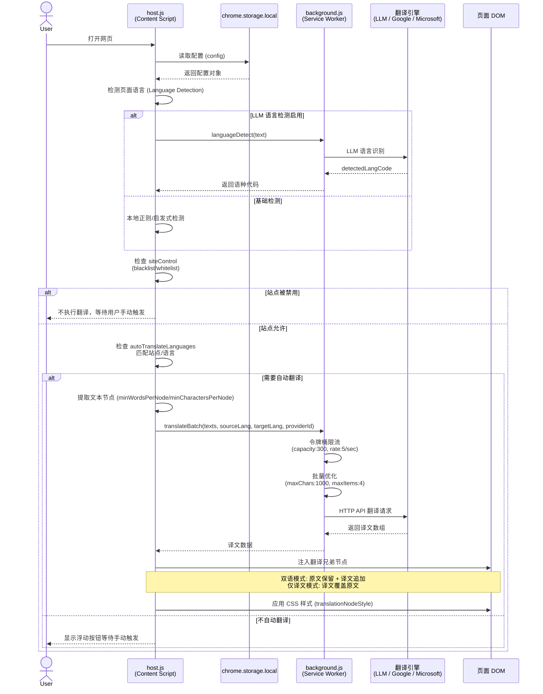
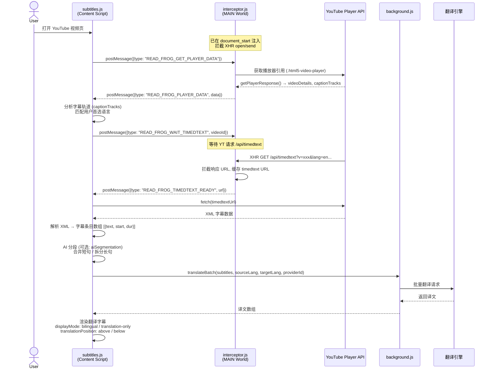
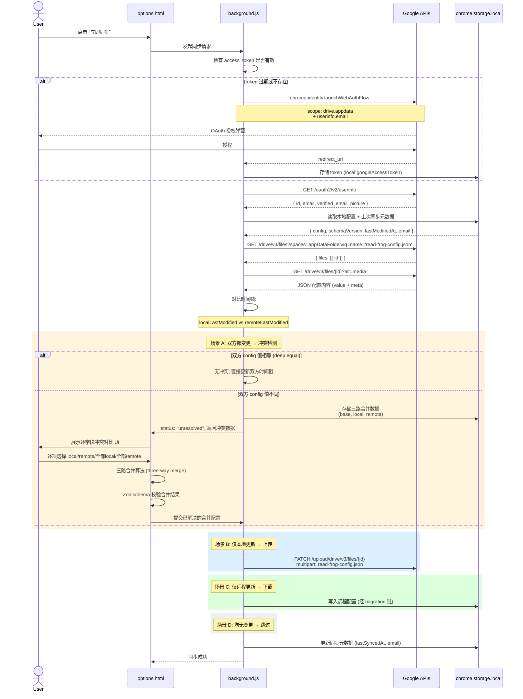
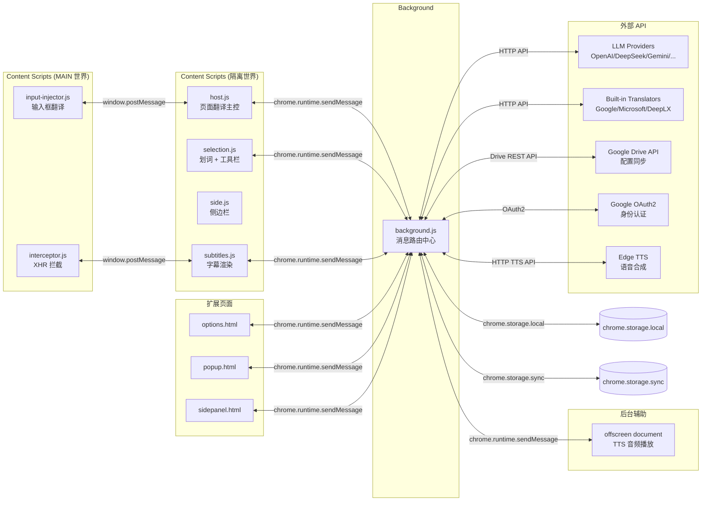

# 数据流分析 — 陪读蛙 (Read Frog) v1.37.2

## 概述

陪读蛙是一个基于 WXT + React 的 Chrome Manifest V3 扩展，核心功能为网页翻译与语言学习。其模块架构包含以下运行时组件：

| 组件 | 类型 | 运行上下文 | 职责 |
|------|------|-----------|------|
| `background.js` | Service Worker | 后台 | 消息路由、翻译请求代理、OAuth 认证、同步调度 |
| `host.js` | Content Script | 页面隔离世界 | 页面翻译主控、语言检测、节点注入、消息中转 |
| `selection.js` | Content Script | 页面隔离世界 | 划词翻译、选择工具栏、自定义动作触发 |
| `side.js` | Content Script | 页面隔离世界 | 侧边栏内容展示 |
| `input-injector.js` | Content Script | MAIN 世界 | 输入框三击空格翻译（直接操作 DOM） |
| `interceptor.js` | Content Script | MAIN 世界 | YouTube XHR/fetch 拦截，字幕数据抓取 |
| `subtitles.js` | Content Script | 页面隔离世界 | YouTube 字幕渲染与翻译 |
| `offscreen` 文档 | Offscreen Document | 后台 | 音频播放 (TTS) |
| `options.html` | 选项页面 | 独立标签页 | 配置管理、API 密钥、同步设置 |
| `popup.html` | 弹出窗口 | 弹窗 | 快捷操作面板 |
| `sidepanel.html` | 侧边面板 | 侧边栏 | 翻译工作台、多引擎对比 |

---

## 一、网页翻译数据流

### 1.1 流程说明

```
用户打开网页
  → host.js 注入页面
  → 检测页面语言 (language detection)
  → 读取站点控制配置 (siteControl: blacklist/whitelist 模式)
  → 匹配 neverAutoTranslatePatterns 跳过列表
  → 检查自动翻译设置 (按站点/语言维度的 autoTranslateLanguages)
  → 确定翻译模式 (bilingual 双语 / translation-only 仅译文)
  → 提取页面文本节点
  → 分批发送翻译请求到 background.js
  → background.js 根据 providerId 路由到:
      ├─ 内置引擎: Google Translate / Microsoft Translator
      └─ LLM 引擎: OpenAI / DeepSeek / Gemini / Grok / Claude / 自定义兼容 API ...
  → 令牌桶限流器 (token bucket rate limiter): capacity=300, rate=5
  → 批量优化: maxCharactersPerBatch=1000, maxItemsPerBatch=4
  → 返回译文
  → host.js 注入翻译节点: 每个原文节点对应一个翻译兄弟节点
  → 应用 CSS 样式 (translationNodeStyle: default/custom preset)
  → 预加载优化 (preload margin/threshold)
```

### 1.2 序列图



### 1.3 关键数据结构

**翻译请求 (host.js -> background.js):**
```typescript
{
  texts: string[],           // 待翻译文本数组
  sourceCode: string,        // 源语言代码 (如 "eng", "cmn", "auto")
  targetCode: string,        // 目标语言代码
  providerId: string,        // 翻译引擎标识
  level: "sentence" | "paragraph",  // 翻译粒度
  promptsConfig: {           // 自定义提示词配置
    promptId: string | null,
    patterns: Array<{ id: string; name: string; prompt: string; systemPrompt: string }>
  }
}
```

**站点控制配置:**
```typescript
{
  siteControl: {
    mode: "blacklist" | "whitelist",  // 黑名单模式(默认全允许) / 白名单模式
    patterns: string[]                // URL 匹配模式
  }
}
```

---

## 二、划词翻译数据流

### 2.1 流程说明

```
用户在页面选中文本
  → selection.js 监听 selectionchange 事件
  → 显示选择工具栏 (selectionToolbar)
  → 工具栏提供功能按钮:
      ├─ 翻译 (translate)
      ├─ 朗读 (speak)
      ├─ 词汇洞察 (vocabularyInsight) — 词典式解释
      └─ 自定义动作 (customActions) — 用户配置的 LLM 动作
  → 用户点击按钮 → content script 发送消息到 background
  → background 调用对应 Provider
  → 返回结果 → content script 显示结果气泡
```

### 2.2 自定义动作流程

```
用户在选项页配置自定义动作:
  - 定义系统提示词 (systemPrompt)
  - 定义用户提示词模板 (prompt，支持 {{selection}} {{context}} {{targetLang}} 等变量)
  - 定义输出 schema (outputSchema): 字段名、类型、是否朗读
  → 选择文本触发动作
  → LLM Provider 返回结构化 JSON
  → 按 schema 解析为字段列表展示
  → 标记了 speaking: true 的字段可一键 TTS 朗读
```

---

## 三、输入框翻译数据流（三击空格）

### 3.1 流程说明

```
用户在输入框输入文本
  → input-injector.js (MAIN 世界) 监听全局 message 事件
  → host.js (隔离世界) 通过事件监听检测输入框中的三击空格
  → 检测连续 3 次快速空格输入 (timeThreshold: 300ms)
  → 识别输入框类型:
      ├─ 原生 contentEditable / input / textarea → execCommand('insertText')
      ├─ Draft.js 编辑器 → React Fiber 查找, editorState.push + onChange
      └─ Slate.js 编辑器 → React Fiber 查找, apply(set_selection) + insertText
  → host.js 提取光标前文本
  → 发送翻译请求到 background.js
  → background 返回译文
  → host.js 通过 window.postMessage({type: "READ_FROG_INPUT_REPLACE"}) 发送到 MAIN 世界
  → input-injector.js 接收消息并替换输入框中的原文为译文
```

### 3.2 关键点

- input-injector.js 运行在 MAIN 世界 (`"world": "MAIN"`)，以获取对页面 JavaScript 对象的直接访问（如 Draft.js / Slate.js 的内部状态）
- host.js 运行在隔离世界，通过 `window.postMessage` 跨世界通信
- 支持普通输入框、Draft.js (通过 React Fiber 查找 editorState/onChange) 和 Slate.js (通过 React Fiber 查找 apply/insertText)

---

## 四、YouTube 字幕翻译数据流

### 4.1 流程说明

```
用户打开 YouTube 视频页
  → interceptor.js (MAIN 世界, document_start 注入, all_frames) 立即拦截:
      ├─ XMLHttpRequest.prototype.open/send
      └─ 全局 message 事件
  → subtitles.js (隔离世界) 发起请求获取播放器数据:
      1. 向 MAIN 世界 postMessage({type: "READ_FROG_GET_PLAYER_DATA"})
      2. interceptor 从 YT Player API 提取:
         - videoDetails.videoId
         - captionTracks (字幕轨道列表)
         - audioCaptionTracks (自动生成字幕)
         - selectedTrack (当前选中字幕)
  → subtitles.js 等待 timedtext 数据:
      1. 向 MAIN 世界 postMessage({type: "READ_FROG_WAIT_TIMEDTEXT", videoId})
      2. interceptor 在 XHR 拦截中捕获 /api/timedtext 请求
      3. 若已缓存则立即返回，否则注册 Promise 等待异步捕获
  → subtitles.js 解析 XML 字幕数据
  → 批量翻译字幕文本
  → 可选 AI 分段 (aiSegmentation) — 用于合并/拆分字幕句子
  → 渲染翻译字幕到视频上方/下方
```

### 4.2 序列图



### 4.3 数据获取架构

```
                    ┌─────────────────────────────┐
                    │     YouTube 页面 (主帧)       │
                    │                             │
                    │  ┌───────────────────────┐  │
                    │  │ interceptor.js (MAIN) │  │
                    │  │                       │  │
                    │  │  XHR 拦截 ──────────┐ │  │
                    │  │  message 监听 ────┐ │ │  │
                    │  │  YT Player 访问   │ │ │  │
                    │  └───────────────────│─│─│──┘  │
                    │                      │ │ │     │
                    │  ┌───────────────────│─│─│──┐  │
                    │  │ subtitles.js (ISO)│ │ │  │  │
                    │  │                   ▼ ▼ ▼  │  │
                    │  │  postMessage 跨世界通信     │  │
                    │  └──────────────────────────┘  │
                    └─────────────────────────────────┘
```

---

## 五、身份验证与配置同步数据流

### 5.1 Google OAuth 认证流程

```
用户点击 "Google Drive 同步"
  → options 页面触发 sync 流程
  → background.js 调用 chrome.identity.launchWebAuthFlow
      URL: https://accounts.google.com/o/oauth2/v2/auth
      参数: client_id, redirect_uri (chrome extension), scope (drive.appdata + userinfo.email)
  → Google 弹出认证窗口
  → 用户授权后重定向到 redirect_uri (携带 access_token 在 URL hash)
  → background 解析 access_token 和 expires_in
  → 存储 token 到 chrome.storage.local (local:googleAccessToken)
  → 调用 Google OAuth2 userinfo API 获取用户信息 (email, picture)
  → 返回用户信息到 options 页面展示
```

### 5.2 Google Drive 配置同步序列图



### 5.3 同步冲突解决

冲突检测采用**三路合并 (three-way merge)**:

- **base**: 上次同步时的配置快照 (存储在 `lastSyncedAt` 元数据中)
- **local**: 当前本地配置
- **remote**: Google Drive 上的配置

对每个字段递归比较: 若 local 和 remote 相对 base 都变更且值不同，则标记为冲突。用户在 UI 中逐字段选择保留 local 或 remote 版本。合并后通过 Zod schema 校验，确保结果有效。

---

## 六、配置迁移链数据流

### 6.1 迁移机制

```
chrome.storage.local 读取配置
  → 检测 schemaVersion (整数)
  → 若 version < 当前最新版 (83):
      循环调用迁移函数: v001toV002 → v002toV003 → ... → v082toV083
      每个迁移函数是一个纯函数: (prevConfig) => nextConfig
  → 迁移完成后 Zod schema 校验 (a.safeParse)
  → 若校验失败: 抛出 ConfigVersionTooNewError 或 ValidationError
  → 校验通过: 返回迁移后的配置对象
  → 写入 chrome.storage.local (更新 schemaVersion 至 83)
```

### 6.2 迁移链流程图

```mermaid
flowchart TD
    A[chrome.storage.local 读取配置] --> B{检测 schemaVersion}
    B -->|version < 83| C[version = 当前版本号]
    C --> D{version < 83?}

    D -->|是| E[加载迁移模块<br/>v{version} → v{version+1}]
    E --> F[执行迁移函数<br/>config = migrate_fn(config)]
    F --> G[version += 1]
    G --> D

    D -->|否| H[Zod schema 校验<br/>a.safeParse(config)]

    H -->|校验失败| I[抛出 ValidationError<br/>含 error.issues 详情]
    H -->|校验通过| J[返回迁移后配置]

    B -->|version === 83| H
    B -->|version > 83| K[抛出 ConfigVersionTooNewError]
    K --> L[提示用户降级扩展版本]
    L --> M[终止加载，使用默认配置]

    J --> N[更新 chrome.storage.local<br/>schemaVersion = 83]

    style E fill:#e1f5fe
    style F fill:#e1f5fe
    style H fill:#fff9c4
    style I fill:#ffcdd2
    style K fill:#ffcdd2
    style N fill:#c8e6c9
```

### 6.3 迁移脚本清单 (v1.37.2, 共 83 个版本)

迁移脚本涵盖的典型变更类别:

| 类别 | 示例版本 | 迁移内容 |
|------|---------|---------|
| 翻译配置初始化 | v001-v008 | 双语模式默认值、翻译提示词、请求队列容量 |
| Provider 扩展 | v009-v011, v013-v014, v072-v073 | 新增/移除 Provider (ollama, openrouter, gemini, deepseek, minimax, ai302) |
| 配置结构重构 | v012-v014, v021-v023, v052-v053, v065-v066 | 字段重命名、嵌套结构扁平化、Provider ID 标准化 |
| UI 行为配置 | v015-v020, v037-v038 | 浮动按钮、选择工具栏、快捷方式 |
| 新功能开关 | v039-v040, v043-v045 | 输入翻译、视频字幕、字幕样式 |
| 站点控制 | v046-v047 | 黑名单/白名单模式迁移 |
| TTS 系统 | v025-v026, v053-v055 | TTS 配置初始化、语言检测模式 |
| 字幕系统 | v044-v052, v076-v077 | 字幕样式、AI 分段、批量/请求队列配置 |
| 自定义动作 | v055-v057, v059-v061, v074-v076 | 字典功能、输出 schema、notebase 连接迁移 |
| 语言检测 | v061-v062 | LLM 检测模式 |
| Provider 模型映射 | v026-v027, v078-v080 | Gemini 1.5→2.5、Grok 4.1→4.20、旧模型→新模型映射 |

---

## 七、TTS（文本转语音）数据流

### 7.1 流程说明

```
用户点击朗读按钮 (选择工具栏 / 选项页测试)
  → Content Script / Options 页面发送消息到 background.js
  → background 接收 TTS 请求:
      ├─ 语言检测: 可选 LLM 检测 (languageDetection.mode === "llm")
      ├─ 语音匹配: 根据语言代码匹配 languageVoices 映射表
      │             若无匹配则回退到 defaultVoice
      └─ 文本分块: 将文本按句/段分割
  → 按块请求语音合成:
      方式 A: Edge TTS (默认)
          background.js → edgeTtsSynthesize → Edge TTS HTTP API
          返回: { audioBase64, contentType }
      方式 B: OpenAI TTS
          background.js → OpenAI API /v1/audio/speech
          返回: audio 二进制数据
  → background 将音频数据发送到 offscreen 文档
  → offscreen 文档使用 DOM AudioController 播放:
      ├─ 逐块播放 (队列管理)
      ├─ 支持停止 (ttsPlaybackStop)
      └─ 播放进度反馈 (currentChunk / totalChunks)
  → 选项页实时展示播放进度
```

### 7.2 组件交互

```
┌──────────────┐    message     ┌──────────────┐
│ Content Script│ ←──────────→ │  background.js │
│ / Options     │              │                │
└──────────────┘              │  • 语言检测     │
                               │  • 语音匹配     │
                               │  • 文本分块     │
                               │  • TTS API 调用 │
                               └───────┬────────┘
                                       │
                              message  │
                                       ▼
                               ┌──────────────┐
                               │   offscreen   │
                               │   document    │
                               │               │
                               │  AudioController│
                               │  • play(base64)│
                               │  • stop()     │
                               │  • 队列管理    │
                               └──────────────┘
```

### 7.3 TTS 配置

```typescript
{
  tts: {
    defaultVoice: string,              // 默认语音 (如 "en-US-GuyNeural")
    languageVoices: Record<string, string>,  // 按语言代码映射 Edge TTS 语音名
    rate: number,                      // 语速 (-100 ~ +100)
    pitch: number,                     // 音高 (-100 ~ +100)
    volume: number,                    // 音量 (-100 ~ +100)
    providerId: string | null,        // TTS 引擎 (null=Edge TTS, "openai-tts" 等)
    model: string,                     // TTS 模型名 (如 "tts-1")
    voice: string,                     // TTS 语音名
    speed: number,                     // 播放速率
    detectLanguageMode: "basic" | "llm"  // 语言检测模式
  }
}
```

---

## 八、自定义 AI 动作数据流

### 8.1 流程说明

```
用户在选项页配置自定义动作:
  {
    id: string;                    // 动作唯一标识
    name: string;                  // 显示名称
    enabled: boolean;
    icon: string;                  // Tabler 图标名
    providerId: string;            // LLM provider
    systemPrompt: string;          // 系统提示词
    prompt: string;                // 用户提示词模板
    outputSchema: Array<{
      id: string;                  // 字段 ID
      name: string;                // 字段显示名
      type: "string" | "number" | "boolean";
      description: string;         // 字段描述
      speaking: boolean;           // 是否该字段可 TTS 朗读
    }>;
  }

用户在页面选中文本
  → 选择工具栏显示自定义动作按钮
  → 用户点击动作
  → Content Script 构建 prompt:
      变量替换: {{selection}} {{context}} {{targetLang}} {{webTitle}} {{webSummary}}
  → Content Script → background.js → LLM Provider
  → Provider 返回结构化 JSON (根据 outputSchema)
  → Content Script 解析并展示:
      每个字段单独显示为卡片
      标记了 speaking: true 的字段旁显示朗读按钮
  → 用户可点击朗读按钮触发 TTS
```

### 8.2 内置动作: 词汇洞察 (Vocabulary Insight)

```
vocabularyInsight (词典功能):
  prompt:
    "Term: {{selection}}
     Context: {{context}}
     Target language: {{targetLang}}"

  outputSchema:
    - Term (string, speaking)
    - Definition (string, speaking)
    - Context (string, speaking)
    - Examples (string)
    - Synonyms (string)
    - Antonyms (string)

  → 返回结构化词典条目
```

---

## 九、消息通信架构总览



---

## 十、令牌桶限流器

### 10.1 工作原理

```
翻译请求队列:
  requestQueueConfig: {
    capacity: 300,    // 桶容量 (最大突发请求数)
    rate: 5           // 补充速率 (每秒补充令牌数)
  }

每个翻译请求消耗 1 个令牌
  → 若令牌足够: 立即发送
  → 若令牌不足: 排队等待令牌补充
  → 超过 capacity 时: 请求被拒绝或等待
```

### 10.2 批量优化

```
批量队列 (batch queue):
  batchQueueConfig: {
    maxCharactersPerBatch: 1000,  // 单批次最大字符数
    maxItemsPerBatch: 4           // 单批次最大条目数 (文本片段)
  }

文本节点 → 分批聚合:
  1. 收集待翻译文本片段
  2. 按 maxCharactersPerBatch 和 maxItemsPerBatch 限制分组
  3. 每组作为单次 API 请求发送
  4. 返回结果按原始顺序解包
```

---

## 十一、存储键空间

| 键 | 用途 | 存储区 |
|----|------|--------|
| `local:{appName}` | 用户配置 (config, schemaVersion, 元数据) | chrome.storage.local |
| `local:googleAccessToken` | Google OAuth2 access_token | chrome.storage.local |
| `local:{appName}LastSynced` | 上次同步时的配置快照 | chrome.storage.local |
| `local:backup_ids` | 配置备份 ID 数组 (最多 8 个) | chrome.storage.local |
| `local:{backupId}` | 单个配置备份 | chrome.storage.local |
| `local:{providerSettings}` | Provider 配置 (API key 等) | chrome.storage.local |
| `sync:{syncKey}` | 跨设备同步标记 | chrome.storage.sync |
