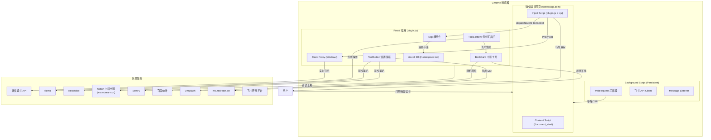
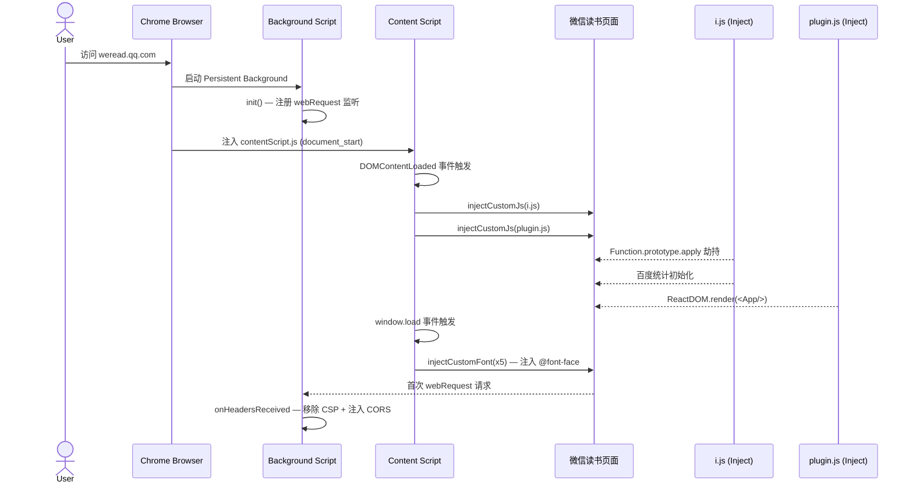
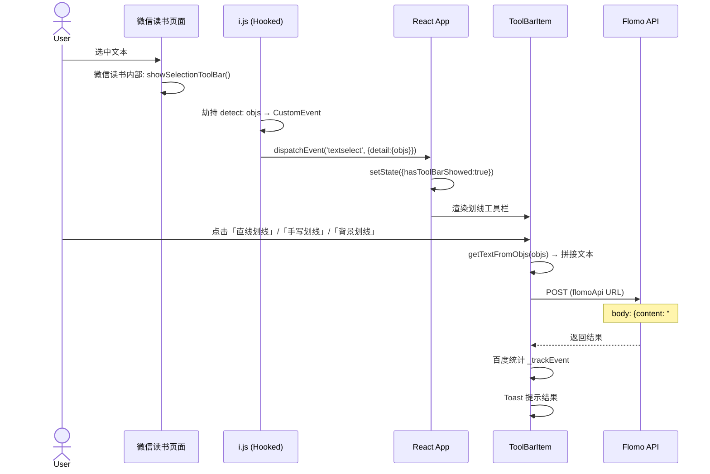
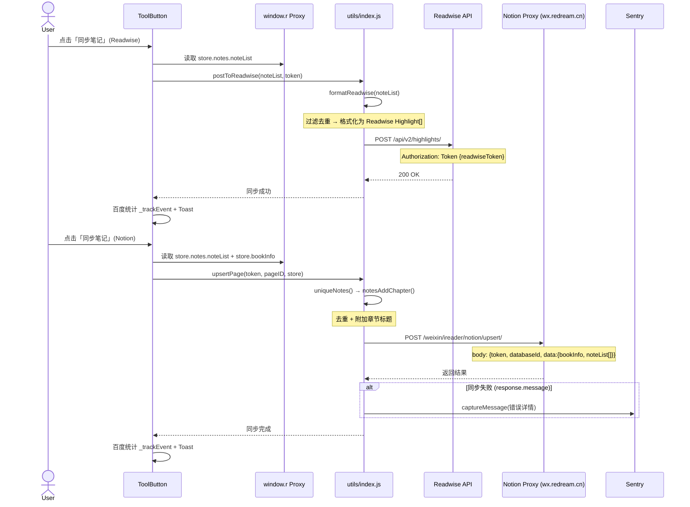
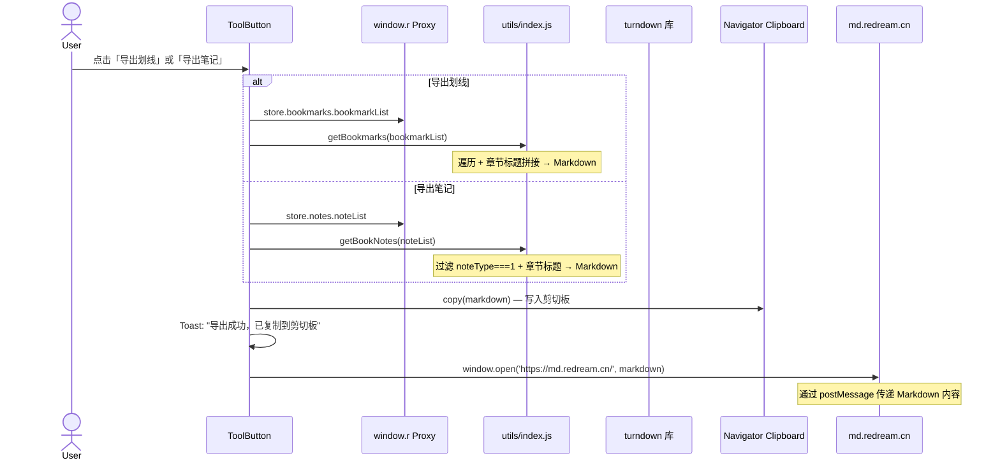
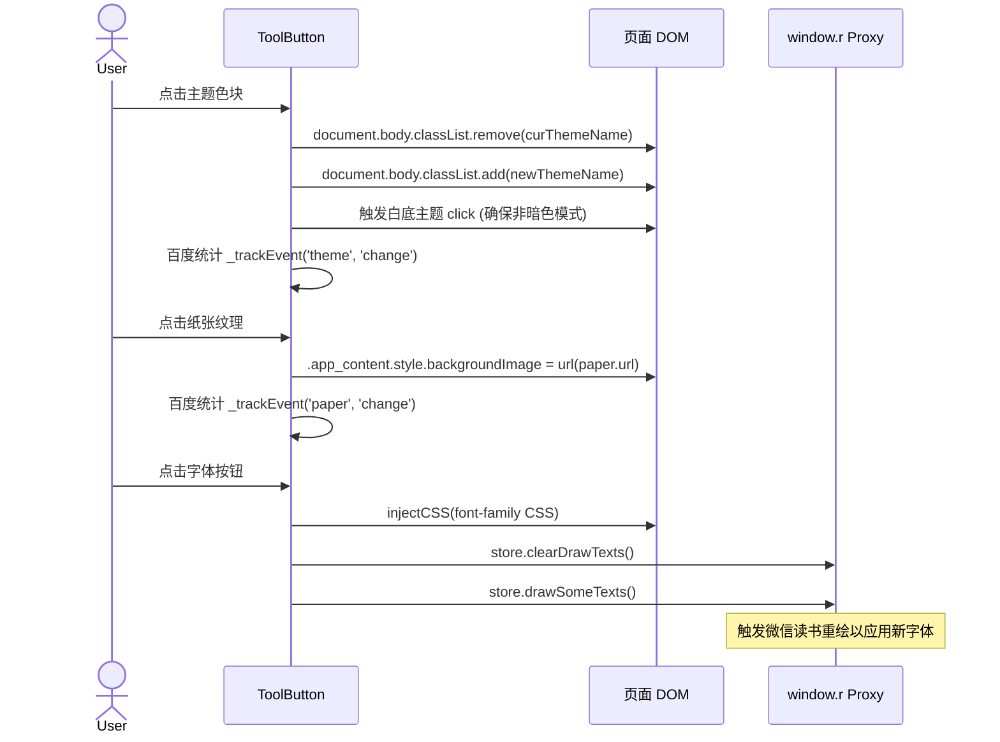
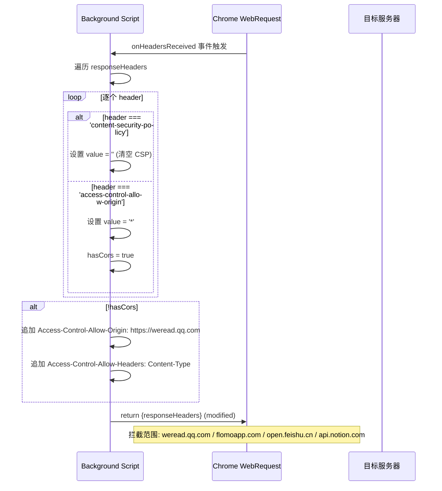
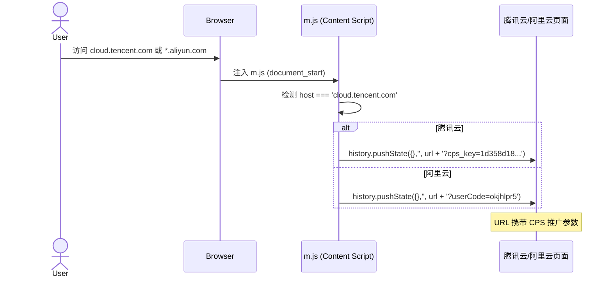
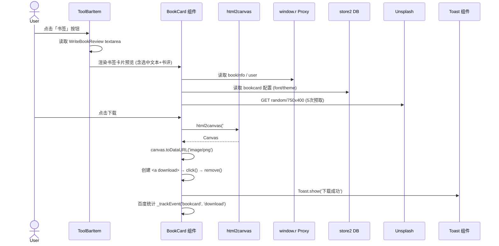

# i微信读书 数据流文档

## 总体数据流概览

---

## 1. 扩展加载与初始化流程

---

## 2. 划线摘抄与 Flomo 同步流程

---

## 3. 批量同步笔记到 Readwise / Notion 流程

---

## 4. 导出笔记到 Markdown 流程

---

## 5. 主题/纸张/字体切换流程

---

## 6. CSP 移除与 CORS 注入流程

---

## 7. 腾讯云/阿里云 CPS 推广参数注入

---

## 8. 书签卡片生成与下载流程

