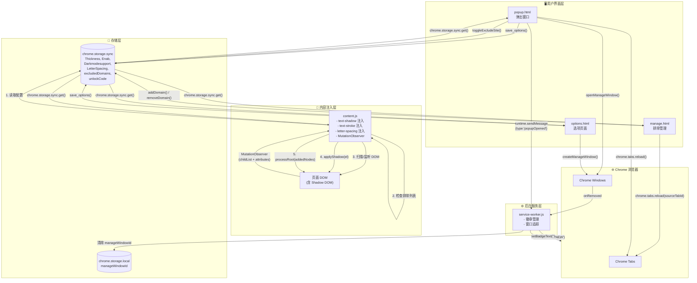

# Chrome Font Super Enhancer — 数据流文档

## 一、总览

本扩展的数据流动围绕 `chrome.storage.sync` 作为唯一数据源 (Single Source of Truth)。所有 UI 组件读写同一份配置，content script 在初始化时读取配置并持续生效。

---

## 二、完整数据流图 (Mermaid)



---

## 三、关键流程详解

### 3.1 页面加载 → 字体增强

```
1. 浏览器导航到 URL
2. Chrome 在 document_end 时将 content.js 注入页面
3. content.js 执行：
   a. chrome.storage.sync.get() 读取全部配置
   b. 检查当前 hostname 是否匹配 excludedDomains 中任一项
      - 匹配: isEnabled = false, 直接退出
      - 不匹配: isEnabled = true, 继续
   c. processRoot(document) 全量扫描当前 DOM
      - collectElements() 收集所有匹配元素（穿透 shadow DOM）
      - applyShadow() 对每个含直接文本的元素应用样式
   d. window.addEventListener('load', () => processRoot(document))
   e. startObserver() 启动 MutationObserver
```

### 3.2 用户修改配置 → 页面立即生效

```
1. 用户在 popup 中拖动滑块或切换开关
2. popup.js 调用 save_options():
   a. 验证输入范围
   b. chrome.storage.sync.set() 写入新值
   c. chrome.tabs.reload() 刷新所有标签页
   d. 500ms 后关闭 popup
3. 标签页刷新后 content.js 重新初始化，新配置生效
```

### 3.3 排除站点

```
1. 用户在 popup 勾选 "Do not apply to this website"
2. popup.js toggleExcludeSite():
   a. 获取当前标签页 hostname
   b. 从 sync 读取 excludedDomains
   c. 添加或移除该域名
   d. 写回 sync
   e. chrome.tabs.reload() 刷新当前页
```

### 3.4 捐赠解锁

```
1. 用户输入解锁码，点击 GO 或按 Enter
2. popup.js checkUnlockCode():
   a. 比较用户输入与 getuc() 结果
   b. 不匹配 → window.close()
   c. 匹配 → chrome.storage.sync.set({unlockCode: code})
   d. activatePopupUI() 隐藏捐赠横幅，启用高级功能
3. 下次打开 popup 时 restore_options() 检测 unlockCode 并恢复解锁状态
```

### 3.5 MutationObserver 增量处理

```
1. DOM 发生变更 (childList / attributes)
2. MutationObserver 回调触发:
   a. childList: 新增节点 → 加入 batch
   b. childList: 文本节点变化 → 父元素加入 batch
   c. attributes (style/class): 仅在 lastColor.has(el) 时加入 batch
3. scheduleProcess(batch):
   a. 清除上一次定时器
   b. 合并到 pendingNodes
   c. 100ms 后统一调用 processRoot(pendingNodes[i])
4. 避免反馈循环: lastColor WeakMap 记录已处理颜色，重复触发不重复处理
```

### 3.6 管理窗口单例

```
1. popup.js 调用 openManageWindow()
2. 检查 chrome.storage.local 中的 manageWindowId
3. 存在 → chrome.windows.update(manageWindowId, {focused: true})
   - 成功 → window.close() (关闭 popup)
   - 失败（窗口已关闭）→ 清除 manageWindowId → createManageWindow()
4. 不存在 → createManageWindow()
5. 创建窗口后保存 manageWindowId 到 local
6. service-worker.js 监听 windows.onRemoved:
   - 移除的 windowId === manageWindowId → 清除 local 中的 manageWindowId
```

---

## 四、跨组件通信矩阵

| 发送方 | 接收方 | 方式 | 消息/数据 |
|--------|--------|------|----------|
| popup.js | service-worker.js | `runtime.sendMessage` | `{type: "popupOpened"}` |
| popup.js | Chrome Tabs | `tabs.reload()` | 刷新所有标签页 |
| manage.js | Chrome Tabs | `tabs.reload(sourceTabId)` | 刷新来源标签页 |
| service-worker.js | Chrome Action | `action.setBadgeText()` | 设置/清除 NEW 徽章 |
| content.js | chrome.storage.sync | `storage.sync.get()` | 读取全局配置 |

无需 content script 与其他脚本的直接通信，配置变更通过 **页面刷新** 传递。

---

## 五、数据一致性

- **强一致性**: 所有组件直接读写 `chrome.storage.sync`，无缓存层
- **无冲突风险**: popup 和 options 页面互斥打开，不会同时写入
- **排除列表**: manage.html 直接操作 sync，变更后通过 `tabs.reload()` 传播
- **解锁状态**: 写入 sync 后跨页面自动同步
