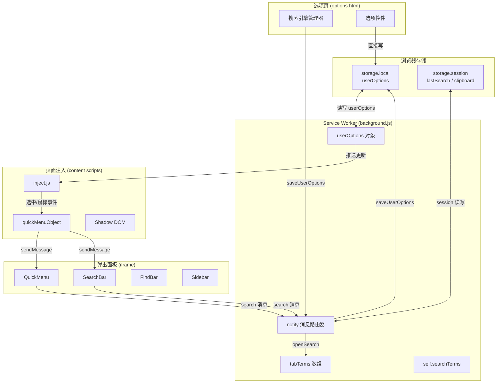
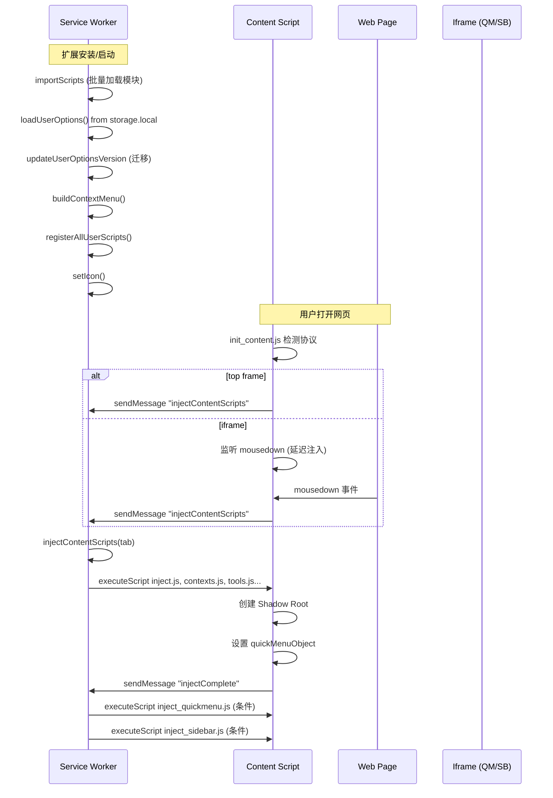
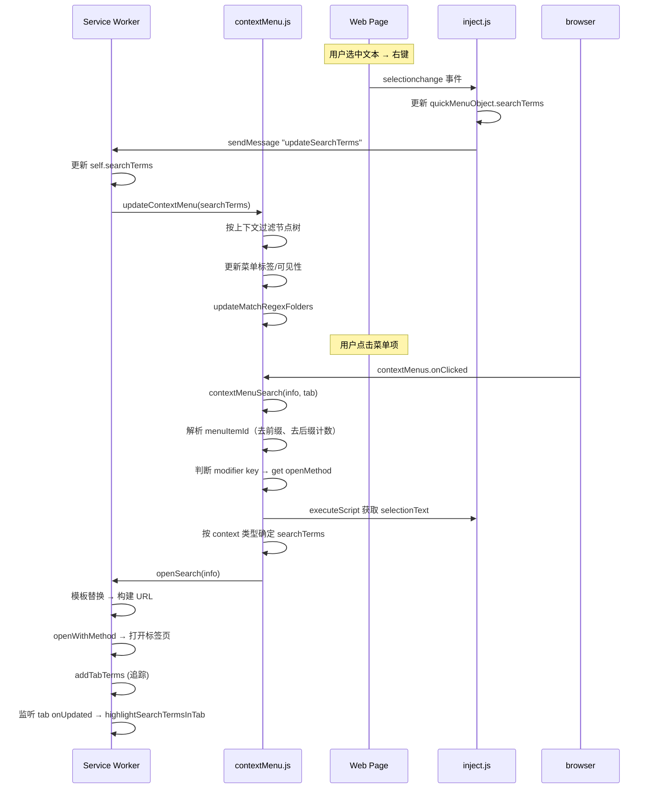
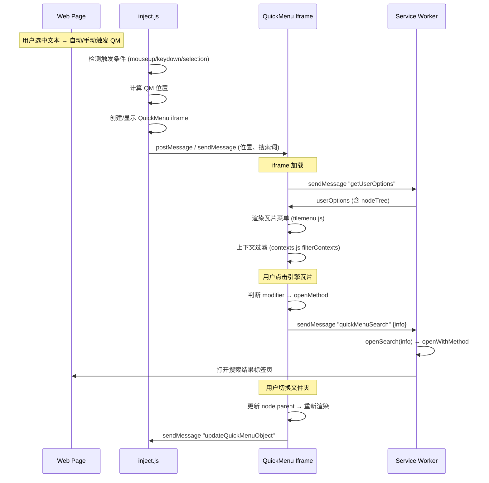
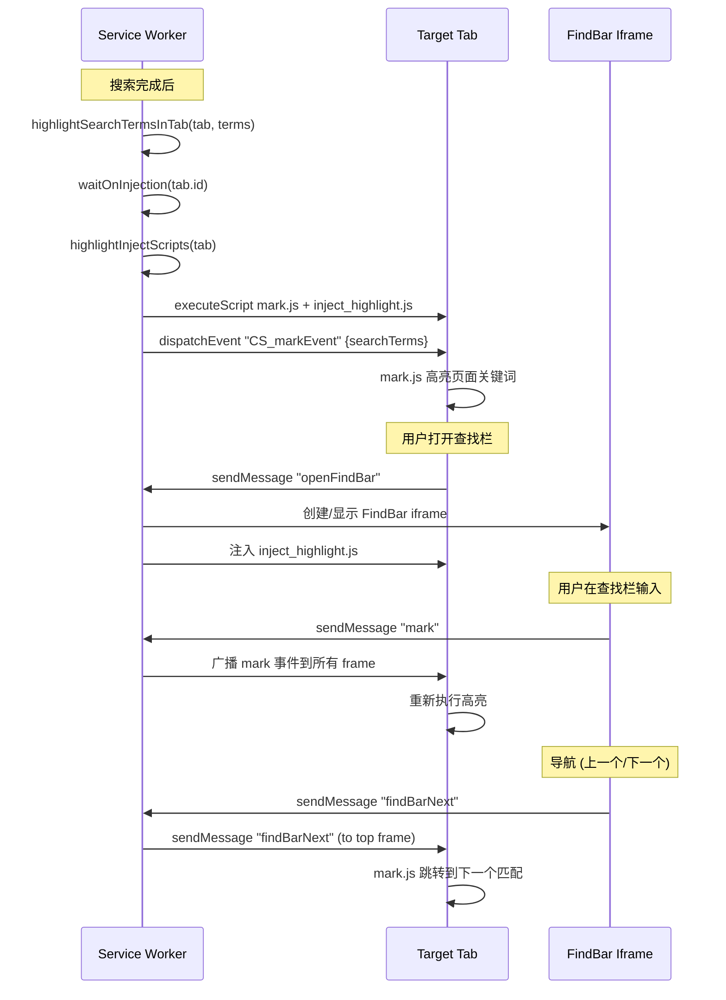
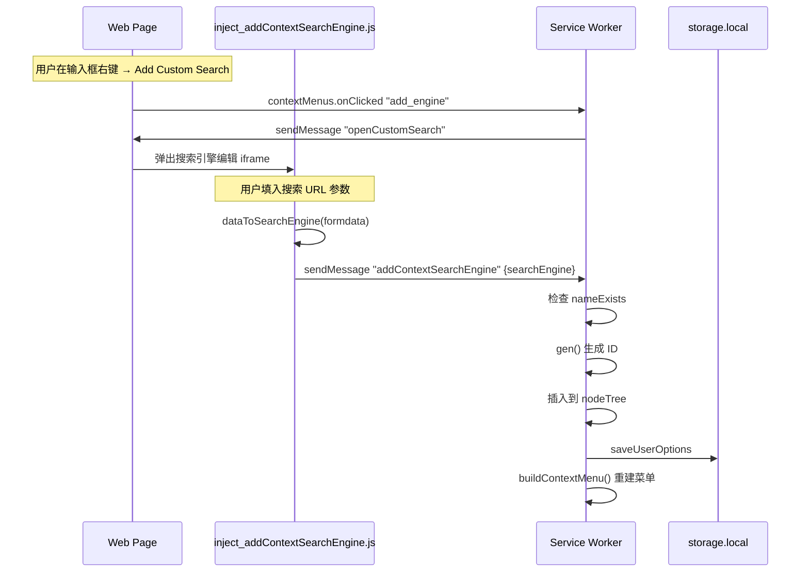
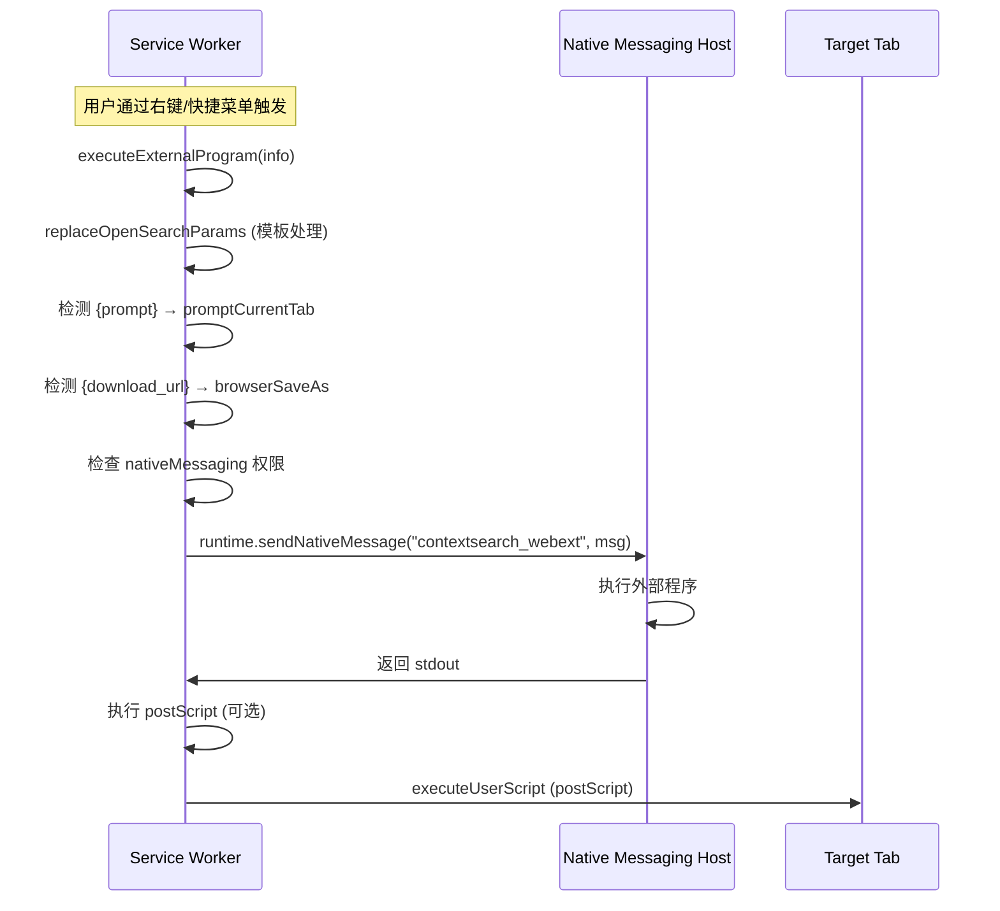

# ContextSearch web-ext 数据流文档

> 基于 v1.48.4.13 源码逆向分析

## 一、总览

ContextSearch web-ext 的数据流围绕三个核心实体展开：
1. **userOptions** - 用户配置（存储于 `storage.local`）
2. **quickMenuObject** - 快捷菜单运行时状态（存储于页面全局变量）
3. **tabTerms / searchTerms** - 搜索词与标签页追踪（存储于 Service Worker 全局变量）



## 二、初始化流



## 三、右键菜单搜索流



## 四、Quick Menu 搜索流



## 五、用户选项持久化流

```mermaid
sequenceDiagram
    participant OPT as Options Page
    participant SW as Service Worker
    participant SL as storage.local
    participant TABS as All Open Tabs

    OPT->>OPT: 用户修改任意选项
    OPT->>OPT: 标记 changed
    OPT->>OPT: saveOptions()
    OPT->>SL: browser.storage.local.set({userOptions})

    Note over OPT: 或者通过消息代理
    OPT->>SW: sendMessage "saveUserOptions"
    SW->>SL: browser.storage.local.set({userOptions})
    SW->>SW: 更新内存 userOptions
    SW->>SW: debounce() → "updateUserOptions"
    SW->>TABS: broadcast userOptions to all tabs
    TABS->>TABS: inject.js 更新本地 userOptions
    SW->>SW: buildContextMenu() (重建)
    SW->>SW: updateUserScripts() (延迟 debounce 2s)
```

## 六、高亮/查找流



## 七、搜索引擎添加流



## 八、外部程序调用流



## 九、全局状态管理

| 变量 | 位置 | 说明 |
|------|------|------|
| `self.userOptions` | Service Worker | 用户配置完整对象 (内存缓存) |
| `self.searchTerms` | Service Worker | 当前选中文本 |
| `self.searchTermsObject` | Service Worker | 按上下文分类的选中文本 `{selection, link, image...}` |
| `self.tabTerms` | Service Worker | 标签页搜索词追踪数组 `[{id, tabId, searchTerms}]` |
| `self.popupWindows` | Service Worker | 弹出窗口 ID 列表 |
| `self.contextMenuMatchRegexMenus` | Service Worker | 正则匹配菜单项 ID 列表 (用于更新/删除) |
| `self.ctrlKey` | Service Worker | 右键菜单弹出时 Ctrl 键状态 |
| `quickMenuObject` (window) | Content Script | 快捷菜单运行时状态 |
| `userOptions` (window) | Content Script | 页面注入层的用户配置缓存 |
| `killswitch` (window) | Content Script | 全局开关，禁用注入功能 |
