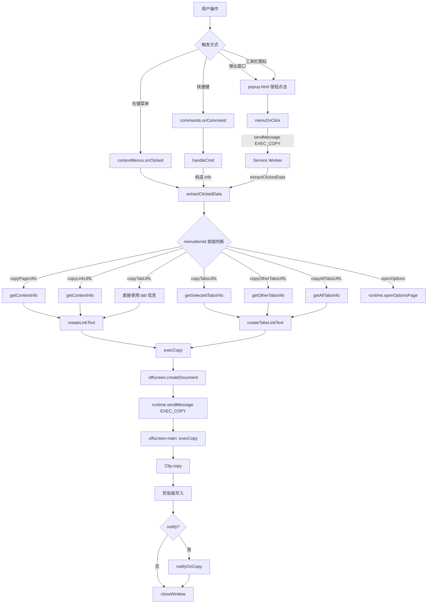
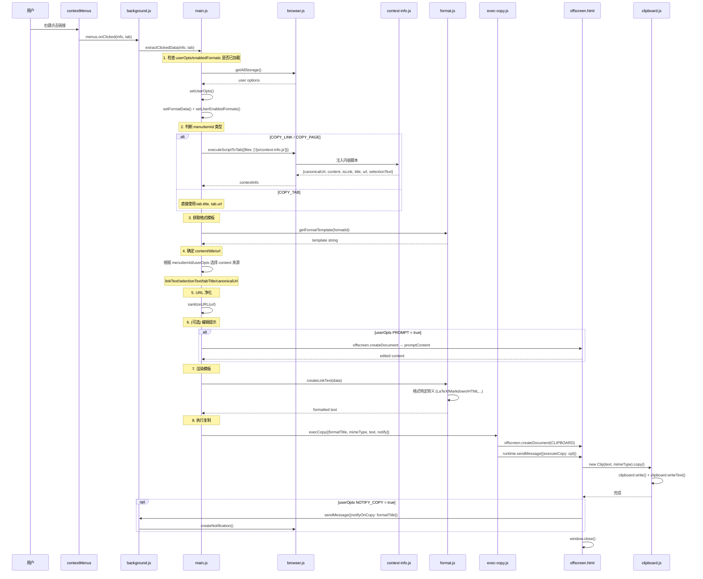
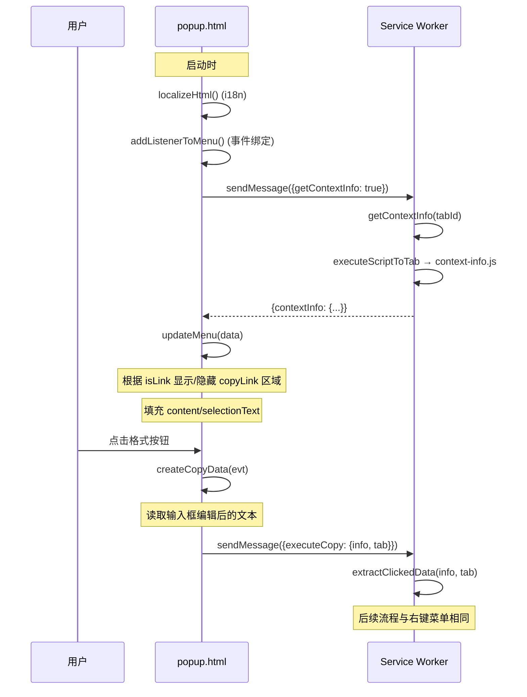
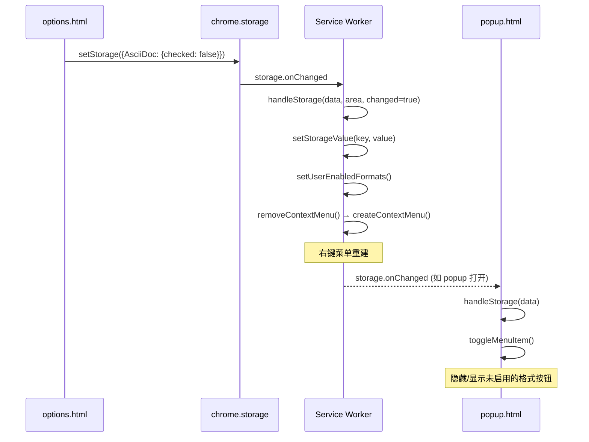
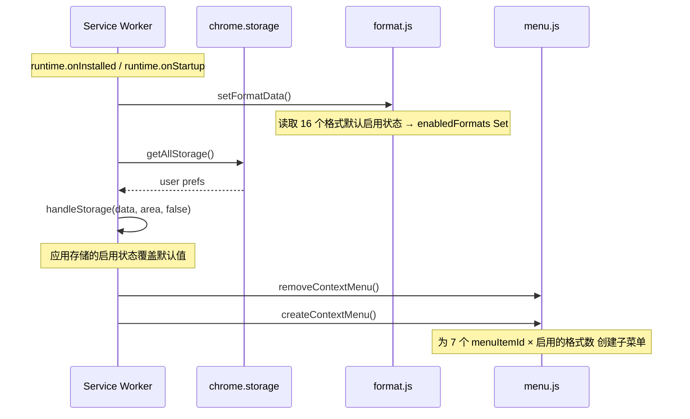

# DATA_FLOW.md -- 复制链接到剪贴板 v15.1.3

## 1. 整体数据流概览



## 2. 右键菜单复制流程 (核心流程)



## 3. 弹出窗口流程



## 4. 存储变更同步流程



## 5. 启动初始化流程



## 6. 剪贴板数据流 (Clip 类内部)

```mermaid
flowchart TD
    A[Clip.copy] --> B{mimeType?}
    B -->|text/plain| C[navigator.clipboard.writeText]
    B -->|text/html etc| D{clipboard.write + ClipboardItem?}
    C -->|失败| E[document.execCommand('copy') fallback]
    D -->|支持| F[DOMParser 解析 → serializeDomString 重建 → Blob → ClipboardItem]
    D -->|不支持| E
    F -->|HTML| G[同时写入 text/html + text/plain 双 blob]
    F -->|其他| H[写入对应 MIME blob]
    F -->|失败| E
    G --> I[navigator.clipboard.write]
    H --> I

    E --> J[addEventListener('copy') → setData → execCommand('copy')]
```

## 7. Sanitize 委托链

Service Worker 无法访问 DOM, URL 净化和 HTML 属性净化均通过 offscreen document 委托执行:

```
main.js (SW)
  └→ sanitize.js: sanitizeURL(url, opt)
       ├─ protocol !== 'data:' → 直接调用 lib/url/url-sanitizer (纯 JS, 可用)
       └─ protocol === 'data:' → offscreen.createDocument → sendMessage(SANITIZE_URL)
            └→ offscreen-main.js: sanitizeURL(url, opt) [来自 url-sanitizer 库]

main.js (SW)
  └→ sanitize.js: sanitizeAttributes(attr)
       └→ offscreen.createDocument → sendMessage(SANITIZE_ATTR)
            └→ offscreen-main.js: sanitize-attr.js: sanitizeAttributes(attr) [DOMPurify]
```

## 8. 关键数据结构流

```
Tab (Chrome API)
  └→ TabLinkData {id, formatId, template, title, url, content, attr?}
       └→ createLinkText(data) → string (format-specific)
            └→ createTabsLinkText(arr) → string (joined with \n or <br>)
                 └→ execCopy({formatTitle, mimeType, text, notify})
                      └→ Clip(content, mimeType).copy()
                           └→ clipboard.write() / writeText()
```
