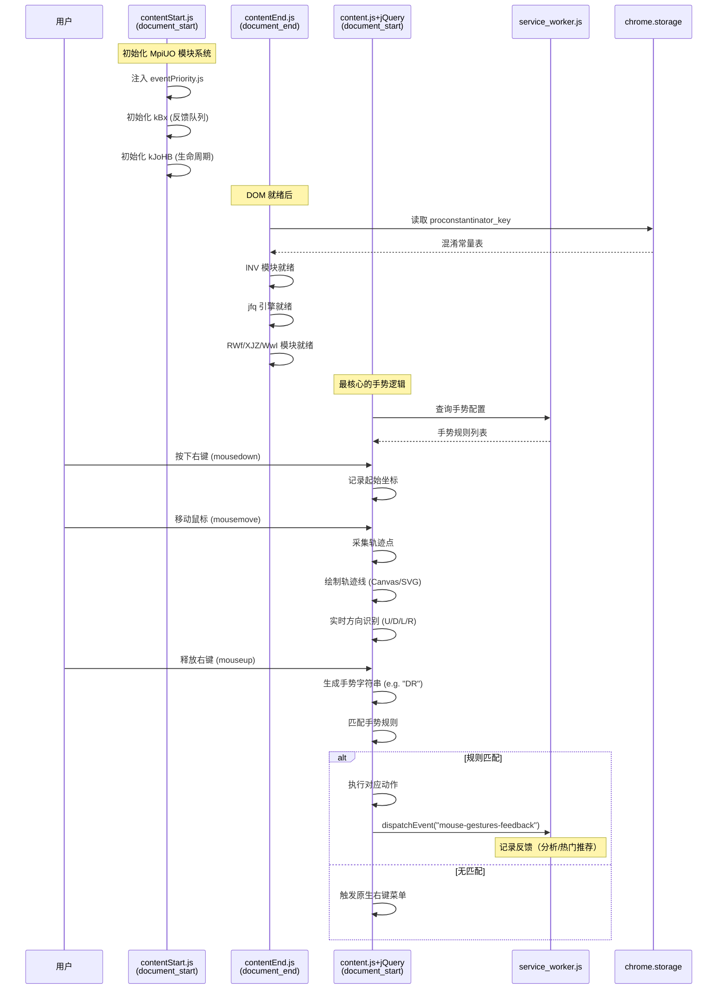
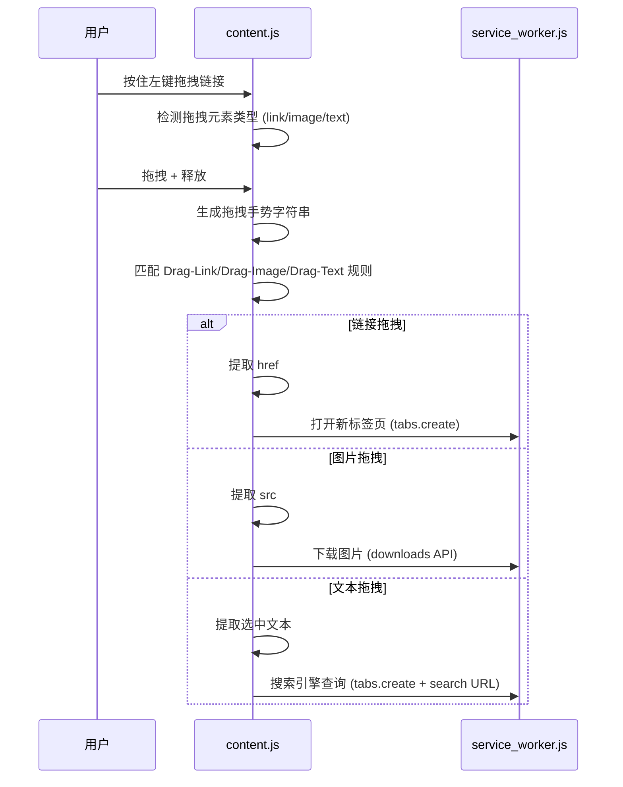
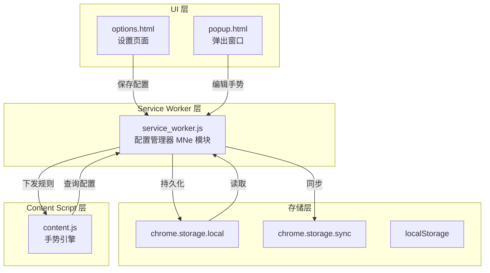
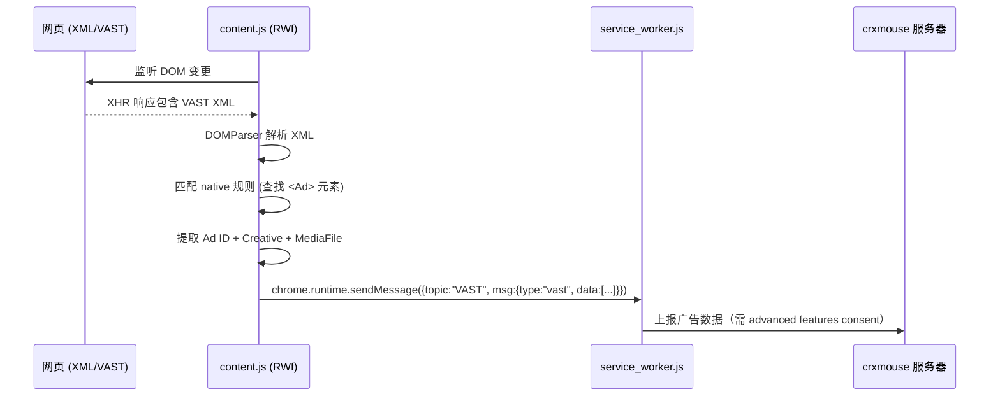
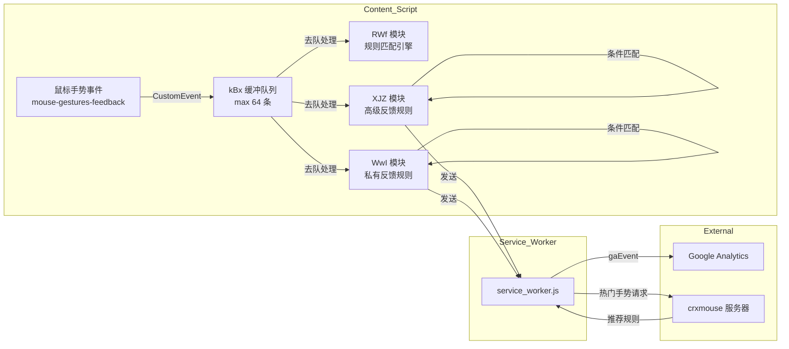
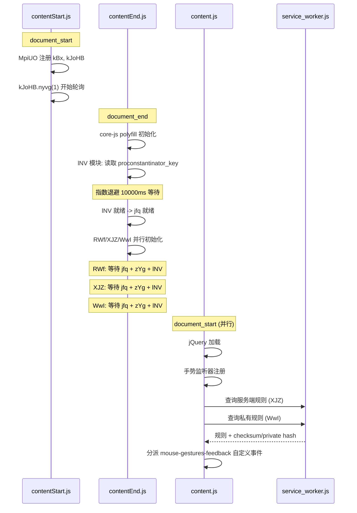
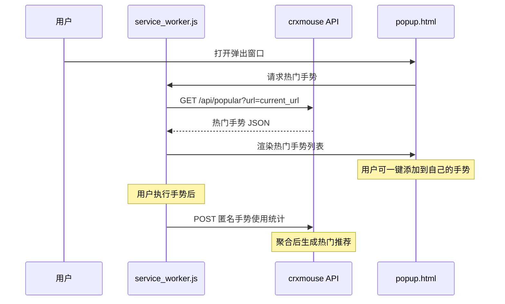
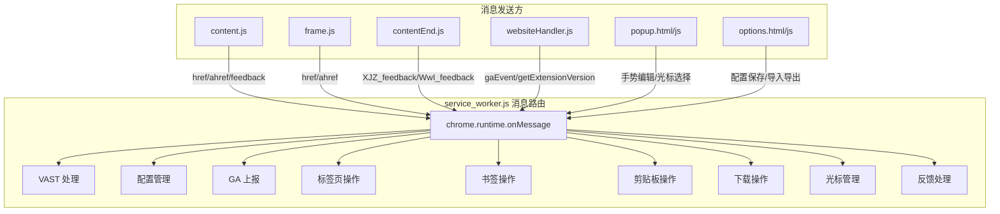

# crxMouse 数据流文档

> 逆向工程分析 | v7.0.5 | 2026-07-06

---

## 概述

本文档描述 crxMouse Chrome Gestures 扩展的数据流动路径，覆盖手势识别、配置同步、广告检测、分析上报等关键数据流。

---

## 一、鼠标手势识别流程

---

## 二、超级拖拽数据流

---

## 三、配置数据流

### 存储分布

| 存储介质 | 内容 | 访问范围 |
|---------|------|---------|
| `chrome.storage.local` | 主配置 JSON、手势规则、拖拽规则、摇杆规则、滚动配置、光标选择、黑名单 | SW + Options + Popup |
| `chrome.storage.sync` | 跨设备同步的配置子集 | SW + Options (登录用户) |
| `localStorage` | 单页面缓存 (checksum-hash, private-hash, 热门手势缓存) | Content Script |
| `sessionStorage` | 会话级临时数据 | Content Script |
| `self.geZbb` (内存) | jfq 引擎运行时变量存储 | Content Script (contentEnd.js) |

---

## 四、VAST 广告检测数据流

---

## 五、反馈 / 分析管道 (XJZ, WwI, RWf)

### 模块协作

### 三种规则引擎的区别

| 模块 | 触发条件 | 数据去向 | 条件 |
|------|---------|---------|------|
| RWf | 页面包含 VAST XML / 匹配规则 | SW -> 服务器 | 需 advanced features consent |
| XJZ | 本地规则匹配 URL + 事件详情 | SW -> 服务器 | 需 advanced features consent + checksum-hash 验证 |
| WwI | 本地规则匹配 URL + 事件详情 | SW -> 服务器 | 需 private-hash 验证（用户自愿） |

---

## 六、模块初始化时序

---

## 七、热门手势同步流程

---

## 八、消息路由完整清单

