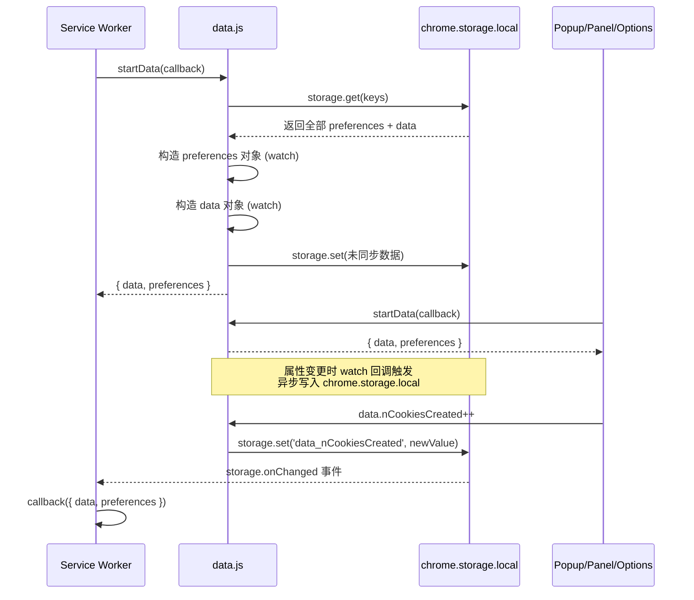
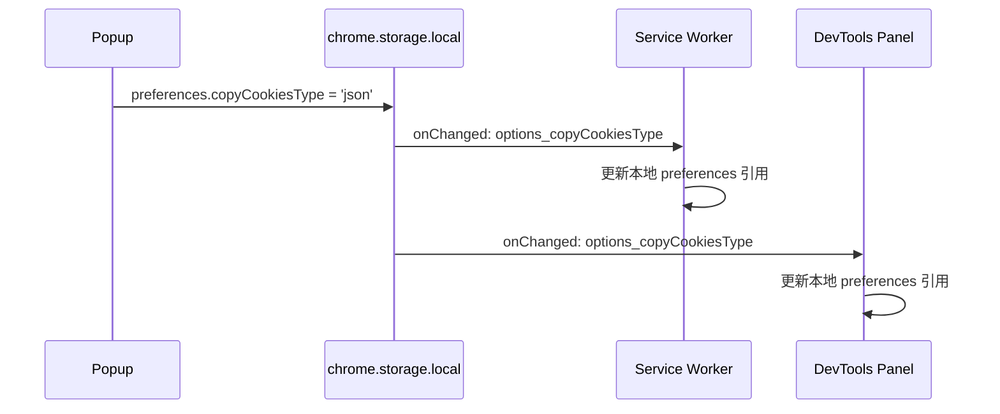
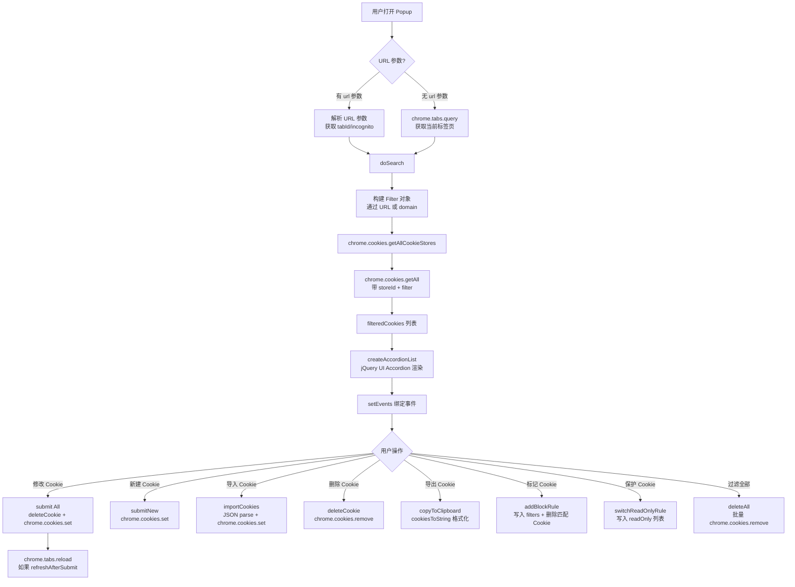
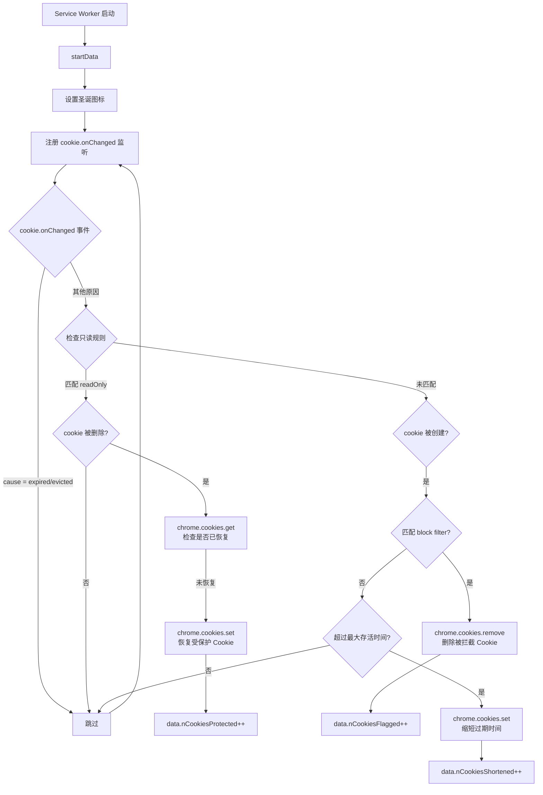
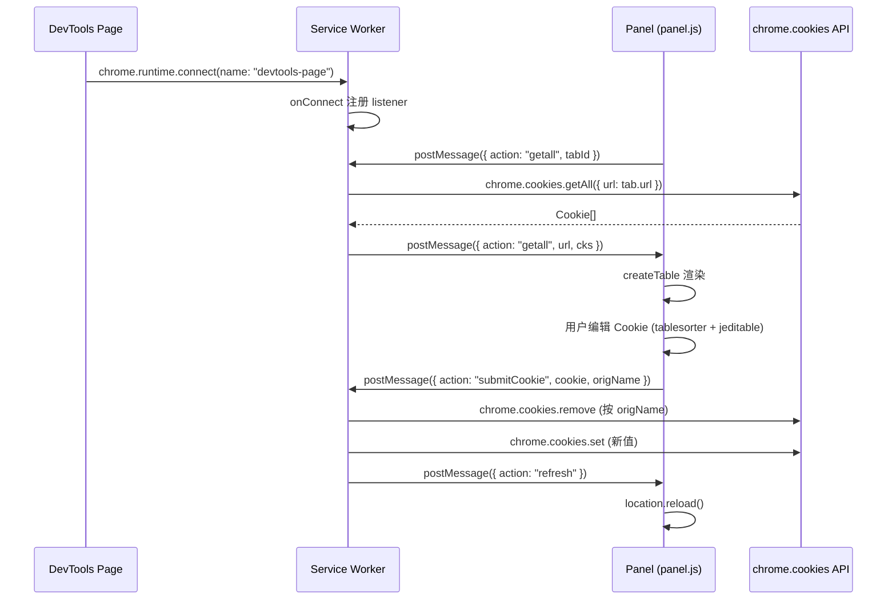

# EditThisCookie V3 数据流文档

> 反向工程版本: dsv4 | 源版本: v3.0.5 | 日期: 2026-07-06

---

## 一、存储层数据流

### 1.1 初始化与数据同步



### 1.2 跨上下文同步



## 二、Popup Cookie 管理数据流



## 三、Service Worker 后台数据流



## 四、DevTools Panel 数据流



## 五、选项页面数据流

```mermaid
flowchart TD
    A[options_main_page.html] --> B[options_main_page.js]
    B --> C[storage.get('option_panel')]
    C --> D{option_panel 值?}
    D -->|null/undefined| E[跳转 support.html]
    D -->|user_preferences| F[跳转 user_preferences.html]
    D -->|block_rules| G[跳转 block_rules.html]
    D -->|readonly_rules| H[跳转 readonly_rules.html]
    D -->|?page=xxx URL 参数| I[跳转 xxx.html]

    F --> J[user_preferences.js]
    J --> K[startData + 绑定 UI -> preferences 双向同步]

    G --> L[block_rules.js]
    L --> M[data.filters 列表渲染<br/>addBlockRule / deleteBlockRule]

    H --> N[readonly_rules.js]
    N --> O[data.readOnly 列表渲染<br/>switchReadOnlyRule / deleteReadOnlyRule]
```

## 六、Cookie 过滤/拦截数据流

```mermaid
flowchart LR
    A[用户添加 Block Rule] --> B[addBlockRule(data, rule)]
    B --> C[检查是否重复]
    C -->|不重复| D[data.filters.push(rule)]
    D --> E[chrome.cookies.getAll({})]
    E --> F[遍历所有 Cookie]
    F --> G{filterMatchesCookie?}
    G -->|匹配| H[chrome.cookies.remove]
    G -->|不匹配| F
    C -->|重复| I[返回重复索引]
```

## 七、数据键映射表

| 存储键 | JS 属性 | 类型 | 默认值 |
|--------|---------|------|--------|
| options_showAlerts | preferences.showAlerts | boolean | false |
| options_showCommandsLabels | preferences.showCommandsLabels | boolean | false |
| options_showDomain | preferences.showDomain | boolean | true |
| options_showDomainBeforeName | preferences.showDomainBeforeName | boolean | true |
| options_showFlagAndDeleteAll | preferences.showFlagAndDeleteAll | boolean | false |
| options_showContextMenu | preferences.showContextMenu | boolean | true |
| options_refreshAfterSubmit | preferences.refreshAfterSubmit | boolean | false |
| options_skipCacheRefresh | preferences.skipCacheRefresh | boolean | true |
| options_useMaxCookieAge | preferences.useMaxCookieAge | boolean | false |
| options_maxCookieAgeType | preferences.maxCookieAgeType | number | -1 |
| options_maxCookieAge | preferences.maxCookieAge | number | 1 |
| options_useCustomLocale | preferences.useCustomLocale | boolean | false |
| options_customLocale | preferences.customLocale | string | 'en' |
| options_copyCookiesType | preferences.copyCookiesType | string | 'json' |
| options_showChristmasIcon | preferences.showChristmasIcon | boolean | true |
| options_sortCookiesType | preferences.sortCookiesType | string | 'domain_alpha' |
| options_showDevToolsPanel | preferences.showDevToolsPanel | boolean | true |
| data_filters | data.filters | FilterRule[] | [] |
| data_readOnly | data.readOnly | ReadOnlyRule[] | [] |
| data_nCookiesCreated | data.nCookiesCreated | number | 0 |
| data_nCookiesChanged | data.nCookiesChanged | number | 0 |
| data_nCookiesDeleted | data.nCookiesDeleted | number | 0 |
| data_nCookiesProtected | data.nCookiesProtected | number | 0 |
| data_nCookiesFlagged | data.nCookiesFlagged | number | 0 |
| data_nCookiesShortened | data.nCookiesShortened | number | 0 |
| data_nPopupClicked | data.nPopupClicked | number | 0 |
| data_nPanelClicked | data.nPanelClicked | number | 0 |
| data_nCookiesImported | data.nCookiesImported | number | 0 |
| data_nCookiesExported | data.nCookiesExported | number | 0 |
| data_lastVersionRun | data.lastVersionRun | string | undefined |
| option_panel | (直接键) | string | null |
