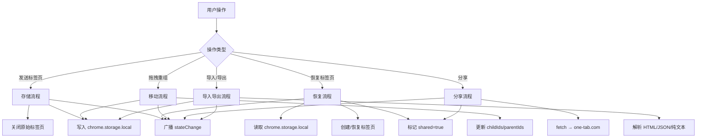
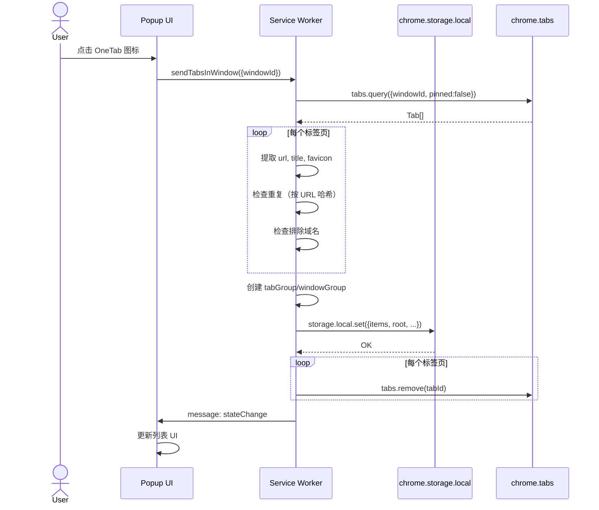
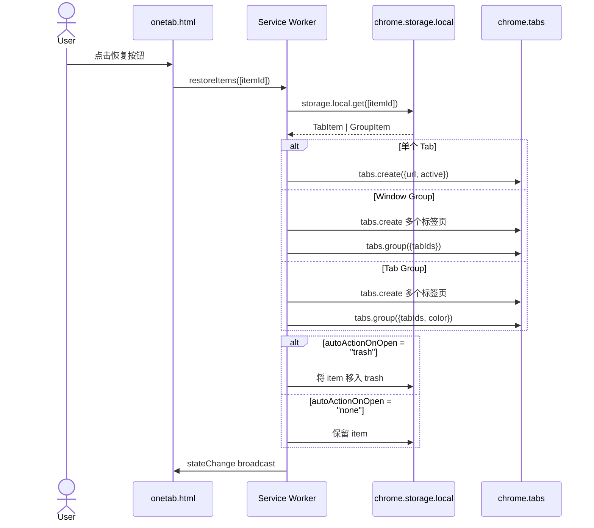
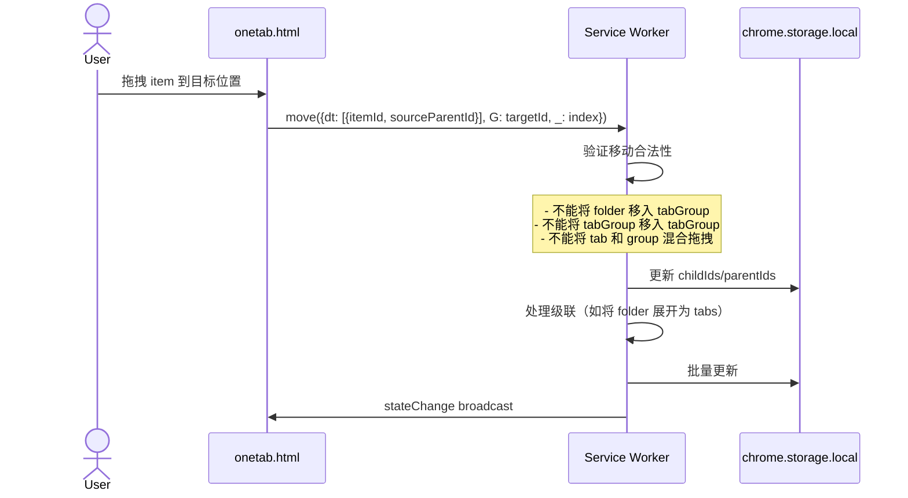
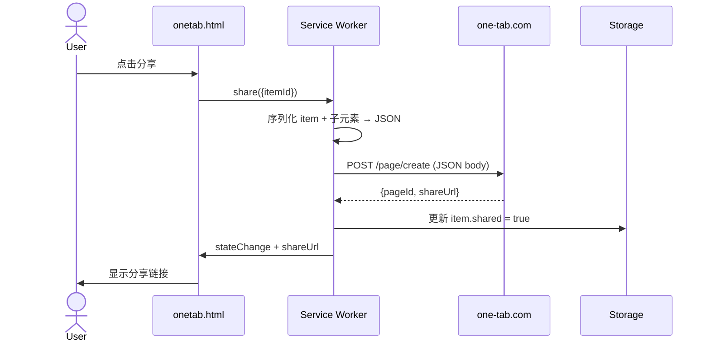
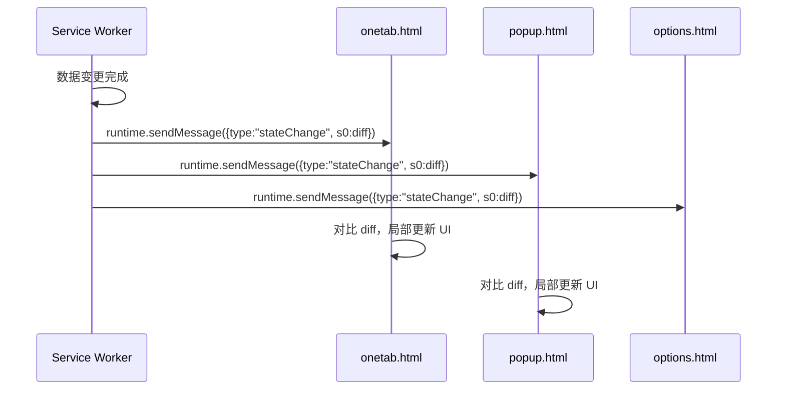

# OneTab v2.18 — 数据流文档 (DATA_FLOW)

## 一、核心数据流概览

## 二、存储标签页流程（Send Tabs to OneTab）

这是最核心的流程。支持多种触发方式：工具栏图标点击、右键菜单、键盘快捷键、地址栏 `11` 关键词。

### 2.1 URL 规范化

存储前对 URL 进行规范化处理：
- 去除 `about:reader?url=` 前缀，提取原始 URL
- 统一 `http://` → `https://`
- 截断 `www.` 前缀用于域名匹配
- 对 Google Docs 特殊域名（sheets/document/presentation/forms/drawings）做分类标记

### 2.2 Favicon 获取

使用 `chrome.favicon` 权限获取 favicon，通过 `Image` 对象加载后转为 base64 PNG data URL（32x32 canvas 绘制）。

## 三、恢复标签页流程（Restore Tabs）

### 3.1 恢复策略

- **单个 Tab**: `chrome.tabs.create({url})`
- **Window Group**: 在新窗口（或当前窗口）中批量创建标签页
- **Tab Group**: 创建标签页后调用 `chrome.tabs.group({tabIds, groupId})` 分组
- **Folder 中的 Tab**: 展平所有子文件夹，收集所有 Tab 后统一恢复

### 3.2 恢复后行为

- 可配置自动移至回收站（`autoActionOnOpen: "trash"`）
- 可配置丢弃非活跃标签页（`discardNonActiveTabOnOpen: true`）
- 可配置切换到新打开的标签页（`switchToOpenedTab: true`）

## 四、拖拽重组流程（Move / Reorganize）

### 4.1 智能移动规则

代码中包含复杂的"智能移动"逻辑（`_n` 函数），处理以下场景：
- Tab 移入 Folder —— 直接添加
- Tab 移入 TabGroup —— 保持 tab/group 类型一致
- Folder 移入 Folder —— 嵌套分组
- Window 组展开为 Tab 移入 TabGroup —— 需要先展平
- Tab 移入 trash —— 标记删除

### 4.2 拖放目标验证

移动操作会验证：
1. 源和目标类型是否兼容
2. 是否会导致循环引用（folder 不能移入自己的子节点）
3. 混合类型拖拽时自动分离

## 五、分享与云同步流程

### 5.1 分享内容

- 默认 30 天过期
- 可配置包含笔记和评分
- 使用 `crypto.getRandomValues` 生成 22 字符 base64url ID
- URL 格式: `https://www.one-tab.com/page/{pageId}`

### 5.2 同步机制

- 在线时自动同步未提交的变更（`uncommittedChangesStore`）
- 离线时变更排队，联网后自动推送
- 定期清理 14 天前的未提交变更记录
- 版本不匹配时通过 `corePing()` 检测并要求重载

## 六、导入导出流程

### 6.1 导入支持格式

1. **OneTab 自有格式** — 通过解析 HTML `<a>` 标签列表
2. **纯文本 URL 列表** — 每行一个 URL，支持 `URL | Title` 格式
3. **Chrome 书签** — 通过 `chrome.bookmarks.getTree()`（需要 optional 权限）
4. **Chrome 阅读列表** — 通过 `chrome.readingList.query()`（需要 optional 权限）

### 6.2 导入解析策略

代码中实现了三级解析策略：
1. 尝试从 `<a>` 标签提取链接（最可靠）
2. 尝试每行 `URL | Title` 格式正则匹配
3. 尝试从纯文本段落提取 URL 正则匹配

### 6.3 导出格式

- **Rich Text** — 带链接和样式的 HTML（默认，用于粘贴到 Word/Google Docs）
- **Plain Text** — `URL | Title` 格式的纯文本列表
- 使用 `navigator.clipboard.write` 写入剪贴板

## 七、State Change 广播机制

各页面注册 `stateChange` 监听器，收到广播后进行增量 UI 更新，避免了轮询和全量刷新。

## 八、内容脚本通信

### 8.1 页面注入 Content Script

通过 `chrome.scripting.registerContentScripts` 动态注册内容脚本到用户页面，用于：
- 监听键盘快捷键（在非扩展页面中）
- 通过 `runtime.onMessage` 接收 `getLinks` 命令，提取当前页面 `<a>` 标签链接列表

### 8.2 one-tab.com Content Script

注入到 `https://www.one-tab.com/*` 的页面，用于：
- 检测用户是否在查看分享页面
- 提供"添加到我的 OneTab"按钮的交互
