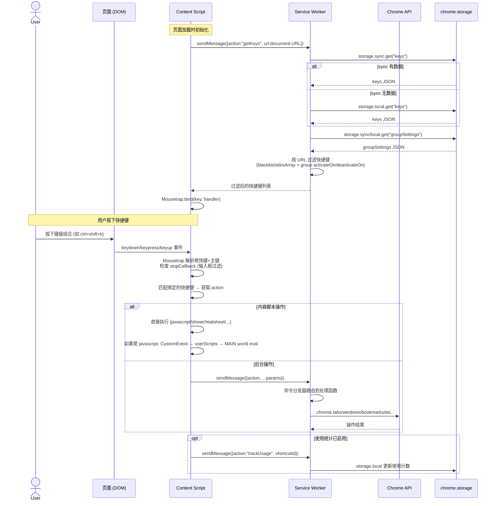
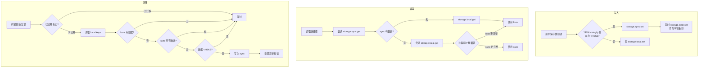
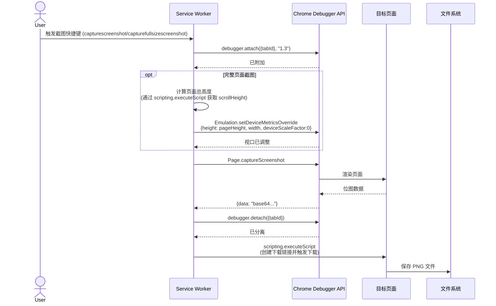
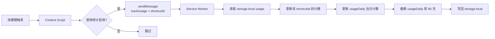
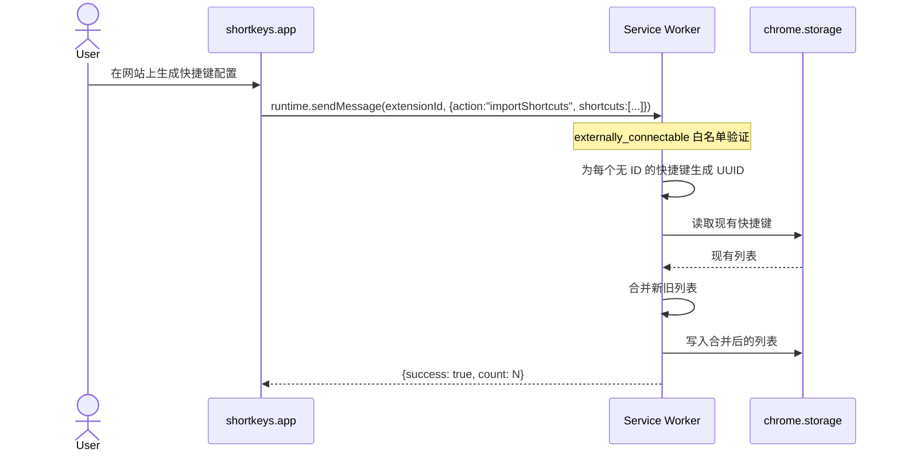
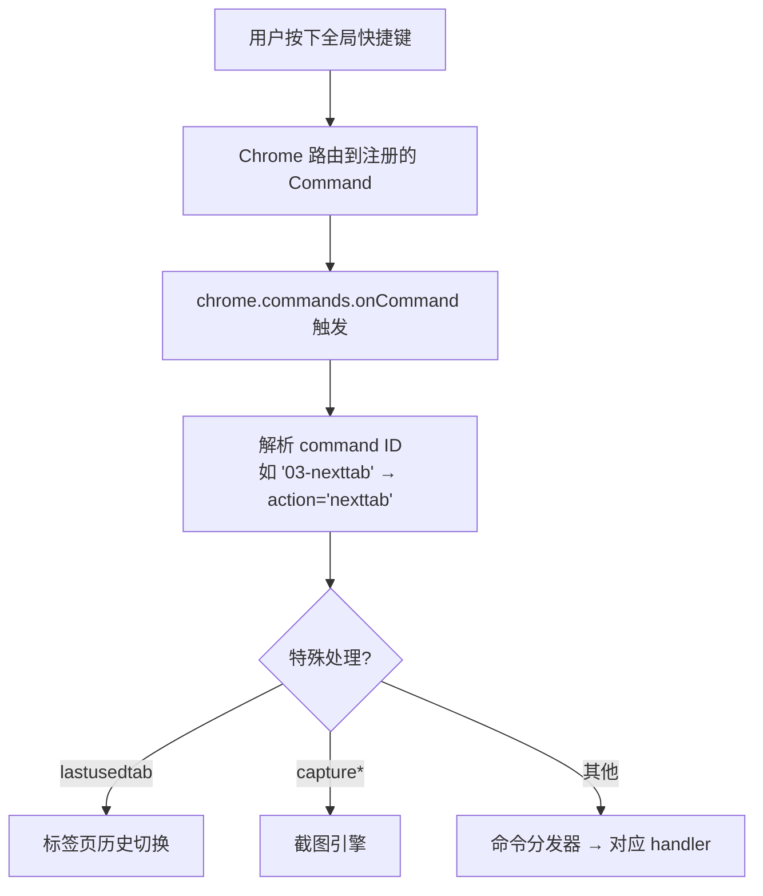

# Shortkeys v5.0.1 — 数据流文档

## 1. 快捷键激活完整流程



## 2. 存储读写流程



## 3. 截图流程 (使用 chrome.debugger)



## 4. JavaScript 执行流程 (userScripts 桥接)

```mermaid
flowchart TD
    subgraph 初始化
        A[Service Worker 启动] --> B{chrome.userScripts API 可用?}
        B -->|是| C[读取所有 action=javascript 的快捷键]
        B -->|否| D[跳过 userScripts 注册]
        C --> E[构造 handlers 对象<br/>{shortcutId: function(){...}}]
        E --> F[注册/更新 userScripts<br/>id='shortkeys-actions'<br/>world='MAIN']
    end

    subgraph 运行时
        G[用户按下 JavaScript 快捷键] --> H[Content Script 接收]
        H --> I[document.dispatchEvent<br/>CustomEvent('shortkeys_js_run')<br/>detail = shortcutId]
        I --> J[userScript 监听器捕获]
        J --> K[handlers[shortcutId]() 执行]
        K --> L[用户代码在 MAIN world 运行]
    end
```

## 5. 宏执行流程

```mermaid
flowchart TD
    A[触发宏快捷键] --> B[读取 macroSteps 数组]
    B --> C[取前 10 步]
    C --> D{遍历每一步}

    D --> E{step.delay > 0?}
    E -->|是| F[setTimeout 等待 delay ms]

    D --> G{step.action 类型}
    G -->|javascript| H[scripting.executeScript<br/>new Function(code)() 在页面执行]
    G -->|内容脚本操作| I[tabs.sendMessage 到 Content Script]
    G -->|后台操作| J[调用对应的 action handler]

    H --> K{还有下一步?}
    I --> K
    J --> K
    K -->|是| D
    K -->|否| L[宏执行完成]
```

## 6. 使用统计数据流



## 7. 外部导入流程



## 8. Chrome Commands API 流程



## 关键数据格式

### 快捷键 JSON (存储格式)

```json
[
  {
    "id": "550e8400-e29b-41d4-a716-446655440000",
    "key": "ctrl+shift+k",
    "action": "newtab",
    "label": "新标签页",
    "enabled": true,
    "activeInInputs": false,
    "group": "我的快捷键",
    "blacklist": "false",
    "sitesArray": ["*github.com*"]
  }
]
```

### 分组设置 (存储格式)

```json
{
  "我的快捷键": {
    "activateOn": "*github.com*\n*stackoverflow.com*",
    "deactivateOn": ""
  }
}
```

### 使用统计 (存储格式)

```json
{
  "usage": {
    "shortcut-id-1": { "count": 42, "firstUsed": 1700000000000, "lastUsed": 1700100000000 }
  },
  "usageDaily": [
    { "date": "2024-11-15", "counts": { "shortcut-id-1": 5 } }
  ]
}
```
