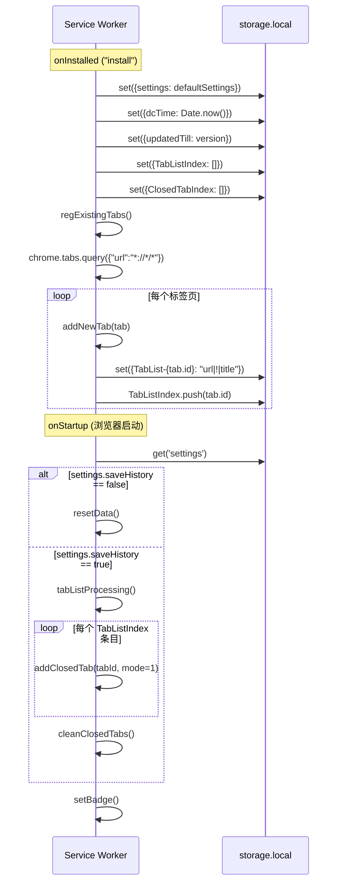
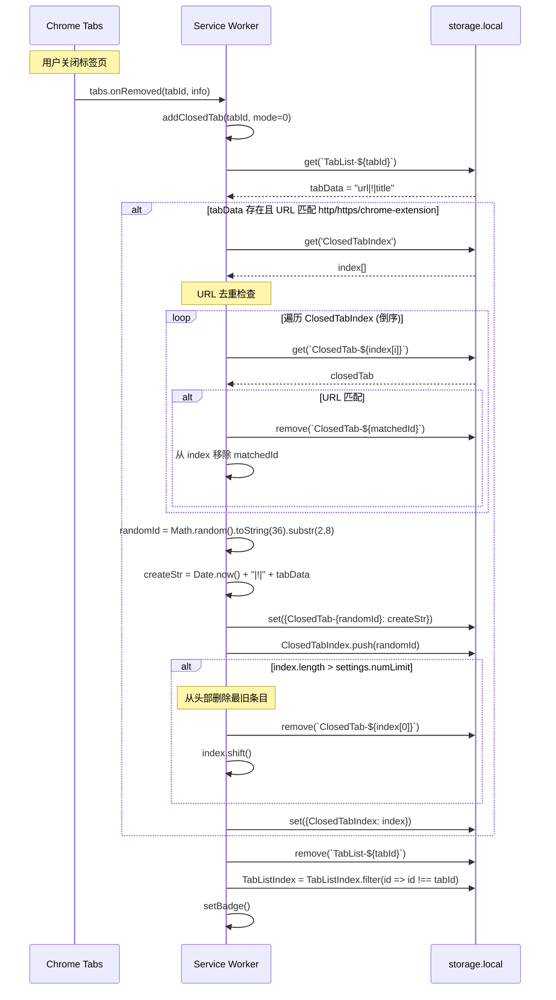
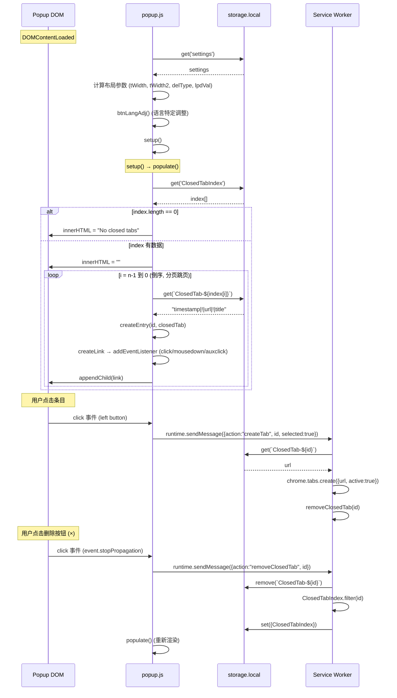
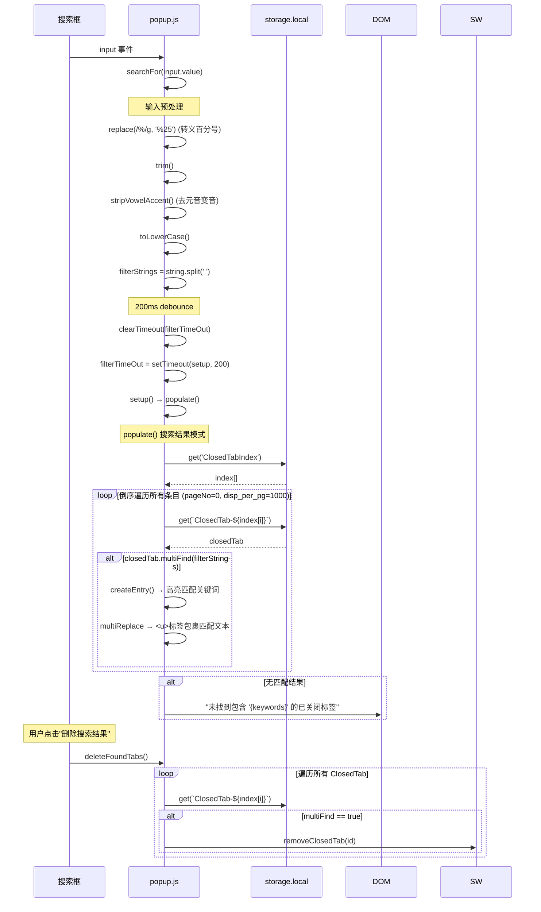
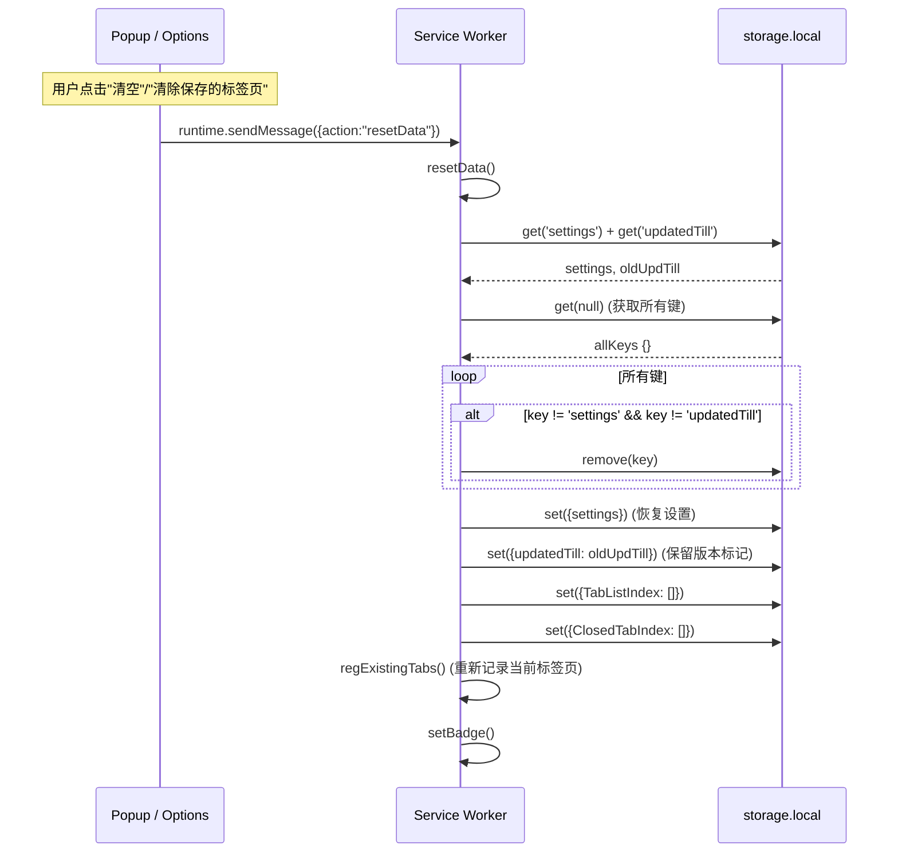
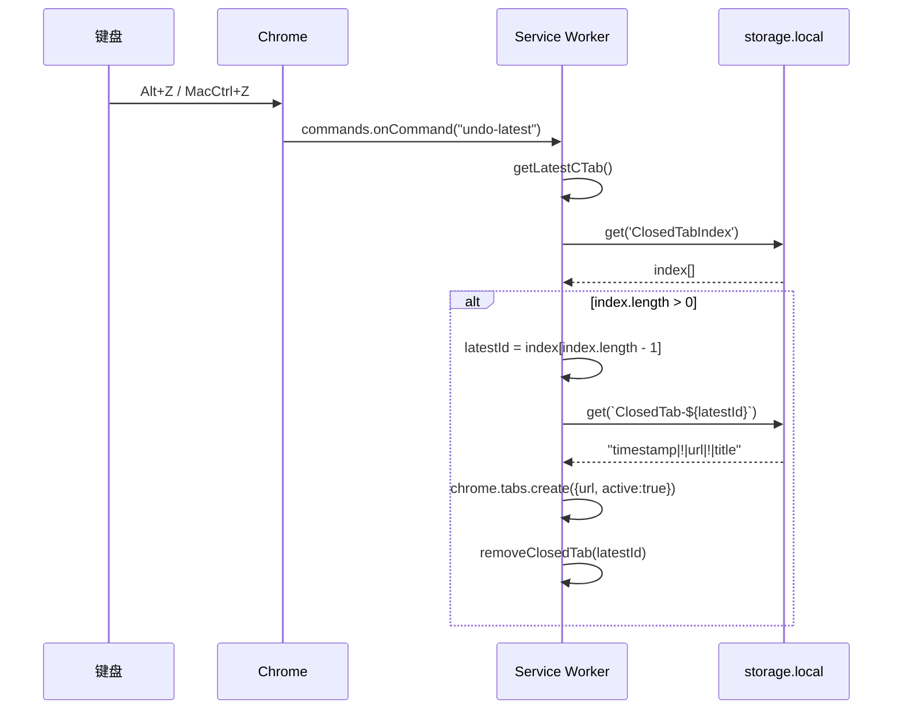
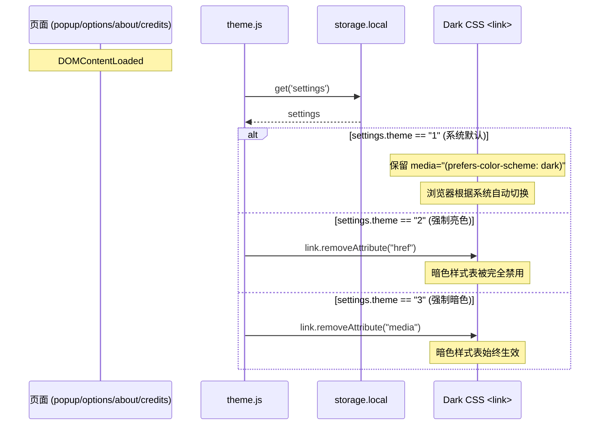

# SimpleUndoClose v3.0.1 — 数据流文档

> 基于 v3.0.1 源码逆向分析

## 一、总览

SimpleUndoClose 的数据流围绕以下核心实体展开：
1. **TabList** — 当前打开标签页的快照 (追踪中)
2. **ClosedTab** — 已关闭标签页的快照 (待恢复)
3. **Settings** — 用户偏好配置 (持久化于 `storage.local`)
4. **Indexes** — 维护插入顺序的索引数组

```mermaid
graph TD
    subgraph "浏览器标签页事件"
        TC[tabs.onCreated]
        TU[tabs.onUpdated]
        TR[tabs.onRemoved]
    end

    subgraph "chrome.storage.local"
        S[settings]
        TLI[TabListIndex]
        CLI[ClosedTabIndex]
        TL[TabList-{tabId}]
        CL[ClosedTab-{randomId}]
    end

    subgraph "Service Worker (background.js)"
        INI[initialize]
        AT[addNewTab]
        ACT[addClosedTab]
        RESET[resetData]
        CLEAN[cleanClosedTabs]
        BADGE[setBadge]
    end

    subgraph "Popup UI (popup.html + popup.js)"
        POP[populate 渲染]
        SRCH[searchFor 搜索]
        CTA[createTab]
        RCTA[removeClosedTab]
    end

    subgraph "Options UI (options.html + options.js)"
        SAVE[save 持久化]
        CLEAR[clearMemory]
    end

    subgraph "外部"
        CMD[快捷键 Alt+Z]
    end

    TC --> AT
    TU --> AT
    TR --> ACT
    AT --> TL
    AT --> TLI
    ACT --> CL
    ACT --> CLI
    ACT --> BADGE
    INI --> S
    INI --> TLI
    INI --> CLI
    POP --> CLI
    POP --> CL
    CTA -->|runtime.sendMessage| ACT
    RCTA -->|runtime.sendMessage| ACT
    SRCH --> POP
    SAVE --> S
    CLEAR -->|runtime.sendMessage| RESET
    RESET --> TLI
    RESET --> CLI
    RESET --> TL
    RESET --> CL
    CLEAN --> CL
    CMD -->|onCommand| ACT
```

## 二、扩展初始化流



## 三、标签页关闭与记录流



## 四、Popup 渲染与交互流



## 五、搜索流



## 六、设置持久化流

```mermaid
sequenceDiagram
    participant UI as Options Page
    participant OPT as options.js
    participant SL as storage.local
    participant SW as Service Worker

    Note over UI: 用户更改任意设置
    UI->>OPT: input/click 事件
    OPT->>OPT: 读取当前所有控件值
    OPT->>OPT: 组装 settings 对象
    OPT->>SL: set({settings})

    Note over OPT: 溢出修剪
    OPT->>SL: get('ClosedTabIndex')
    SL-->>OPT: index[]
    alt index.length > settings.numLimit
        OPT->>OPT: trimTabs(settings.numLimit)
        loop index[0..n] 旧条目
            OPT->>SL: remove(`ClosedTab-${id}`)
            OPT->>OPT: index.shift()
        end
        OPT->>SL: set({ClosedTabIndex: index})
    end

    OPT->>SW: runtime.sendMessage({action:"setBadge"})
    SW->>SW: setBadge()

    OPT->>SW: runtime.sendMessage({action:"updateIcon"})
    SW->>SW: updateIcon()

    Note over UI: 主题设置改变
    UI->>OPT: theme radio click
    OPT->>SL: set({settings})
    OPT->>OPT: location.reload() (立即生效)
```

## 七、数据重置流



## 八、快捷键恢复流



## 九、主题流



## 十、全局状态管理

| 变量 | 位置 | 说明 |
|------|------|------|
| `defaultSettings` (const) | background.js | 默认设置的模板对象，用于初始化 + 键合并 |
| `settings` (let) | popup.js, options.js | 从 storage 加载后的内存缓存 |
| `pageNo` (let) | popup.js | 当前分页页码 (0 起始) |
| `filterStrings` (let) | popup.js | 当前搜索关键词数组 (null = 无搜索) |
| `longpress` (let) | popup.js | 是否处于长按批量选择模式 |
| `chkArray` (let) | popup.js | 长按模式下选中的 ClosedTab ID 列表 |
| `delType` (let) | popup.js | 缓存自 settings.style 的删除按钮样式 |
| `lpdVal` (let) | popup.js | 缓存自 settings.lpDelay * 1000 的长按延迟 (ms) |
| `selLink` (let) | popup.js | 键盘导航时当前选中的链接索引 |
| `filterTimeOut` (let) | popup.js | 搜索 debounce 定时器 ID |
