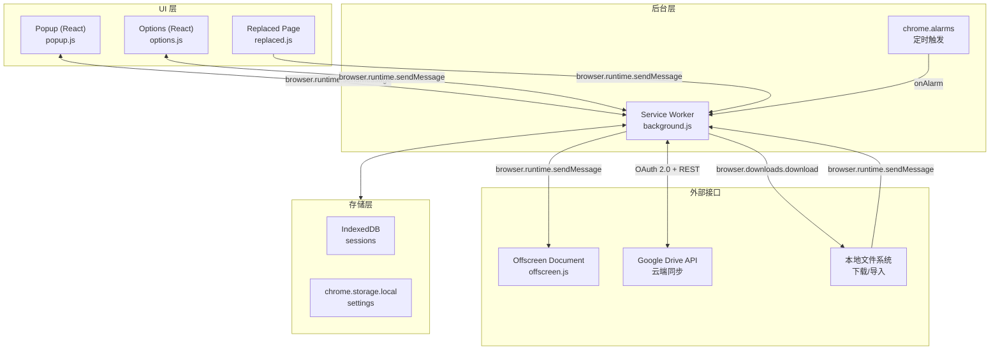
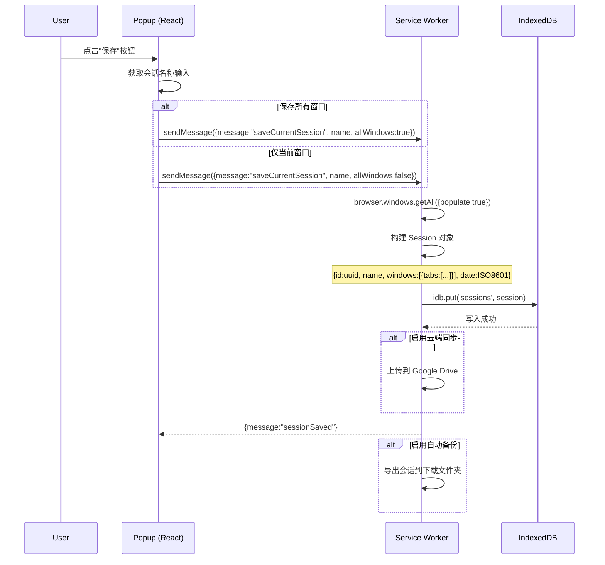
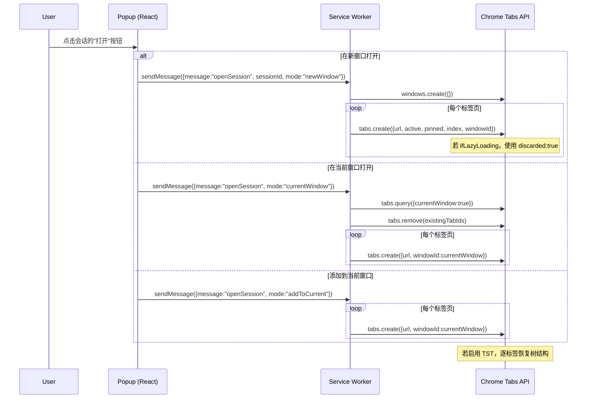
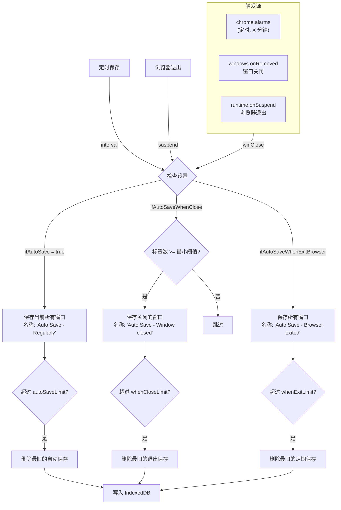
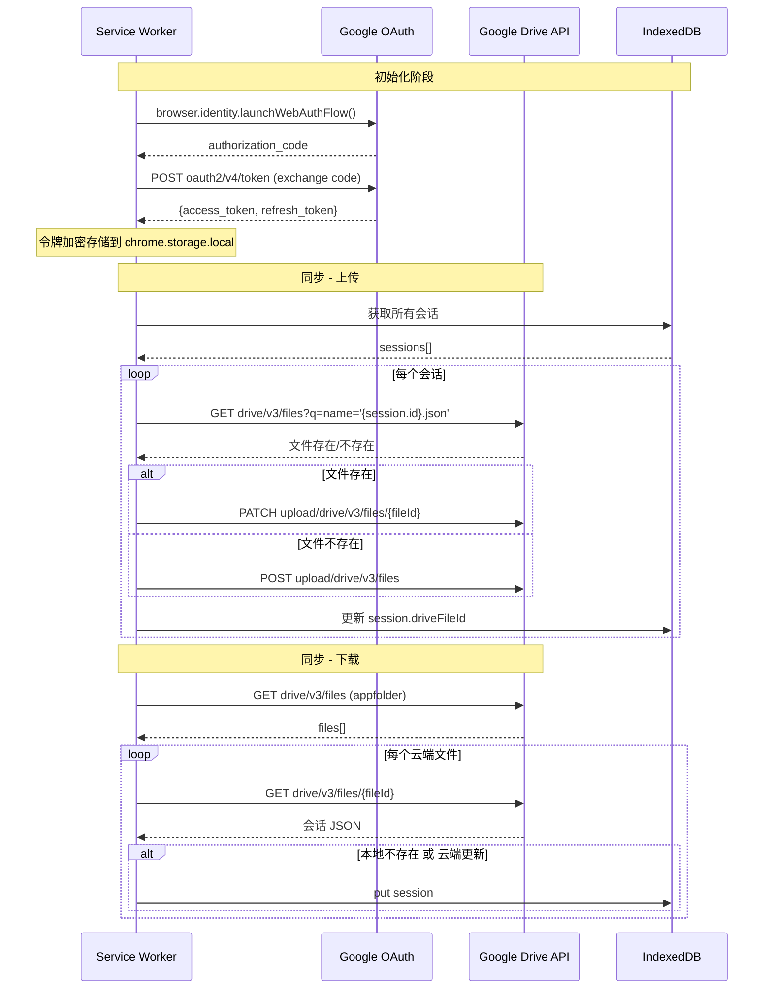
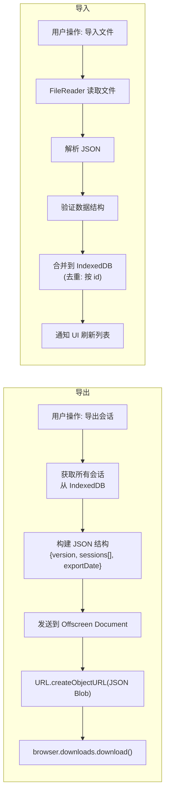
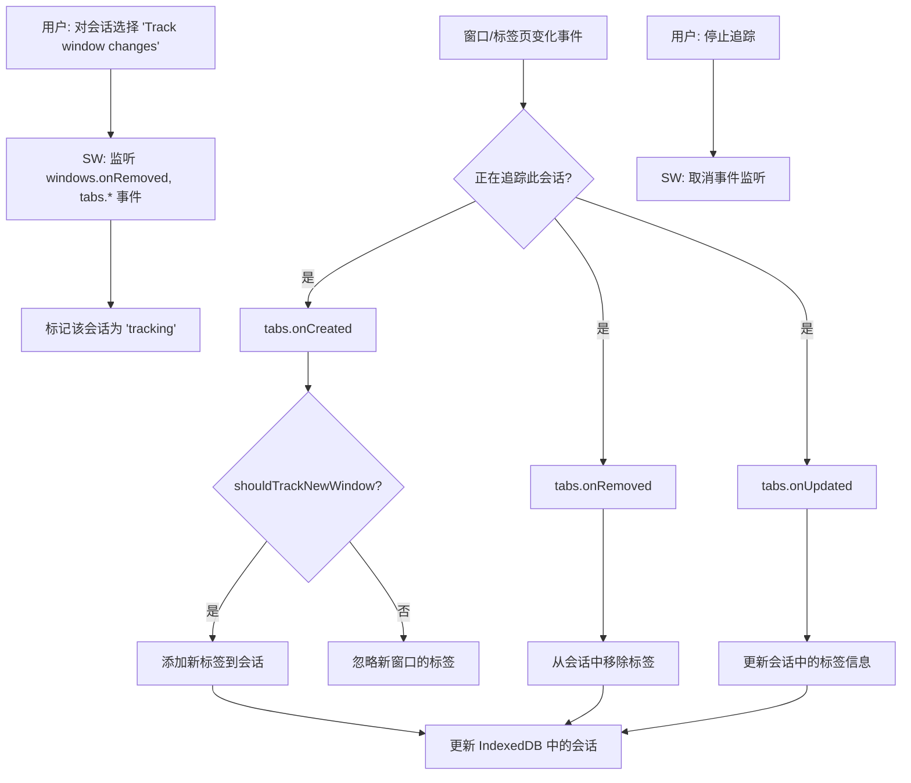

# Tab Session Manager v7.3.0 — 数据流文档

## 一、组件通信概览

## 二、核心业务流程

### 2.1 保存会话

### 2.2 恢复会话

### 2.3 自动保存流程

### 2.4 云端同步 (Google Drive)

### 2.5 会话导出/导入

### 2.6 会话追踪 (Tracking)

## 三、消息类型完整列表

| 消息类型 | 发送方 | 接收方 | 说明 |
|----------|--------|--------|------|
| `saveCurrentSession` | Popup/快捷键 | SW | 保存当前会话 |
| `requestAllSessions` | Popup/Options | SW | 请求所有会话列表 |
| `responseAllSessions` | SW | Popup/Options | 返回所有会话 |
| `deleteSession` | Popup | SW | 删除指定会话 |
| `updateSession` | Popup | SW | 更新会话 (重命名、加标签) |
| `getCurrentSession` | Popup | SW | 获取当前浏览器状态 |
| `backupAllSessions` | Options | SW | 触发全量备份 |
| `compressAllSessions` | Options | SW | 压缩所有会话的 favicon |
| `updateCompressStatus` | SW | Options | 压缩进度通知 |
| `signInGoogle` | Options | SW | 触发 Google 登录 |
| `signOutGoogle` | Options | SW | 触发 Google 登出 |
| `updateSyncStatus` | SW | Options | 同步状态通知 |
| `updateTrackingStatus` | SW | Popup | 追踪状态通知 |
| `updateUndoStatus` | SW | Popup/Options | 撤销状态更新 |
| `applyDeviceName` | Options | SW | 批量添加设备名称标签 |
| `importSessions` | Options | SW | 导入会话数据 |
| `exportSessions` | Options | SW | 导出所有会话 |
| `deleteAllSessions` | Options | SW | 删除所有会话 |
| `migrateSessionsFromStorage` | 启动 | SW | 从旧格式迁移数据 |
| `offscreen_createObjectUrl` | SW | Offscreen | 创建下载 Blob URL |
| `offscreen_revokeObjectUrl` | SW | Offscreen | 释放 Blob URL |
