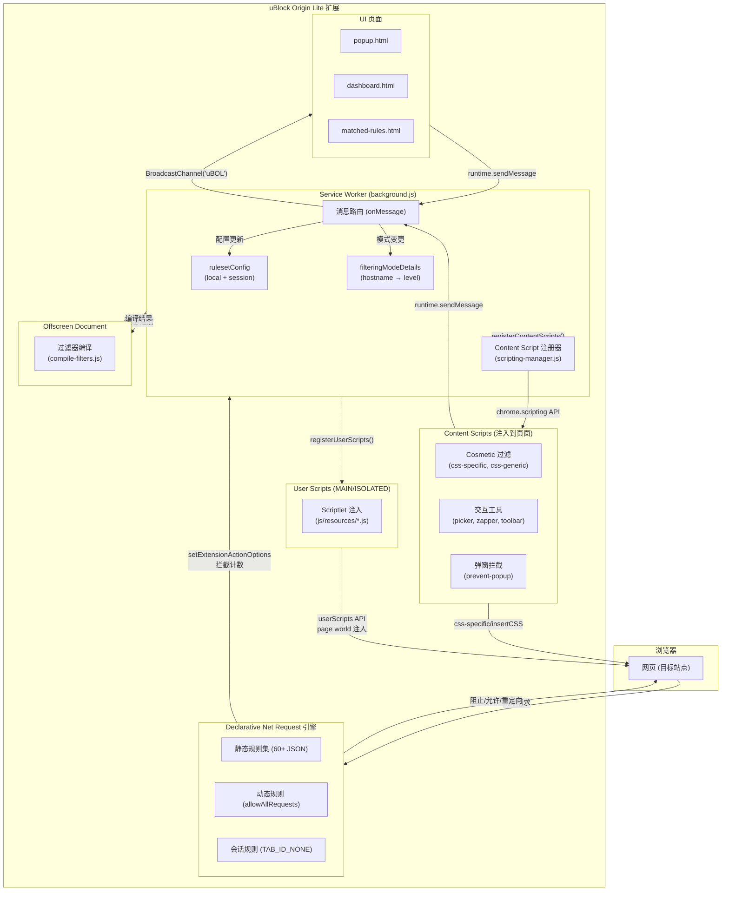
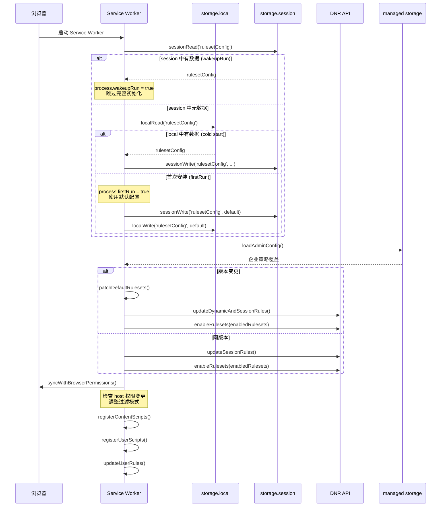
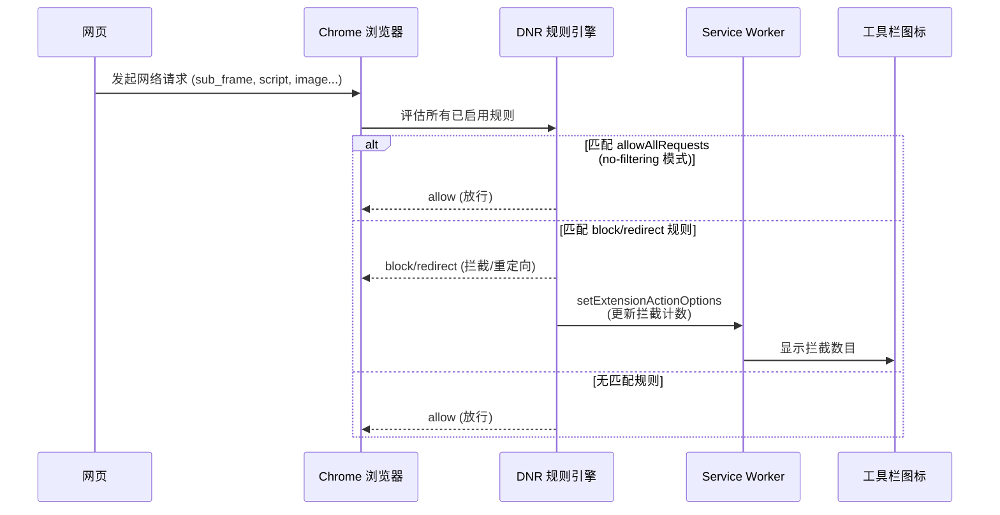
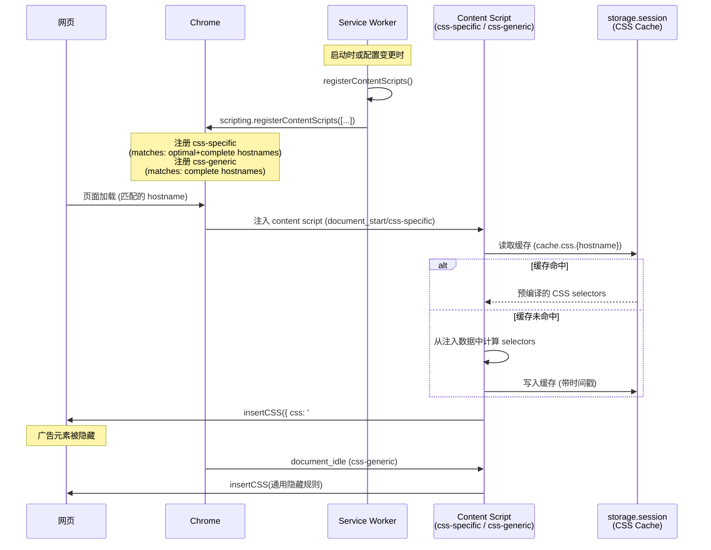
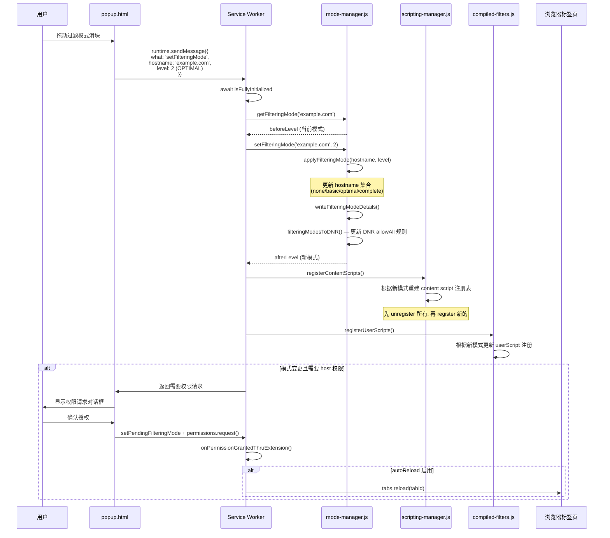
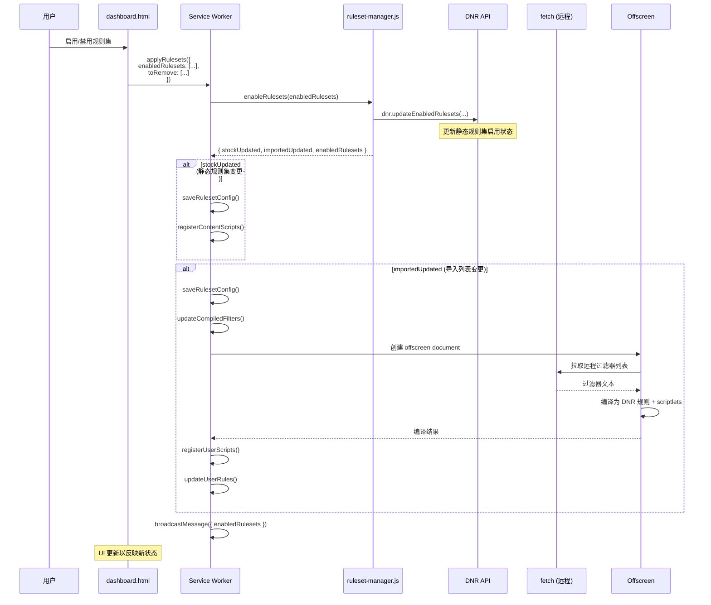
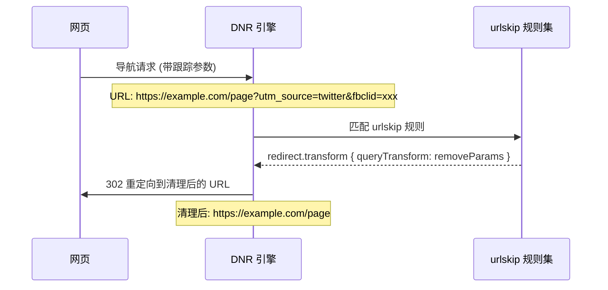

# uBlock Origin Lite — 数据流文档

> **版本:** 2026.628.2035 | **逆向日期:** 2026-07-06 | **模型:** dsv4

---

## 一、整体数据流概览



---

## 二、核心数据流详解

### 2.1 启动流程 (Cold Start / Wakeup)



### 2.2 网络请求过滤流程



**规则优先级体系:**
```
优先级从高到低:
1. TRUSTED_DIRECTIVE_PRIORITY (2,000,000) — 管理员强制规则
2. USER_RULES_PRIORITY (1,000,000)     — 用户自定义规则
3. STRICTBLOCK_PRIORITY (29)           — 严格拦截规则
4. 规则集内默认优先级 (1-28)             — 标准过滤规则
```

**规则类型:**
- **静态规则** (`dnr.updateStaticRules`): 打包在扩展内的预编译规则, 随扩展更新
- **动态规则** (`dnr.updateDynamicRules`): 运行时添加, 跨会话持久化 (allowAllRequests 豁免)
- **会话规则** (`dnr.updateSessionRules`): 运行时添加, 仅当前会话有效 (TAB_ID_NONE 豁免)
- **用户规则** (`updateUserRules`): 用户通过过滤器编辑器创建的自定义 DNR 规则

### 2.3 Cosmetic 过滤流程 (CSS 隐藏)



**CSS 注入优化:**
- `css-specific` (document_start): 针对特定站点的规则, 尽早注入以避免闪烁
- `css-generic` (document_idle): 通用规则, 延迟注入以优化性能
- `cache.css.*` 缓存: session storage 缓存, 上限 ~288 条目, LRU 淘汰

### 2.4 Scriptlet 注入流程

```mermaid
sequenceDiagram
    participant SW as Service Worker
    participant Offscreen as Offscreen Document
    participant Chrome as Chrome
    participant Page as 网页
    participant US as User Script (MAIN world)

    Note over SW: 配置变更触发
    SW->>Offscreen: 创建 offscreen document
    Offscreen->>Offscreen: 编译过滤器列表
    Offscreen-->>SW: compileFilters:result<br/>(scriptlets JSON)

    SW->>Chrome: userScripts.register([...])
    Note over Chrome: 注册到指定 hostname<br/>world: MAIN 或 ISOLATED

    Page->>Chrome: 页面加载 (匹配的 hostname)
    Chrome->>US: 注入 scriptlet (MAIN world)
    Note over US: 访问页面全局作用域<br/>拦截/修改 JS API

    alt Scriptlet 类型: set-constant
        US->>Page: Object.defineProperty(window, 'apiKey', ...)
    alt Scriptlet 类型: json-prune
        US->>Page: JSON.parse = modifiedParse
    alt Scriptlet 类型: prevent-fetch
        US->>Page: window.fetch = blockedFetch
    end
```

**Scriptlet 安全隔离:**
- **MAIN world:** 脚本可与页面 JS 交互 (继承 `userScripts` 权限), 用于需要修改页面全局对象的 scriptlet
- **ISOLATED world:** 脚本与页面 JS 隔离 (标准 content script 沙箱), 用于不需要访问页面全局的 scriptlet
- 根据 `scriptlet-details.json` 中每个规则集的 `world` 属性决定注入到哪个 world

### 2.5 过滤模式切换流程 (用户交互)



### 2.6 Element Picker / Zapper 工作流

```mermaid
sequenceDiagram
    participant User as 用户
    participant Page as 网页
    participant CS as Content Script<br/>(tool-overlay + picker/zapper)
    participant SW as Service Worker
    participant CM as filter-manager.js

    User->>SW: 点击工具栏按钮 → enter-picker-mode
    SW->>Page: scripting.executeScript(<br/>  ['tool-overlay.js', 'picker.js'])

    CS->>Page: 注入选择器覆盖层 UI

    User->>Page: 悬停/点击页面元素
    Page->>CS: 识别被选元素的 CSS selector

    User->>CS: 确认创建过滤规则
    CS->>SW: runtime.sendMessage({<br/>  what: 'addCustomFilters',<br/>  hostname: 'example.com',<br/>  selectors: ['##.ad-banner']<br/>})

    SW->>CM: addCustomFilters(hostname, selectors)
    CM->>CM: 存储到 local storage

    alt selector 是普通 CSS
        SW->>SW: registerContentScripts()
    alt selector 是 scriptlet ('+js(...)')
        SW->>SW: updateCompiledFilters()
        SW->>SW: registerUserScripts()
    end

    SW-->>CS: 返回成功

    Note over Page: 被选元素立即被隐藏
```

### 2.7 规则集数据流 (导入/启用/禁用)



---

## 三、存储数据流

### 3.1 双存储策略

```
         ┌─────────────────────┐
         │  storage.local       │ ← 持久化 (跨浏览器会话)
         │  (永久配置、过滤器)    │
         └──────┬──────────────┘
                │ 读取/写入
         ┌──────▼──────────────┐
         │  storage.session     │ ← 会话级 (跨 Service Worker 唤醒)
         │  (CSS 缓存、配置缓存)  │
         └─────────────────────┘
```

**存储键读写模式:**

| 键 | local | session | 读频率 | 写频率 | 用途 |
|----|:-----:|:-------:|:------:|:------:|------|
| `rulesetConfig` | 持久 | 缓存 | 高 | 低 | 扩展配置 |
| `filteringModeDetails` | 持久 | 缓存 | 高 | 中 | 过滤模式主机名映射 |
| `customFilters` | 持久 | — | 低 | 低 | 用户自定义过滤规则 |
| `importedLists` | 持久 | — | 低 | 低 | 导入的第三方列表 |
| `permissions.hostnames` | 持久 | — | 低 | 低 | 已授予的主机权限 |
| `cache.css.*` | — | 缓存 | 高 | 高 | 编译后的 CSS 选择器 |
| `admin.*` | 缓存 | 缓存 | 低 | 极低 | 企业策略缓存 |
| `goodStart` | 持久 | — | 极低 | 极低 | 启动健康哨兵 |

### 3.2 CSS 缓存数据流

```
写入路径:
  Content Script → 计算 selectors → sessionWrite('cache.css.{hostname}', {t: now, ...})
  
读取路径:
  Content Script → sessionRead('cache.css.{hostname}') → 命中直接使用
                                                      → 未命中重新计算

淘汰策略:
  Service Worker → sessionKeys() → 筛选 'cache.css.*' 
                 → 按时间戳 t 排序 → 删除最旧的条目
                 → 触发: 超过 256 (低水位) 条目时
                 → 淘汰至 256 以下
```

### 3.3 管理员配置覆盖流

```mermaid
flowchart LR
    Admin[管理员策略<br/>storage.managed] -->|adminReadEx| Cache[admin.* 缓存<br/>(session + local)]
    Cache -->|变更检测 (JSON diff)| Debounce[127ms 防抖]
    Debounce -->|defaultFiltering| Mode[覆盖默认过滤模式]
    Debounce -->|rulesets| RM[覆盖规则集启用/禁用]
    Debounce -->|noFiltering| Mode2[添加不拦截域名]
    Debounce -->|strictBlockMode| SW[设置严格拦截]
    Debounce -->|popupBlockMode| SW2[设置弹窗拦截]
    Debounce -->|showBlockedCount| Badge[设置徽标显示]
    Debounce -->|disabledFeatures| UI[隐藏 UI 功能]
```

---

## 四、消息通信协议

### 4.1 Service Worker 消息接口 (完整)

| 消息类型 (what) | 方向 | 关键参数 | 返回值 |
|---|---|---|---|
| `insertCSS` | CS→SW | `css`, `tabId`, `frameId` | void |
| `removeCSS` | CS→SW | `css`, `tabId`, `frameId` | void |
| `injectCSSProceduralAPI` | CS→SW | `tabId`, `frameId` | void |
| `toggleToolbarIcon` | CS→SW | `tabId` | void |
| `startCustomFilters` | CS→SW | `tabId`, `frameId` | void |
| `terminateCustomFilters` | CS→SW | `tabId`, `frameId` | void |
| `injectCustomFilters` | CS→SW | `tabId`, `frameId`, `hostname` | void |
| `applyRulesets` | UI→SW | `enabledRulesets[]`, `toRemove[]` | void |
| `getDefaultConfig` | UI→SW | — | DefaultConfig |
| `getCurrentConfig` | UI→SW | — | RulesetConfig |
| `getOptionsPageData` | UI→SW | — | OptionsPageData |
| `popupPanelData` | UI→SW | `hostname` | PopupPanelData |
| `getFilteringMode` | UI→SW | `hostname` | FilteringLevel |
| `setFilteringMode` | UI→SW | `hostname`, `level` | FilteringLevel |
| `setDefaultFilteringMode` | UI→SW | `level` | FilteringLevel |
| `getFilteringModeDetails` | UI→SW | — | FilteringModeDetails |
| `setFilteringModeDetails` | UI→SW | `modes` | FilteringModeDetails |
| `addCustomFilters` | UI/CS→SW | `hostname`, `selectors[]` | void |
| `removeCustomFilters` | UI→SW | `hostname`, `selectors[]` | void |
| `removeAllCustomFilters` | UI→SW | `hostname` | void |
| `getAllCustomFilters` | UI→SW | — | CustomFiltersMap |
| `getSandboxFilters` | UI→SW | — | string |
| `setSandboxFilters` | UI→SW | `text` | void |
| `importFilterList` | UI→SW | `url` | void |
| `getImportedLists` | UI→SW | — | ImportedList[] |
| `updateImportedLists` | UI→SW | — | number |
| `getMatchedRules` | UI→SW | `tabId` | MatchedRule[] |
| `getAllDynamicRules` | UI→SW | — | DNRRule[] |
| `getAllSessionRules` | UI→SW | — | DNRRule[] |
| `getEffectiveUserRules` | UI→SW | — | DNRRule[] |
| `updateUserDnrRules` | UI→SW | — | void |
| `hasBroadHostPermissions` | UI→SW | — | boolean |
| `setAutoReload` | UI→SW | `state` | void |
| `setShowBlockedCount` | UI→SW | `state` | void |
| `setStrictBlockMode` | UI→SW | `state` | void |
| `setPopupBlockMode` | UI→SW | `state` | void |
| `setDeveloperMode` | UI→SW | `state` | boolean |
| `gotoURL` | UI→SW | `url`, `type` | void |
| `excludeFromStrictBlock` | UI→SW | `hostname`, `permanent` | void |
| `showMatchedRules` | UI→SW | `tabId` | void |
| `getRegisteredContentScripts` | UI→SW | — | string[] |
| `getConsoleOutput` | UI→SW | — | string |
| `pruneCSSCache` | UI→SW | — | void |
| `keepAlive` | UI→SW | — | void |

### 4.2 BroadcastChannel 事件

```
Channel: 'uBOL'

消息类型:
  { enabledRulesets: string[] }       — 规则集启用状态变更
  { autoReload: boolean }             — 自动重载设置变更
  { showBlockedCount: boolean }       — 徽标显示设置变更
  { strictBlockMode: boolean }        — 严格拦截模式变更
  { popupBlockMode: boolean }         — 弹窗拦截模式变更
  { developerMode: boolean }          — 开发者模式变更
  { defaultFilteringMode: number }    — 默认过滤模式变更
  { filteringModeDetails: object }    — 过滤模式详情变更
  { hasOmnipotence: boolean }         — 广泛权限状态变更
```

### 4.3 Offscreen Document 消息协议

```
Channel: runtime.onMessage (同 Service Worker 消息通道)

消息类型:
  compileFilters:getResourceTypes    — Offscreen → SW: 获取 DNR ResourceType 枚举
  compileFilters:getUserList         — Offscreen → SW: 获取用户自定义过滤器
  compileFilters:getEnabledImportedLists — Offscreen → SW: 获取启用的导入列表
  compileFilters:result              — Offscreen → SW: 返回编译结果
  compileFilters:getImportedListData — Offscreen → SW: 获取导入列表编译数据
```

---

## 五、URL Skip (跟踪参数剥离) 流程



URL skip 规则通过 DNR 的 `redirect.transform` 动作实现, 规则集存储在 `rulesets/urlskip/` 目录, 在 Session 启动时通过 `updateSessionRules()` 注册。

---

## 六、错误恢复与弹性

### 6.1 Service Worker 崩溃恢复

```
start() 失败
  → 检查 process.wakeupRun (是否是唤醒运行)
  → 是: 放弃 (避免重启循环)
  → 否: 检查 local.goodStart
    → goodStart === false: 上次重启失败, 放弃
    → goodStart !== false: 写入 false, runtime.reload()
```

### 6.2 权限撤销处理

```
permissions.onRemoved 触发
  → onPermissionsRemoved()
  → syncWithBrowserPermissions()
    → 如果没有广泛权限但默认模式 > BASIC
      → 降级默认模式到 BASIC
    → 移除不再授权的 hostname 的高级过滤模式
    → 重新注册 content scripts
```

### 6.3 DNR 规则集 ID 冲突处理

`enableRulesets()` 中处理扩展更新后规则集 ID 变化: `patchDefaultRulesets()` 检测过时规则集并替换为新的等价规则集。

---

## 七、性能优化策略

| 策略 | 实现 | 效果 |
|------|------|------|
| CSS 选择器会话缓存 | `cache.css.*` in session storage | 避免重复计算选择器 |
| 惰性初始化 | `isFullyInitialized` 门控 | 事件到达时已完成初始化 |
| 防抖批处理 | 127ms debounce in admin.js | 减少管理员配置变更的重复处理 |
| DNR 规则 diff 比较 | `deepCompare` before update | 避免无变化的 DNR 规则更新 |
| LRU CSS 缓存淘汰 | 256/288 水位线 | 控制 session storage 占用 |
| 串行化异步突变 | `pendingOp = pendingOp.then(...)` | 防止配置读写的竞态条件 |
| BroadcastChannel 广播 | 替代逐个 sendMessage | 减少 N-to-1 消息传递开销 |
