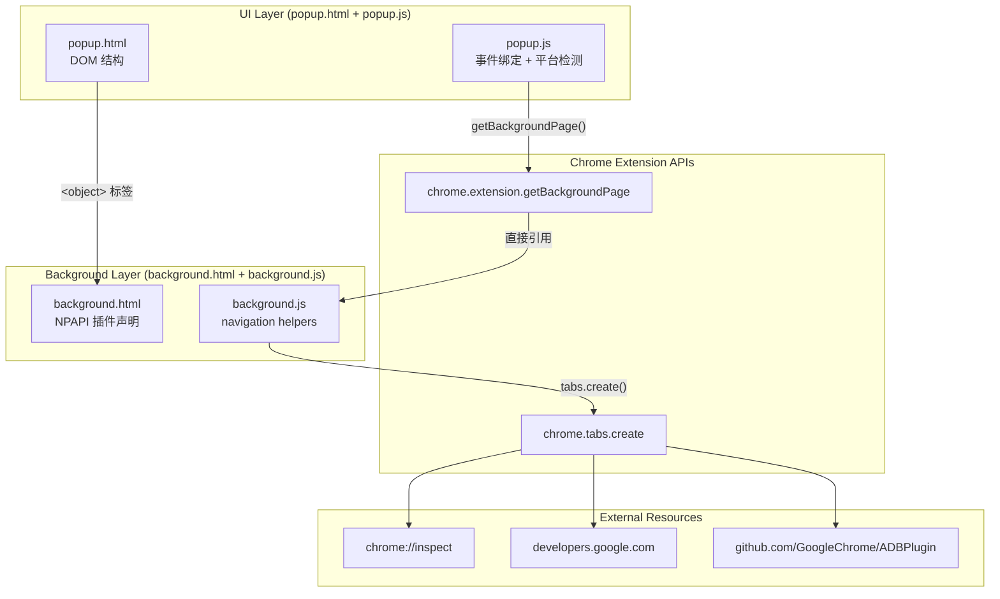

# ADB v0.9.8 — 架构文档

## 1. 项目概述

ADB 是一个 Chrome 扩展（Manifest V2），最初用于通过 NPAPI 插件与 Android 设备通信，实现 Chrome 远程调试。Chrome 45+ 移除 NPAPI 后，该功能已原生集成到 `chrome://inspect`，扩展仅保留导航引导功能。

## 2. 分层架构图



## 3. 模块职责表

| 文件 | 类型 | 职责 | 行数 |
|------|------|------|------|
| `manifest.json` | 配置 | 扩展元数据、入口声明（零权限） | 23 |
| `background.html` | HTML | 加载 NPAPI 插件 object 标签 + 引入 background.js | 12 |
| `background.js` | JS | 暴露 `devices()` / `help()` / `ticket()` 三个导航函数 | 15 |
| `popup.html` | HTML | 弹出窗口 UI（内联 CSS + DOM 结构） | 82 |
| `popup.js` | JS | 平台检测 + DOM 事件绑定 + 调用后台函数 | 35 |

## 4. 技术栈识别

| 维度 | 结论 | 依据 |
|------|------|------|
| **打包工具** | 无 | 无 webpack_require / __webpack_modules__ / parcel / vite / rspack 特征；JS 文件为纯手写代码 |
| **UI 框架** | 无（原生 DOM） | 直接使用 `document.querySelectorAll` / `addEventListener`，无 React/Vue/Angular 特征 |
| **TypeScript** | 否 | 原始 `.js` 文件，无 `.ts` / `tsconfig.json` |
| **模块系统** | 无（全局作用域） | 函数直接挂载在 window 上，通过 `getBackgroundPage()` 访问 |
| **CSS 预处理** | 无（内联 CSS） | 所有样式写在 `popup.html` 的 `<style>` 标签中 |
| **NPAPI 依赖** | `application/x-adbplugin` | 在 `background.html` 中声明，Chrome 45+ 已不可用 |

## 5. 权限清单

| 权限 | 声明方式 | 用途 |
|------|----------|------|
| （无） | — | 该扩展在 manifest.json 中未声明任何 `permissions` 字段 |

该扩展是一个**零权限扩展**，仅使用以下无需声明的 Chrome API：

| API | 调用位置 | 用途 |
|-----|----------|------|
| `chrome.tabs.create` | `background.js` | 创建新标签页导航到指定 URL |
| `chrome.extension.getBackgroundPage` | `popup.js` | 获取后台页面的 window 引用以调用其函数 |

## 6. 入口点分析

### 6.1 Background Page（持久后台页）

- **入口文件**：`background.html`
- **加载方式**：manifest.json 中 `background.page` 声明，扩展安装/启动时自动加载
- **生命周期**：扩展存活期间常驻内存（MV2 persistent background page）
- **核心行为**：
  1. 解析 HTML，尝试加载 `<object type="application/x-adbplugin">` NPAPI 插件（现代 Chrome 中静默失败）
  2. 执行 `background.js`，在全局作用域注册 `devices()` / `help()` / `ticket()` 三个函数

### 6.2 Browser Action Popup

- **入口文件**：`popup.html`
- **加载方式**：用户点击工具栏图标触发（`browser_action.default_popup`）
- **生命周期**：弹出窗口打开时加载，失去焦点后销毁
- **核心行为**：
  1. 执行 `popup.js`，通过 User-Agent 检测操作系统并设置 CSS class
  2. 绑定三个按钮的 click 事件
  3. 点击时通过 `getBackgroundPage()` 调用后台函数，然后 `window.close()` 关闭 popup

### 6.3 图标资源

| 文件 | 尺寸 | 使用场景 |
|------|------|----------|
| `icon_128.png` | 128x128 | Chrome 扩展管理页面 |
| `icon_48.png` | 48x48 | Chrome 扩展管理页面 |
| `on_19.png` | 19x19 | 工具栏图标（默认状态，浏览器操作） |
| `on_38.png` | 38x38 | 工具栏图标（Retina 显示） |
| `off_19.png` | 19x19 | 工具栏图标（离线状态） |
| `off_38.png` | 38x38 | 工具栏图标（离线状态 Retina） |

## 7. 通信模型

扩展内部通信极其简单：popup 通过 `chrome.extension.getBackgroundPage()` 获取后台页面的 `window` 对象引用，直接调用后台 JS 中注册的全局函数。无消息传递（`chrome.runtime.sendMessage`）机制，无 content script。

```
┌──────────┐  getBackgroundPage()  ┌────────────┐  tabs.create()  ┌──────────────────┐
│ popup.js │ ────────────────────→ │ background │ ──────────────→ │ 浏览器新标签页    │
│          │ ←──────────────────── │   .js      │                 │ (外部 URL)       │
└──────────┘   直接函数调用 (同步)   └────────────┘                 └──────────────────┘
```
