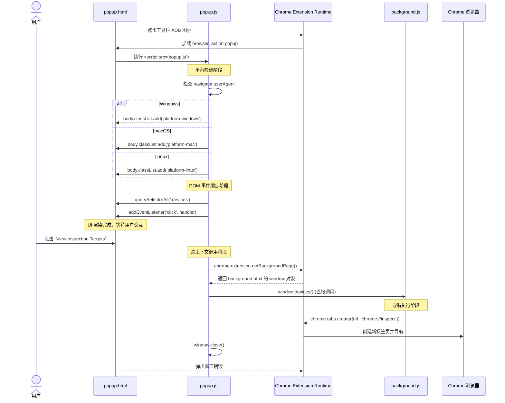
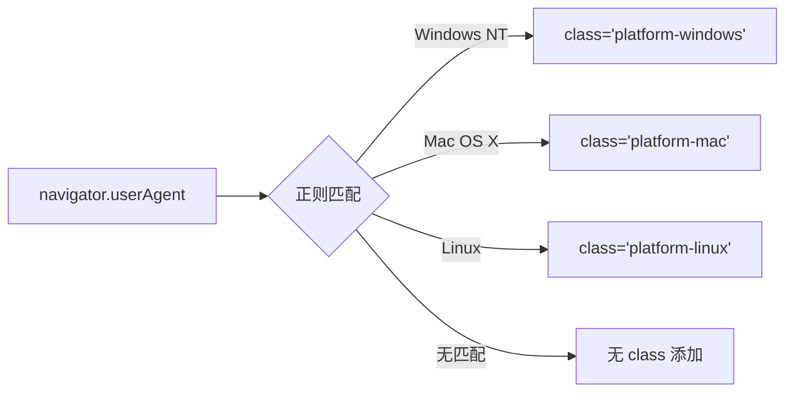
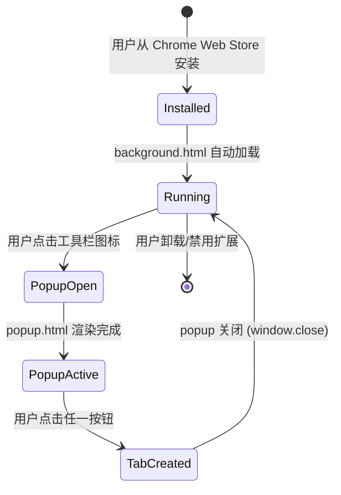

# ADB v0.9.8 — 数据流文档

## 1. 核心业务流程：用户点击 "View Inspection Targets"

这是扩展唯一的运行时业务流程。用户点击弹出窗口中的按钮，经过平台检测、跨上下文调用、最终打开目标页面。

### 1.1 序列图



### 1.2 数据流转详解

| 阶段 | 参与者 | 输入 | 处理 | 输出 |
|------|--------|------|------|------|
| **平台检测** | `popup.js` | `navigator.userAgent` 字符串 | 正则匹配 `Windows NT` / `Mac OS X` / `Linux` | 对应 CSS class 添加到 `document.body` |
| **DOM 事件绑定** | `popup.js` | `document.querySelectorAll('.devices')` | 遍历 `.devices` 元素，绑定 click 事件 | 事件监听器注册完成 |
| **跨上下文调用** | `popup.js` → `background.js` | 用户点击事件 | `chrome.extension.getBackgroundPage()` 获取后台 window，调用 `.devices()` | 函数执行 |
| **标签页导航** | `background.js` | URL 常量 `'chrome://inspect'` | `chrome.tabs.create({url})` | 浏览器打开新标签页 |
| **Popup 关闭** | `popup.js` | — | `window.close()` | 弹出窗口销毁，资源释放 |

### 1.3 "Help" 和 "File a ticket" 流程

两个流程与上述流程结构完全相同，仅目标 URL 不同：

| 按钮 | 调用的函数 | 目标 URL |
|------|-----------|----------|
| Help & Documentation | `background.help()` | `https://developers.google.com/chrome-developer-tools/docs/remote-debugging` |
| File a ticket | `background.ticket()` | `https://github.com/GoogleChrome/ADBPlugin` |

## 2. 平台检测数据流



平台检测仅影响 popup 的字体渲染（`font-family`），无功能性影响。

## 3. 无持久化数据流

该扩展不涉及任何数据存储：

- 不使用 `chrome.storage`（local/sync/managed）
- 不使用 `localStorage` / `sessionStorage`
- 不使用 `IndexedDB` / Web SQL
- 不使用 `chrome.storage.sync`
- 无 cookie 操作
- 无缓存写入

扩展是完全无状态的，每次 popup 打开和关闭不产生任何持久化副作用。

## 4. 扩展生命周期



## 5. 关键调用链总结

```
用户点击按钮
  → popup.js click handler
    → chrome.extension.getBackgroundPage()
      → background[devices|help|ticket]()
        → chrome.tabs.create({url: TARGET_URL})
          → popup.js: window.close()
```

整个调用链同步执行，无回调嵌套，无 Promise，无异步流程。
