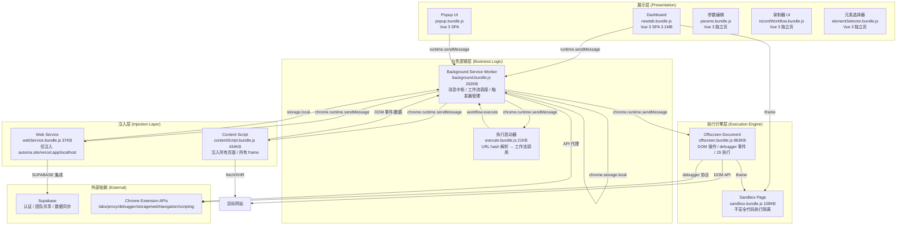

# Automa v1.30.01 — 架构文档

> 本文档基于对 Automa Chrome 扩展 v1.30.01 Webpack bundle 的逆向分析编写。
> 所有内容均为从压缩打包代码中推断得出，可能与原始源码有细微差异。

---

## 一、总体分层架构



---

## 二、模块职责表

| 模块 | 文件 | 大小 | 入口点 | 核心职责 |
|------|------|------|--------|----------|
| **Background** | `background.bundle.js` | 262KB / 22行(压缩) | manifest.json `background.service_worker` | 消息路由中枢、工作流执行调度、触发器注册/管理、浏览器 API 代理、调试器协调 |
| **Dashboard** | `newtab.bundle.js` | 3.1MB / 84行 | `newtab.html` | Vue 3 全功能 SPA：工作流编辑器 (drawflow)、历史日志查看、Block 包管理、设置面板、团队功能 |
| **Popup** | `popup.bundle.js` | 614KB / 42行 | `popup.html` | 快速访问面板：工作流列表、执行状态、快捷操作 |
| **ContentScript** | `contentScript.bundle.js` | 435KB / 24行 | manifest.json `content_scripts` | DOM 操作代理、元素选择、数据提取、表单提交、截图捕获、JS 代码注入执行 |
| **Offscreen** | `offscreen.bundle.js` | 863KB / 49行 | `offscreen.html` | Chrome Debugger API 宿主 + DOM API 操作 (MV3 Service Worker 无 DOM) |
| **Element Selector** | `elementSelector.bundle.js` | 547KB / 36行 | web_accessible_resources | 可视化元素选择器 UI（类似 DevTools inspect） |
| **Sandbox** | `sandbox.bundle.js` | 108KB / 2行 | `sandbox.html` | 沙箱页面：执行 `new Function()` 代码（绕过 CSP 限制） |
| **Web Service** | `webService.bundle.js` | 37KB / 0行 | manifest.json `content_scripts` | automa.site 页面集成：从网页接收/管理工作流、Supabase 认证 |
| **Execute** | `execute.bundle.js` | 21KB / 0行 | `execute.html` | 外部调用入口：解析 URL hash 参数启动工作流 |
| **Recorder** | `recordWorkflow.bundle.js` | 164KB / 22行 | web_accessible_resources | 用户操作录制器：捕获点击/输入/导航生成工作流 |
| **Params** | `params.bundle.js` | 393KB / 35行 | `params.html` | Block 参数编辑面板：每个 Block 类型的配置表单 |

---

## 三、技术栈识别

### 构建工具链

| 技术 | 版本 | 证据 |
|------|------|------|
| **Webpack** | 5.x | `self.webpackChunkautoma` 全局变量、`r.d/r.o/r.nmd` 辅助函数、chunk 加载模式 |
| **代码分割** | Webpack `splitChunks` | 数字命名 chunk 文件 (3162/3317/3475/4232.bundle.js) |
| **CSS 提取** | `mini-css-extract-plugin` | 独立 CSS 文件 (contentScript.css/popup.css/newtab.css) |
| **Source Map** | **无** | 所有 bundle 均未包含 source map 注释 |

### 运行时框架与库

| 库 | 用途 | 证据 |
|----|------|------|
| **Vue 3.4.38** | UI 框架 | `@vue/reactivity v3.4.38` 注释 (背景脚本内联)、响应式系统模块 |
| **Vue Router** | 路由 | Dashboard 多页面导航逻辑、`/workflows/:id` 路由模式 |
| **Pinia** 或类似 | 状态管理 | 集中式 stores (workflow/log/package/settings) |
| **Drawflow** | 工作流编辑器 | drawflow 节点/边数据结构、`pos_x`/`pos_y`/`inputs`/`outputs` 字段 |
| **webextension-polyfill** | 浏览器兼容 | `browser` polyfill 扩展代码、Chrome → Promise 包装 |
| **lodash** | 工具函数 | `deep-merge` (72266 模块)、`dot-object` 模式 (81843 模块) |
| **dayjs** | 日期处理 | `dayjs` 库 (16483 模块)、`relativeTime` 插件 (97148 模块) |
| **idb** | IndexedDB 包装 | `idb` 库 (webService 内)、`openDB`/`wrap` 模式 |
| **Supabase SDK** | 后端 API | `supabase.auth.token` localstorage 键、`@supabase/supabase-js` 集成 |
| **CodeMirror** (推测) | 代码编辑器 | Dashboard 代码编辑场景、语法高亮需求 |
| **tippy.js** (推测) | 工具提示 | 轻量 tooltip 库特征 |

---

## 四、权限清单与用途说明

### 必需权限 (`permissions`)

| 权限 | 用途 | 风险等级 |
|------|------|----------|
| **tabs** | 管理标签页：创建、关闭、切换、注入脚本、发送消息 | 高 |
| **proxy** | 设置/清除代理（HTTP/HTTPS Block 使用） | 高 |
| **alarms** | 定时触发器 (interval/cron 调度) | 中 |
| **storage** | 持久化工作流数据、日志、配置 | 中 |
| **debugger** | Chrome DevTools Protocol 操作（网络拦截/CSS/JS 断点） | 高 |
| **activeTab** | 获取当前活跃标签页访问权 | 中 |
| **offscreen** | 创建 Offscreen Document (DOM 操作) | 中 |
| **webNavigation** | 监听导航事件、获取 frame 信息 | 中 |
| **unlimitedStorage** | 大型工作流和日志数据无限制存储 | 低 |
| **scripting** | 动态注入 content script | 中 |

### 主机权限 (`host_permissions`)

| 模式 | 用途 |
|------|------|
| `<all_urls>` | 工作流可操作任意网站（自动化核心需求） |

### 可选权限 (`optional_permissions`)

| 权限 | 用途 | 请求时机 |
|------|------|----------|
| **cookies** | 获取/设置/删除 Cookie | 用户使用 Cookie Block 时 |
| **downloads** | 管理下载 | 用户使用下载 Block 时 |
| **contextMenus** | 右键菜单触发器 | 用户启用上下文菜单触发器时 |
| **clipboardRead** | 读取剪贴板 | 用户使用剪贴板 Block 时 |
| **notifications** | 系统通知 | 工作流执行完成/失败通知 |

---

## 五、各入口点详细分析

### 5.1 Background Service Worker (`background.bundle.js`)

**生命周期**: 事件驱动激活，空闲超时自动休眠。

**核心模块 (从代码推断)**:
- `BrowserAPI` / `BrowserAPIService` — Chrome API 统一抽象层，将所有 API 调用标准化为路径访问（如 `tabs.get`, `proxy.settings.set`）
- `MessageRouter` / `MessageListener` — 消息监听器注册/分发，支持 `prefix--name` 命名空间隔离
- `WorkflowEngine` — 工作流执行调度器：解析 drawflow 图、按拓扑排序执行 Block、错误处理/重试
- `TriggerManager` — 触发器生命周期管理：定时器(interval/cron)、上下文菜单、导航事件、启动触发器
- `DebuggerCoordinator` — 调试器 attach/detach 协调（通过 offscreen 转发）
- `WorkflowStore` — 工作流 CRUD + chrome.storage.local 持久化
- `ContentScriptManager` — 动态注入管理 (scripting API + tabs.executeScript)

**消息处理入口**:
```
chrome.runtime.onMessage → MessageRouter.onMessage → 分发到对应 handler
```

### 5.2 Dashboard (`newtab.bundle.js` + `newtab.html`)

**入口**: `chrome://newtab` 覆盖或独立标签页。

**组件树 (推断)**:
- `App.vue` — 根组件，主题管理、路由入口
- `pages/WorkflowEditor.vue` — 画布编辑器 (drawflow 集成)
- `pages/WorkflowList.vue` — 工作流列表/搜索/分组
- `pages/WorkflowLogs.vue` — 执行日志/历史
- `pages/Settings.vue` — 全局设置
- `pages/Packages.vue` — Block 包市场
- `components/blocks/*` — 各 Block 类型编辑面板

**沙箱集成**: 通过 `<iframe src="/sandbox.html" id="sandbox">` 嵌入，用于不安全 JS 执行。

### 5.3 Content Script (`contentScript.bundle.js`)

**注入范围**: 所有 URL、所有 frame (`all_frames: true`)、`document_start`、包括 `about:blank`。

**功能模块**:
- `ElementSelector` — 鼠标悬停高亮、CSS 选择器生成、XPath 计算
- `DataExtractor` — 从 DOM 提取文本/属性/HTML
- `FormFiller` — 自动填写表单
- `DOMObserver` — MutationObserver 监听
- `ScreenshotCapture` — 视口/元素/全页截图
- `JSExecutor` — 注入执行 JS 表达式 (`new Function` 在沙箱 iframe)
- `WebInteraction` — 点击/输入/滚动/拖拽模拟

**通信模式**: 通过 `chrome.runtime.sendMessage` 与 Background 双向通信。

### 5.4 Offscreen Document (`offscreen.bundle.js` + `offscreen.html`)

**创建时机**: Background Service Worker 需要 DOM API 或 Debugger 功能时动态创建。

**功能**:
- **Chrome Debugger Protocol 宿主** — `chrome.debugger.attach/detach/sendCommand/onEvent`
- **DOM 解析器** — `DOMParser` / `document.createElement` 等
- **Clipboard 操作** — 读/写剪贴板
- **Canvas/Media** — 图像处理、Blob 操作

**关键设计**: 由于 MV3 Service Worker 没有 DOM 访问能力，Automa 通过 Offscreen Document 桥接了所有需要 DOM 环境的功能。Offscreen 内部还嵌入 `<iframe src="/sandbox.html">` 用于不安全代码隔离执行。

### 5.5 Sandbox (`sandbox.bundle.js` + `sandbox.html`)

**清单配置**: `sandbox.pages: ["/sandbox.html"]`

**功能**: 绕过 CSP 的 `unsafe-eval` 限制，允许执行 `new Function()` 构造的动态代码。

**使用场景**: 用户在 Block 中编写的 JS 表达式、自定义 CSS 选择器逻辑等。

### 5.6 Web Service (`webService.bundle.js`)

**注入范围**: 仅 `http://localhost/*`, `*://*.automa.site/*`, `*://automa.vercel.app/*`

**功能**:
- **从 automa.site 网页导入工作流** — 监听自定义事件 `__automa-ext__`
- **Supabase 认证集成** — OAuth token 同步到 chrome.storage.local
- **团队工作流共享** — 从网站接收团队工作流推送到本地存储
- **插件包安装** — 接收 Block 包安装请求

### 5.7 Execute Launcher (`execute.bundle.js` + `execute.html`)

**用途**: 作为短命令触发入口，由快捷键或外部调用打开。

**处理流程**:
1. 解析 `window.location.hash` → 提取 `workflowId` 和查询参数
2. 从 `chrome.storage.local.get("workflows")` 获取工作流定义
3. 发送 `workflow:execute` 消息到 Background Service Worker
4. 1 秒后自动关闭窗口

---

## 六、跨上下文通信架构

```
所有上下文通过 chrome.runtime.sendMessage 通信，
Background Service Worker 作为唯一消息中枢。

消息格式: { name: string, data: unknown }

消息命名约定:
  - 前缀语义: "domain:action" (如 workflow:execute, browser-api:...)
  - 模块前缀: prefix--name (如 offscreen--browser-api:on-browser-event)
  - 内部 API: browser-api (非浏览器原生 API 的统一抽象)
```

**通信矩阵**:

| 源 → 目标 | Protocol | 频率 |
|-----------|----------|------|
| Popup → Background | runtime.sendMessage | 低频 |
| Dashboard → Background | runtime.sendMessage | 中频 |
| Dashboard → Sandbox | postMessage (iframe) | 高频 |
| ContentScript → Background | runtime.sendMessage | 中频 |
| Background → ContentScript | tabs.sendMessage | 中频 |
| Background → Offscreen | runtime.sendMessage | 高频 |
| Offscreen → Background | runtime.sendMessage | 高频 |
| WebService → Background | runtime.sendMessage | 低频 |
| Execute → Background | runtime.sendMessage | 低频 |
| Offscreen → Sandbox | postMessage (iframe) | 中频 |

---

## 七、技术决策与推断

### 为什么使用 Offscreen Document

MV3 Service Worker 无 DOM 访问权限，Automa 的以下功能必须依赖 DOM 环境：
- Chrome Debugger API (`chrome.debugger` 需要 Window 上下文)
- 剪贴板读写 (`navigator.clipboard`)
- DOM 解析 (`DOMParser`)
- Canvas 操作 (截图处理)
- Audio/Video 元素 (媒体播放 Block)

### 为什么使用 Sandbox Page

Automa 允许用户在工作流中编写自定义 JavaScript 代码。这些代码通过 `new Function()` 动态执行。MV3 的严格 CSP 禁止 `unsafe-eval`，sandbox page 被排除在 CSP 之外，从而实现了安全的代码隔离。

### Webpack 代码分割策略

- 数字 chunk ID (3162/3317/3475/4232) 表明使用 Webpack 确定性 ID
- Vendor 分离：Vue 核心库、lodash、dayjs 被内联到主 bundle 而非独立 chunk
- CSS 独立提取：`mini-css-extract-plugin` 生成独立样式表
- 入口 chunk 对应独立 HTML 页面 (popup/newtab/params)
