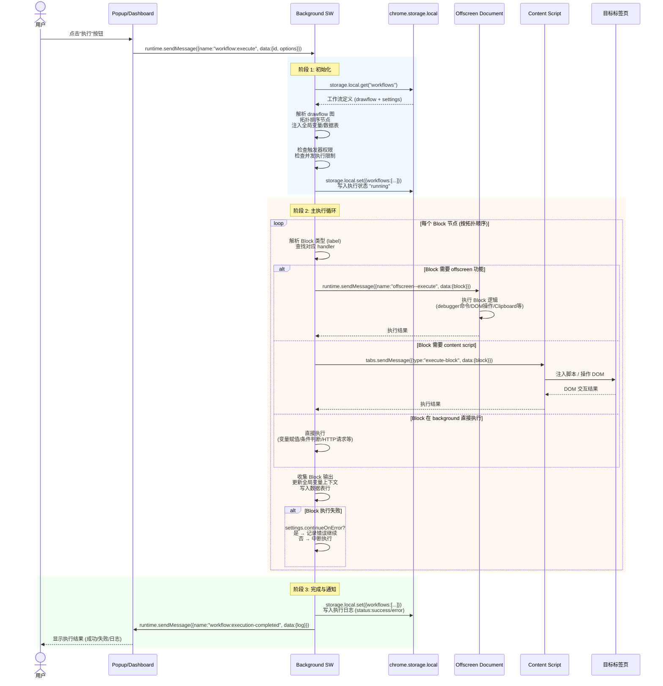
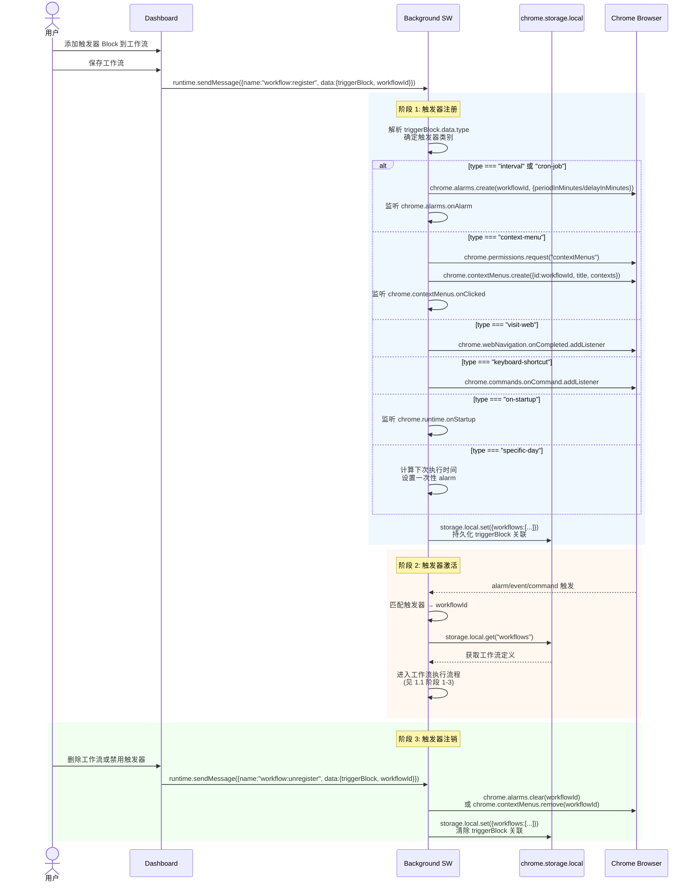
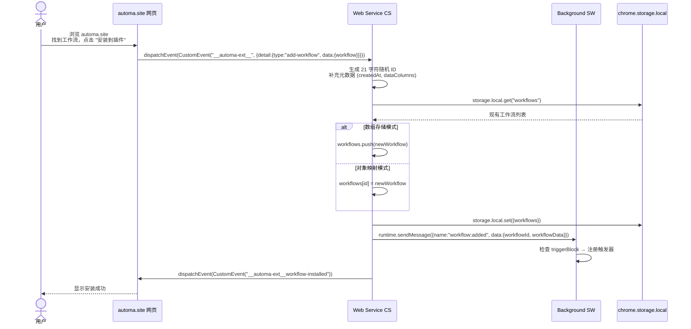
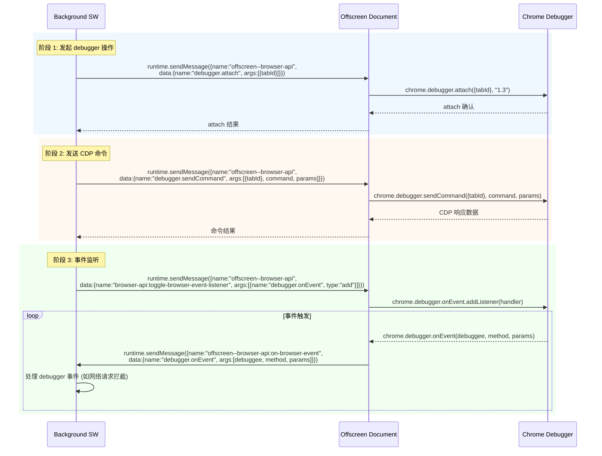

# Automa v1.30.01 — 数据流文档

> 本文档基于对 Automa v1.30.01 Webpack bundle 的逆向分析编写。
> 覆盖两条核心数据流：工作流执行流程、触发器注册与激活流程。

---

## 一、工作流执行流程

这是 Automa 的核心业务流程：用户触发工作流 → Background 调度 → 逐 Block 执行 → 结果返回。

### 1.1 序列图



### 1.2 关键数据对象流转

```
输入:
  workflow:execute 消息
    └─ { id: string, options: { checkParam: boolean, data: { variables: Record<string,string> } } }

中间态:
  WorkflowContext (不持久化，仅内存)
    ├─ nodes: DrawflowNode[] (拓扑排序后)
    ├─ edges: DrawflowEdge[]
    ├─ variables: Map<string, any> (全局变量上下文)
    ├─ table: TableRow[] (数据表)
    ├─ columnData: Map<string, any> (当前 Block 输出列)
    ├─ loopData: any (循环上下文)
    └─ logs: LogStep[] (执行日志)

输出:
  chrome.storage.local.workflows[id].logs[]
    └─ { id, workflowId, status, startedAt, endedAt, steps: LogStep[] }

  runtime.sendMessage({ name: "workflow:execution-completed", data: { log: WorkflowLog } })
```

### 1.3 Block 类型路由机制

Background Service Worker 内部维护一个 Block Handler 注册表。当解析 drawflow 节点时：

1. 读取节点的 `label` 字段 (如 `"trigger"`, `"tab"`, `"click-element"`, `"http-request"` 等)
2. 在注册表中查找对应的 handler 函数
3. 根据 handler 的目标上下文决定执行位置：
   - **Background 本地**: 纯数据操作 Block (变量、条件、循环、HTTP 请求)
   - **Offscreen**: 需要 debugger/DOM API 的 Block (元素交互、CSS 操作、网络拦截)
   - **Content Script**: 需要页面上下文的 Block (表单填写、元素提取、截图)

---

## 二、触发器注册与激活流程

Automa 支持多种触发器启动工作流，包括定时器、上下文菜单、导航事件、键盘快捷键等。

### 2.1 序列图



### 2.2 触发器类型对照表

| 触发器类型 | Chrome API | 注册方式 | 数据结构 |
|-----------|-----------|---------|---------|
| `interval` | `chrome.alarms.create` | 周期性 alarm | `{ type, interval: number, delay: number }` |
| `specific-day` | `chrome.alarms.create` | 一次性 alarm | `{ type, date: string, time: string }` |
| `cron-job` | `chrome.alarms.create` | cron 解析 → 周期性 alarm | `{ type, cronExpression: string }` |
| `context-menu` | `chrome.contextMenus.create` | 右键菜单项 | `{ type, title: string, contexts: string[] }` |
| `visit-web` | `chrome.webNavigation.onCompleted` | 导航事件监听 | `{ type, url: string, pattern: string }` |
| `keyboard-shortcut` | `chrome.commands.onCommand` | 命令监听 | `{ type, shortcut: string }` |
| `on-startup` | `chrome.runtime.onStartup` | 启动事件 | `{ type }` |

---

## 三、Web Service 工作流导入流程

### 3.1 序列图



### 3.2 Web Service 事件总线

Web Service 通过 `window.addEventListener("__automa-ext__", ...)` 建立事件总线：

| 事件类型 | 方向 | 功能 |
|---------|------|------|
| `open-dashboard` | 网页 → 插件 | 打开 Dashboard 并导航到指定路径 |
| `open-workflow` | 网页 → 插件 | 打开指定工作流的编辑器 |
| `add-workflow` | 网页 → 插件 | 添加新工作流到本地存储 |
| `add-team-workflow` | 网页 → 插件 | 添加团队共享工作流 |
| `check-team-workflow` | 网页 → 插件 | 检查团队工作流是否存在 |
| `add-package` | 网页 → 插件 | 安装 Block 包 |
| `update-package` | 网页 → 插件 | 更新已安装的 Block 包 |
| `send-message` | 网页 ⇄ 插件 | 通用双向通信 (内部协议) |
| `__automa-ext__workflow-installed` | 插件 → 网页 | 确认工作流安装完成 |
| `__automa-team-workflow__` | 插件 → 网页 | 回复团队工作流检查结果 |

---

## 四、Debugger 协议代理流程

由于 MV3 Service Worker 无法直接使用 `chrome.debugger`（需要 Window 上下文），Automa 通过 Offscreen Document 代理所有 Debugger 操作。

### 4.1 序列图



### 4.2 Browser API 注册表 (Offscreen 侧)

从代码中提取的 Offscreen 侧 Browser API 注册列表：

```typescript
const apiRegistry = [
  { path: "tabs.get",              api: () => browser.tabs.get },
  { path: "tabs.query",            api: () => browser.tabs.query },
  { path: "tabs.update",           api: () => browser.tabs.update },
  { path: "tabs.create",           api: () => browser.tabs.create },
  { path: "tabs.remove",           api: () => browser.tabs.remove },
  { path: "tabs.reload",           api: () => browser.tabs.reload },
  { path: "tabs.goBack",           api: () => browser.tabs.goBack },
  { path: "tabs.goForward",        api: () => browser.tabs.goForward },
  { path: "tabs.captureVisibleTab",api: () => browser.tabs.captureVisibleTab },
  { path: "tabs.sendMessage",      api: () => browser.tabs.sendMessage },
  { path: "windows.get",           api: () => browser.windows.get },
  { path: "windows.create",        api: () => browser.windows.create },
  { path: "debugger.attach",       api: () => chrome.debugger.attach },
  { path: "debugger.detach",       api: () => chrome.debugger.detach },
  { path: "debugger.sendCommand",  api: () => chrome.debugger.sendCommand },
  { path: "proxy.settings.set",    api: () => browser.proxy.settings.set },
  { path: "proxy.settings.clear",  api: () => browser.proxy.settings.clear },
  { path: "cookies.get",           api: () => browser.cookies?.get },
  { path: "cookies.set",           api: () => browser.cookies?.set },
  { path: "downloads.download",    api: () => browser.downloads?.download },
  // ... 共约 50+ API 路径
]
```

事件监听器路径：
```typescript
const eventRegistry = [
  "tabs.onRemoved",
  "windows.onRemoved",
  "webNavigation.onCreatedNavigationTarget",
  "webNavigation.onErrorOccurred",
  "debugger.onEvent",
  "storage.onChanged",
  "downloads.onCreated",
  "downloads.onDeterminingFilename",
  "downloads.onChanged",
]
```

---

## 五、存储结构全景

```
chrome.storage.local
├── workflows: Record<string, Workflow> | Workflow[]
│   ├── [workflowId]: { id, name, drawflow, dataColumns, table, variables,
│   │                    settings, createdAt, editedAt, logs, triggerBlock }
│   └── ...
├── teamWorkflows?: Record<string, Record<string, Workflow>>
│   └── [teamId]: { [workflowId]: Workflow }
├── savedBlocks?: SavedBlock[]
├── session?: SessionData
└── sessionToken?: SessionToken

IndexedDB: "automa" / v1
└── objectStore: "store"
    └── key: "workflows" → 备份的工作流数据 (webService context)

localStorage (仅 webService context):
└── "supabase.auth.token" → JSON SessionData
```
