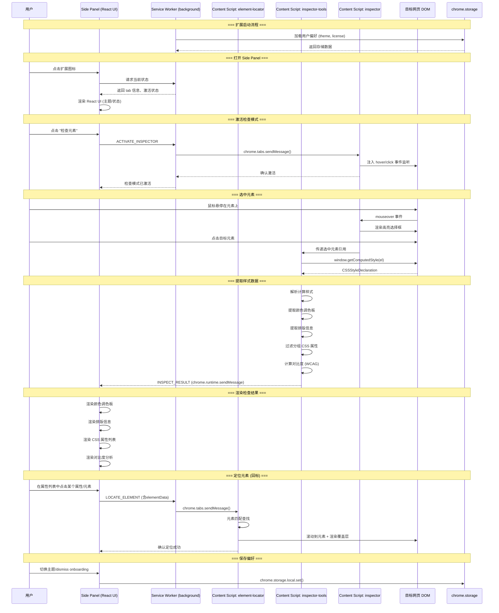
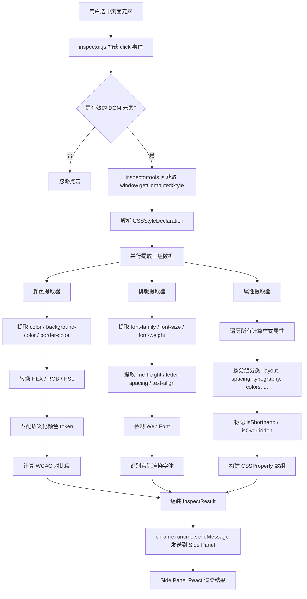
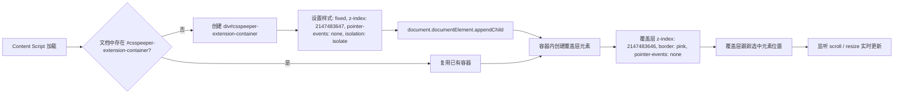
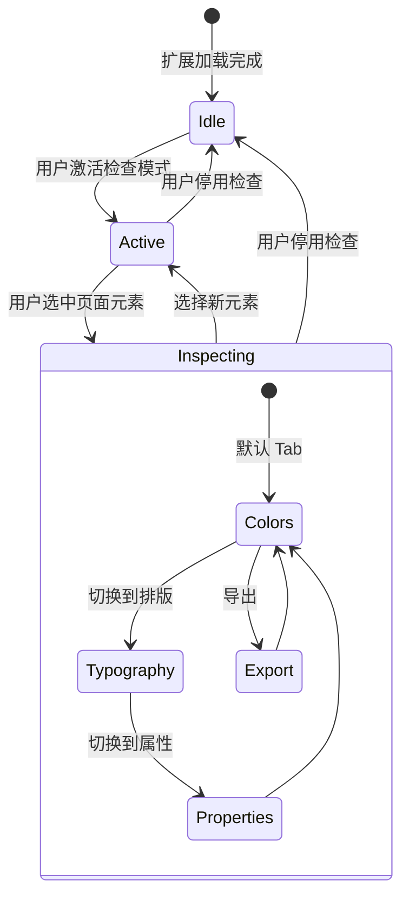

# CSS Peeper 数据流文档

> **版本**: v1.2.2 | **基于**: 源码逆向分析 | **分析日期**: 2026-07-05

---

## 一、整体数据流概览



---

## 二、消息流详细说明

### 2.1 消息通道

CSS Peeper 使用 Chrome Extension 的标准消息传递机制：

```
Side Panel ──(chrome.runtime.sendMessage)──► Service Worker
Service Worker ──(chrome.runtime.sendMessage)──► Side Panel
Service Worker ──(chrome.tabs.sendMessage)──► Content Script
Content Script ──(chrome.runtime.sendMessage)──► Service Worker
Content Script ──(chrome.runtime.sendMessage)──► Side Panel (直达)
```

### 2.2 核心消息类型

| 消息类型 | 发送方 | 接收方 | 触发条件 |
|----------|--------|--------|----------|
| `ACTIVATE_INSPECTOR` | Side Panel | Service Worker | 用户点击激活检查 |
| `DEACTIVATE_INSPECTOR` | Side Panel | Service Worker | 用户关闭检查模式 |
| `LOCATE_ELEMENT` | Side Panel | Content Script: locator | 用户在侧栏选中元素 |
| `GET_COMPUTED_STYLES` | Content Script: inspector | Content Script: tools | 用户选中页面元素 |
| `GET_COLOR_PALETTE` | Content Script: inspector | Content Script: tools | 提取颜色 |
| `GET_TYPOGRAPHY` | Content Script: inspector | Content Script: tools | 提取排版 |
| `INSPECT_RESULT` | Content Script | Side Panel | 检查结果已就绪 |
| `ERROR` | 任意 | 任意 | 发生错误 |

### 2.3 元素定位数据流

当用户在 Side Panel 的属性列表中点击时，`LOCATE_ELEMENT` 消息携带以下数据：

```
{
  type: "LOCATE_ELEMENT",
  tabId: number,
  elementData: {
    tag: "div",
    elements: [{ text, className, styles }],
    className: "...",
    id: "..."
  },
  indexOfElement: 0
}
```

Content Script (locator) 响应：
```
{ success: boolean, message?: string }
```

### 2.4 检查结果数据流

```
{
  type: "INSPECT_RESULT",
  payload: {
    selector: "body > div.container > ...",
    tagName: "div",
    computedStyles: { "font-size": "16px", ... },
    colorPalette: { backgroundColor: {...}, textColor: {...}, ... },
    typography: { fontFamily: "Inter", fontSize: "16px", ... },
    cssProperties: [{ name, value, group, isShorthand, isOverridden, source }],
    boundingRect: DOMRect
  }
}
```

---

## 三、样式提取流程



---

## 四、扩展容器 DOM 注入



---

## 五、Side Panel 状态管理



---

## 六、跨组件通信总结

| 方向 | 方式 | 延迟 | 适用场景 |
|------|------|------|----------|
| Side Panel → Content Script | `chrome.tabs.sendMessage` (经 SW 中转) | ~5-20ms | 激活检查、定位元素 |
| Content Script → Side Panel | `chrome.runtime.sendMessage` | ~5-20ms | 返回检查结果 |
| Side Panel ↔ SW | `chrome.runtime.sendMessage` | ~1-5ms | 查询状态、路由消息 |
| Content Script ↔ Page | DOM Events + CSSOM | 同步 | 样式读取、事件监听 |
| 所有 → Storage | `chrome.storage.local` | ~5-50ms | 持久化偏好 |
