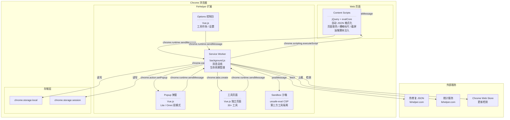
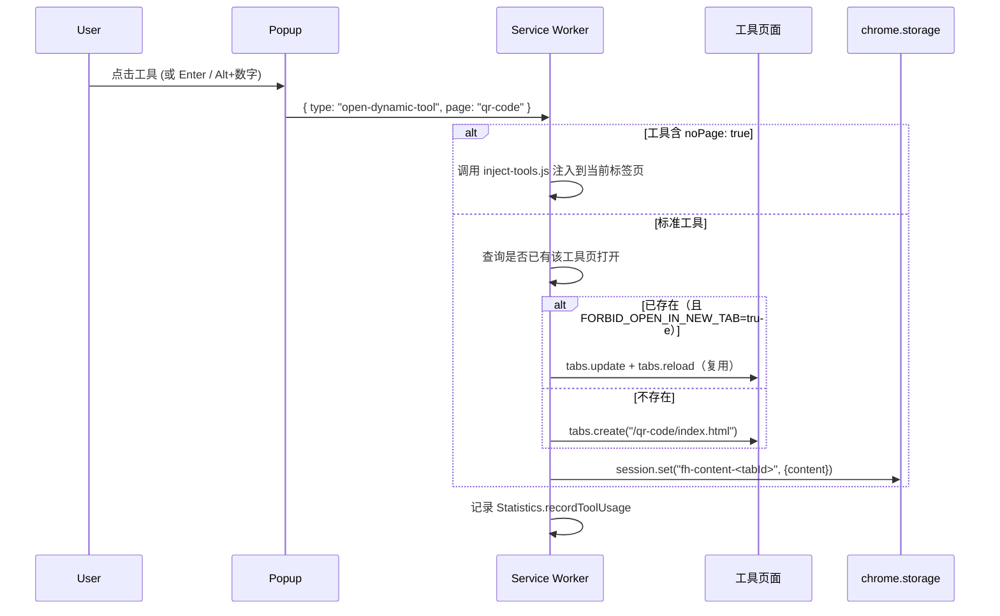
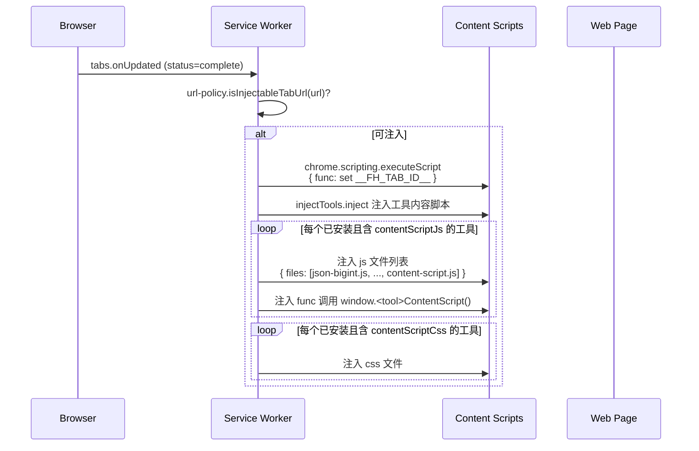
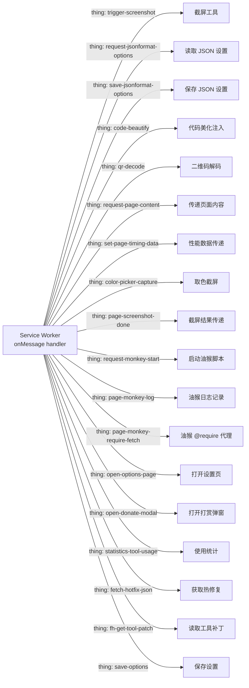
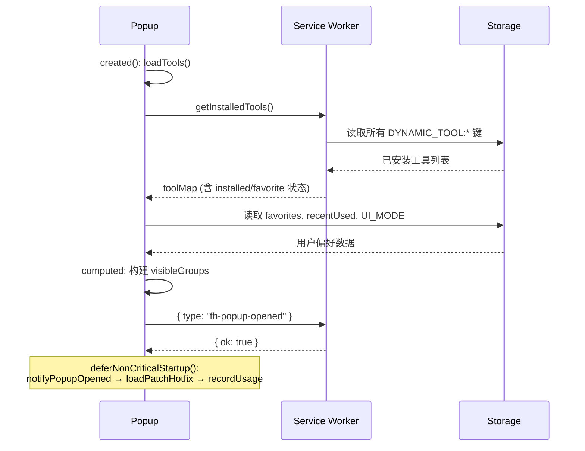
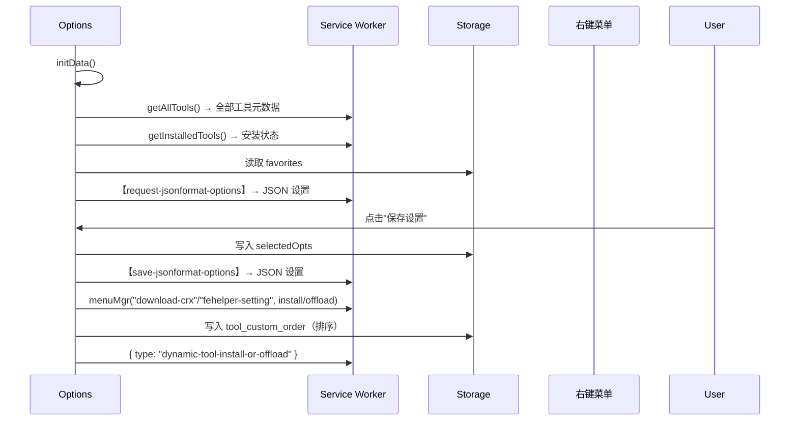
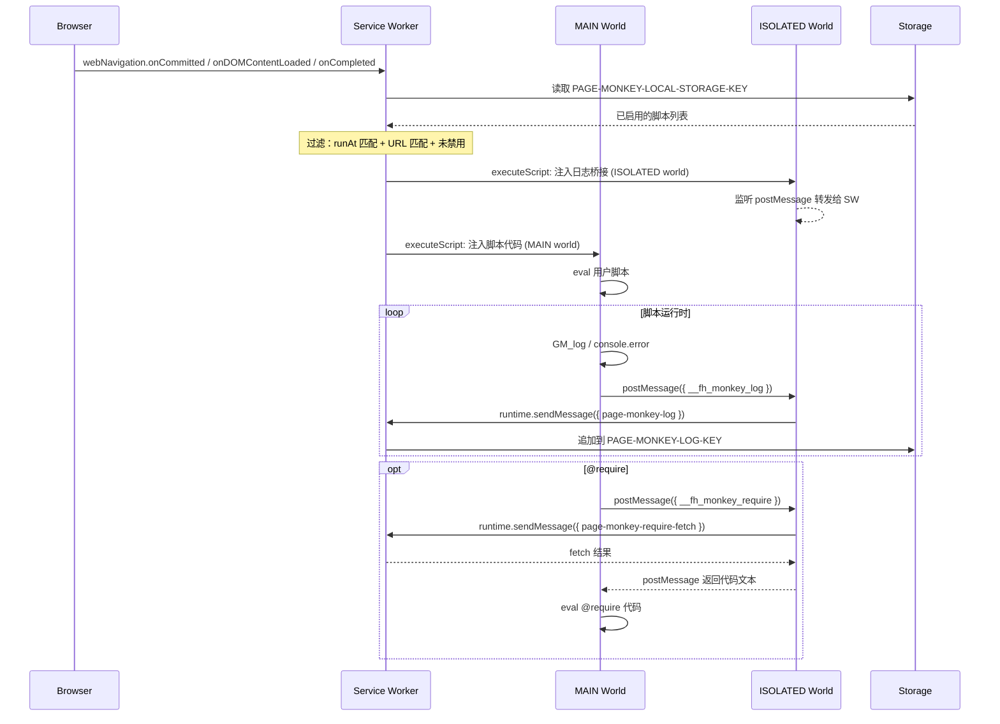

# FeHelper 数据流文档

> 反向工程版本：dsv4 | 原始版本：v2026.7.3  
> 本文档描述 FeHelper Chrome 扩展中各组件的消息传递、数据流转和状态同步机制。

---

## 一、整体数据流概览



---

## 二、核心数据流路径

### 2.1 工具打开流程



### 2.2 内容脚本注入流程



### 2.3 DYNAMIC_ANY_THING 消息分发



### 2.4 弹窗 (Popup) 数据流



### 2.5 设置 (Options) 数据流



### 2.6 油猴脚本 (Page Monkey) 数据流



---

## 三、存储键空间设计

### 3.1 chrome.storage.local（持久存储）

| 键名模式 | 用途 | 数据结构 |
|----------|------|----------|
| `DYNAMIC_TOOL:<name>` | 工具安装标记 | 时间戳（Number） |
| `DYNAMIC_TOOL:CS:<name>` | 工具内容脚本缓存 | JS 字符串 |
| `DYNAMIC_TOOL:CS:CSS:<name>` | 工具内容样式缓存 | CSS 字符串 |
| `DYNAMIC_MENU:<name>` | 工具右键菜单状态 | "1" 或 "0" |
| `DEV-TOOLS:MY-TOOLS` | 第三方开发工具列表 | JSON 字符串 |
| `favorites` | 用户收藏工具 | `string[]` |
| `popup_recent_tools` | 最近使用工具 | `string[]` (最多 10) |
| `FH_USER_USAGE_DATA` | 使用统计数据 | JSON → `UserUsageData` |
| `FH_UI_MODE` | 全局 UI 模式 | "lite" 或 "omni" |
| `FH_POPUP_UI_MODE` | Popup UI 模式 | "lite" 或 "omni" |
| `FH_OPTIONS_UI_MODE` | Options UI 模式 | "lite" 或 "omni" |
| `tool_custom_order` | 工具排序 | JSON 字符串 |
| `PAGE-MODIFIER-LOCAL-STORAGE-KEY` | 油猴脚本定义 | JSON 字符串 |
| `PAGE-MODIFIER-LOG-KEY` | 油猴运行日志 | JSON 字符串（限 300 条） |
| `fehelper_view_mode` | 视图模式 | "grid" 或 "list" |
| `fehelper_latest_version_data` | 版本检测缓存 | JSON → `VersionInfo` |
| `FH_PATCH_HOTFIX_<version>` | 工具热修复补丁 | `ToolPatchMap` |
| `fh_ai_provider` | AI Provider 选择 | "builtin" |
| `fh_ai_builtin_status_snapshot` | AI 模型状态 | `AiModelStatusSnapshot` |

### 3.2 chrome.storage.session（会话存储）

| 键名模式 | 用途 | 生命周期 |
|----------|------|----------|
| `fh-content-<tabId>` | 工具页面内容传递（如 JSON 原文） | 会话级别 |

### 3.3 localStorage（页面内部 / 油猴脚本）

| 键名模式 | 用途 |
|----------|------|
| `__FH_GM_<scriptId>_<key>` | 油猴脚本 GM_setValue/GM_getValue |
| `AUTO_DARK_MODE` / `ALWAYS_DARK_MODE` | 夜间模式状态同步 |

---

## 四、事件流

```mermaid
flowchart TB
    subgraph Events["主要事件"]
        E1["chrome.tabs.onUpdated<br/>(页面加载完成)"]
        E2["chrome.webNavigation.onCommitted<br/>(导航提交)"]
        E3["chrome.webNavigation.onDOMContentLoaded<br/>(DOM 就绪)"]
        E4["chrome.webNavigation.onCompleted<br/>(导航完成)"]
        E5["chrome.webNavigation.onHistoryStateUpdated<br/>(SPA 路由变化)"]
        E6["chrome.runtime.onInstalled<br/>(安装/更新)"]
        E7["chrome.runtime.onStartup<br/>(浏览器启动)"]
        E8["chrome.alarms.onAlarm<br/>(定时更新检测)"]
        E9["chrome.runtime.onMessage<br/>(消息接收)"]
        E10["chrome.contextMenus.onClicked<br/>(右键菜单)"]
    end

    E1 --> SW_INIT["注入 content scripts<br/>设置 __FH_TAB_ID__"]
    E2 & E3 & E4 & E5 --> MONKEY["油猴脚本匹配注入<br/>(按 runAt 过滤)"]
    E6 --> INSTALL["安装: 打开 Options<br/>更新: 显示 Badge<br/>共用: 重建右键菜单"]
    E7 --> MENU["重建右键菜单"]
    E8 --> UPDATE["检测 CWS 更新<br/>update_available → reload"]
    E9 --> DISPATCH["消息分发<br/>(见 2.3 DYNAMIC_ANY_THING)"]
    E10 --> TOOL["打开对应工具页面"]
```



---

## 五、热修复机制

```
1. 工具页/Popup/Options 加载完成后调用 fh-get-tool-patch
2. Service Worker 从 chrome.storage.local 读取 FH_PATCH_HOTFIX_<version>
3. 命中则返回 { css, js }
4. 工具页创建 <style> 注入 css，用 new Function() 执行 js（限 50KB）
5. 补丁数据来源：
   - 上次 fetch-hotfix-json 请求的缓存
   - fetch-hotfix-json 从 https://fehelper.com/static/js/hotfix.json 获取
```

---

## 六、内容传递（工具间通信）

部分工具需要跨页面传递数据，使用 `chrome.storage.session` 临时存储：

1. **来源**：用户在 Web 页面上选中 JSON 文本，通过 content_script 发送请求
2. **存储**：SW 将内容缓存到 `chrome.storage.session` 键 `fh-content-<tabId>`
3. **消费**：工具页打开后通过 `request-page-content` 读取
4. **清理**：读取后立即删除（`chrome.storage.session.remove`）

也支持通过 `withContent` 直接在 `open-dynamic-tool` 消息中携带数据。
