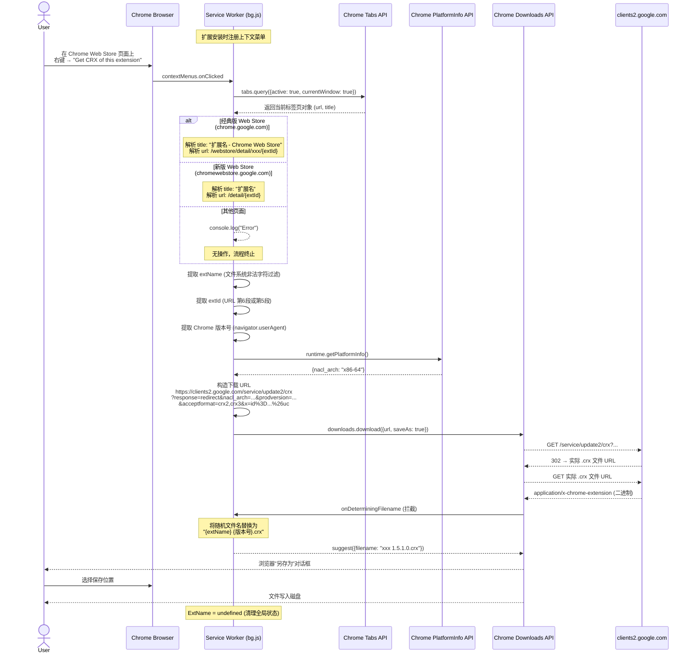
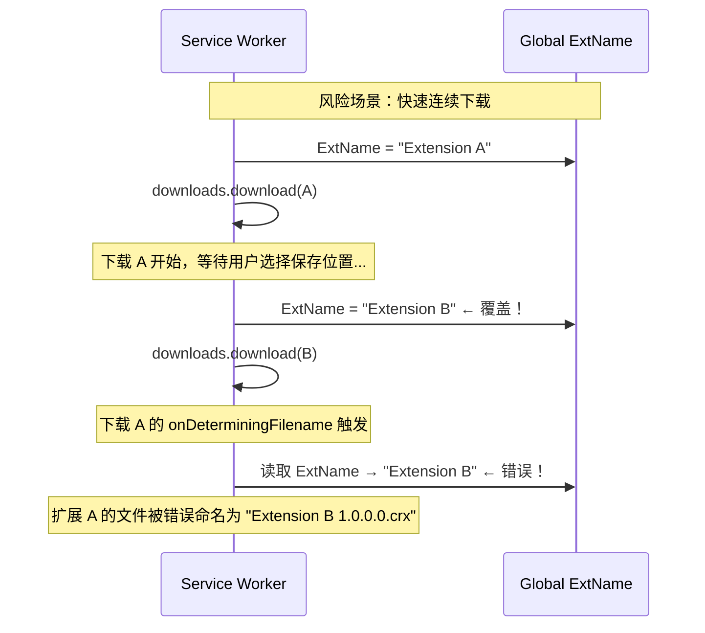

# Get CRX — 数据流文档

## 整体数据流（Mermaid 序列图）



## 关键数据转换

### 1. 扩展 ID 提取

```
经典版: https://chrome.google.com/webstore/detail/扩展名/abcdefghijklmnopqrstuvwxyz123456
                                               [0] [1]  [2]   [3]   [4]   [5]              [6]
                                              split("/")[6].split("?")[0]
                                              结果: "abcdefghijklmnopqrstuvwxyz123456"

新版:   https://chromewebstore.google.com/detail/abcdefghijklmnopqrstuvwxyz123456
                                           [0]  [1]   [2]   [3]   [4]              [5]
                                          split("/")[5].split("?")[0]
                                          结果: "abcdefghijklmnopqrstuvwxyz123456"
```

### 2. 扩展名称清理

```
经典版: title = "uBlock Origin - Chrome Web Store"
        → split(" - Chrome Web Store")[0] → "uBlock Origin"
        → 去掉 [/&\\:"*<>|?] → "uBlock Origin"

新版:   title = "uBlock Origin"
        → 直接去掉 [/&\\:"*<>|?] → "uBlock Origin"
```

### 3. CRX 下载 URL 构造

```
https://clients2.google.com/service/update2/crx
  ?response=redirect
  &nacl_arch=x86-64                          ← 来自 PlatformInfo
  &prodversion=126.0.6478.126                 ← 来自 navigator.userAgent
  &acceptformat=crx2,crx3
  &x=id%3Dabcdefghij...%26installsource%3Dondemand%26uc
    ↑
    参数部分进行 URL 编码:
    id=abcdefghij...&installsource=ondemand&uc
```

### 4. 文件名转换

```
Google 原始返回文件名: extension_1_5_1_0.crx
                         └──┬──┘ └┬┘
                      substring("_") ← 找到第一个下划线位置
                        去掉第一个下划线
                        后续下划线替换为点号

结果文件名: {extName} 1.5.1.0.crx

示例: "uBlock Origin 1.61.1.0.crx"
```

## 全局状态时序风险



**缓解因素**：由于 `downloads.download({saveAs: true})` 会弹出"另存为"对话框阻塞 UI，用户几乎不会在同一个对话框打开期间触发第二次下载。但在 Service Worker 生命周期内，如果用户快速操作，极端情况下仍可能出现此 Race Condition。
