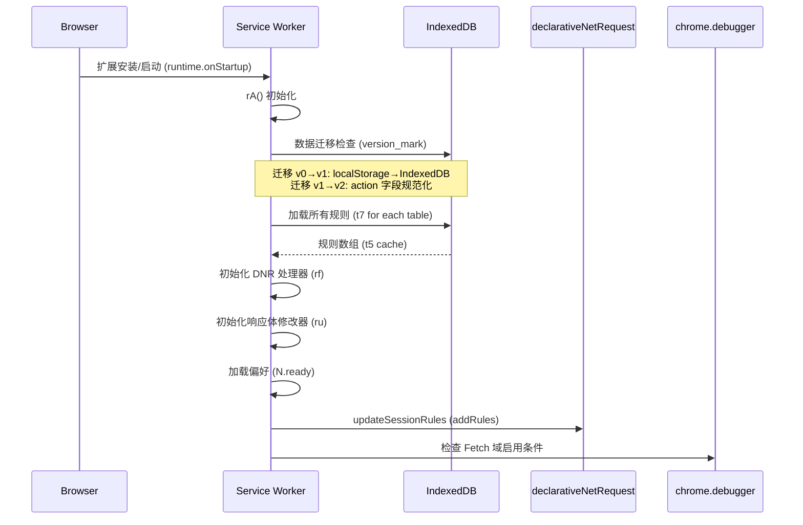
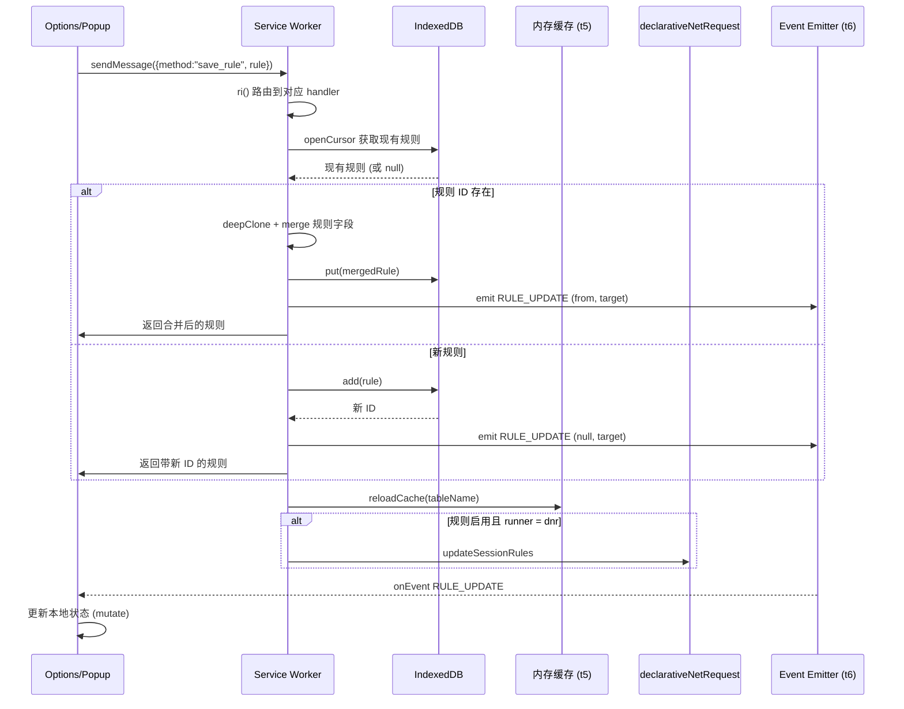
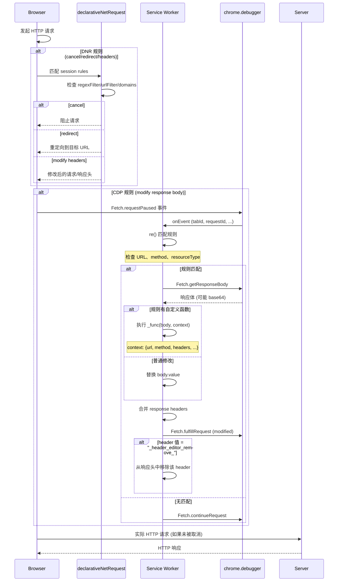
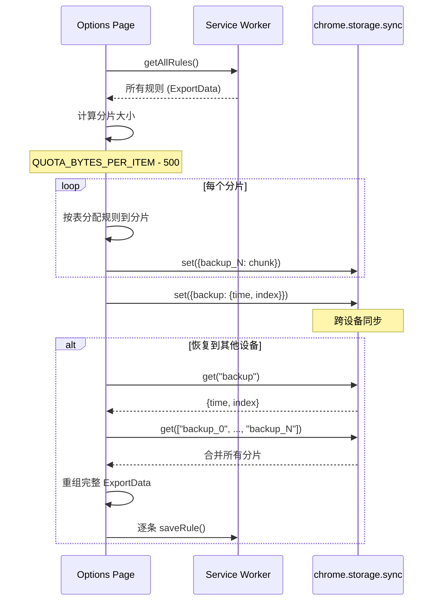

# Header Editor Lite - 数据流文档 (DATA_FLOW.md)

## 1. 启动流程



## 2. 规则保存流程



## 3. 请求拦截流程



## 4. URL 匹配逻辑

```mermaid
flowchart TD
    A[开始匹配] --> B{condition.all?}
    B -->|是| C[匹配成功]
    B -->|否| D{condition.url?}
    D -->|是| E{url === condition.url?}
    E -->|是| F[继续检查]
    E -->|否| G[不匹配]
    D -->|否| H{condition.urlPrefix?}
    H -->|是| I{url startsWith prefix?}
    I -->|是| F
    I -->|否| G
    H -->|否| J{condition.domain?}
    J -->|是| K{提取 URL 域名}
    K --> L{domains.includes domain?}
    L -->|是| F
    L -->|否| G
    J -->|否| M{condition.regex?}
    M -->|是| N{regex.test(url)?}
    N -->|是| F
    N -->|否| G
    M -->|否| O[默认匹配]
    O --> F

    F --> P{excludeDomain?}
    P -->|匹配| Q[匹配但排除]
    P -->|不匹配| R{excludeRegex?}
    R -->|匹配| Q
    R -->|不匹配| S{method check}
    S -->|不匹配| G
    S -->|匹配| T{resourceType check}
    T -->|不匹配| G
    T -->|匹配| C
```

## 5. 偏好同步流程

```mermaid
flowchart TD
    A[用户修改偏好] --> B{UI 类型}
    B -->|Options Page| C[setPrefs]
    B -->|Popup Panel| C

    C --> D[N.set(key, value)]
    D --> E[$().set({settings})]
    E --> F[chrome.storage.sync]

    D --> G[j.emit EVENT_PREFS_UPDATE]

    F --> H[storage.onChanged listener]
    H --> I{其他设备同步?}
    I -->|是| J[N.set(key, newValue, true)]
    J --> G

    G --> K{监听者}
    K -->|DNR Handler| L[rf.setDisableAll]
    K -->|CDP Handler| M[ru.checkEnable]
    K -->|Action Icon| N[ra update icon]
    K -->|Options Page| O[et.handleUpdate]
    K -->|Popup Panel| P[更新 UI 状态]
```

## 6. 云备份流程



## 7. 组件间通信模式

```mermaid
flowchart LR
    subgraph Background
        SW[Service Worker]
        EM[t6 Event Emitter]
        IDB[(IndexedDB)]
        DNR[DNR Handler]
        CDP[CDP Handler]
        PREFS[Preferences]
    end

    subgraph UI Pages
        OPTIONS[Options Page]
        POPUP[Popup Panel]
    end

    subgraph Chrome APIs
        MSG[runtime.sendMessage]
        ONMSG[runtime.onMessage]
    end

    OPTIONS -->|sendMessage| MSG
    POPUP -->|sendMessage| MSG
    MSG --> ONMSG
    ONMSG --> SW

    SW --> EM
    EM -->|RULE_UPDATE| OPTIONS
    EM -->|RULE_DELETE| OPTIONS
    EM -->|RULE_UPDATE| POPUP
    EM -->|PREFS_UPDATE| OPTIONS
    EM -->|PREFS_UPDATE| POPUP

    SW --> IDB
    SW --> DNR
    SW --> CDP
    PREFS -->|sync| SW

    OPTIONS -.->|tabs.sendMessage<br/>(rule switch suggest)| POPUP
```

## 8. 数据存储总览

| 存储 | API | 用途 | 容量 |
|------|-----|------|------|
| IndexedDB (`headeditor`) | IndexedDB | 规则持久化存储 | 无限制 (unlimitedStorage) |
| `chrome.storage.sync` | storage.sync API | 偏好同步 + 云备份 | ~100KB |
| `chrome.storage.local` | storage.local API | 规则切换历史、common rules | ~10MB |
| `chrome.storage.session` | Proxy wrapper | 通知消息 (session 级) | ~10MB |
| 内存 (`t5` cache) | 变量 | 规则运行时缓存 | 页面生命周期 |

## 9. 数据迁移历史

| 版本标记 | 迁移内容 |
|----------|----------|
| version_mark < 1 | localStorage 中的 `groups` 和 `dl_history` 迁移到 IndexedDB 和 storage.local |
| version_mark < 2 | 规则 `action` 字段规范化: {name, value} → headers 字典 |

## 10. 关键数据结构序列化规则

1. **规则导出**: 移除所有运行时字段 (`_reg`, `_func`, `_v_key`, `_runner`, `_exclude`)
2. **规则导入**: 规范化旧格式字段 (`matchType`→`condition`, `action`→`headers`)
3. **DNR 规则 ID**: `ruleId * 100000 + tableOffset`
4. **云备份分片**: 每片 `< QUOTA_BYTES_PER_ITEM - 500 bytes`
5. **Switch history key**: `rule_switch_{tableName}-{ruleId}`
