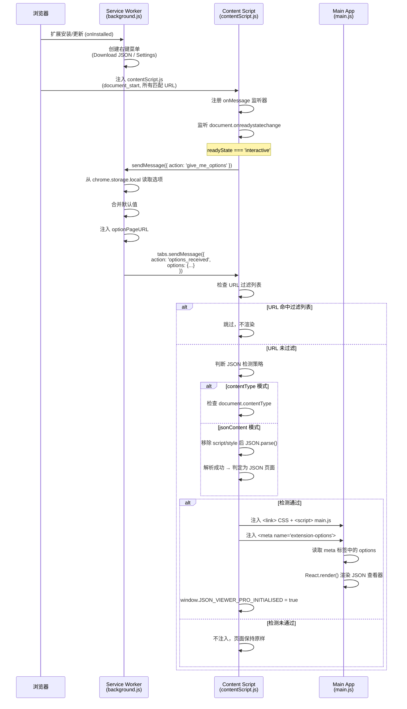
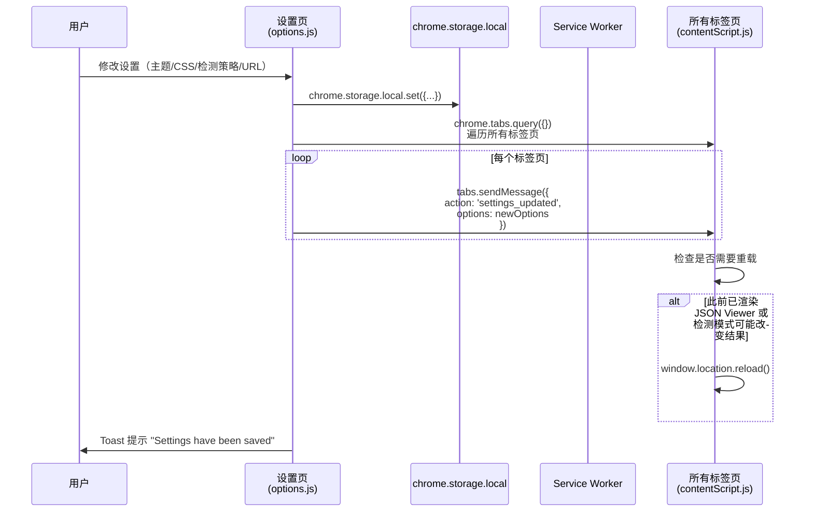
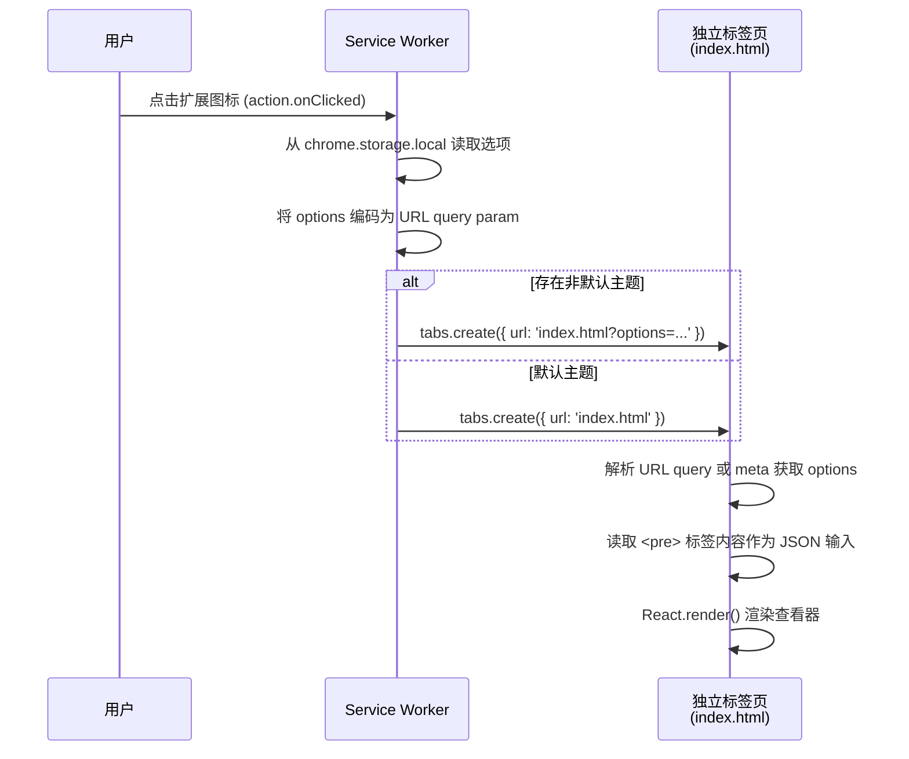
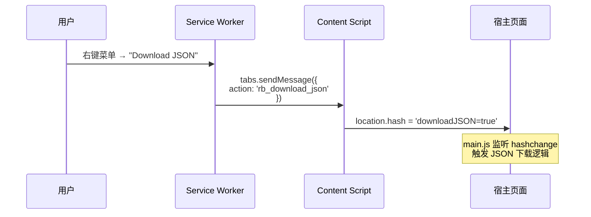
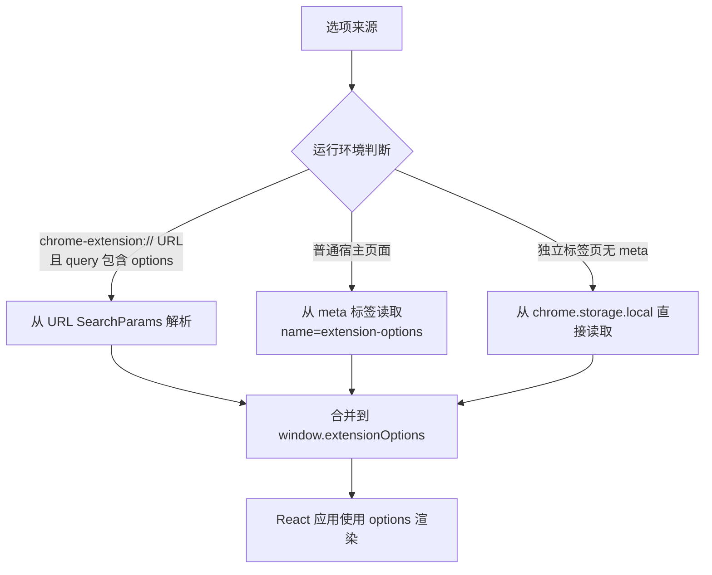

# JSON Viewer Pro 数据流文档

> 逆向工程分析 (dsv4) | 基于 v1.0.6

---

## 一、扩展初始化流程



---

## 二、选项保存与广播流程



---

## 三、独立标签页模式流程（点击扩展图标）



---

## 四、右键菜单下载 JSON 流程



---

## 五、数据存储结构

### chrome.storage.local

```
Key: "rb-awesome-json-ver-options"

Value:
{
  "theme": "default" | "mdn",
  "css": "... 自定义 CSS 文本 ...",
  "collapsed": 0 | N,
  "filteredURL": ["https://example.com", ...],
  "jsonDetection": {
    "method": "contentType" | "jsonContent",
    "selectedContentTypes": [
      "application/json",
      "text/json",
      "application/javascript",
      ...
    ]
  }
}
```

---

## 六、消息类型汇总

| 消息 action | 方向 | 触发时机 |
|-------------|------|----------|
| `give_me_options` | CS → SW | 页面 readyState === interactive |
| `options_received` | SW → CS | SW 响应 give_me_options |
| `settings_updated` | 设置页 → CS (全Tab广播) | 用户在设置页保存 |
| `rb_download_json` | SW → CS | 右键菜单点击 Download JSON |

---

## 七、关键通信机制

### 7.1 跨上下文通信

由于 MV3 安全隔离限制，扩展使用三种通信方式：

1. **SW <-> CS**: `chrome.runtime.sendMessage` + `chrome.tabs.sendMessage`
2. **CS -> Main App**: 通过 DOM（`<meta name="extension-options">` 标签）
3. **设置页 -> 全局**: 查询所有 tabs 后逐个 sendMessage

### 7.2 向后兼容的选项读取

`background.js` 中的 `getBackwardCompatibleOptions()` 处理两种存储格式：
- **旧格式**: `chrome.storage.local` 中的字符串值（尝试 `JSON.parse`）
- **新格式**: 直接存储的对象值

---

## 八、选项传递的替代路径


