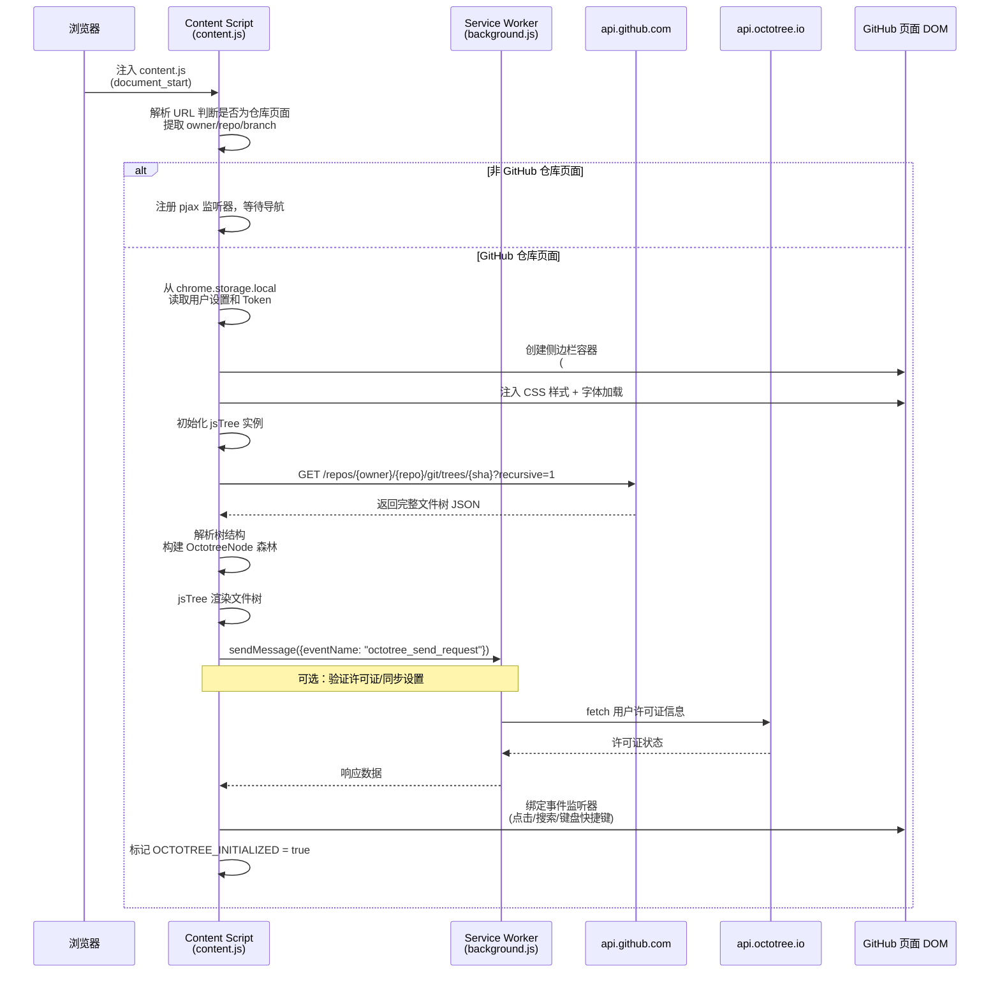
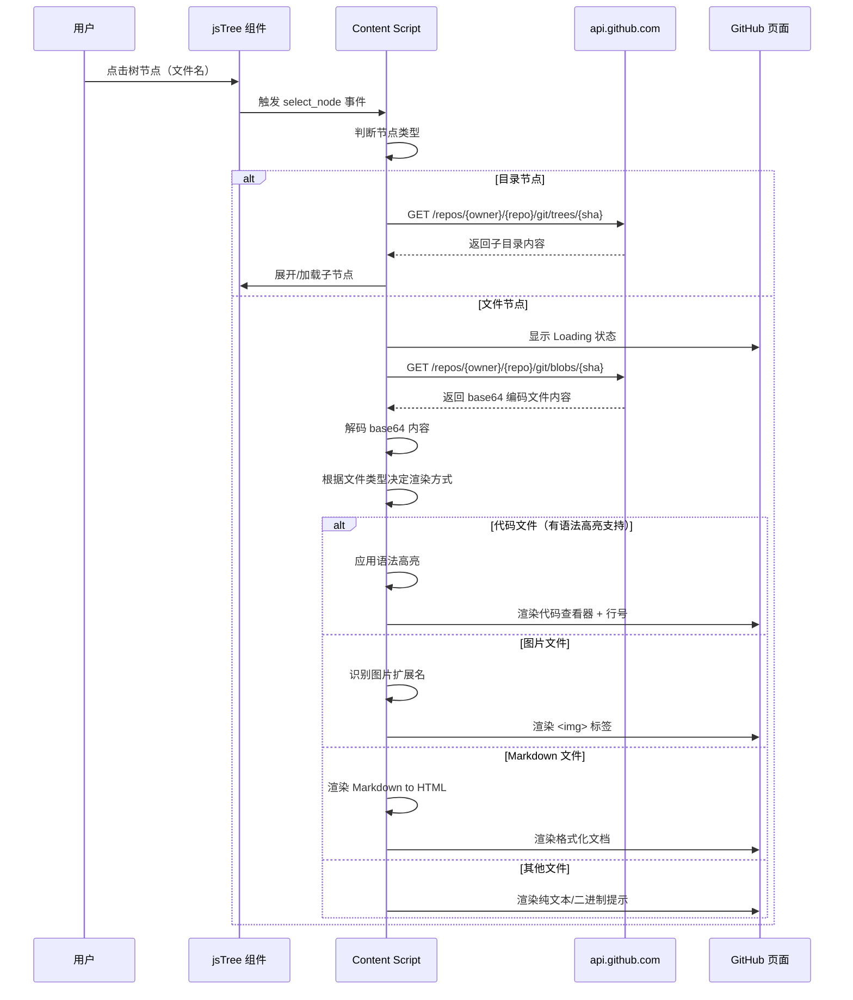
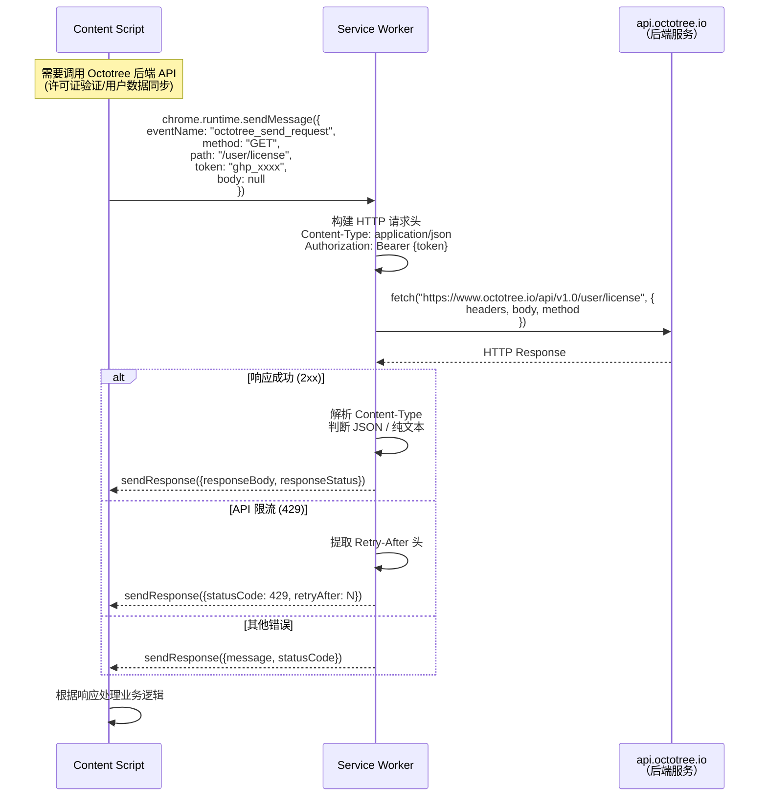
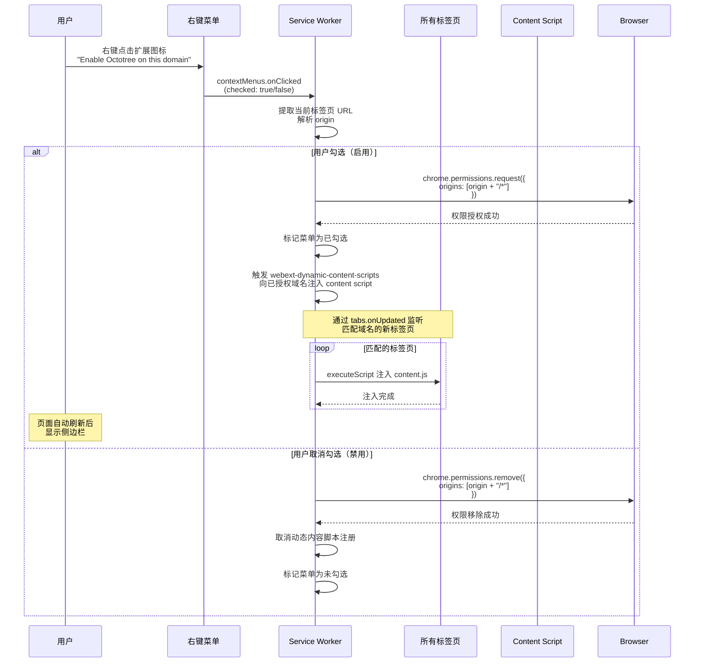
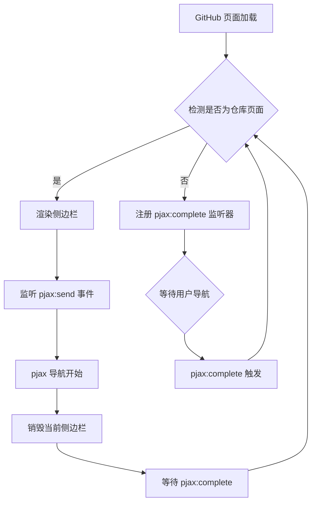

# Octotree v8.3.0 数据流文档

> 逆向工程分析 (dsv4) | 基于 v8.3.0

---

## 一、核心业务流程：页面加载到树形视图渲染



---

## 二、文件点击 -> 内容预览流程



---

## 三、API 代理请求流程



---

## 四、域名权限切换流程



---

## 五、存储数据结构

### 5.1 chrome.storage.local

```
键：octotree_access_token
值：string  — GitHub Personal Access Token (ghp_xxxx)

键：octotree_settings
值：
{
  "dockPosition": "left" | "right",
  "sidebarWidth": 320,
  "theme": "default" | "dark" | "light",
  "fontFamily": "cascadia-code" | "fira-code" | ...,
  "fontSize": 13,
  "iconTheme": "vscode" | "vscodemat",
  "showFileIcons": true,
  "showFolderIcons": true,
  "autoCollapse": false,
  "expanded": false,
  "showLineNumbers": true,
  "codeHighlight": true,
  "prFileTree": true,
  "loadFonts": true,
  "hideEmptyDirectories": false,
  "lazyLoadDepth": 1
}

键：octotree_license
值：
{
  "tier": "free" | "pro" | "team" | "enterprise",
  "valid": true,
  "expiresAt": "2026-12-31T00:00:00Z",
  "githubUser": "username"
}

键：octotree_session
值：
{
  "lastUsed": "2026-07-05T12:00:00Z",
  "recentRepos": ["owner/repo1", "owner/repo2"]
}
```

### 5.2 chrome.storage.session

扩展使用 `webext-events` 模式检测扩展首次启动（`__webext-events__startup` 键），防止 `onExtensionStart` 回调重复触发。

---

## 六、消息类型汇总

| 消息 eventName | 方向 | 触发时机 | 说明 |
|----------------|------|----------|------|
| `octotree_send_request` | CS -> SW | Content Script 需要调用 Octotree 后端 API | 参数：method, path, body, token |
| `webext-permission-toggle:add-permission` | SW -> (内部) | 用户点击右键菜单权限切换 | 触发权限请求/移除 |
| `__webext-events__startup` | SW -> (内部) | 扩展首次启动检测 | chrome.storage.session 标记 |

---

## 七、关键通信机制

### 7.1 Content <-> Background 通信

```
Content Script                    Service Worker
     │                                  │
     │ chrome.runtime.sendMessage()      │
     │─────────────────────────────────>│
     │  {eventName, method, path, ...}   │
     │                                   │—— fetch() to Octotree API
     │  sendResponse({responseBody, ...})│
     │<─────────────────────────────────│
     │                                   │
```

### 7.2 SW -> 页面 权限变更

```
Service Worker                        标签页
     │                                  │
     │ chrome.tabs.sendMessage()         │
     │  {action: "permission_changed"}   │
     │─────────────────────────────────>│
     │                                   │—— location.reload()
```

### 7.3 SW -> 标签页 DOM（动态注入）

使用 `chrome.scripting.executeScript()` (MV3) 或 `chrome.tabs.executeScript()` (降级) 向匹配的标签页动态注入 `content.js`。

### 7.4 fetch API 代理

Content Script 不直接在页面沙箱中调用 Octotree 后端 API，而是通过 SW 代理所有请求，确保 Bearer Token 不被暴露在宿主页面的网络请求中。

---

## 八、GitHub pjax 导航兼容



Octotree 通过 jQuery-pjax 事件机制兼容 GitHub 的单页导航：
- `pjax:send`: 在页面切换前销毁旧侧边栏
- `pjax:complete`: 在新页面加载后重新检测仓库信息并渲染
