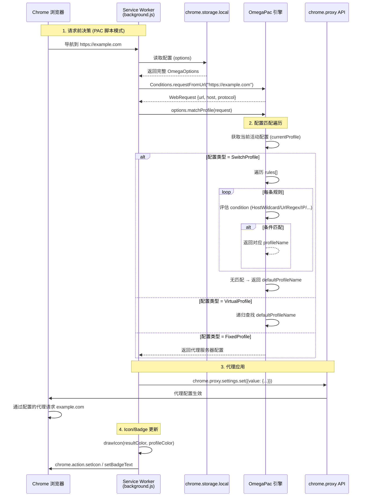
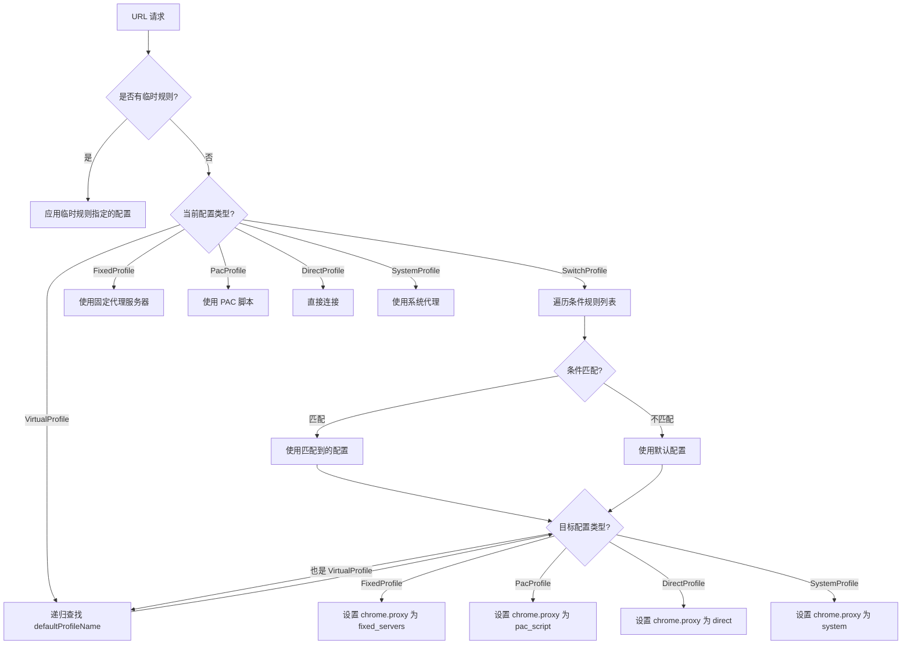
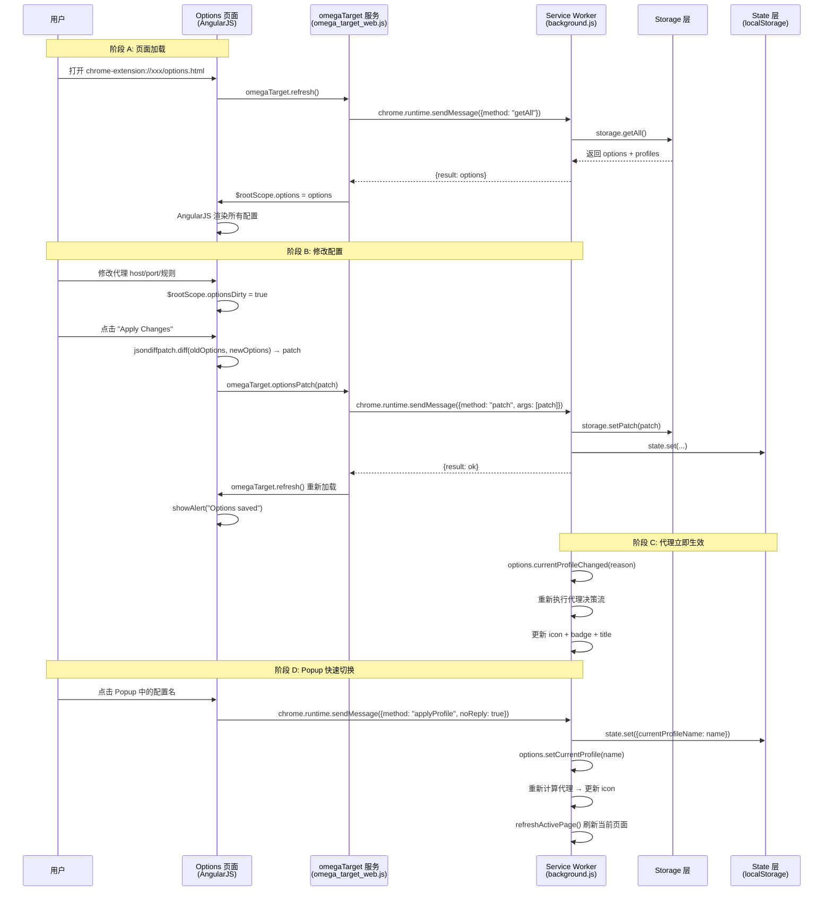
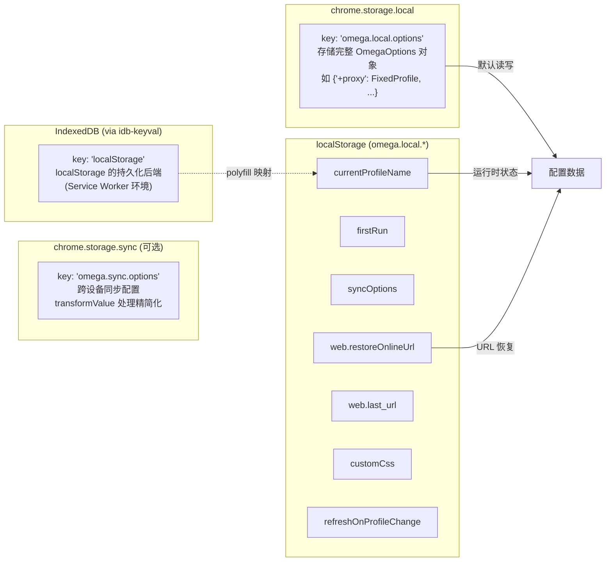
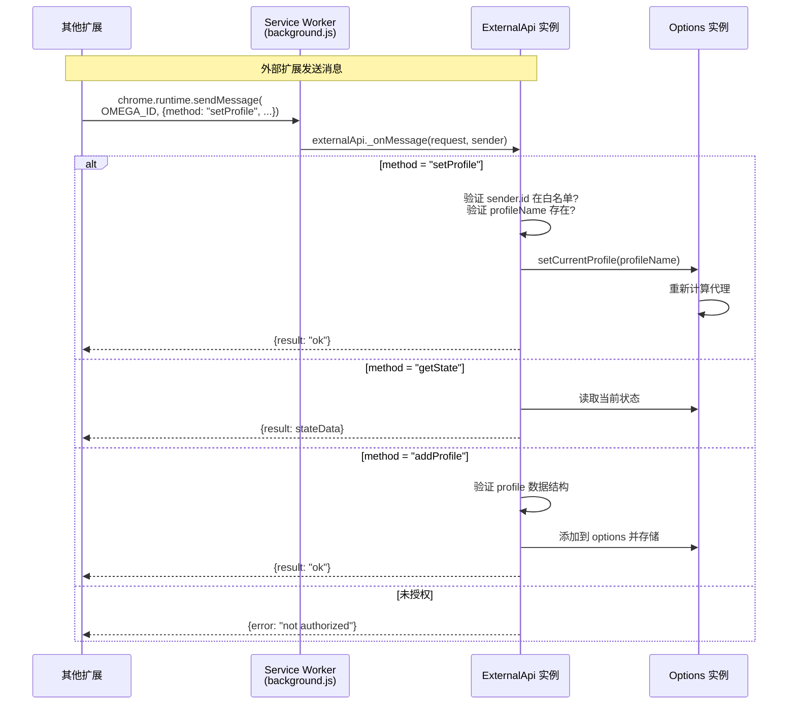
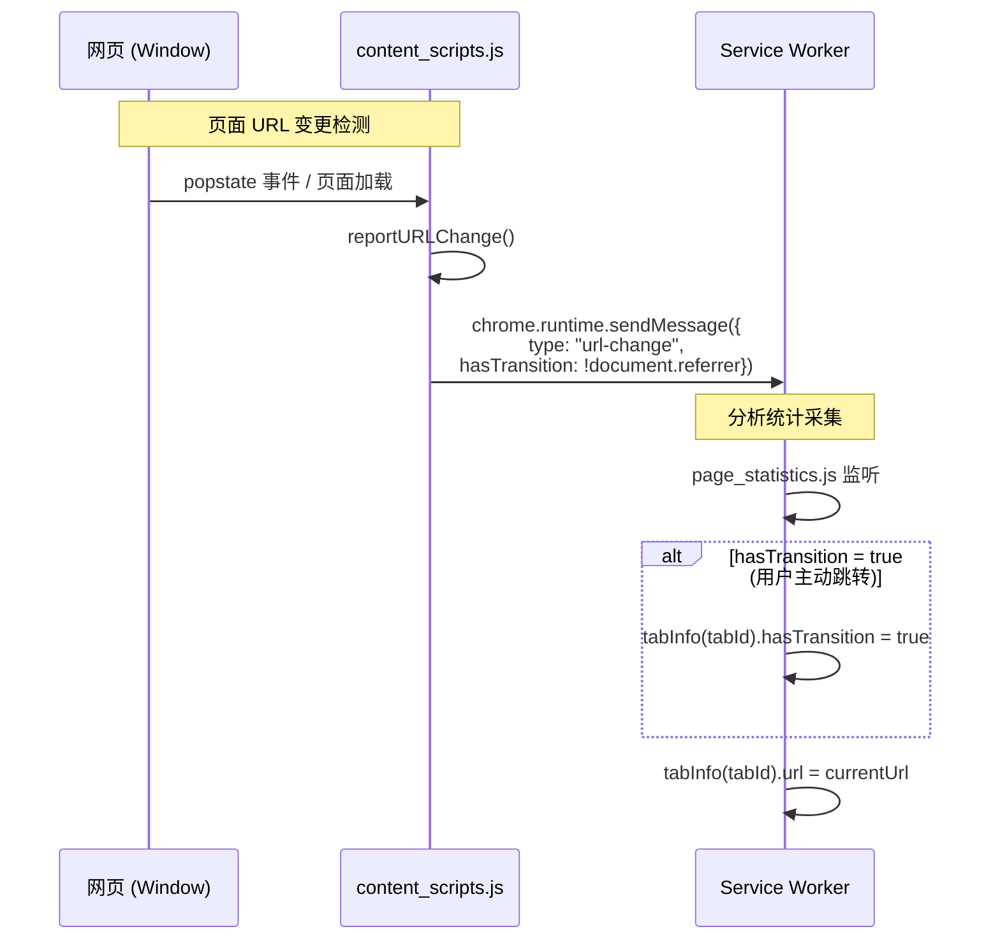
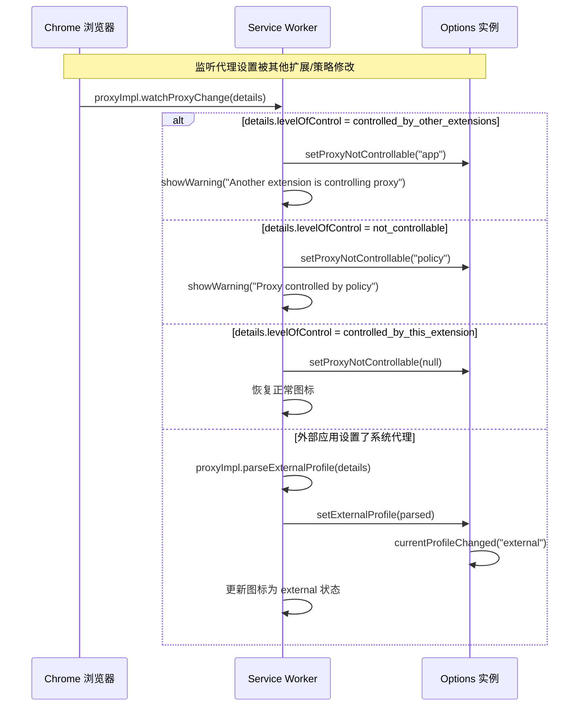
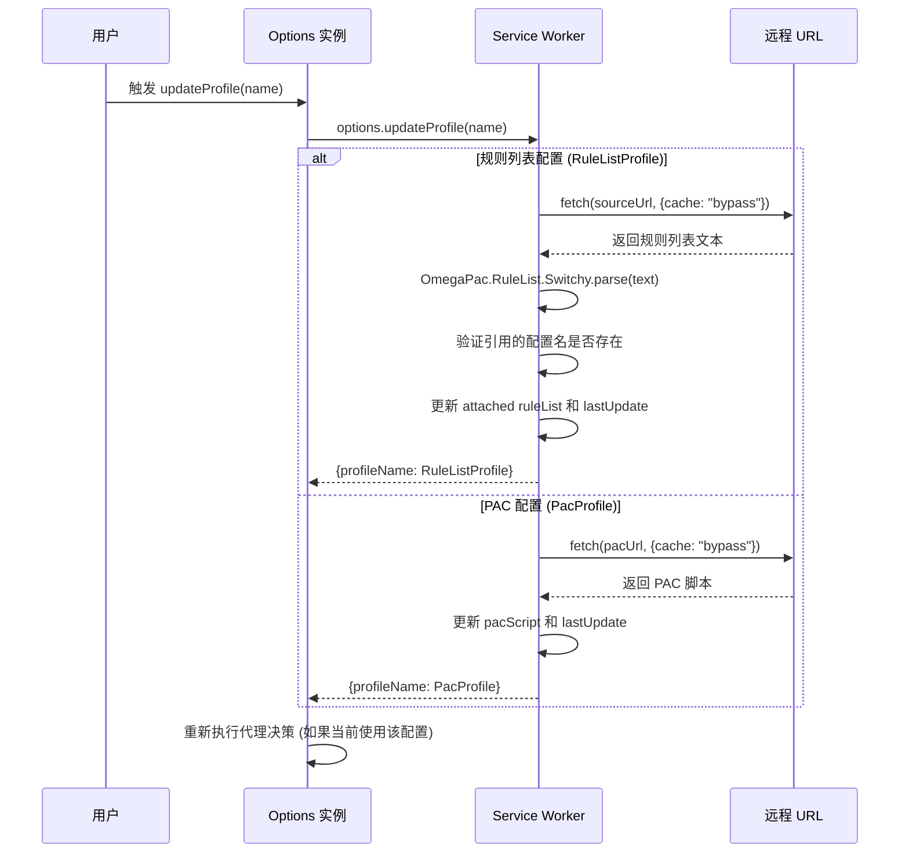

# Proxy SwitchyOmega (V3) v3.0.5 — 数据流文档

## 概述

本文档描述 Proxy SwitchyOmega 的三大核心数据流:
1. **代理决策流** — URL 请求如何匹配到代理配置
2. **用户配置流** — 用户在 UI 中的操作如何持久化并生效
3. **扩展间通信流** — 外部扩展如何控制和查询代理状态

---

## 1. 代理决策流 (Proxy Decision Flow)

当用户在浏览器中访问一个 URL 时, SwitchyOmega 决定使用哪个代理配置。

### 代理配置优先级

---

## 2. 用户配置流 (User Configuration Flow)

用户通过 Options 页面或 Popup 面板修改配置的全流程。

### 配置持久化存储模型

---

## 3. 扩展间通信流 (External API Flow)

允许其他扩展通过 `chrome.runtime.sendMessage` 控制 SwitchyOmega。

---

## 4. 内容脚本数据流

---

## 5. 代理外部变更检测流

---

## 6. 规则列表 (RuleList) 在线更新流

---

## 7. 数据存储层级总结

| 存储层 | 用途 | 数据量 | 同步 | 持久性 |
|---|---|---|---|---|
| `chrome.storage.local` | 配置主数据 (所有 profiles + rules) | KB ~ MB | 否 | 永久 (不清除) |
| `chrome.storage.sync` | 跨设备配置同步 | 有限 (100KB) | 是, Chrome Sync | 永久 |
| `localStorage` (omega.local.*) | 运行时状态 (当前配置、首次运行标记等) | < 1KB | 否 | 清除即丢失 |
| `IndexedDB` (idb-keyval) | localStorage polyfill 后端 | < 1KB | 否 | 永久 |
| 图标缓存 (内存) | 动态生成的彩色 icon ImageData | 几 KB | 否 | 会话期 |
| 日志 (localStorage['log']) | 错误日志和调试日志 | 增长中 | 否 | 限制 5MB |
