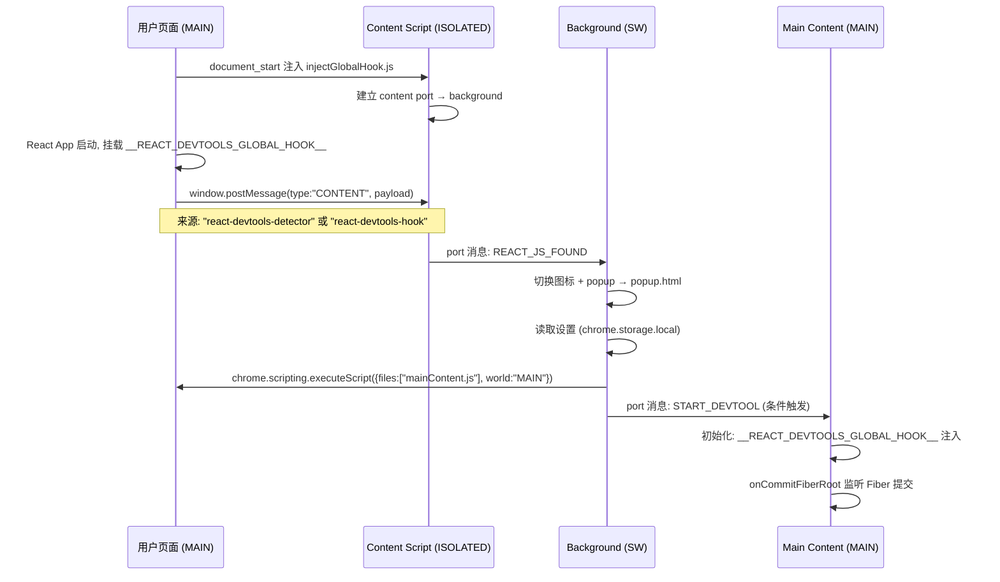
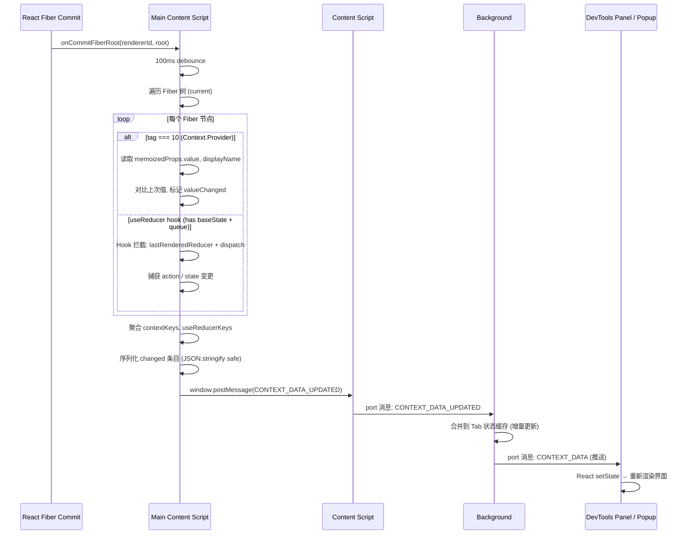
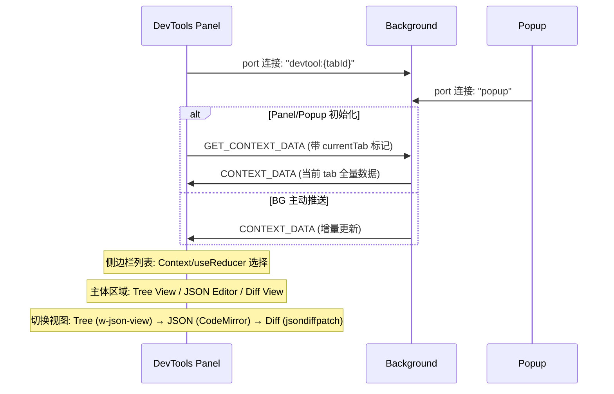
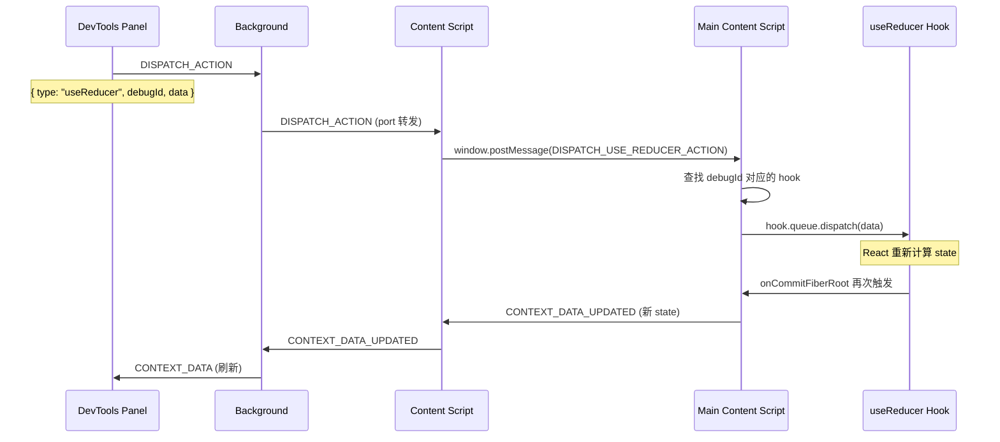
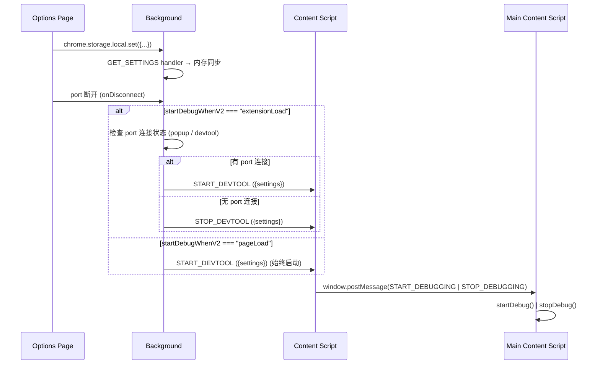

# React Context DevTool v4.4 — 数据流文档

## 1. 整体数据流概览

```
用户页面 (MAIN world)          Content Script (ISOLATED)        Background (Service Worker)      UI (Panel/Popup)
     │                              │                                │                               │
     │  [React Fiber Tree]          │                                │                               │
     │         │                    │                                │                               │
     │   ① onCommitFiberRoot        │                                │                               │
     │         │                    │                                │                               │
     │   ② Hook 拦截 + Fiber 遍历   │                                │                               │
     │         │                    │                                │                               │
     │   ③ window.postMessage ─────►│                                │                               │
     │      (type: "CONTENT")       │                                │                               │
     │                              │  ④ chrome.runtime.connect ───►│                               │
     │                              │     (CONTEXT_DATA_UPDATED)     │                               │
     │                              │                                │  ⑤ 更新 Tab 状态缓存          │
     │                              │                                │         │                     │
     │                              │                                │  ⑥ chrome.runtime ──────────►│
     │                              │                                │     (CONTEXT_DATA)             │
     │                              │                                │                               │
     │                              │                                │◄── ⑦ 请求 (GET_CONTEXT_DATA) ──│
     │                              │                                │──► ⑧ 响应 (CONTEXT_DATA) ────►│
     │                              │                                │                               │
     │◄─ ⑨ DISPATCH_USE_REDUCER_ACTION ───────── (反向)             │                               │
     │                              │◄──────────────────────────────│◄──────────────────────────────│
```

## 2. 关键流程

### 2.1 React 检测与初始化



### 2.2 Context/useReducer 数据采集与上报



### 2.3 UI 数据查看



### 2.4 Action Dispatch (时间旅行调试)



### 2.5 设置变更流程



## 3. 通信协议详细说明

### 3.1 端口命名规范

| 端口名称模式 | 示例 | 说明 |
|-------------|------|------|
| `background` | `background` | 内置虚拟端口（非 Chrome 真实端口，内部消息转发用） |
| `content:{tabId}` | `content:123` | Content Script 端口（后台自动解析 "active" → 当前 tab ID） |
| `devtool:{tabId}` | `devtool:123` | DevTools Panel 端口 |
| `popup` | `popup` | Browser Action Popup 端口 |

### 3.2 window.postMessage 协议

| type | 方向 | eventName |
|------|------|-----------|
| `CONTENT_WINDOW` | Content Script → 主页面 | START_DEBUGGING, STOP_DEBUGGING, DISPATCH_USE_REDUCER_ACTION |
| `CONTENT` | 主页面 → Content Script | CONTEXT_DATA_UPDATED, REACT_JS_FOUND (via "react-devtools-detector"/"react-devtools-hook") |

### 3.3 消息生命周期

每条消息包含 `to`/`from`/`eventName`/`eventData` 字段。支持请求-响应模式：

1. 发送方调用 `sendMessage(to, eventName, eventData)`
2. 接收方在 `onMessage` 中处理，return 的值自动作为 `eventName::RESPONSE`
3. 异常自动转为 `eventName::RESPONSE_ERROR`
4. 30 秒超时后 reject Promise

## 4. 数据缓存策略

### 4.1 Background Tab 状态缓存 (`O` map)

```typescript
Map<tabId: number, TabDebugData> {
  tabId: number;
  tab: { title?: string };
  context: {                     // 增量更新：有新 key 则添加，缺少 key 则删除
    [debugId]: { oldValue, newValue }
  };
  useReducer: {                  // 增量更新
    [debugId]: { actions[], state[], displayName, hook, valueChanged }
  };
  reactInfo: { version, rendererPackageName };
  reactDevtoolPayload: { reactBuildType };
  isReactDetected: boolean;
}
```

- **写入时机**：CONTEXT_DATA_UPDATED 消息到达时（增量 merge）
- **清除时机**：Tab 关闭事件 (`chrome.tabs.onRemoved`)
- **读取时机**：UI 初始化 GET_CONTEXT_DATA 请求时

### 4.2 Settings 缓存

- 持久化：`chrome.storage.local` 中的 `startDebugWhenV2`、`debugUseReducer`、`debugContext` 三个键
- 内存：每次 `GET_SETTINGS` 请求时从 storage 读取最新值（无内存缓存，保证实时性）
