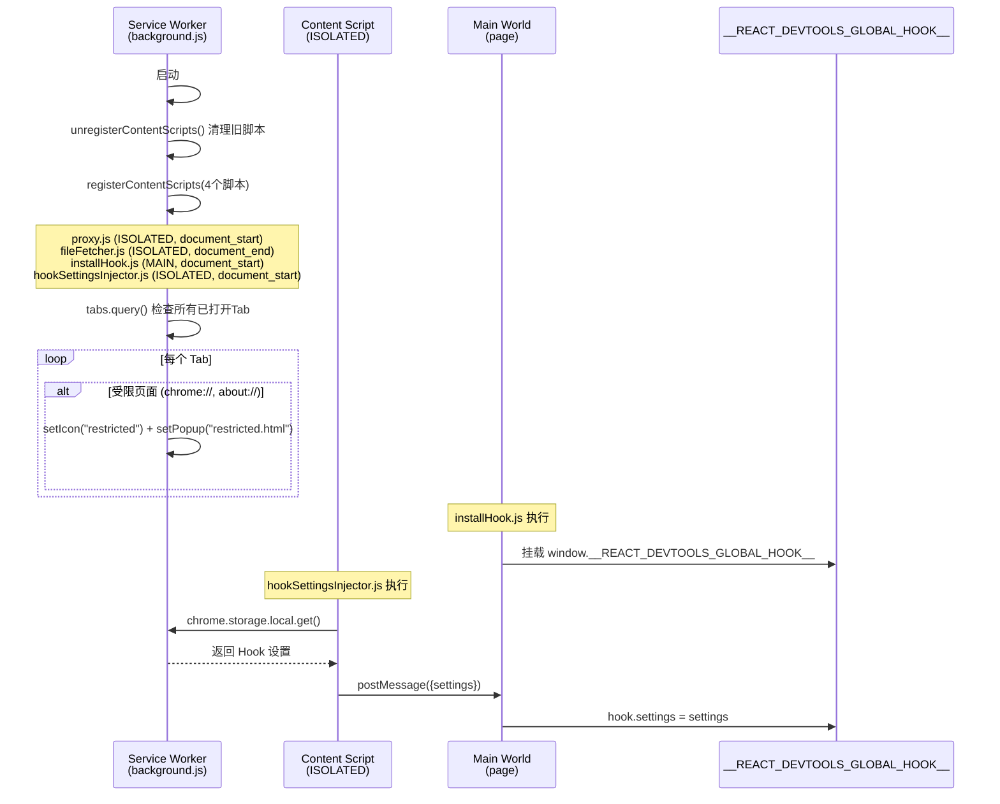
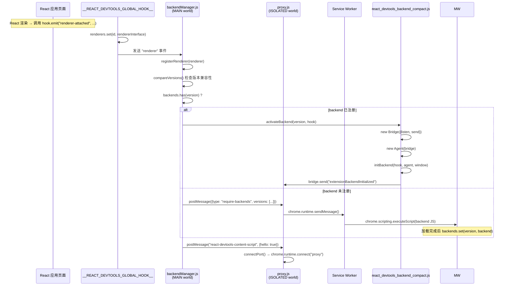
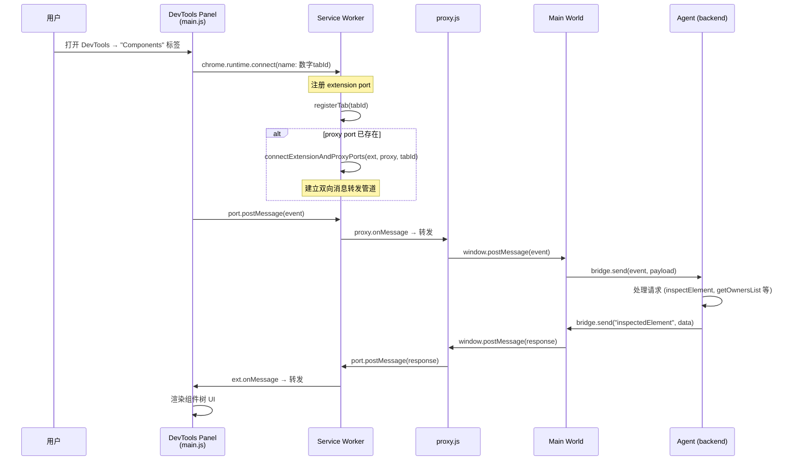
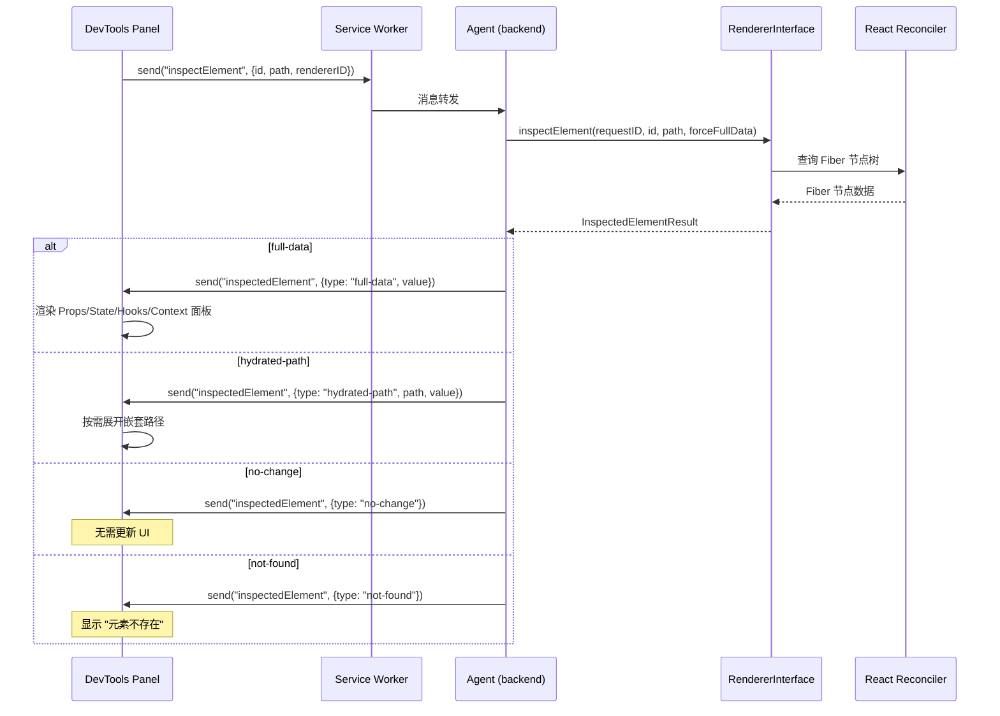
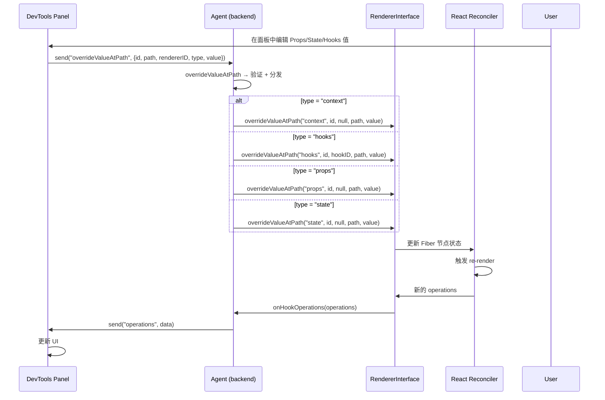
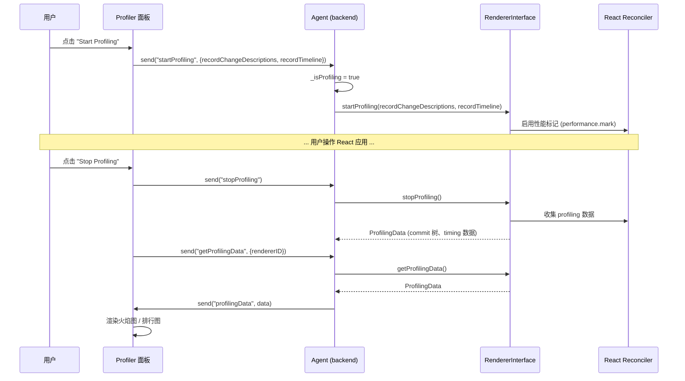
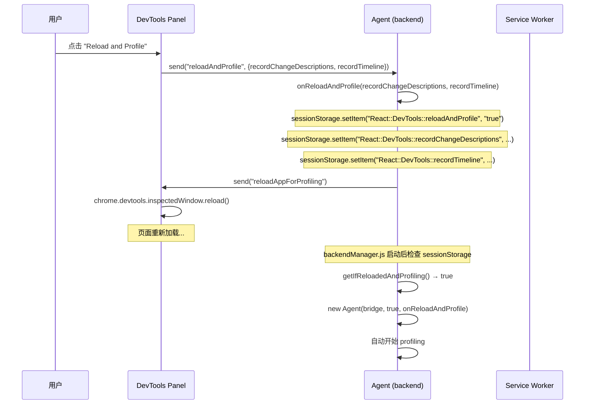
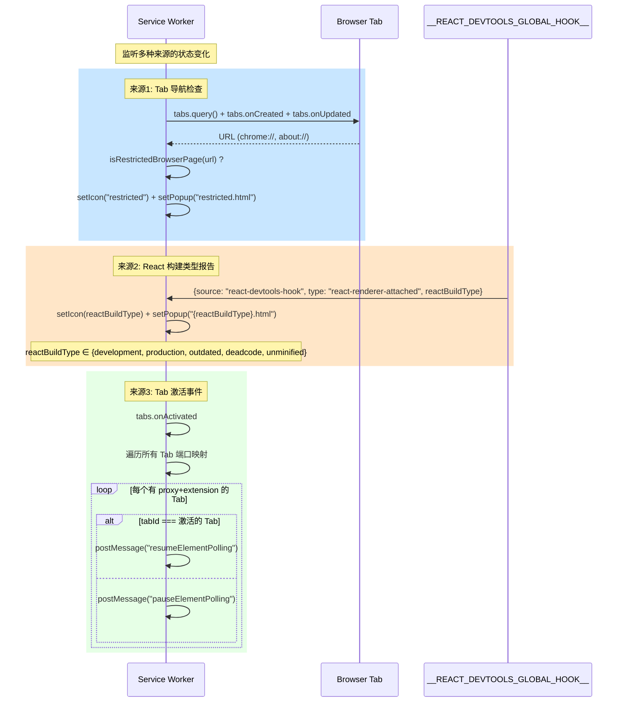
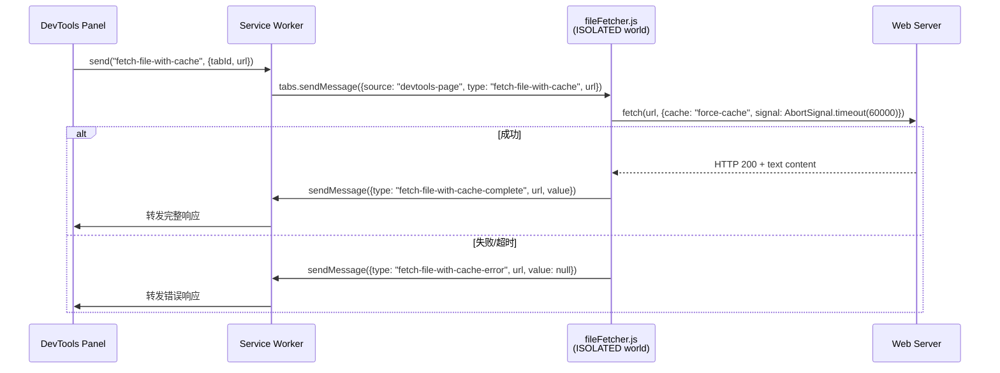
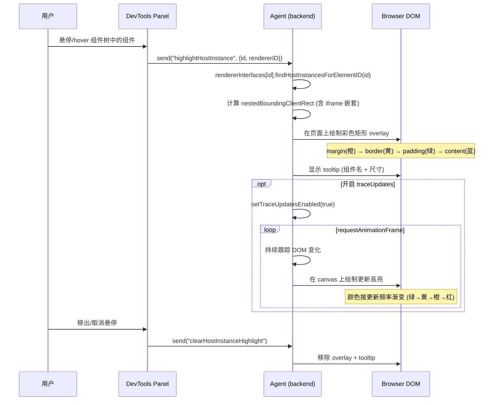

# React Developer Tools v7.0.1 — 数据流文档

## 概述

本文档描述 React Developer Tools 中核心业务流程的数据流向，涵盖启动初始化、组件检查、性能分析和页面重载分析等关键场景。

---

## 1. 扩展启动与脚本初始化流

---

## 2. React 检测与 Backend 激活流

---

## 3. DevTools 面板开通信流

---

## 4. 组件检查流（inspectElement）

---

## 5. 属性覆写流（overrideValueAtPath）

---

## 6. 性能分析流（Profiling）

---

## 7. 重载并分析流（Reload and Profile）

---

## 8. 图标/弹窗状态切换流

---

## 9. 文件获取流（Fetch File with Cache）

---

## 10. 元素高亮与追踪流

