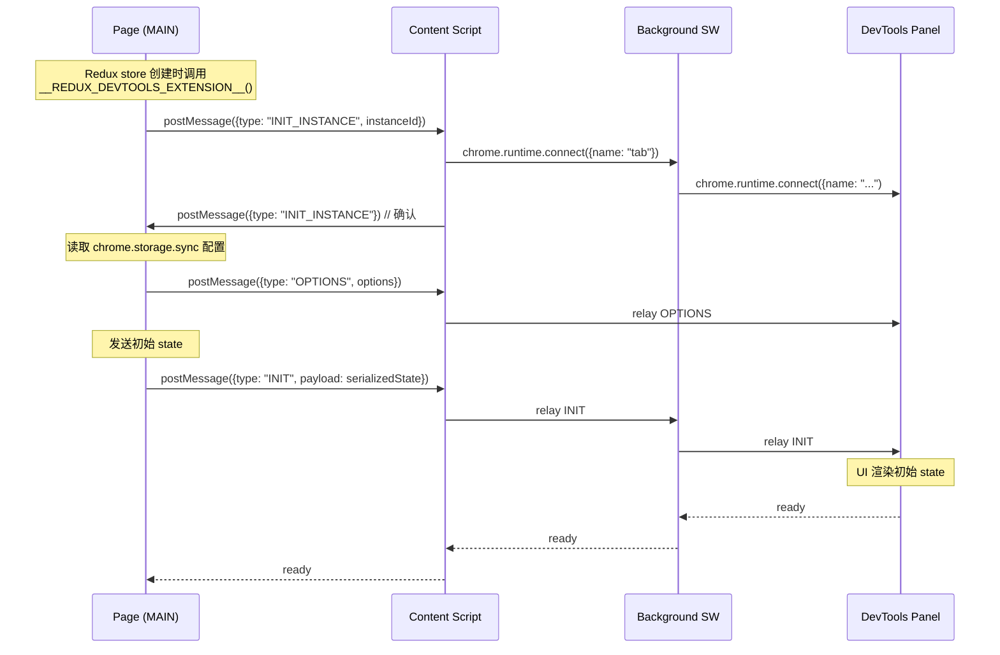
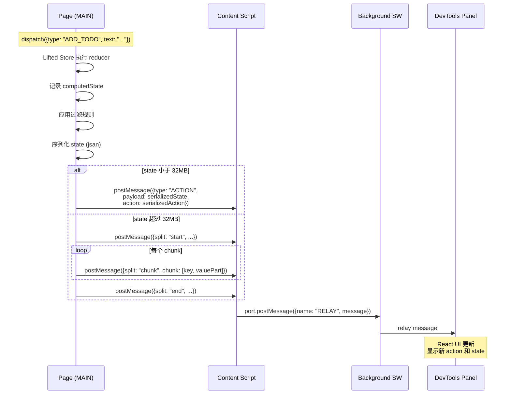
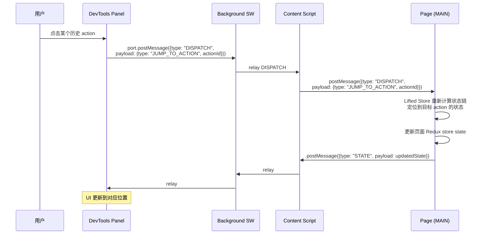
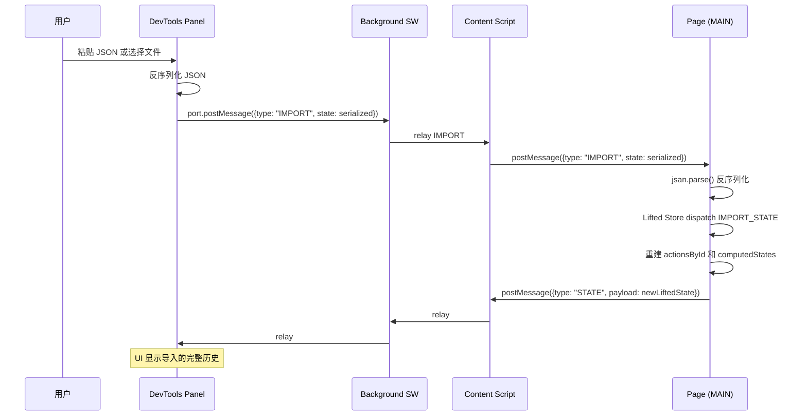
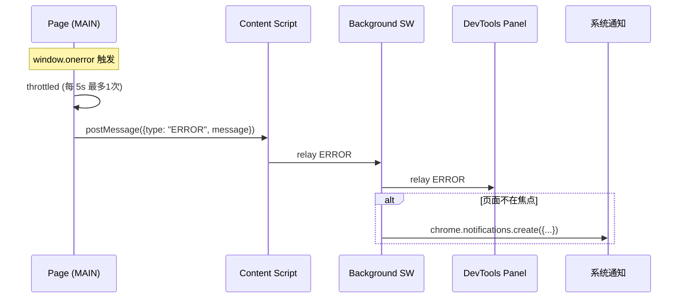
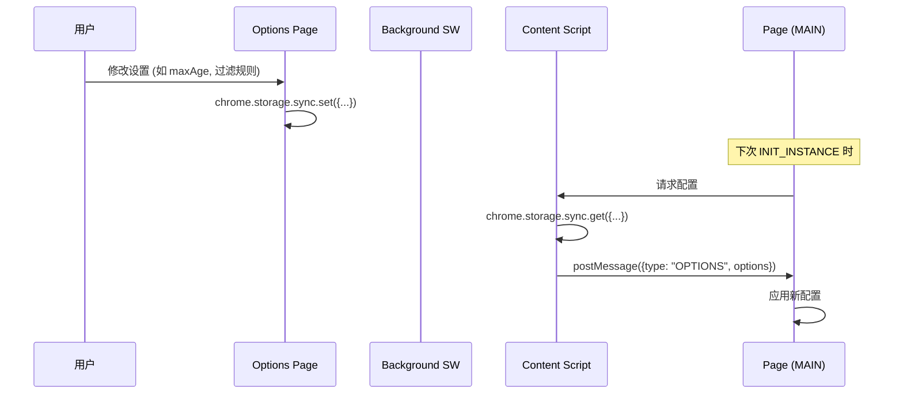

# Redux DevTools v3.2.10 — 数据流文档

## 整体通信架构

```
┌──────────────┐   postMessage    ┌──────────────┐  chrome.runtime  ┌──────────────┐  chrome.runtime  ┌──────────────┐
│  Page        │ ◄──────────────► │  Content     │ ◄──────────────► │  Background  │ ◄──────────────► │  DevTools    │
│  (MAIN)      │  @devtools-page  │  Script      │  port.connect   │  Service     │  port.connect   │  Panel       │
│              │  @devtools-ext   │  (Isolated)  │                 │  Worker      │                 │  (React UI)  │
└──────────────┘                  └──────────────┘                  └──────────────┘                  └──────────────┘
        ▲                                                                                                   ▲
        │                                                                                                   │
        │  chrome.storage.sync                                                                             │
        └───────────────────────────────────────────────────────────────────────────────────────────────────┘
        │                                                                                                   │
        ▼                                                                                                   │
┌──────────────┐                                                                                  ┌──────────────┐
│  Options     │                                                                                  │  Remote      │
│  Page        │                                                                                  │  DevTools    │
│  (React UI)  │                                                                                  │  (React UI)  │
└──────────────┘                                                                                  └──────────────┘
```

## 关键数据流

### 流程 1: 初始化连接



### 流程 2: Action 分派与记录



### 流程 3: 时间旅行 (Jump to Action)



### 流程 4: 导入 State



### 流程 5: 错误通知



### 流程 6: 选项同步



## 消息协议

### postMessage 通道 (page <-> content script)

消息格式: `window.postMessage(data, "*")`

| type | 方向 | 说明 |
|------|------|------|
| `INIT_INSTANCE` | Page → CS → BG | 新建 store 实例 |
| `DISPATCH` | DT → CS → Page | 执行 lifted action |
| `ACTION` | Page → CS → DT | 单个 action + state |
| `STATE` | Page → CS → DT | 完整 lifted state |
| `PARTIAL_STATE` | Page → CS → DT | 增量 state 更新 |
| `EXPORT` | Page → CS → DT | 导出 action 历史 |
| `IMPORT` | DT → CS → Page | 导入 state |
| `START` | DT → CS → Page | 开始监听 |
| `STOP` | DT → CS → Page | 停止监听 |
| `ERROR` | CS → BG | 运行时错误 |
| `OPTIONS` | CS → Page | 配置更新 |
| `OPEN` | Page → CS → BG | 打开 DevTools 窗口 |
| `DISCONNECT` | Page → CS | 断开连接 |

### 消息大小控制

- 消息大小限制: 32 MB (Chrome 扩展消息上限)
- 超大消息自动拆分为 chunk (start → chunk[] → end)
- 每个 chunk 包含 `[key, partialValue]` 对

## 状态生命周期

```
INIT ──► START ──► PERFORM_ACTION ──► (循环) ──► COMMIT/RESET ──► STOP
                    │                    │
                    ├── TOGGLE_ACTION    ├── ROLLBACK
                    ├── JUMP_TO_*        ├── SWEEP
                    ├── REORDER_ACTION   ├── IMPORT_STATE
                    ├── LOCK_CHANGES     └── PAUSE_RECORDING
                    └── SET_ACTIONS_ACTIVE
```

- `PAUSE_RECORDING`: 暂停记录但保留历史
- `LOCK_CHANGES`: 锁定所有变更
- `COMMIT`: 将当前"时间旅行"状态固定为新的基准
- `ROLLBACK`: 回到上次 commit 状态
- `SWEEP`: 清除所有被 skip 的 action
