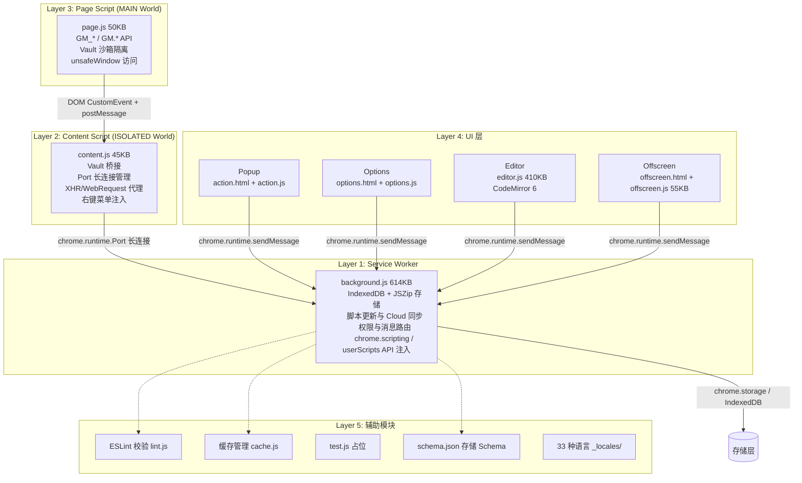
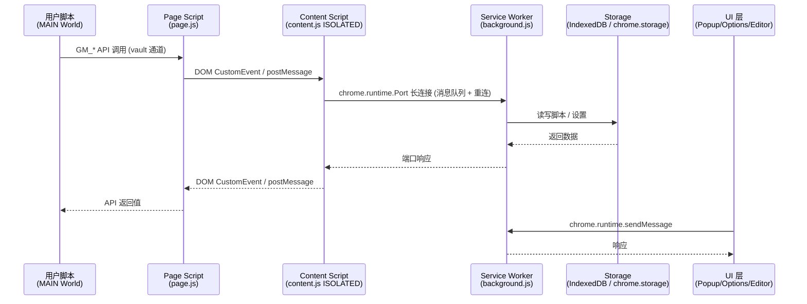
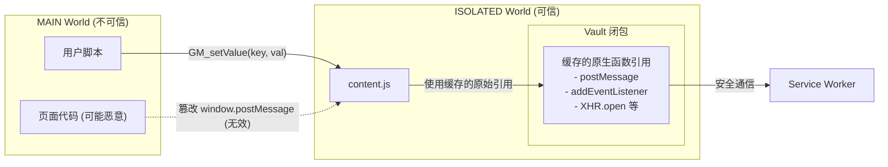
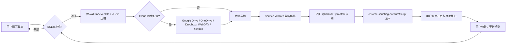
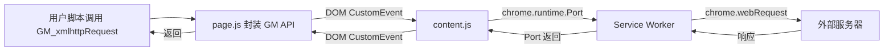
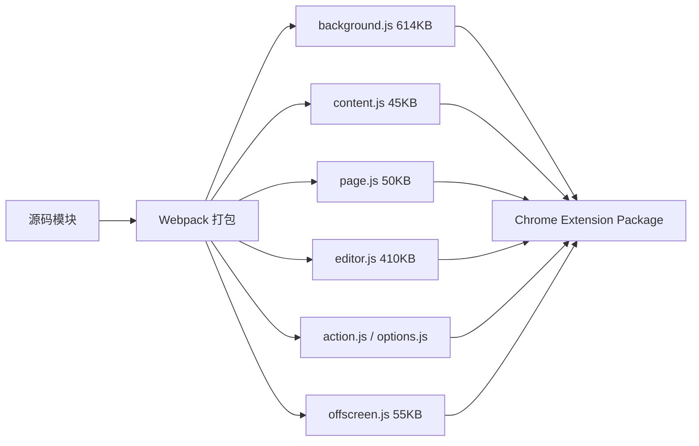

# Tampermonkey v5.5.0 架构文档

## 一 扩展概述

| 属性 | 值 |
|------|-----|
| 名称 | 篡改猴 (Tampermonkey) |
| 版本 | 5.5.0 |
| Manifest 版本 | MV3 |
| 类型 | 用户脚本管理器 (Userscript Manager) |
| 代码规模 | 86 个文件，6 个主要 Bundle，约 2MB |
| 打包工具 | Webpack (自定义 `__webpack_require__` 运行时) |

## 二 分层架构

## 三 模块职责详表

### Layer 1: Service Worker

| 模块 | 文件 | 大小 | 职责 |
|------|------|------|------|
| 核心后台 | background.js | 614KB | Webpack Bundle，整合全部后台逻辑 |
| 脚本存储 | (内联 JSZip 3.5.0) | — | IndexedDB 存储用户脚本，JSZip 压缩 |
| 脚本更新 | — | — | 定时检查远程脚本更新源 |
| Cloud 同步 | — | — | Google Drive / OneDrive / Dropbox / WebDAV / Yandex 云存储同步 |
| 权限管理 | — | — | 统一管理 Chrome API 权限调用 |
| 消息路由 | — | — | 中央消息总线，处理所有来自 content script / popup / options / editor 的请求 |
| 事件监听 | — | — | tabs, webNavigation, webRequest, alarms, idle, contextMenus |
| 脚本注入 | — | — | 通过 `chrome.scripting.executeScript` / `registerContentScripts` / `userScripts` API 注入 |
| ESLint 引擎 | vendor/eslint/ | 1.5MB | 自定义 ESLint 规则集，用于用户脚本校验 |

### Layer 2: Content Script

| 模块 | 文件 | 大小 | 职责 |
|------|------|------|------|
| Content Script | content.js | 45KB | 注入所有页面，ISOLATED World 运行 |
| Vault 沙箱 | — | — | 将 GM API 安全暴露给用户脚本，闭包缓存原生函数防止篡改 |
| 页面桥接 | — | — | 通过 DOM CustomEvent 与 postMessage 与 page.js 通信 |
| Port 管理 | — | — | 维持与 Service Worker 的 chrome.runtime.Port 长连接，支持消息队列与重连 |
| 上下文菜单 | — | — | 注入右键菜单项 |
| 网络代理 | — | — | 拦截用户脚本 XHR/WebRequest 并在 Page 上下文中代理 |

### Layer 3: Page Script

| 模块 | 文件 | 大小 | 职责 |
|------|------|------|------|
| Page Script | page.js | 50KB | 注入页面 MAIN World，直接与用户脚本交互 |
| GM API | — | — | 提供 `GM_*` / `GM.*` API 完整实现 |
| 沙箱隔离 | — | — | Vault 模式：原生函数引用缓存在闭包中，防止页面代码篡改 |
| unsafeWindow | — | — | 暴露页面原始 `window` 对象给用户脚本 |

### Layer 4: UI 层

| 模块 | 文件 | 大小 | 职责 |
|------|------|------|------|
| Popup | action.html + action.js | — | 工具栏弹出窗口，显示当前页面匹配的脚本列表及开关状态 |
| Options | options.html + options.js | — | 设置页面，管理全局偏好、编辑器配置、Cloud 同步、黑名单等 |
| Editor | editor.js | 410KB | 基于 CodeMirror 6 的脚本编辑器，语法高亮 + ESLint 实时校验 |
| Offscreen | offscreen.html + offscreen.js | 55KB | MV3 Offscreen Document，用于 clipboard、audio 等需要 DOM 的 API |

### Layer 5: 辅助模块

| 模块 | 文件 | 大小 | 职责 |
|------|------|------|------|
| 元数据校验 | lint.js | 14KB | 校验用户脚本 `@name` / `@version` / `@grant` 等头部元数据 |
| 缓存管理 | cache.js | 2KB | 资源缓存生命周期管理 |
| 测试占位 | test.js | 1 byte | Webpack 入口占位 |
| 存储 Schema | schema.json | — | Chrome 托管存储 (Managed Storage) 的 JSON Schema 定义 |

## 四 技术栈

| 技术 | 版本/说明 | 用途 |
|------|-----------|------|
| Webpack | 自定义 `__webpack_require__` 运行时 | 模块打包，6 个独立 Bundle |
| CodeMirror 6 | 最新版 | 脚本编辑器，语法高亮、代码折叠、自动补全 |
| JSZip | 3.5.0 (内联) | 用户脚本压缩存储，节省 IndexedDB 空间 |
| ESLint | 自定义规则集 (vendor/eslint/, 1.5MB) | 用户脚本实时语法与风格校验 |
| jsdiff | — (vendor/jsdiff/) | 脚本差异对比 |
| FileSaver.js | — (vendor/saveas/) | 导出脚本文件到本地 |
| Chrome Extensions API (MV3) | Service Worker + scripting + userScripts | 扩展运行平台 |
| IndexedDB | — | 用户脚本 + 资源本地持久化 |

## 五 通信架构

### 完整通信链路

### 通信机制说明

| 链路 | 机制 | 方向 | 特性 |
|------|------|------|------|
| 用户脚本 → Page Script | Vault Sandbox (闭包传递) | 双向 | 防篡改，原生函数缓存 |
| Page Script → Content Script | DOM CustomEvent + postMessage | 双向 | 跨 World 桥接 |
| Content Script → Service Worker | chrome.runtime.Port | 双向 | 长连接，消息队列，断线重连 |
| UI → Service Worker | chrome.runtime.sendMessage | 请求-响应 | 一次性消息 |
| Service Worker → Storage | IndexedDB + chrome.storage | 双向 | 异步持久化 |

## 六 权限清单

| 权限 | 类型 | 用途 |
|------|------|------|
| notifications | API | 脚本更新桌面通知 |
| unlimitedStorage | API | 大量用户脚本及资源的本地存储配额 |
| tabs | API | 获取和操作标签页信息 |
| idle | API | 检测用户空闲，触发后台脚本更新 |
| webNavigation | API | 监听页面导航事件，触发脚本注入 |
| webRequest | API | 拦截网络请求 (GM_webRequest) |
| webRequestBlocking | API | 同步拦截/重定向网络请求 |
| storage | API | chrome.storage 持久化用户设置 |
| contextMenus | API | 右键菜单添加自定义脚本命令 |
| clipboardWrite | API | GM_setClipboard 实现 |
| cookies | API | GM_cookie API |
| alarms | API | 定时任务：脚本更新检查、资源同步 |
| declarativeNetRequestWithHostAccess | API | 声明式网络请求规则 |
| scripting | API | 脚本注入 (executeScript) 与动态 content script 注册 |
| userScripts | API | MV3 用户脚本 API (按需使用) |
| offscreen | API | 创建 offscreen document，支持 clipboard/audio 等需 DOM 的操作 |
| chrome://favicon/ | URL | 在脚本列表中显示网站 favicon |
| downloads | optional API | GM_download 实现 |

## 七 核心安全机制: Vault 沙箱

Tampermonkey 的核心安全模型是 **Vault Sandbox**，在 content.js 中实现：

1. **闭包保护**: content.js 在加载时缓存所有原生函数引用（如 `document.createElement`、`XMLHttpRequest.prototype.open`）到闭包中的私有变量
2. **代理注入**: 通过 DOM CustomEvent 和 postMessage 向 page.js 传递 API 调用，而非直接将函数引用暴露给 MAIN World
3. **接口封装修订**: page.js 在 MAIN World 中提供 `GM_*` API 时，所有实现均回调至 ISOLATED World 中的 content.js，再由 content.js 通过 Port 向 Service Worker 请求
4. **防篡改**: 即使页面代码重写了 `window.postMessage` 或 DOM 事件 API，Vault 中缓存的原始函数引用不受影响

## 八 数据流

### 脚本生命周期数据流

### 网络请求代理流

## 九 Bundle 结构

| Bundle | 入口 | 大小 | 加载场景 |
|--------|------|------|----------|
| background.js | Service Worker | 614KB | Extension 启动时加载，常驻 |
| content.js | Content Script | 45KB | 每个匹配页面注入 |
| page.js | Page Script | 50KB | 内联于 extension.js / 动态注入到 MAIN World |
| editor.js | Editor 页面 | 410KB | 用户打开脚本编辑器时加载 |
| popup (action.js) | Popup 页面 | — | 用户点击工具栏图标时加载 |
| options (options.js) | Options 页面 | — | 用户打开设置页面时加载 |
| offscreen.js | Offscreen Document | 55KB | 需要 clipboard/audio 等 DOM API 时创建 |

## 十 关键设计决策

1. **Webpack 多入口打包**: 将全部模块按运行环境拆分为 6 个独立 Bundle，每个页面/Worker 只加载所需代码，避免 Service Worker 加载 UI 代码
2. **Vault 沙箱隔离**: 通过闭包缓存原生函数引用的方式，在 ISOLATED World 与 MAIN World 之间建立安全屏障 —— 这是 Tampermonkey 区别于其他脚本管理器的核心设计
3. **Port 长连接**: content script 与 Service Worker 之间使用 `chrome.runtime.Port` 而非 `sendMessage`，以维持持久双向通信通道，减少消息序列化开销，支持断线自动重连
4. **JSZip 压缩存储**: 所有用户脚本在写入 IndexedDB 前使用 JSZip 压缩，有效降低存储空间占用
5. **CodeMirror 6 + 内联 ESLint**: 编辑器使用最新 CodeMirror 6 架构，集成自定义 ESLint 规则集实现实时语法校验（包括 `@name`、`@version`、`@grant` 等 Tampermonkey 专有 Meta 标记）
6. **MV3 Offscreen Document**: 利用 MV3 的 `offscreen` API 创建临时 DOM 环境，替代 MV2 中 Background Page 的 DOM 能力（如 clipboard、audio 播放）
7. **多语言国际化**: 33 种语言的 `_locales/` 目录覆盖全球主要语言

## 十一 构建与运行时

### 构建流程

### 运行时加载

1. Chrome 启动 → 加载 Service Worker (background.js)，注册所有事件监听器
2. 用户导航到页面 → `webNavigation` 事件触发 → 匹配脚本规则 → `chrome.scripting.executeScript` 注入 content.js
3. content.js 初始化 Vault 沙箱 → 通过 Port 连接 Service Worker → 注入 page.js 到 MAIN World
4. page.js 在 MAIN World 暴露 `GM_*` API → 注入匹配的用户脚本
5. 用户点击图标 → 加载 Popup (action.js) → 通过 `sendMessage` 查询当前页匹配脚本
