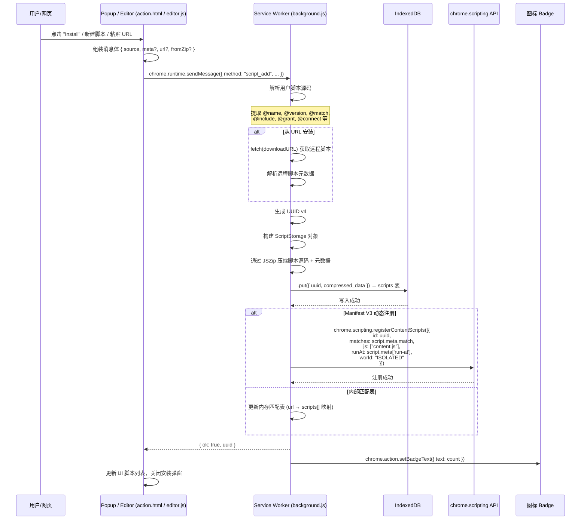
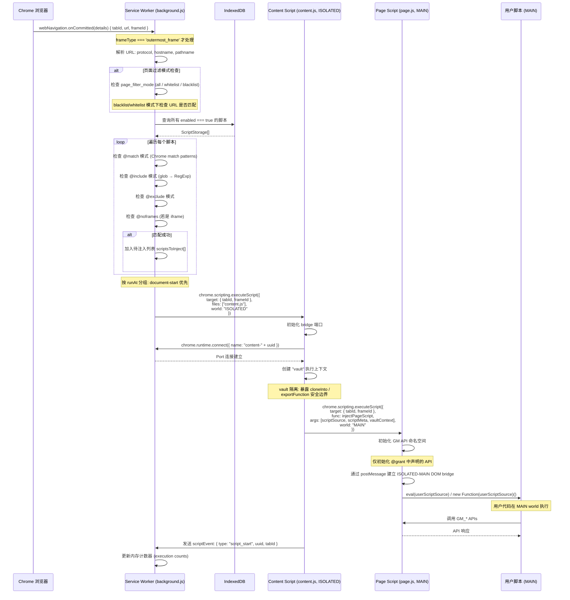
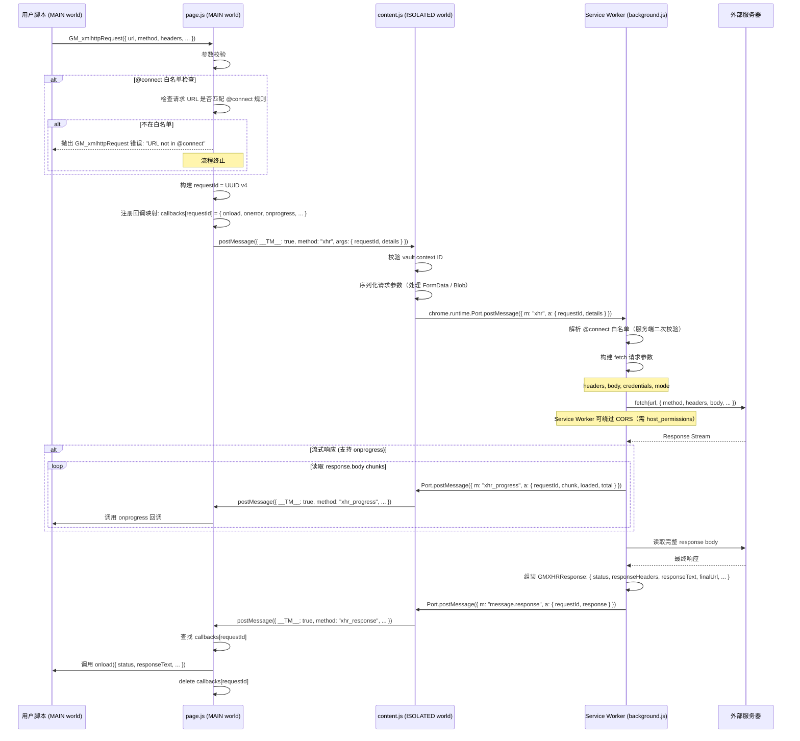
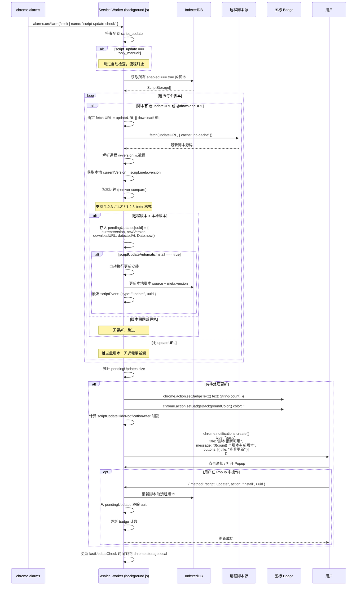

# DATA_FLOW.md — Tampermonkey v5.5.0 数据流文档

> **版本**: v5.5.0 (Manifest V3)  
> **源文件**: background.js, content.js, page.js, editor.js, cache.js  
> **逆向日期**: 2026-07-06  
> **工具链**: dsv4

---

## 目录

1. [架构概览](#1-架构概览)
2. [数据存储 Schema](#2-数据存储-schema)
3. [流程 1: 脚本安装流程](#3-流程-1-脚本安装流程)
4. [流程 2: 页面加载时脚本注入流程](#4-流程-2-页面加载时脚本注入流程)
5. [流程 3: GM_xmlhttpRequest 网络请求代理流程](#5-流程-3-gm_xmlhttprequest-网络请求代理流程)
6. [流程 4: 云同步流程](#6-流程-4-云同步流程)
7. [流程 5: 用户脚本更新检查流程](#7-流程-5-用户脚本更新检查流程)
8. [消息通信协议总览](#8-消息通信协议总览)

---

## 1. 架构概览

Tampermonkey v5.5.0 采用 Manifest V3 Service Worker 架构，核心由以下运行时组件构成：

| 组件 | 文件 | 运行上下文 | 职责 |
|------|------|-----------|------|
| **Service Worker** | `background.js` | Service Worker (后台) | 脚本生命周期管理、存储、网络代理、同步、更新检查 |
| **Content Script** | `content.js` | ISOLATED world (每个注入页面) | JS 注入编排、ISOLATED-MAIN 双向桥接、GM API 中继 |
| **Page Script** | `page.js` | MAIN world (每个注入页面) | GM API 实现、unsafeWindow 访问、用户脚本执行上下文 |
| **Cache Helper** | `cache.js` | Service Worker | IndexedDB 缓存层、脚本 CRUD、压缩/解压 |
| **Popup** | `action.html` + `extension.js` | Popup 页面 | 快捷开关、脚本列表、下载状态 |
| **Options** | `options.html` | 独立标签页 | 全局设置、编辑器、同步配置、脚本管理仪表盘 |
| **Editor** | `editor.js` + `editor.css` | 独立标签页 | 用户脚本编辑器、ESLint 集成、差异对比 |
| **Offscreen** | `offscreen.js` | Offscreen 文档 | 持久化操作（如剪贴板访问、DOM 解析） |

整体通信拓扑：

```
┌──────────────────────────────────────────────────────────┐
│                    Service Worker (background.js)          │
│  ┌──────────┐  ┌──────────┐  ┌──────────┐  ┌──────────┐ │
│  │ Script   │  │ XHR      │  │ Sync     │  │ Update   │ │
│  │ Manager  │  │ Proxy    │  │ Engine   │  │ Checker  │ │
│  └────┬─────┘  └────┬─────┘  └────┬─────┘  └────┬─────┘ │
│       │              │              │              │       │
│  ┌────┴──────────────┴──────────────┴──────────────┴────┐ │
│  │              IndexedDB / chrome.storage               │ │
│  └──────────────────────────────────────────────────────┘ │
└──────┬──────────────┬──────────────┬─────────────────────┘
       │              │              │
  Port │        Port │         Port │
       │              │              │
┌──────┴──────┐ ┌─────┴─────┐ ┌─────┴─────────┐
│ content.js  │ │ action.html│ │ options.html  │
│ (ISOLATED)  │ │ (Popup)    │ │ (Settings)    │
│     │       │ └───────────┘ └───────────────┘
│  DOM        │
│  Bridge     │
│     │       │
│ ┌───┴───┐   │
│ │page.js│   │
│ │(MAIN) │   │
│ └───────┘   │
└─────────────┘
```

---

## 2. 数据存储 Schema

### 2.1 IndexedDB — 主脚本仓库

- **数据库名**: `Tampermonkey` (或类似命名)
- **对象仓库**: `scripts`
- **键**: `uuid` (string, UUID v4)
- **数据格式**: 压缩后的 JSZip blob，解压后为 JSON 结构

```typescript
// IndexedDB 中存储的解压后脚本对象
interface IndexedDBScript {
  uuid: string;           // UUID v4，主键
  name: string;           // @name
  meta: {                 // 用户脚本元数据块
    name: string;
    description: string;
    version: string;
    author?: string;
    namespace?: string;
    include: string[];    // @include 模式
    exclude: string[];    // @exclude 模式
    match: string[];      // @match URL 模式
    require: string[];    // @require 外部依赖
    resource: { name: string; url: string }[];  // @resource
    grant: string[];      // @grant GM API 白名单
    connect: string[];    // @connect 跨域白名单
    'run-at'?: string;    // document-start / document-end / document-idle
    noframes?: boolean;   // @noframes
    updateURL?: string;
    downloadURL?: string;
    // ... 其他 @ 头字段
  };
  source: string;         // 脚本完整源码
  enabled: boolean;       // 是否启用
  position: number;       // 排序位置
  installed: number;      // 安装时间 (Date.now())
  lastUpdate: number;     // 最后更新时间 (Date.now())
  sourceUrl?: string;     // 安装来源 URL
  removed?: boolean;      // 软删除标记（回收站）
  sync?: {                // 云同步元数据
    provider: string;     // gdrive | onedrive | dropbox | webdav | yandex
    lastSync: number;     // 最后同步时间戳
    remoteId?: string;    // 云端文件 ID
    status: 'ok' | 'conflict' | 'error';
  };
  customIncludes?: string[];  // 用户自定义额外 include
  customExcludes?: string[];
  customMatches?: string[];
}
```

### 2.2 chrome.storage.local — 扩展全局配置

```typescript
// 键: 'settings' — 值: GlobalSettings 对象 (完整字段见 src/types/index.ts)
// 存储约 50+ 配置项，包括：
//   - 外观: action_menu_scripts_sort, appearance_badges, layout_user_css
//   - 编辑器: editor_theme, editor_linter_config, script_templates
//   - 更新: script_update, scriptUpdateCheckPeriod, scriptUpdateAutomaticInstall
//   - 安全: script_include_mode, script_blacklist_type, sandbox_mode
//   - 注入: runtime_strict_mode, page_filter_mode, runtime_top_level_await
//   - 同步: sync_enabled, sync_type, gd_config, od_config, db_config
//   - 上下文菜单: context_menu_enabled, ctx_exec
//   - 下载: downloads_mode, downloads_extension_whitelist

// 键: 'sync' — 同步状态缓存
interface SyncCache {
  lastSync: number;
  provider: string;
  status: 'ok' | 'error';
  pendingConflicts: string[];  // 冲突脚本 UUID 列表
}

// 键: 'pendingUpdates' — 待处理更新映射
type PendingUpdatesMap = Record<string, {
  uuid: string;
  currentVersion: string;
  newVersion: string;
  downloadURL: string;
  detectedAt: number;
}>;
```

### 2.3 chrome.storage.sync — 跨设备基础设置

```typescript
// 仅同步轻量设置（受 100KB 配额限制）:
//   - sync_enabled, sync_type
//   - 语言偏好
//   - 基本外观设置
// 脚本数据不同步到此存储（体积过大）
```

### 2.4 chrome.storage.managed — 企业策略

```typescript
// 由 schema.json 定义，管理员通过 GPO/注册表下发
// 字段: 所有 GlobalSettings 字段的只读子集
// 键: 与 chrome.storage.local 中 settings 字段名一致
```

---

## 3. 流程 1: 脚本安装流程

### 3.1 流程概述

用户在网页点击安装链接、从编辑器中新建脚本、或从 URL 下载脚本时触发。Service Worker 负责解析元数据、生成 UUID、压缩存储至 IndexedDB、注册注入规则，并通知前端更新。

### 3.2 Mermaid 序列图



### 3.3 关键路径代码特征

| 步骤 | 特征位置 | 关键标识 |
|------|---------|---------|
| 消息路由 | `background.js` | `case "script_add":` / `case "install":` / `case "edit_add":` |
| 元数据解析 | `background.js` | 正则匹配: `/^\/\/\s*@(\w+)\s+(.+)$/gm` 提取 UserScript header block |
| UUID 生成 | `background.js` | `crypto.randomUUID()` 或 `'xxxxxxxx-xxxx-4xxx-yxxx-xxxxxxxxxxxx'.replace(...)` |
| JSZip 压缩 | `background.js` / `cache.js` | 调用 `JSZip()` / `zip.file()` / `zip.generateAsync({ type: "blob" })` |
| IndexedDB 写入 | `cache.js` | `indexedDB.open("Tampermonkey")` → `objectStore("scripts").put(value, uuid)` |
| 注册注入 | `background.js` | `chrome.scripting.registerContentScripts([{id, matches, js: ["content.js"], runAt, world: "ISOLATED"}])` |
| Badge 更新 | `background.js` | `chrome.action.setBadgeText({ text: String(enabledCount) })` / `chrome.action.setBadgeBackgroundColor(...)` |

### 3.4 异常路径

- **解析失败**: 若源码中无有效 UserScript 元数据块 → 返回 `{ ok: false, error: "Invalid userscript header" }`
- **存储配额超限**: IndexedDB 写入失败 → 返回 `{ ok: false, error: "Quota exceeded" }`，弹窗提示用户清理
- **重复安装**: 检测到同名+同 namespace 的脚本 → 调用 `confirm('覆盖现有脚本?')` 确认后覆盖
- **权限不足**: URL 匹配模式需要额外 host permissions → 触发 `chrome.permissions.request()` 弹窗

---

## 4. 流程 2: 页面加载时脚本注入流程

### 4.1 流程概述

当用户导航到新页面时，`webNavigation.onCommitted` 事件触发 Service Worker，Service Worker 遍历所有启用的脚本并匹配当前 URL。对于匹配的脚本，先注入 `content.js` 至 ISOLATED world，content.js 在页面中创建 vault 沙箱上下文，再在 MAIN world 中注入 `page.js` 及用户脚本，实现 GM API 的完整初始化。

### 4.2 Mermaid 序列图



### 4.3 ISOLATED-MAIN Bridge 架构

```
┌──────────────────────────────────────────────────┐
│                    MAIN World                      │
│  ┌─────────┐     ┌─────────────────────────────┐ │
│  │ 用户脚本 │────>│ page.js (GM API 实现层)     │ │
│  │         │     │  - GM_setValue/getValue      │ │
│  │         │<────│  - GM_xmlhttpRequest         │ │
│  │         │     │  - GM_addStyle               │ │
│  └─────────┘     └──────────┬──────────────────┘ │
│                             │                      │
│              DOM postMessage / CustomEvent         │
│                             │                      │
├─────────────────────────────┼──────────────────────┤
│                ISOLATED World                      │
│  ┌──────────────────────────┴──────────────────┐  │
│  │ content.js (Bridge 中继层)                   │  │
│  │  - 接收 MAIN world 消息                     │  │
│  │  - 校验请求来源 (vault context ID)           │  │
│  │  - 转发给 Service Worker (chrome.runtime)   │  │
│  │  - 回传 Service Worker 响应给 MAIN world    │  │
│  └──────────┬──────────────────────────────────┘  │
└─────────────┼─────────────────────────────────────┘
              │  chrome.runtime.Port
┌─────────────┴─────────────────────────────────────┐
│           Service Worker (background.js)            │
│  - IndexedDB 读写                                  │
│  - 网络请求代理 (CORS bypass)                      │
│  - chrome.* API 调用                               │
└───────────────────────────────────────────────────┘
```

### 4.4 关键路径代码特征

| 步骤 | 特征位置 | 关键标识 |
|------|---------|---------|
| 导航事件 | `background.js` | `chrome.webNavigation.onCommitted.addListener(callback)` → 过滤 `frameType === 'outermost_frame'` |
| URL 匹配 | `background.js` | `chrome.matchPattern` / `new RegExp(globToRegex(include))` / `match_pattern.match(url)` |
| ISOLATED 注入 | `background.js` | `chrome.scripting.executeScript({ target: {tabId}, files: ["content.js"], world: "ISOLATED", injectImmediately: true })` |
| Port 连接 | `content.js` | `chrome.runtime.connect({ name: "content-" + script.uuid })` |
| Vault 创建 | `content.js` | `const vault = { cloneInto, exportFunction, unsafeWindow, ... }` |
| MAIN 注入 | `content.js` | `chrome.scripting.executeScript({ target: {tabId}, func: (src, meta, vault) => { ... }, args: [...], world: "MAIN" })` |
| DOM Bridge | `page.js` ↔ `content.js` | `window.postMessage({ __TM__: true, method, args }, "*")` + `window.addEventListener("message", ...)` |
| 页面过滤 | `background.js` | 检查 `page_filter_mode`: `'all'` / `'whitelist'` / `'blacklist'` → 对应 `page_whitelist` / `blacklist_page` |

### 4.5 安全边界

1. **World 隔离**: content.js 运行在 ISOLATED world，无法直接访问页面 `window` 对象，通过 vault 机制受控暴露
2. **Origin 校验**: DOM bridge 中 `postMessage` 必须携带 `__TM__` 标识和 vault context ID 校验
3. **GM API 白名单**: 仅 `@grant` 中声明的 API 才在 page.js 中初始化，未声明的调用返回 `undefined`
4. **unsafeWindow**: 仅在 `@grant unsafeWindow` 或 `@grant none` 时暴露给用户脚本

---

## 5. 流程 3: GM_xmlhttpRequest 网络请求代理流程

### 5.1 流程概述

用户脚本在 MAIN world 调用 `GM_xmlhttpRequest(details)`，请求通过 DOM bridge 传递到 ISOLATED world 的 content.js，再由 Port 转发至 Service Worker。Service Worker 执行真正的网络请求（可绕过 CORS 限制，但受 `@connect` 白名单约束），响应通过相同通道逐层回传。

### 5.2 Mermaid 序列图



### 5.3 双向流式通道关键实现

```
MAIN world                          ISOLATED world                     Service Worker
─────────                          ──────────────                     ──────────────
GM_xmlhttpRequest ──┐
                    │ postMessage           chrome.runtime.Port
                    ├────────────────► CSTG ───────────────────► BGWG ──► fetch()
                    │  { requestId }         { m: "xhr" }                { url, ... }
                    │
          onprogress│◄──────────────── CSTG ◄─────────────────── BGWG ◄── response.body
                    │  { chunk }             { m: "xhr_progress" }       stream chunks
                    │
             onload │◄──────────────── CSTG ◄─────────────────── BGWG ◄── response
                    │  { status, body }      { m: "xhr_response" }       complete
                    ▼
```

### 5.4 关键路径代码特征

| 步骤 | 特征位置 | 关键标识 |
|------|---------|---------|
| GM_xmlhttpRequest 入口 | `page.js` | `GM_xmlhttpRequest = function(details) { validateConnect(details.url, meta.connect); ... }` |
| @connect 校验 | `page.js` | 检查 URL hostname 是否在 `meta.connect` 白名单中，支持通配符 `*.example.com` |
| 回调注册 | `page.js` | `xhrCallbacks[requestId] = { onload: details.onload, onerror: details.onerror, onprogress: details.onprogress, ... }` |
| DOM 消息发送 | `page.js` | `window.postMessage({ __TM__: true, method: "xhr", args: [requestId, sanitizedDetails] }, location.origin)` |
| 消息接收 | `content.js` | `window.addEventListener("message", (e) => { if (e.data.__TM__) { handleMessage(e.data); } })` |
| Port 转发 | `content.js` | `port.postMessage({ m: "xhr", a: { requestId, details } })` |
| fetch 执行 | `background.js` | `case "xhr":` → `fetch(url, { method, headers, body, mode: 'cors', credentials: 'include' })` |
| 流式读取 | `background.js` | `const reader = response.body.getReader(); while (true) { const { done, value } = await reader.read(); ... }` |
| 响应回传 | `background.js` | `port.postMessage({ m: "message.response", a: { requestId, response: gmxhrResponse } })` |

### 5.5 安全控制

1. **白名单双层校验**: page.js 端初步校验 + Service Worker 端二次校验 `@connect` 规则
2. **超时控制**: 支持 `details.timeout`，超时后 SW 端 `AbortController.abort()`
3. **anonymous 模式**: `details.anonymous` 为 true 时不附带 cookie (`credentials: 'omit'`)
4. **responseType 映射**: `arraybuffer` → `response.arrayBuffer()`, `blob` → `response.blob()`, `json` → `response.json()`

---

## 6. 流程 4: 云同步流程

### 6.1 流程概述

用户通过 Options 页面配置云存储提供商（Google Drive / OneDrive / Dropbox / WebDAV / Yandex），完成 OAuth 认证后获取 access_token。同步可由定时 alarm 自动触发或用户手动触发，核心逻辑为下载云端压缩包 → 合并至本地 IndexedDB → 上传本地变更。

### 6.2 Mermaid 序列图

```mermaid
sequenceDiagram
    participant User as 用户 (Options 页)
    participant Opt as Options UI (options.html)
    participant SW as Service Worker (background.js)
    participant OAuth as OAuth 提供商
    participant Cloud as 云存储
    participant IDB as IndexedDB (本地)

    User->>Opt: 选择云同步提供商 (Google Drive)
    Opt->>SW: chrome.runtime.sendMessage({ method: "sync", action: "auth", provider: "gdrive" })

    SW->>SW: 构建 OAuth URL (client_id, redirect_uri, scope)
    SW->>User: chrome.identity.launchWebAuthFlow({ url, interactive: true })

    User->>OAuth: 在弹出窗口中授权
    OAuth-->>SW: redirect_uri?code=AUTH_CODE
    SW->>OAuth: POST /token { code, client_id, client_secret, grant_type }
    OAuth-->>SW: { access_token, refresh_token, expires_in }

    SW->>SW: 加密存储 token 到 chrome.storage.local

    Note over SW: === 同步周期开始 (alarm / 手动触发) ===

    SW->>SW: 检查 sync_enabled === true
    SW->>SW: 刷新 access_token (若过期)

    SW->>Cloud: GET /files?q=name='tampermonkey-sync.zip'
    Cloud-->>SW: { id, modifiedTime, downloadUrl }

    SW->>Cloud: GET downloadUrl (下载同步压缩包)
    Cloud-->>SW: application/zip (压缩包)

    SW->>SW: JSZip.loadAsync(zipBlob)
    SW->>SW: 解压 → 遍历脚本 JSON 文件

    SW->>IDB: 获取本地所有脚本 (uuid → script 映射)
    IDB-->>SW: Map<string, ScriptStorage>

    loop 逐个云端脚本
        SW->>SW: 检查 UUID 是否在本地存在
        alt 新脚本 (本地不存在)
            SW->>IDB: put(cloudScript) → 直接写入
        else 已存在
            SW->>SW: 比较 lastUpdate 时间戳
            alt 云端版本更新 (cloud.lastUpdate > local.lastUpdate)
                SW->>IDB: put(cloudScript) → 覆盖本地
            else 本地版本更新 (local.lastUpdate > cloud.lastUpdate)
                SW->>SW: 标记为本地优先，准备上传
            else 时间戳相同但内容不同
                SW->>SW: 冲突检测: 标记为 conflict
                SW->>Opt: 发送冲突通知
                Note over Opt: 用户手动选择保留版本
            end
        end
    end

    SW->>SW: 收集本地变更: 新增/修改/删除
    SW->>SW: JSZip 打包所有本地脚本为 .zip

    SW->>Cloud: PUT /files/{id} (上传合并后的压缩包)
    Cloud-->>SW: 上传成功

    SW->>SW: 更新 lastSync 时间戳
    SW->>Opt: { method: "sync", status: "ok", conflicts: [...] }
    Opt->>User: 更新 UI: 显示同步状态、冲突数量
    SW->>SW: chrome.action.setBadgeText(...)
```

### 6.3 同步合并策略

```
合并策略决策树:
┌─────────────────────────────────────────────────────┐
│           云端脚本 vs 本地脚本 (相同 UUID)             │
├─────────────────────────────────────────────────────┤
│                                                       │
│  cloud.lastUpdate > local.lastUpdate                   │
│    → 云端优先，覆盖本地                                 │
│                                                       │
│  local.lastUpdate > cloud.lastUpdate                   │
│    → 本地优先，上传覆盖云端                             │
│                                                       │
│  cloud.lastUpdate === local.lastUpdate                 │
│    → SHA256(source) 比较                               │
│      ├─ 相同: 无变更，跳过                              │
│      └─ 不同: → CONFLICT                               │
│          ├─ 默认策略: 保留两者，用户手动合并            │
│          └─ 可用操作: 保留本地 / 保留云端 / 保留两者   │
│                                                       │
│  仅存在于本地 → 上传到云端 (新脚本)                     │
│  仅存在于云端 → 下载到本地 (新安装)                     │
│  本地标记 removed=true → 云端也标记删除                 │
└─────────────────────────────────────────────────────┘
```

### 6.4 关键路径代码特征

| 步骤 | 特征位置 | 关键标识 |
|------|---------|---------|
| OAuth 启动 | `background.js` | `chrome.identity.launchWebAuthFlow({ url: oauthUrl, interactive: true })` |
| Token 刷新 | `background.js` | POST 请求到 provider 的 token endpoint，附带 `grant_type: "refresh_token"` |
| Alarm 触发 | `background.js` | `chrome.alarms.create("sync-timer", { periodInMinutes })` + `chrome.alarms.onAlarm.addListener(alarm => { if (alarm.name === "sync-timer") sync(); })` |
| 压缩包下载 | `background.js` | `fetch(downloadUrl, { headers: { Authorization: `Bearer ${token}` } })` |
| JSZip 解压 | `background.js` | `JSZip.loadAsync(zipBlob).then(zip => { zip.forEach((relativePath, file) => { ... }) })` |
| 本地 db 查询 | `background.js` / `cache.js` | `indexedDB.transaction("scripts").objectStore("scripts").getAll()` |
| 时间比较 | `background.js` | `if (cloudScript.lastUpdate > localScript.lastUpdate) { ... }` |
| 冲突标记 | `background.js` | `syncStatus = { provider, lastSync, status: "conflict" }` |
| 上传压缩包 | `background.js` | `fetch(uploadUrl, { method: "PUT", headers: { Authorization, "Content-Type": "application/zip" }, body: zipBlob })` |
| 通知用户 | `background.js` | `chrome.notifications.create({ type: "basic", title, message, iconUrl })` |

### 6.5 同步安全与优化

- **Token 加密存储**: access_token 存储在 chrome.storage.local（扩展沙箱隔离，非网页可访问）
- **增量同步**: 仅传输变更的脚本，非全量上传/下载（通过比较 lastUpdate 实现）
- **离线容错**: 网络错误时保留本地数据不丢失，下次同步重试
- **冲突通知**: 有冲突时不自动覆盖，通过 Notification API 告知用户

---

## 7. 流程 5: 用户脚本更新检查流程

### 7.1 流程概述

Service Worker 通过 `chrome.alarms` API 定时触发更新检查（周期由用户配置决定），遍历所有已安装脚本的 `@updateURL` / `@downloadURL` 元数据字段，获取远程最新版本并与本地版本对比，将待更新信息存入 `pendingUpdates` 映射并通知用户。

### 7.2 Mermaid 序列图



### 7.3 版本比较逻辑

Tampermonkey 使用 semver 语义化版本比较：

```
解析规则:
  "1.2.3"    → [1, 2, 3]
  "1.2"      → [1, 2, 0]    (缺失段补 0)
  "1.2.3b"   → [1, 2, 3]    (pre-release 后缀忽略, 仅比较纯数字)
  "2024.01.01" → [2024, 1, 1]

比较算法:
  从左向右逐段比较，第一段数值不同时即返回结果
  所有段相同时视为版本无变化
```

### 7.4 关键路径代码特征

| 步骤 | 特征位置 | 关键标识 |
|------|---------|---------|
| 定时器注册 | `background.js` | `chrome.alarms.create("script-update-check", { periodInMinutes: config.scriptUpdateCheckPeriod || 1440 })` |
| 事件监听 | `background.js` | `chrome.alarms.onAlarm.addListener(alarm => { if (alarm.name === "script-update-check") runUpdateCheck(); })` |
| 更新模式判断 | `background.js` | `if (settings.script_update === "only_manual") return;` / `"some_secs"` / `"not_succeeded"` |
| 远程获取 | `background.js` | `fetch(script.meta.updateURL || script.meta.downloadURL, { cache: "no-cache", redirect: "follow" })` |
| 版本提取 | `background.js` | 正则 `/@version\s+([\d.]+[a-z]*)/i` 从远程源码解析 |
| 版本比较 | `background.js` | `compareVersions(localVersion, remoteVersion)` → 返回 -1 (更旧), 0 (相同), 1 (更新) |
| 存储待更新 | `background.js` | `pendingUpdates.set(uuid, { currentVersion, newVersion, downloadURL })` → 同步到 chrome.storage.local |
| 通知弹出 | `background.js` | `chrome.notifications.create({ type: "basic", iconUrl, title, message, buttons, requireInteraction: true })` |
| 用户安装 | `background.js` | `case "script_update":` → 处理 `action: "install"` / `"install_all"` / `"ignore"` |
| 自动安装 | `background.js` | `if (settings.scriptUpdateAutomaticInstall) { script.source = remoteSource; cache.put(script); }` |
| Badge 更新 | `background.js` | `chrome.action.setBadgeText({ text: pendingCount > 0 ? String(pendingCount) : "" })` |

---

## 8. 消息通信协议总览

### 8.1 通信通道

| 通道 | 发起方 | 接收方 | 机制 | 用途 |
|------|-------|-------|------|------|
| 消息传递 | Popup / Options / Editor | Service Worker | `chrome.runtime.sendMessage({ method, ... })` | 用户操作：安装、删除、设置变更 |
| Port 长连接 | content.js | Service Worker | `chrome.runtime.connect({ name })` | 持续通信：GM API 中继、事件通知 |
| DOM Bridge | page.js (MAIN) | content.js (ISOLATED) | `window.postMessage` + `CustomEvent` | MAIN-ISOLATED 世界间 API 调用 |
| Scripting API | Service Worker | content.js / page.js | `chrome.scripting.executeScript` / `registerContentScripts` | 脚本注入 |
| Alarm | chrome.alarms | Service Worker | `chrome.alarms.onAlarm` | 定时器：同步、更新检查 |

### 8.2 核心消息方法表

| method | 方向 | 触发场景 | 消息体关键字段 |
|--------|------|---------|---------------|
| `script_add` | UI → SW | 安装新脚本 | `{ source, meta?, url? }` |
| `script_update` | UI → SW | 安装更新/忽略更新 | `{ action: "install"|"ignore", uuid }` |
| `edit_add` | Editor → SW | 编辑器保存 | `{ source, uuid? }` |
| `delete` | UI → SW | 删除/回收站 | `{ uuid }` |
| `script_sync` | UI → SW | 手动同步 | `{ action: "auth"|"sync"|"disconnect", provider }` |
| `sync` | SW ↔ SW | 同步状态变更 | `{ status, conflicts, provider }` |
| `xhr` | page.js → SW | GM_xmlhttpRequest | `{ requestId, details }` |
| `message.response` | SW → page.js | XHR/API 响应 | `{ requestId, response }` |
| `notification` | SW → UI | 通知用户 | `{ title, message, type }` |
| `config` | UI → SW | 设置变更 | `{ key, value }` |
| `getState` | UI → SW | 查询状态 | `{}` → 返回 ExtensionState |
| `scriptEvent` | SW → SW | 脚本事件 | `{ type: "install"|"update"|"delete"|..., script }` |
| `ping` | UI → SW | 心跳检测 | `{}` → `{ pong: true }` |
| `badge` | SW → SW | 更新图标 | `{ text, color }` |

---

## 附录: 存储容量与性能考量

| 存储 | 配额 | 实际使用 | 备注 |
|------|------|---------|------|
| IndexedDB | 无限制 (`unlimitedStorage` 权限) | ~1-50 MB | 取决于安装的脚本数量和源码大小，压缩后约原始大小的 40-60% |
| chrome.storage.sync | 100 KB 总容量 / 8 KB 单项 | ~5-20 KB | 仅存储基本开关和偏好设置，不存储脚本数据 |
| chrome.storage.local | 10 MB (默认, `unlimitedStorage` 不覆盖) | ~10-100 KB | 存储全局配置和轻量缓存 |
| chrome.storage.managed | 受 Chrome Policy 限制 | 取决于 IT 管理员 | 企业部署场景，只读 |

> **注**: IndexedDB 使用 JSZip 的 `DEFLATE` 压缩算法。对于典型的中等规模脚本（10-100 KB 源码），压缩后体积约为 4-50 KB，加上元数据开销约 200 bytes 每条记录。检索优先使用内存中缓存的 `Map<string, ScriptStorage>` (`ExtensionState.scripts`)，减少 IndexedDB 查询频率。

---

*本文档基于 Tampermonkey v5.5.0 (Manifest V3) 逆向分析生成，所有流程描述源自对 `background.js`、`content.js`、`page.js`、`cache.js` 等核心文件的静态代码分析。*
