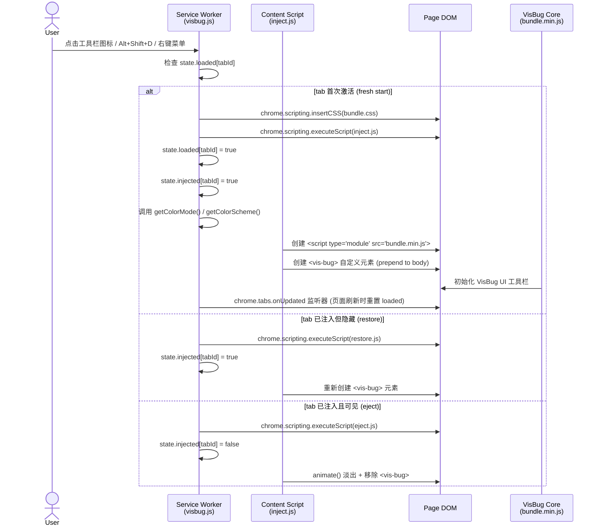
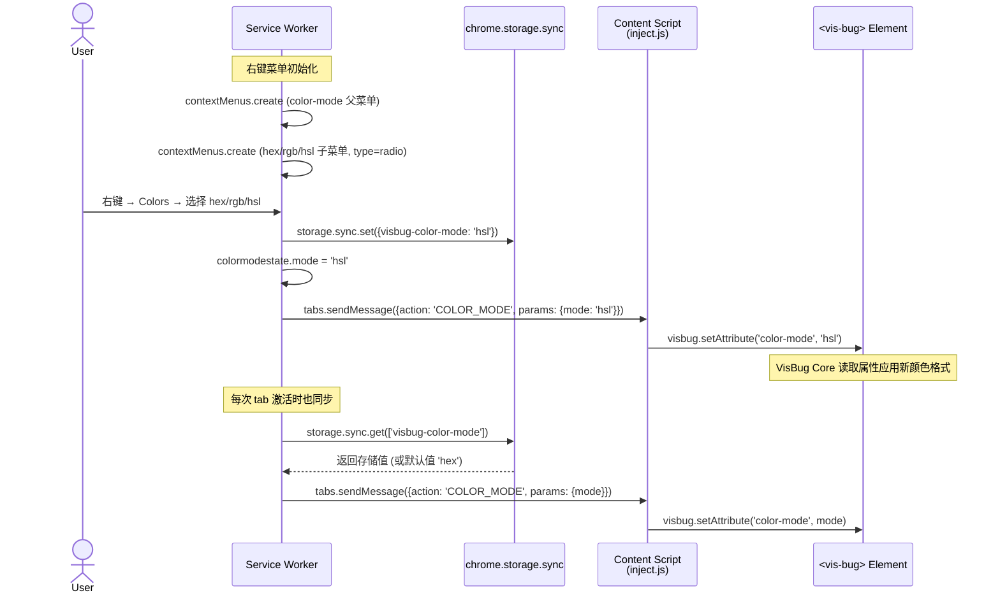
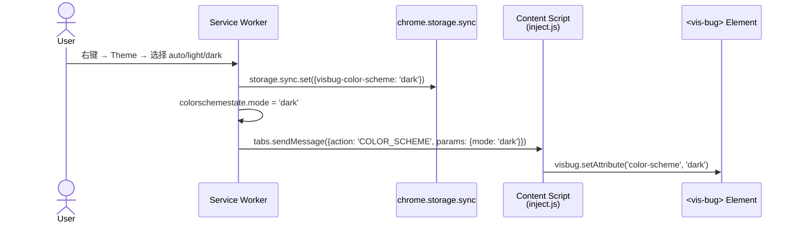
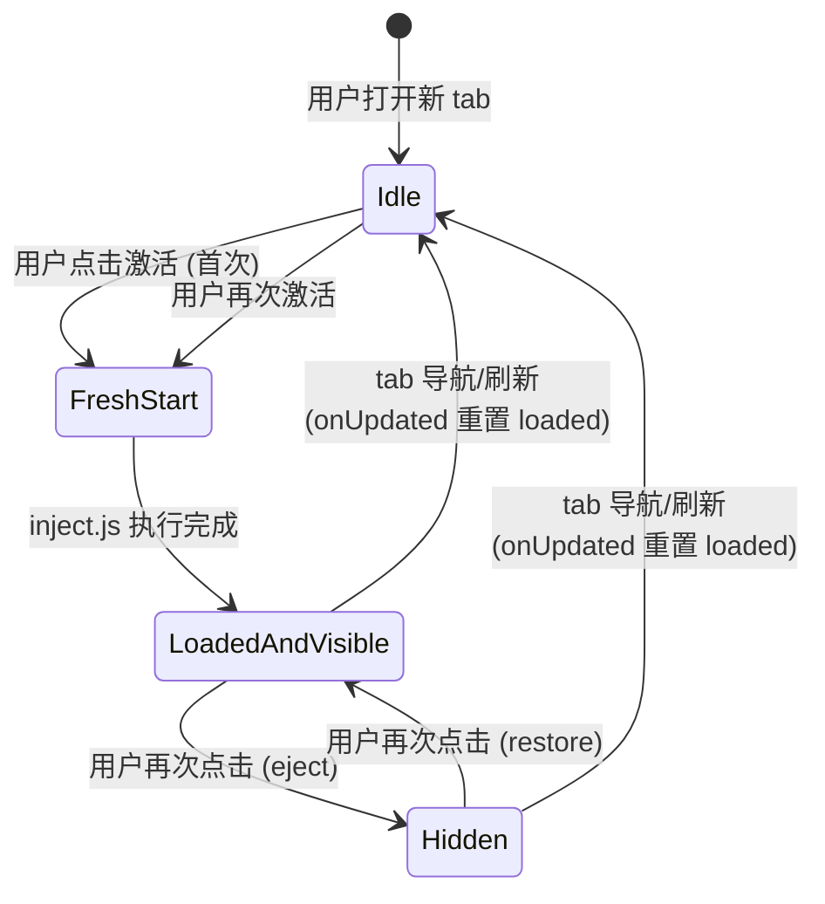

# VisBug v0.4.10 — 数据流文档

## 1. 流程总览

VisBug 的数据流围绕三个核心事件展开：激活/停用、颜色偏好同步、跨上下文消息传递。

**参与者：**
- **用户** — 通过工具栏图标、快捷键或右键菜单交互
- **Service Worker** — 后台协调器 (visbug.js + contextmenu 模块)
- **Content Script** — 页面注入脚本 (inject/eject/restore.js)
- **VisBug Core** — 页面内运行的主应用 (bundle.min.js)
- **chrome.storage.sync** — 持久化存储
- **chrome.contextMenus** — 右键菜单 API

## 2. 激活/停用流程



## 3. 颜色偏好变更流程



## 4. 主题 (颜色方案) 变更流程



## 5. 存储 Schema

```
chrome.storage.sync:
├── visbug-color-mode:    "hex" | "rgb" | "hsl"     (默认: "hex")
└── visbug-color-scheme:  "auto" | "light" | "dark" (默认: "auto")
```

**旧值迁移规则 (colormode.js):**
- `hsla` → `hsl`
- `rgba` → `rgb`
- 首次安装 → 写入默认值 `hex`

## 6. 消息协议

### Service Worker → Content Script

| 消息 | 格式 | 触发时机 |
|------|------|---------|
| COLOR_MODE | `{action: 'COLOR_MODE', params: {mode: 'hex'\|'rgb'\|'hsl'}}` | 用户切换颜色格式 / tab 激活时同步 |
| COLOR_SCHEME | `{action: 'COLOR_SCHEME', params: {mode: 'auto'\|'light'\|'dark'}}` | 用户切换主题 / tab 激活时同步 |

### 无 Content Script → Service Worker 消息

本扩展中内容脚本不向 Service Worker 发送消息，通信是单向的 (SW → 页面)。

## 7. Tab 生命周期状态机



## 8. 关键数据流边界

1. **SW 状态不持久化**: `state.loaded` / `state.injected` 仅存在内存中，SW 被回收后丢失。重新激活时视为 fresh start，会重新注入完整 VisBug
2. **颜色偏好同步**: 仅在 `toggleIn()` 调用时同步 (即用户激活/切换 tab 时)，不会实时监听 storage 变更事件
3. **`tutsBaseURL` 计算**: 通过 `platform.runtime.getURL('tuts/guides.gif')` 获取完整 URL，再截取目录路径部分，传递给 `<vis-bug>` 元素用于加载教程 GIF
