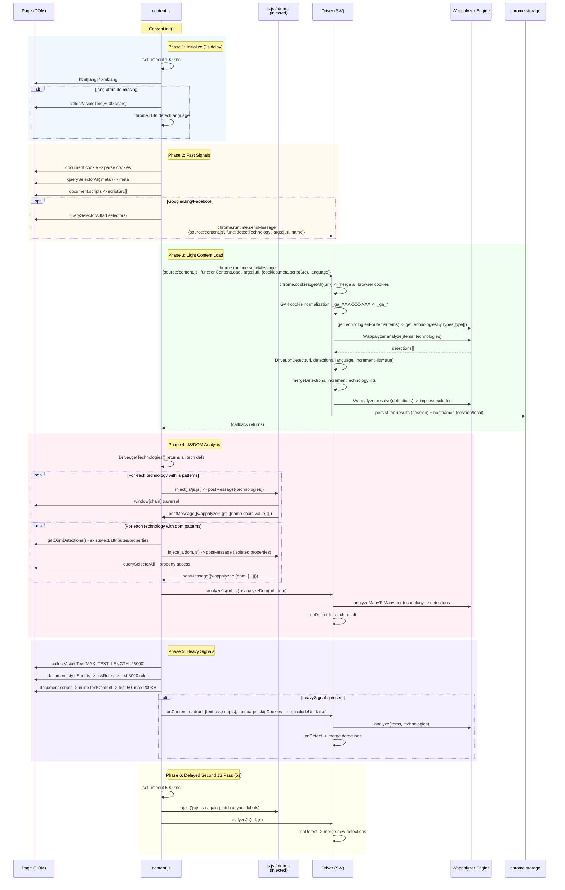
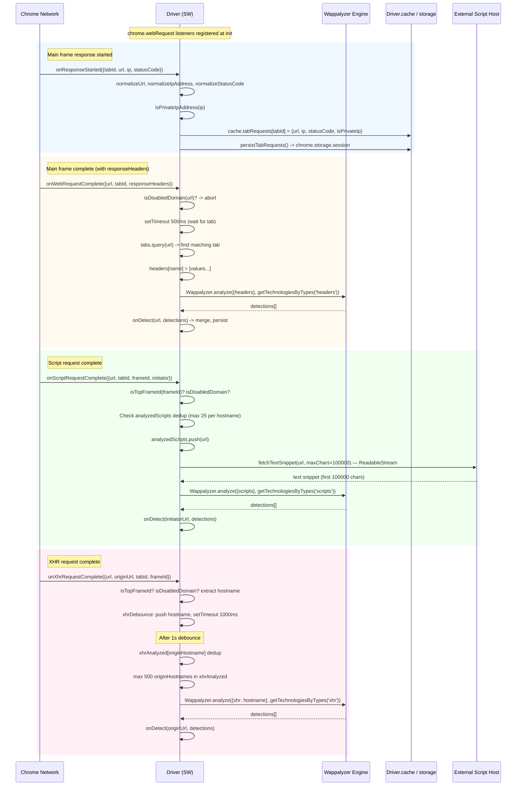
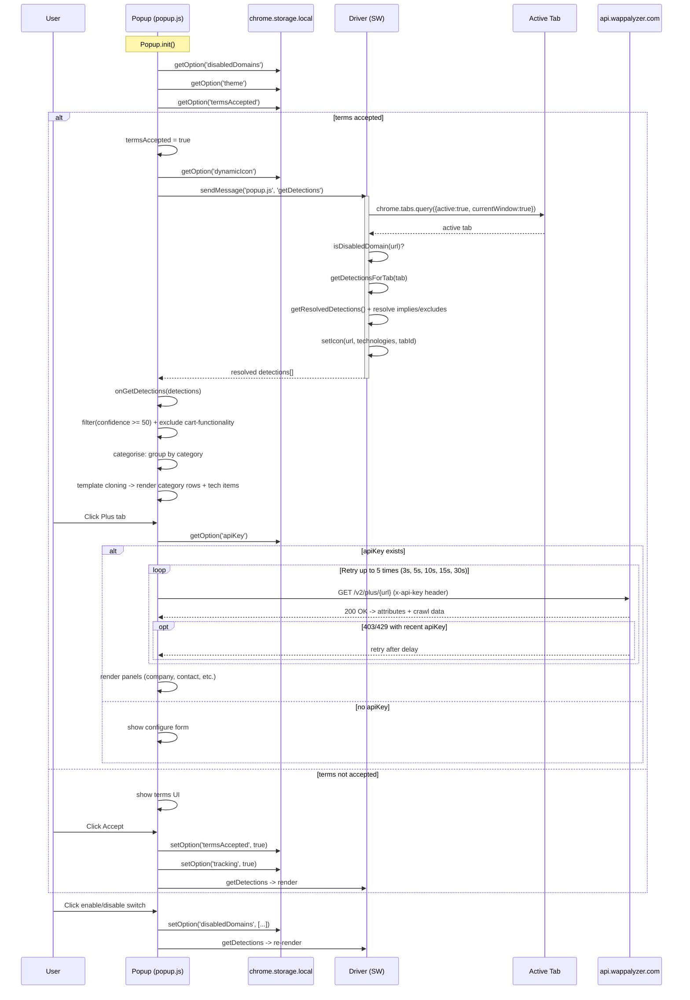
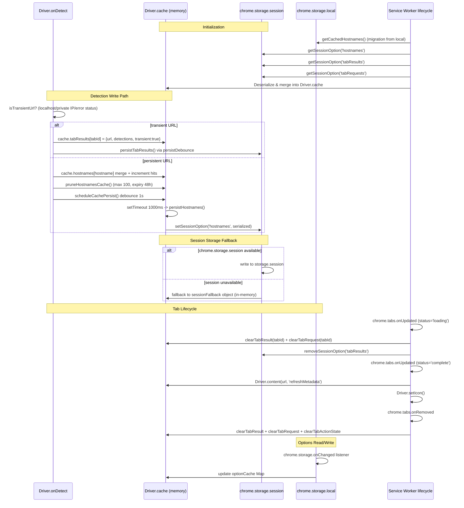
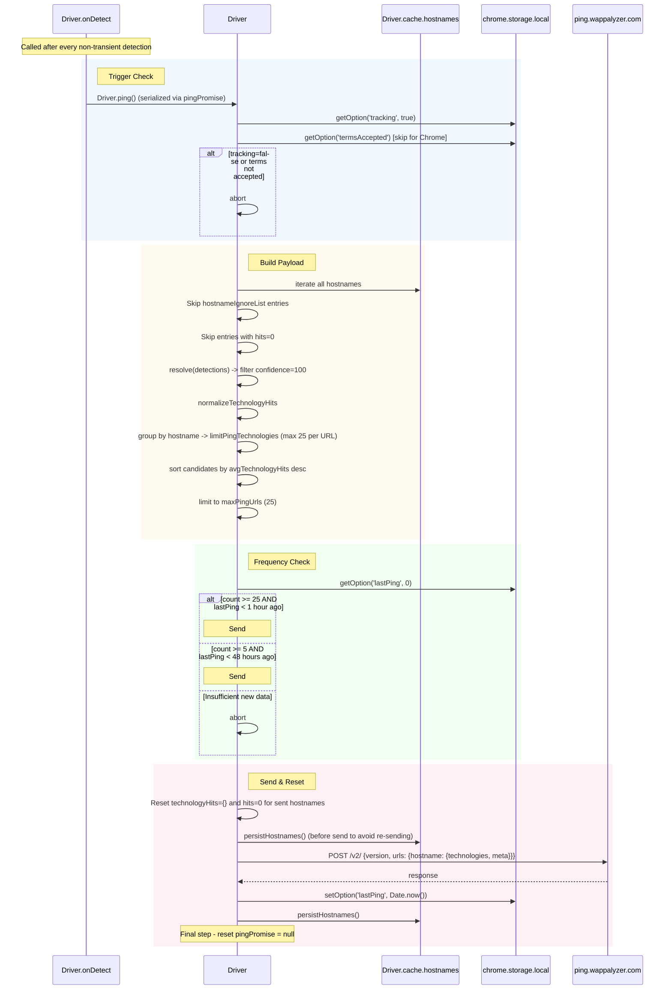
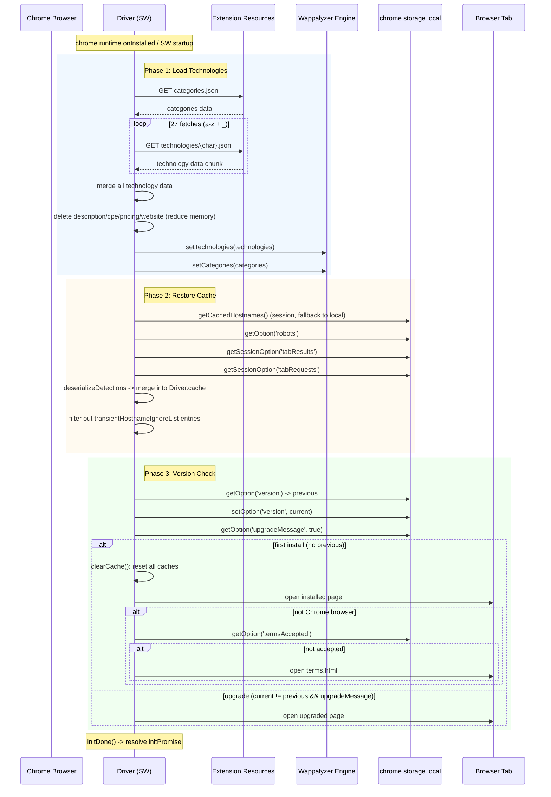

# DATA FLOW -- Wappalyzer v6.12.3 (MV3)

## 概述

Wappalyzer v6.12.3 由四个独立上下文组成：**content script (content.js)**、**Service Worker / Driver (index.js)**、**page script (js.js / dom.js)** 和 **Popup (popup.js)**。各组件的通信全部通过 Chrome Extension Messaging API 完成。

核心数据流路径：

- content.js 收集页面信号 -> chrome.runtime.sendMessage -> Driver 分析 -> 结果回传
- webRequest 事件 -> Driver.onWebRequestComplete/onScriptRequestComplete/onXhrRequestComplete -> Wappalyzer.analyze -> onDetect
- Popup -> sendMessage -> Driver.getDetections -> 返回解析后的检测结果
- Driver.onDetect -> 持久化 hostnames -> Ping 上报

---

## Flow 1: 页面加载检测流程

页面加载检测是整个系统的核心流程，分为轻量信号阶段、JS/DOM 注入阶段、重信号阶段和延迟二次 JS 检测四个子阶段。

### Sequence Diagram



### Key Constants

| 常量 | 值 | 说明 |
|------|-----|------|
| MAX_TEXT_LENGTH | 25000 | 可见文本最大采集长度 |
| MAX_INLINE_SCRIPT_COUNT | 50 | 内联脚本最大数量 |
| MAX_INLINE_SCRIPT_CHARS | 200000 | 内联脚本最大总字符数 |
| MAX_DOM_TEXT_LENGTH | 1000000 | DOM 文本节点最大长度 |
| MAX_TECH_DETECTIONS | 50 | 每技术最大 DOM 检测数 |
| LANGUAGE_DETECTION_SAMPLE_LENGTH | 5000 | 语言检测采样长度 |
| LANGUAGE_DETECTION_MIN_PERCENTAGE | 85 | 语言检测最低置信度 |
| LANGUAGE_DETECTION_MIN_MARGIN | 25 | 语言检测最低差距 |

---

## Flow 2: webRequest 后台分析

Driver 注册了四个 webRequest listener，在后台持续分析网络流量。

### Sequence Diagram



### webRequest Listener 注册

```javascript
// Main frame -- response started (IP/statusCode cache)
chrome.webRequest.onResponseStarted.addListener(
  Driver.onResponseStarted,
  { urls: ['http://*/*', 'https://*/*'], types: ['main_frame'] }
)

// Main frame -- response headers
chrome.webRequest.onCompleted.addListener(
  Driver.onWebRequestComplete,
  { urls: ['http://*/*', 'https://*/*'], types: ['main_frame'] },
  ['responseHeaders']
)

// Script -- external script body
chrome.webRequest.onCompleted.addListener(
  Driver.onScriptRequestComplete,
  { urls: ['http://*/*', 'https://*/*'], types: ['script'] }
)

// XHR -- hostname analysis
chrome.webRequest.onCompleted.addListener(
  Driver.onXhrRequestComplete,
  { urls: ['http://*/*', 'https://*/*'], types: ['xmlhttprequest'] }
)
```

### 关键限制

| 限制 | 值 | 说明 |
|------|-----|------|
| maxExternalScriptChars | 100000 | 外部脚本最大抓取字符数 |
| 每域名最大脚本分析数 | 25 | analyzedScripts 去重上限 |
| XHR 去重窗口 | 1000ms | debounce 延时 |
| xhrAnalyzed 最大域名 | 500 | 超过后清空重置 |
| onWebRequestComplete 延迟 | 500ms | 等待 tab 就绪 |

---

## Flow 3: Popup 交互流程

### Sequence Diagram



### Popup 数据流关键点

1. **过滤逻辑**: confidence >= 50, 排除 `cart-functionality`
2. **分类分组**: 按 `categories[].id` 分组，一个技术可属于多个分类
3. **Plus API 重试**: 基于 apiKey 更新时间的 5 分钟窗口内，403/429 自动重试
4. **CSV 导出**: URL + 各分类技术列表 + 42 个属性列
5. **Footer 营销**: 随机展示 5 种 CTA 之一 (lead-generation / data-enrichment)

---

## Flow 4: 存储与缓存数据流

### Sequence Diagram



### 缓存层次

| 层级 | 存储 | 生命周期 | 内容 |
|------|------|----------|------|
| L1: 内存 | `Driver.cache` | SW 生命周期 | hostnames, robots, tabResults, tabRequests, tabScripts, tabActions |
| L2: Session | `chrome.storage.session` | 浏览器会话 | hostnames (serialized), tabResults, tabRequests |
| L3: Local | `chrome.storage.local` | 持久化 | options (apiKey, theme, etc.), robots, hostnames (legacy) |
| L4: Fallback | `sessionFallback` | SW 生命周期 | 当 storage.session 不可用时 |

### 缓存淘汰策略

| 策略 | 值 | 说明 |
|------|-----|------|
| hostnames 过期时间 | 48h (`expiry`) | 超过 48 小时未更新的条目删除 |
| hostnames 最大条数 | 100 (`maxHostnames`) | 按 dateTime 降序保留前 100 |
| robots 最大条数 | 50 | 超过后保留最后 50 条 |
| 持久化防抖 | 1000ms (`persistDebounce`) | 每次 onDetect 后防抖写入 |
| transient 忽略列表 | `transientHostnameIgnoreList` | local/dev/staging/localhost 等 |

---

## Flow 5: Ping 上报

### Sequence Diagram



### Ping Payload Structure

```typescript
{
  version: string,            // Extension version from manifest
  urls: {
    [hostname: string]: {
      technologies: {
        [name: string]: {
          version: string,
          hits: number,       // technologyHits[name]
          rootPath: boolean
        }
      },
      meta: {
        language: string      // detected page language
      }
    }
  }
}
```

### Ping 频率策略

| 条件 | 阈值 |
|------|------|
| 高频模式 | >= 25 个新 URL (过去 1 小时内) |
| 低频模式 | >= 5 个新 URL (过去 48 小时内) |
| 未满足 | 不上报，等待更多数据 |
| URL 上限 | 25 |
| 每 URL 技术数上限 | 25 |
| 仅上报 confidence=100 | 且 technologyHits > 0 |

---

## Flow 6: 安装/升级流程

### Sequence Diagram



### Technology Loading

- 27 个 JSON 文件: `technologies/_` (特殊字符), `technologies/a` 到 `technologies/z`
- 加载后删除 `description`, `cpe`, `pricing`, `website` 字段以减少内存占用
- `setTechnologies` 自动计算 indexes: `requires`, `categoryRequires`, `technologiesByType`
- `Wappalyzer.technologies` 只包含没有 requires/requiresCategory 的技术

---

## 状态转换表

### Tab 生命周期

| 状态 | 触发事件 | Driver 动作 |
|------|----------|-------------|
| `loading` | chrome.tabs.onUpdated | `clearTabResult(tabId)` |
| `loading` (non-http) | chrome.tabs.onUpdated | `clearTabResult` + `clearTabRequest` |
| `loading` (different origin) | chrome.tabs.onUpdated | `clearTabResult` (mismatched URL/origin) |
| `complete` | chrome.tabs.onUpdated | `Driver.content(url, 'refreshMetadata')` + `setIcon` |
| `removed` | chrome.tabs.onRemoved | `clearTabResult` + `clearTabRequest` + `clearTabActionState` |

### 检测结果状态

| 状态 | 条件 | 存储位置 |
|------|------|----------|
| `transient` | isTransientUrl=true (localhost/private IP/error status) | cache.tabResults[tabId] |
| `persistent` | 正常 URL，非 transient | cache.hostnames[hostname] |
| `cached` | showCached=true 时从 hostnames 取 | cache.hostnames[hostname].detections |
| `live` | showCached=false 或 transient 时从 tabResults 取 | cache.tabResults[tabId].detections |
| `expired` | hostname.dateTime < Date.now() - 48h | 被 pruneHostnamesCache 删除 |

### Ping 状态机

| 状态 | 条件 | 动作 |
|------|------|------|
| `idle` | pingPromise = null | 等待 onDetect 触发 |
| `queued` | pingPromise != null | 等待当前 ping 完成 |
| `checking` | 进入 ping() | 检查 tracking/termsAccepted |
| `payload_built` | getPingPayload() 完成 | 检查频率条件 |
| `sent` | fetch POST 完成 | reset hits + setOption('lastPing') |
| `aborted` | 条件不满足 | 直接返回, pingPromise = null |

### Plus API Key 验证

| 状态 | HTTP Status | 动作 |
|------|-------------|------|
| `success` | 200 | 渲染面板，重置 apiKeyUpdatedAt=0 |
| `pending` | 403/429 + apiKeyUpdatedAt < 5min | 按延迟序列重试 (3s,5s,10s,15s,30s) |
| `no_access` | 403 (非 pending) | 显示配置表单 + 错误信息 |
| `rate_limited` | 429 (非 pending) | 显示速率限制错误 |
| `bad_request` | 400 | 显示 API 返回的错误文本 |
| `generic_error` | 其他 | 显示通用错误 |

---

## 消息格式契约

### 通用消息格式

所有跨组件消息均使用统一格式：

```typescript
interface Message {
  source: string   // 发送方标识: 'content.js' | 'driver.js' | 'popup.js'
  func: string     // 目标方法名
  args: any[]      // 参数数组
}
```

### Content -> Service Worker (chrome.runtime.sendMessage)

| func | args | 说明 |
|------|------|------|
| `onContentLoad` | `[url, items, language, requires?, categoryRequires?, options?]` | 页面信号分析 |
| `analyzeJs` | `[url, js[], requires?, categoryRequires?, requiredTechnologyNames?]` | JS 变量分析 |
| `analyzeDom` | `[url, dom[], requires?, categoryRequires?, requiredTechnologyNames?]` | DOM 节点分析 |
| `detectTechnology` | `[url, technologyName]` | 强制检测 (广告等) |
| `getTechnologies` | `[]` | 获取全部技术定义 |
| `isDisabledDomain` | `[url]` | 检查域名是否禁用 |
| `error` | `[errorMessage]` | 错误上报 |
| `log` | `[{source, func, args}]` | 日志 |

注: tabAwareMethods (`analyzeDom`, `analyzeJs`, `detectTechnology`, `onContentLoad`) 会自动追加 `sender.tab.id` 和 `sender.frameId`。

### Popup -> Service Worker (sendMessage)

| func | args | 说明 |
|------|------|------|
| `getDetections` | `[]` | 获取当前 tab 检测结果 |
| `getCategories` | `[]` | 获取分类列表 |
| `log` | `[message]` | 日志 |

### Service Worker -> Content (chrome.tabs.sendMessage)

| func | args | 说明 |
|------|------|------|
| `onGetTechnologies` | `[technologies[], requires?, categoryRequires?, requiredTechnologyNames?]` | 通知 content 注入 JS/DOM |
| `analyzeRequires` | `[url, requires[]]` | 触发依赖技术重分析 |
| `refreshMetadata` | `[]` | tab 更新时刷新元数据 |
| `log` | `[message]` | 日志 |

### Page <-> Content (window.postMessage)

**Content -> Page:**
```typescript
// JS injection trigger
window.postMessage({
  wappalyzer: {
    technologies: [
      { name: string, chains: string[] }
    ]
  }
}, '*')

// DOM properties injection trigger
window.postMessage({
  wappalyzer: {
    technologies: [
      { name: string, dom: { [selector]: [{ properties }] } }
    ]
  }
}, '*')
```

**Page -> Content:**
```typescript
// JS results (from js.js)
window.postMessage({
  wappalyzer: {
    js: [
      { name: string, chain: string, value: string|number|boolean }
    ]
  }
}, '*')

// DOM results (from dom.js + getDomDetections)
window.postMessage({
  wappalyzer: {
    dom: [
      {
        name: string,
        selector?: string,
        exists?: string,
        text?: string,
        property?: string,
        attribute?: string,
        value?: string|number|boolean
      }
    ]
  }
}, '*')
```

### JS/DOm Analysis 结果项 (内部)

```typescript
interface JsResult {
  name: string        // technology name
  chain: string       // e.g. "jQuery.fn.jquery"
  value: string | number | boolean
}

interface DomResult {
  name: string        // technology name
  selector?: string   // CSS selector
  exists?: string     // element exists flag
  text?: string       // innerText (truncated to MAX_DOM_TEXT_LENGTH)
  property?: string   // DOM property name
  attribute?: string  // HTML attribute name
  value?: string | number | boolean
}
```

---

## 存储 Schema

### chrome.storage.local

```typescript
interface LocalStorage {
  // Extension state
  version: string                        // 当前版本号
  upgradeMessage: boolean                // 升级时是否显示消息 (default: true)

  // Display
  dynamicIcon: boolean                   // 动态图标 (default: false)
  badge: boolean                         // badge 文字 (default: true)
  showCached: boolean                    // 显示缓存结果 (default: true)
  theme: 'light' | 'dark'               // 主题 (default: 'light')
  pinnedCategory: number | null          // 固定分类 ID

  // Privacy
  tracking: boolean                      // 匿名上报 (default: true)
  termsAccepted: boolean                 // 条款接受
  disabledDomains: string[]             // 禁用域名列表

  // Plus API
  apiKey: string                         // Wappalyzer Plus API key
  apiKeyUpdatedAt: number                // API key 更新时间戳
  collapseFooter: boolean                // Footer 折叠状态

  // Ping
  lastPing: number                       // 上次 ping 时间戳

  // Cache (legacy, migrated to session)
  hostnames?: HostnameCache             // 已迁移到 session，读取后删除

  // Robots
  robots: Record<string, string[]>      // hostname -> disallow paths
}
```

### chrome.storage.session (或内存 fallback)

```typescript
interface SessionStorage {
  // 检测结果持久化 (自动过期 48h, 最大 100 条)
  hostnames: SerializedHostnameCache

  // Tab 级别结果 (transient)
  tabResults: SerializedTabResults

  // Tab 级别请求缓存 (IP/statusCode)
  tabRequests: TabRequests
}

interface SerializedHostnameCache {
  [hostname: string]: {
    detections: SerializedDetection[]
    technologyHits: Record<string, number>   // 每技术命中计数
    hits: number                              // URL 总访问次数
    language?: string                         // 检测到的页面语言
    analyzedScripts: string[]                // 已分析的脚本 URL 列表
    https?: boolean                           // HTTPS 标记
    dateTime: number                          // 最后更新
  }
}

interface SerializedDetection {
  technology: string         // technology name
  pattern: {
    regex: string            // RegExp source (serialized)
    confidence: number
    value?: string
  }
  version?: string
  rootPath?: boolean
  lastUrl?: string
}

interface SerializedTabResults {
  [tabId: string]: {
    url: string
    detections: SerializedDetection[]
    language?: string
    transient: boolean
    dateTime: number
  }
}

interface TabRequests {
  [tabId: string]: {
    url: string
    ip: string
    statusCode: number
    isPrivateIp: boolean
    dateTime: number
  }
}
```

### Driver.cache (内存)

```typescript
interface DriverCache {
  // hostnames -> 检测结果缓存 (反序列化后)
  hostnames: Record<string, HostnameCacheEntry>

  // robots.txt 规则缓存
  robots: Record<string, string[]>

  // Tab 级别检测结果
  tabResults: Record<number, TabResultEntry>

  // Tab 级别请求元数据
  tabRequests: Record<number, TabRequestEntry>

  // Tab 级别脚本分析去重列表 (transient URLs)
  tabScripts: Record<number, string[]>

  // Tab 级别 action icon 状态
  tabActions: Record<number, { badgeText: string; iconPathKey: string }>
}

interface HostnameCacheEntry {
  detections: Detection[]
  technologyHits: Record<string, number>
  hits: number
  language?: string
  analyzedScripts: string[]
  dateTime: number
}

interface Detection {
  technology: Technology
  pattern: {
    regex: RegExp
    confidence: number
    type?: string
    value?: string
    match?: string
  }
  version: string
  rootPath?: boolean
  lastUrl?: string
}
```

### 存储迁移路径

1. **首次启动**: `getCachedHostnames()` 尝试 `storage.session`，不存在则从 `storage.local` 读取并迁移到 session，然后从 local 删除
2. **SW 重启**: `storage.session` 数据保留，直接从 session 恢复，避免重复分析
3. **存储降级**: `chrome.storage.session` 不可用时（旧版浏览器），全部退化为 `sessionFallback` 内存对象

---

## 完整数据流汇总图

```mermaid
flowchart TB
    subgraph Page["Page (Web Page)"]
        DOM[DOM Elements]
        COOKIE[document.cookie]
        META[meta tags]
        SCRIPT[script tags]
        TEXT[visible text]
        CSS[CSS rules]
    end

    subgraph Content["Content Script (content.js)"]
        INIT[Content.init]
        GET_JS[getJs]
        GET_DOM[getDom]
        HEAVY[getHeavySignals]
        REFRESH[refreshMetadata]
    end

    subgraph Injected["Injected Scripts"]
        JS_JS[js.js<br/>window property chain]
        DOM_JS[dom.js<br/>isolated properties]
    end

    subgraph SW["Service Worker (index.js)"]
        DIRECTION subgraph Driver
            ONLOAD[onContentLoad]
            ONDETECT[onDetect]
            GETDET[getDetections]
            PING[ping]
            SETICON[setIcon]
            ANALYZEJS[analyzeJs]
            ANALYZEDOM[analyzeDom]
        end

        subgraph WREQ["webRequest Listeners"]
            WEBCOMPLETE[onWebRequestComplete<br/>headers]
            SCRIPTCOMPLETE[onScriptRequestComplete<br/>external scripts]
            XHRCOMPLETE[onXhrRequestComplete<br/>XHR hostnames]
            RESPSTART[onResponseStarted<br/>IP/status]
        end
    end

    subgraph Engine["Wappalyzer Engine"]
        ANALYZE[analyze]
        RESOLVE[resolve]
        implies[implies/excludes]
    end

    subgraph Storage["Storage"]
        SESSION[chrome.storage.session<br/>hostnames / tabResults]
        LOCAL[chrome.storage.local<br/>options / robots]
        MEMORY[Driver.cache<br/>in-memory]
    end

    subgraph Popup["Popup (popup.js)"]
        POPUP_INIT[Popup.init]
        RENDER[render detections]
        PLUS[Plus API]
    end

    subgraph External["External"]
        PING_API[ping.wappalyzer.com]
        PLUS_API[api.wappalyzer.com/v2/plus]
        EXT_SCRIPT[External script hosts]
    end

    %% Content Script Flows
    DOM --> INIT
    COOKIE --> INIT
    META --> INIT
    SCRIPT --> INIT
    INIT -->|1. sendMessage| ONLOAD
    INIT -->|2. getTechnologies| GET_JS
    INIT -->|2. getTechnologies| GET_DOM
    GET_JS -->|inject| JS_JS
    GET_DOM -->|inject| DOM_JS
    JS_JS -->|postMessage| GET_JS
    DOM_JS -->|postMessage| GET_DOM
    GET_JS -->|analyzeJs| ANALYZEJS
    GET_DOM -->|analyzeDom| ANALYZEDOM
    INIT -->|getHeavySignals| HEAVY
    TEXT --> HEAVY
    CSS --> HEAVY
    SCRIPT --> HEAVY
    HEAVY -->|onContentLoad (skipCookies)| ONLOAD

    %% Driver Flows
    ONLOAD --> ANALYZE
    ANALYZEJS --> ONDETECT
    ANALYZEDOM --> ONDETECT
    ANALYZE --> ONDETECT
    ONDETECT --> RESOLVE
    RESOLVE --> implies
    implies --> ONDETECT

    %% webRequest Flows
    WEBCOMPLETE --> ANALYZE
    SCRIPTCOMPLETE -->|fetch snippet| EXT_SCRIPT
    EXT_SCRIPT --> ANALYZE
    XHRCOMPLETE --> ANALYZE
    RESPSTART --> MEMORY

    %% Storage Flows
    ONDETECT -->|persist| MEMORY
    MEMORY -->|debounce 1s| SESSION
    LOCAL -->|migration| SESSION
    SESSION -->|restore| MEMORY

    %% Popup Flows
    POPUP_INIT -->|getDetections| GETDET
    GETDET --> MEMORY
    GETDET --> RESOLVE
    GETDET --> SETICON
    GETDET -->|return| RENDER
    RENDER -->|Plus tab| PLUS
    PLUS --> PLUS_API

    %% Ping
    ONDETECT -->|non-transient| PING
    PING --> PING_API

    %% Tab Update
    REFRESH -->|tab complete| ONLOAD
```

---

## 文档版本

| 项目 | 值 |
|------|-----|
| 创建日期 | 2026-07-06 |
| 分析版本 | Wappalyzer v6.12.3 |
| Manifest | V3 |
| 模型 | dsv4 |
