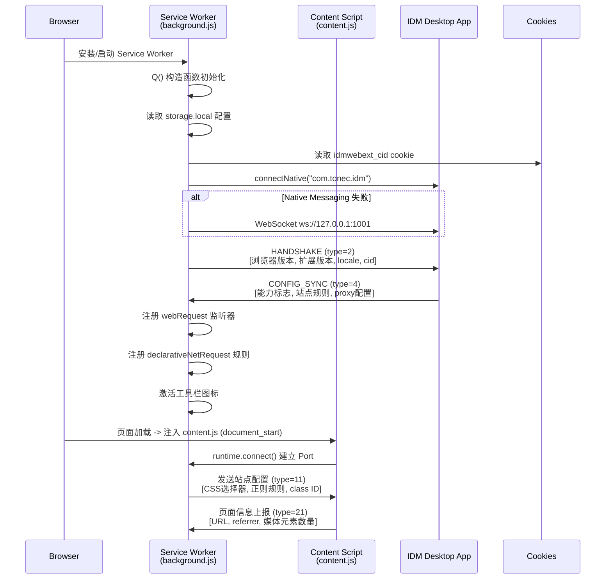
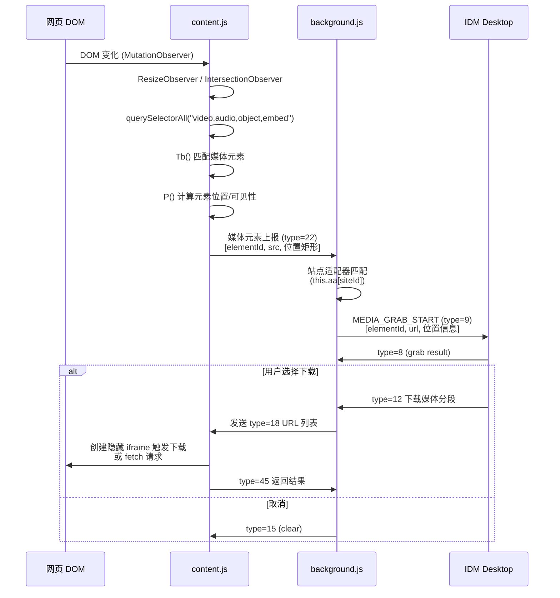
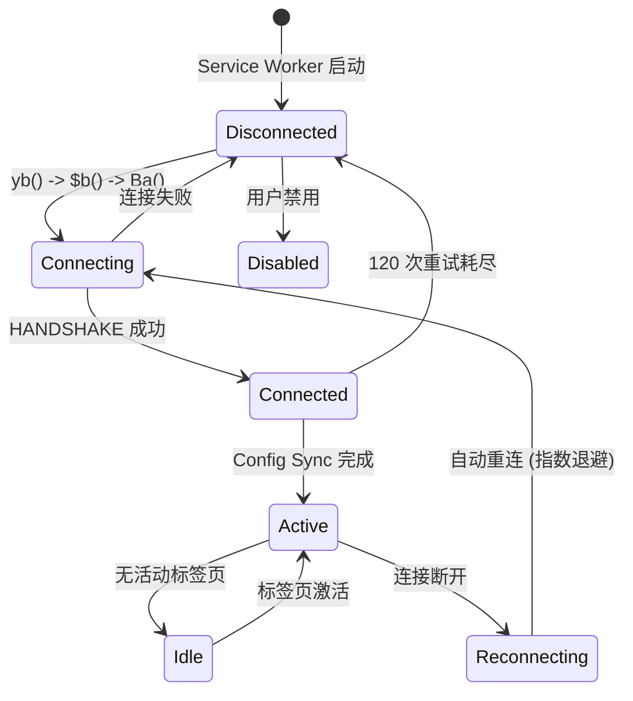

# IDM Integration Module — 数据流分析

> v6.43.1 | 包含 Mermaid 流程图

---

## 一、启动与初始化流程



## 二、下载拦截数据流

```mermaid
flowchart TD
    A[浏览器发起 HTTP 请求] --> B{webRequest<br/>onBeforeRequest}
    B --> |URL 解析| C[T() 函数<br/>协议分类: http/https/ftp]
    C --> D{Fc() 早期过滤}
    D --> |过滤通过| E[创建 DownloadTask<br/>注册到 this.i]
    D --> |过滤拒绝| Z1[标记 action=1 跳过]
    E --> F{onBeforeSendHeaders}
    F --> |POST 请求| G[提取 requestBody]
    F --> |XMLHttpRequest| H[解析 Accept 头<br/>检测 vnd.t1c 前缀]
    F --> |有 Post 数据| G
    H --> I{Gc() 站点规则匹配}
    I --> |匹配下载| J[action=2/4]
    I --> |匹配嗅探| K[action=3]
    I --> |不匹配| Z2[action=1 跳过]
    G --> I
    J --> L{onHeadersReceived}
    L --> M[Hc() 响应分类]
    M --> |判定为下载| N[action=2/4/5]
    N --> O[X() 组装下载消息]
    O --> P[S() 发送至 IDM<br/>type=13 DOWNLOAD_REQUEST]
    P --> Q[IDM 桌面应用]
    Q --> |type=13 响应| R[更新 this.ha<br/>暂停/取消浏览器下载]
    K --> L
    M --> |视频页面| S1[Hc() 站点特定逻辑<br/>YouTube/Vimeo/Facebook]
    S1 --> T1[action=5 媒体抓取]
    T1 --> P
```

## 三、媒体元素嗅探流程



## 四、XHR/fetch API Hook 数据流

```mermaid
flowchart LR
    subgraph Page["目标网页 (JavaScript)"]
        A1[XMLHttpRequest.open/send]
        A2[fetch]
        A3[ReadableStream.getReader]
    end

    subgraph Hook["document.js (Web Accessible)"]
        B1[ua() 拦截 open/send<br/>注入 pfm/pxr 标记]
        B2[la() 拦截 fetch<br/>URL 参数注入]
        B3[拦截 getReader<br/>tee 分流]
        B4[Aa/Oa/Pa/Qa<br/>拦截 text/json/arrayBuffer/blob]
        B5[Sa 拦截 body getter]
    end

    subgraph SW["background.js"]
        C1[接收 postMessage<br/>1229212980 事件]
        C2[解析 URL + 响应数据]
        C3[匹配站点规则]
    end

    A1 --> B1
    A2 --> B2
    A3 --> B3
    B1 --> B4
    B2 --> B4
    B4 --> B5
    B3 --> B4
    B5 --> C1
    B4 --> C1
    C1 --> C2
    C2 --> C3
    C3 --> D[IDM Desktop]
```

### Hook 技术细节

document.js 通过原型链修改实现对以下 API 的拦截：

1. **XMLHttpRequest.prototype.open**: 在请求 URL 添加 `pfm-{id}` 查询参数
2. **XMLHttpRequest.prototype.send**: 在请求头添加 `pxr-{id}` 标记
3. **XMLHttpRequest.prototype.setRequestHeader**: 追踪自定义请求头
4. **Response.prototype.text/json/arrayBuffer/blob**: 拦截响应体
5. **Response.prototype.body.getReader**: tee 分流 ReadableStream
6. **ReadableStream.prototype.getReader**: 拦截流读取

所有拦截的数据通过 `window.postMessage` 以编码的整数标识符 `1229212980` 发送给 Service Worker。

## 五、用户交互数据流

```mermaid
flowchart TD
    A1[右键菜单点击] --> B1{Ea()/Qa()}
    A2[工具栏图标点击] --> B2{pb()}
    A3[键盘快捷键] --> B3{content.js tb()}

    B1 --> |下载链接| C1[pa() 发送{type=14}]
    B1 --> |下载选中| C2[Xb() 提取页面链接]
    B1 --> |下载全部| C2
    B2 --> C3[激活/停用扩展]
    B3 --> C4[发送键盘事件{type=31}]

    C1 --> D[IDM Desktop]
    C2 --> D
    C4 --> D
```

## 六、代理配置同步

```mermaid
flowchart LR
    A[Chrome 代理设置变更] --> B[proxy.settings.onChange]
    B --> C[bb() 解析代理配置]
    C --> D{模式判断}
    D --> |direct| E1["0"]
    D --> |fixed_servers| E2["1:scheme://host:port"]
    D --> |pac_script| E3[VA 数组标记 PAC]
    D --> |system| E4["4"]
    E1 --> F[this.J 存储]
    E2 --> F
    E3 --> F
    E4 --> F
    F --> G[S() 发送至 IDM<br/>type=1 PROXY_INFO]
```

## 七、协议消息格式

IDM 自定义二进制协议使用以下分层格式：

```
帧级别 (WebSocket 传输):
  [二进制 blob]

消息级别:
  MSG#<seq>#<type>#<flags>#<subtype>[:<param1>:<param2>:...][,<key>=<value>...]

  分隔符:
  #  — 头部字段分隔
  :  — 数组元素分隔
  ,  — 键值对起始

字段类型编码:
  string   -> "keyname:stringvalue"  (长度前缀 + 分隔符)
  number   -> "keyname=42"
  boolean  -> "keyname=1" 或 "keyname=0"
  bytes    -> "keyname=B64ENCODED" (Base64 + 长度前缀 + %)
  blob     -> "keyname=size:binarydata"
```

---

## 八、状态管理



## 九、Cookie 持久化

扩展通过以下 cookie 在 `internetdownloadmanager.com` 域维持状态：

| Cookie 名 | 用途 | 生命周期 |
|---|---|---|
| `idmwebext_cid` | 客户端唯一标识 (安装时生成) | 永久 (2038年过期) |
| `idmmzcc3_uri` | Firefox 扩展 URI 验证 | 永久 |
