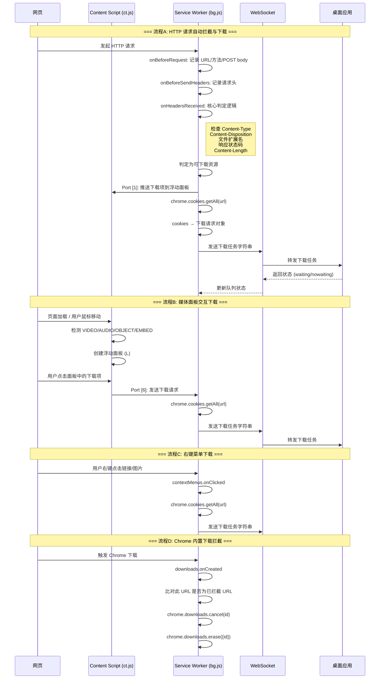
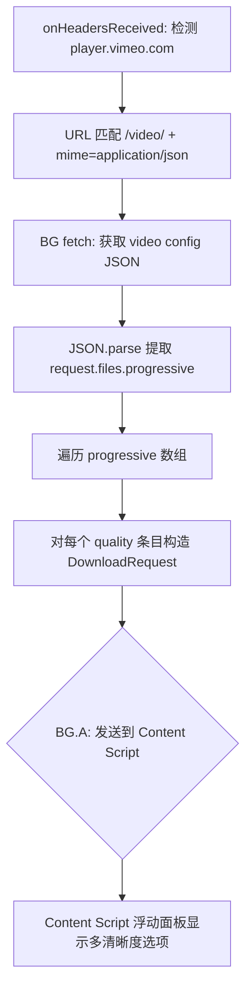
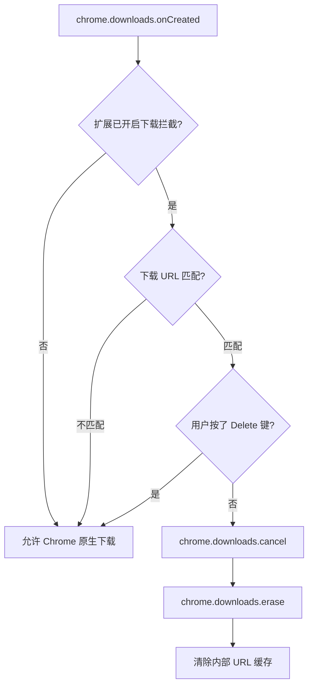

# NeatDownloadManager Extension v1.9.92 — 数据流文档

## 核心数据流概览



## 流程A 详解: HTTP 请求拦截判定链路

```mermaid
flowchart TD
    A[onBeforeRequest] --> B{协议类型?}
    B -->|FTP 且有文件名| Z[直接构造请求→发送]
    B -->|HTTP/HTTPS| C[记录 requestId→requestRecord]
    C --> D{方法?}
    D -->|POST| E[保存 requestBody]
    D -->|GET| F[继续]
    E --> F
    F --> G[onBeforeSendHeaders: 保存请求头]
    G --> H[onHeadersReceived: 核心判定]
    H --> I{资源类型=image?}
    I -->|是| SKIP[跳过: 删除记录]
    I -->|否| J{Content-Disposition=attachment?}
    J -->|是| DOWNLOAD
    J -->|否| K{状态码?}
    K -->|重定向 301-308| SKIP2[标记重定向, 跳过]
    K -->|200/206| L{提取 Content-Type/Content-Length/Content-Range}
    L --> M{Content-Length=0?}
    M -->|是| SKIP
    M -->|否| N{文件扩展名判定}
    N --> O{扩展名在浏览器安全列表?<br/>(HTML/CSS/JS/SVG/PNG等)}
    O -->|是| P{特殊检查: main_frame+视频扩展?<br/>或 other+媒体扩展?<br/>或 attachment?}
    P -->|通过| DOWNLOAD
    P -->|不通过| Q{特殊排除?<br/>(manif/favicon/wasm/json/dict/pem)}
    Q -->|是| SKIP
    Q -->|否| R{大小检查: 非媒体且 <512KB?}
    R -->|是| SKIP
    R -->|否| DOWNLOAD
    O -->|否| DOWNLOAD

    DOWNLOAD --> S{用户开启了下载拦截?}
    S -->|是| T[构造下载请求对象 RequestInfo]
    S -->|否| SKIP
    T --> U{桌面应用有等待队列?}
    U -->|是 (waiting)| V[执行 HEAD 请求获取 Content-Type/Length]
    U -->|否 (nowaiting)| W[直接通过 WebSocket 发送]
    V --> W

    W --> X[Content Script?]
    X -->|是| Y[Port [1]: 通知 Content Script 显示面板]
    X -->|否| END
```

## 流程B 详解: 媒体元素发现与面板交互

```mermaid
flowchart TD
    A[Content Script 注入] --> B[chrome.runtime.connect]
    B --> C[监听 mouseup/keydown/resize/DOMContentLoaded]
    C --> D{用户 mouseup 事件}
    D --> E[记录鼠标坐标 T, U]
    E --> F{Background 推送下载项? Port [1]}
    F --> G[调用 N.G: 关联下载项与媒体元素]
    G --> H{找媒体元素? N.fa}
    H --> I[document.elementFromPoint: 鼠标位置元素]
    I --> J[遍历 VIDEO/AUDIO/OBJECT/EMBED 标签]
    J --> K[匹配元素 src/data 与下载 URL]
    K -->|找到| L[创建/更新浮动面板 L, 绑定到该元素]
    K -->|未找到| M[使用无锚点面板 或 复用已有面板]
    L --> N[面板渲染: neatDiv + neatTable]
    N --> O[30秒后半透明渐隐]
    O --> P{用户交互?}
    P -->|mouseover| Q[恢复不透明度]
    P -->|mousedown + 拖拽| R[移动面板位置]
    P -->|点击下载项| S[Port [6]: 发送下载请求到 BG]
    P -->|点击关闭| T[隐藏面板]
    P -->|15秒无交互| U[恢复半透明]
    S --> V[BG: Cookie获取 → WebSocket发送]
```

### 媒体元素发现算法 (N.fa)

1. 首先检查 `document.activeElement` 是否为 VIDEO/AUDIO/OBJECT/EMBED
2. 若否，用 `document.elementFromPoint(T, U)` 获取鼠标位置的元素
3. 若仍未找到，遍历所有 VIDEO/AUDIO/OBJECT/EMBED 标签
4. 对每个元素的 `src`/`data` 属性与目标 URL 进行匹配
5. 若多个元素匹配，按面积 (width * height) 最大的选择（但排除竖屏比例）
6. 回退策略: `document.querySelectorAll('video,audio')[0]`

## 流程C 详解: M3U8/HLS 解析

```mermaid
flowchart TD
    A[检测到 .m3u8 文件] --> B[创建 W 解析器实例]
    B --> C[fetch 获取 M3U8 内容]
    C --> D[解析 #EXTM3U 头部确认]
    D --> E{逐行解析}
    E --> F[#EXTINF: 累计时长]
    E --> G[#EXT-X-STREAM-INF: 提取多码率流 URL]
    E --> H[#EXT-X-BYTERANGE: 提取字节范围]
    E --> I[TS 片段 URL: 构建完整 URL]
    F & G & H & I --> J{结果类型?}
    J -->|有 TS 主文件 URL| K[构造单个 media 下载项, 延迟2.5s发送]
    J -->|有 EXT-X-STREAM-INF 流| L[为每个流构造 hls 下载项, 延迟2.5s发送]
    J -->|仅有 EXTINF 累计时长| M[使用原始 URL, type=hls]
    K & L & M --> N[通过 BG.A → Port[1] → Content Script 面板]
```

## 流程D 详解: Vimeo 视频提取



## 流程E 详解: Facebook 视频适配

```mermaid
flowchart TD
    A[ct.js 注入 Facebook 页面] --> B[MutationObserver: 监听 DOM 变化]
    B --> C[检测 a[href*='/videos/'] 链接出现]
    C --> D[提取 video_id]
    D --> E[fetch: facebook.com/video/embed?video_id=X]
    E --> F[正则提取 sd_src / hd_src / sd_src_no_ratelimit / hd_src_no_ratelimit]
    F --> G[定位页面上的 video 元素]
    G --> H[构造两个下载项: MP4 File HQ + MP4 File LQ]
    H --> I[通过 Port[6] 发送下载请求到 BG]
```

## Chrome 内置下载拦截流程



## 连接恢复流程

```mermaid
flowchart TD
    A[WebSocket.onclose 或 onerror] --> B[清理连接状态: D=false, i=null]
    B --> C{有待发送的下载请求?}
    C -->|是| D[查询活跃标签页]
    D --> E[Port [15]: 通知 Content Script 连接失败告警]
    E --> F[alert 提示用户检查桌面应用]
    C -->|否| G[Content Script Port.onDisconnect]
    G --> H[自动重连: 重新 chrome.runtime.connect]
    H --> I[重新注册 onMessage/onDisconnect]
    I --> J[Port [3]: 分配新连接 ID]
```

## 数据存储流向

```mermaid
flowchart LR
    A[桌面应用] -->|ShowPanelChrome=0/1| B[WebSocket]
    B --> C[BG: U.da 处理]
    C --> D{值与当前状态不同?}
    D -->|是| E[chrome.storage.local.set]
    E --> F[更新 U.F 标志]
    F --> G[Port [13]: 通知所有 Content Script]

    H[扩展启动/Service Worker 激活] --> I[chrome.storage.local.get: ShowMediaPanel]
    I --> J[设置 U.F: true/false]
```

## 请求对象生命周期

```
onBeforeRequest → 创建 requestRecord {id, url:2, tabId, frameId}
    ↓ (存 POST body: ja)
onBeforeSendHeaders → 添加请求头 (o)
    ↓
onHeadersReceived → 核心判定 (详见流程A), 发送或丢弃
    ↓
onCompleted / onErrorOccurred → 清理 (delete this.m[requestId])
```
