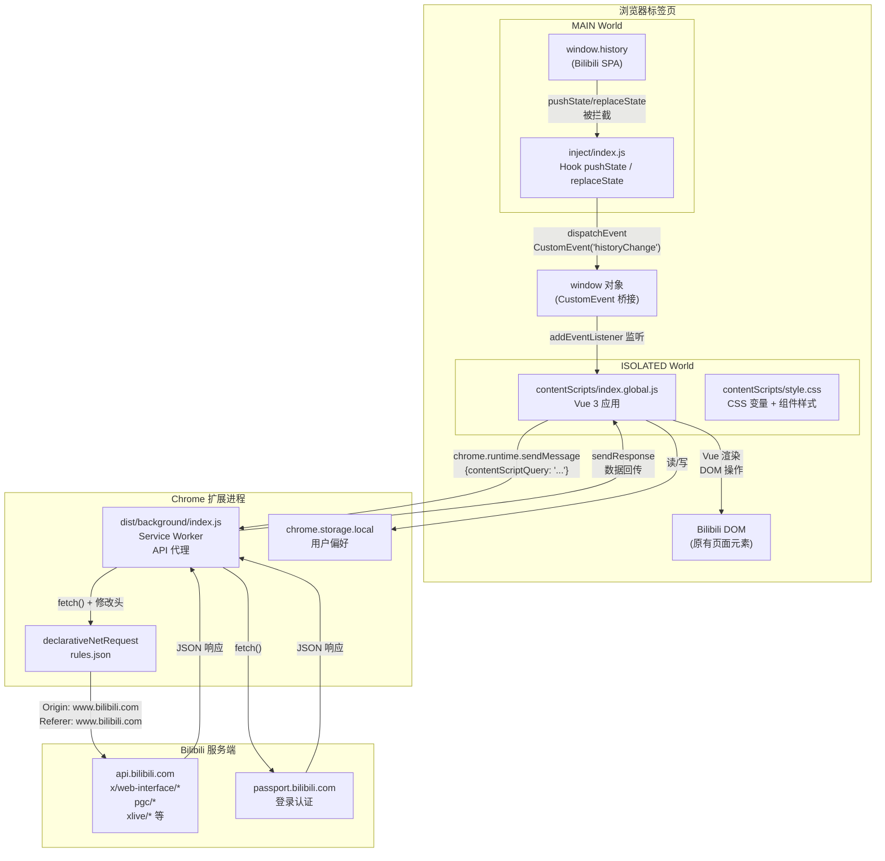
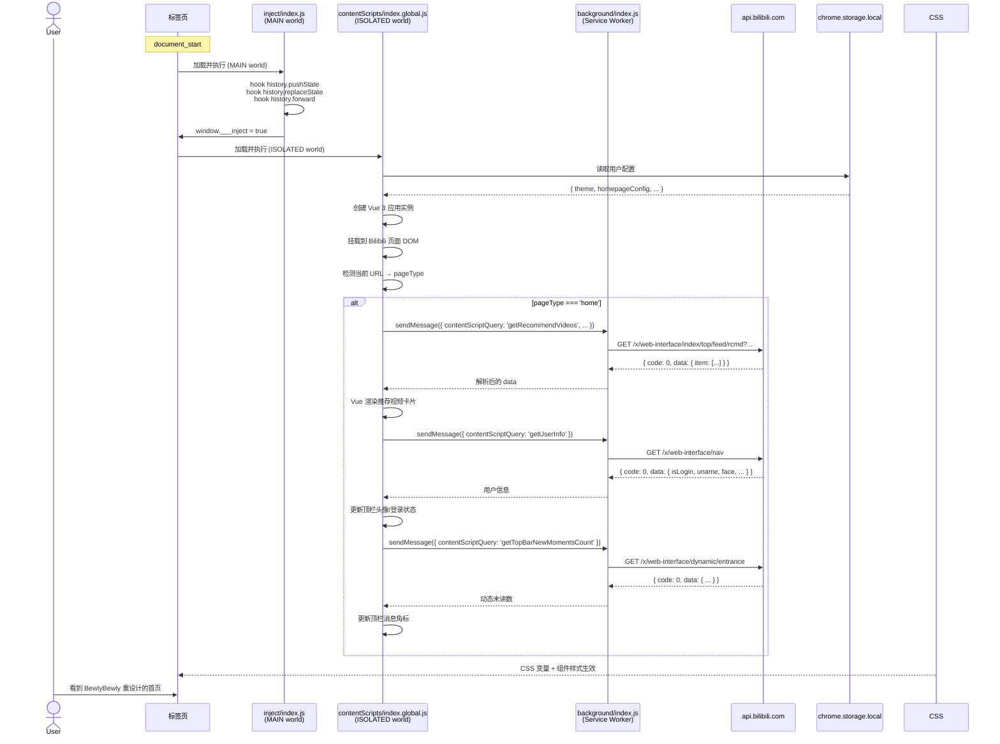
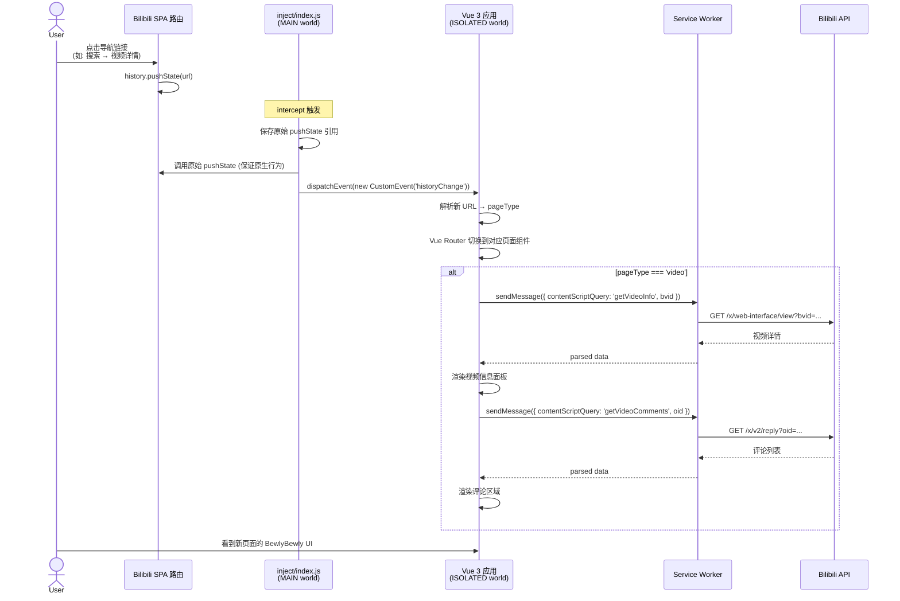
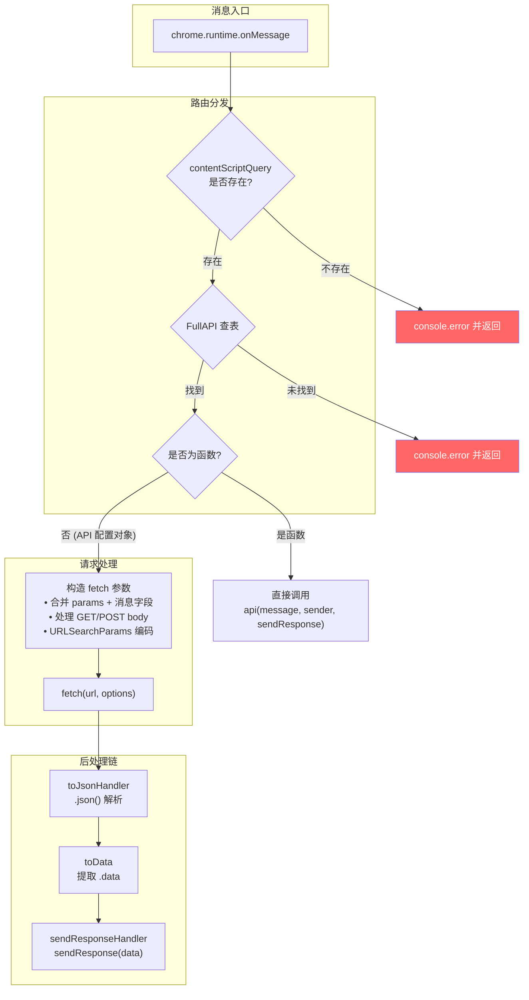
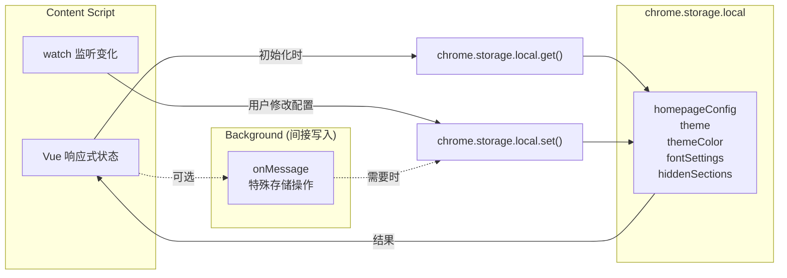
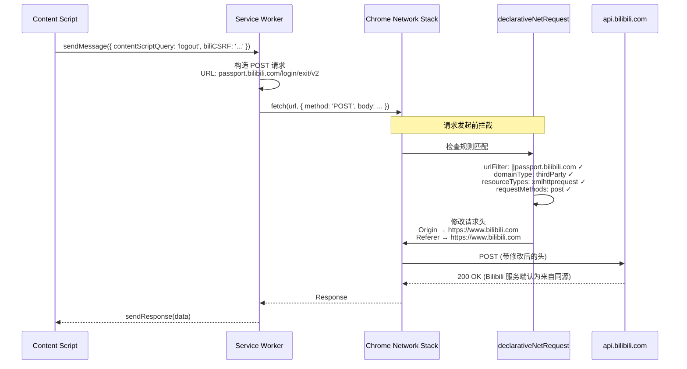

# BewlyBewly 数据流文档

> **版本**: 0.41.2 | **基于**: 逆向工程静态分析

---

## 一、全局数据流总览



---

## 二、首屏加载数据流

扩展安装后首次访问 `www.bilibili.com` 的完整时序：



---

## 三、SPA 导航数据流

用户在 Bilibili 站点内导航（不刷新页面）时的数据流：



---

## 四、API 代理层数据流

Background Service Worker 中的消息处理与请求转发：



**后处理器组合 (afterHandle)**:

| 模式 | 处理器链 | 适用场景 |
|------|---------|---------|
| `J_D` | `.json()` → `toData` (提取 .data) | 大部分数据查询 API |
| `J_S` | `.json()` → `sendResponse` | 登录/认证 API (需要完整响应) |
| `S` | `sendResponse` (原样返回) | 特殊操作 (如标签页创建) |

---

## 五、存储数据流



---

## 六、declarativeNetRequest 规则触发流



---

## 七、关键数据结构的运行时转换

```
Bilibili API 原始响应:
{
  "code": 0,
  "message": "0",
  "data": {
    "item": [
      { "id": 123, "title": "...", "owner": {...}, "stat": {...} },
      ...
    ]
  }
}

        │ toJsonHandler (response.json())
        ▼

{
  code: 0,
  message: "0",
  data: { item: [...] }
}

        │ toData (提取 .data)
        ▼

{
  item: [
    { id: 123, title: "...", owner: {...}, stat: {...} },
    ...
  ]
}

        │ sendResponse 回传给 content script
        ▼

Vue 组件接收 → computed/ref → 模板渲染
```
