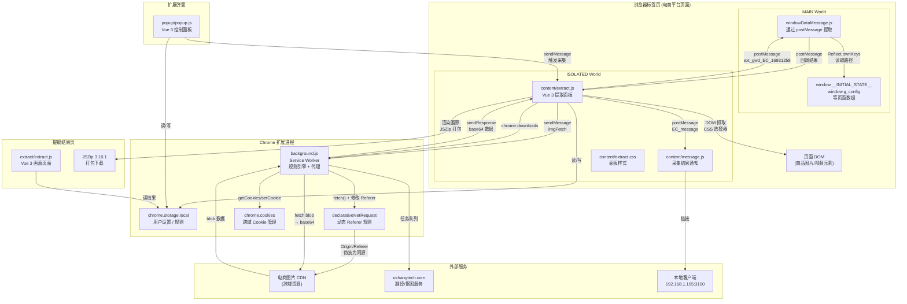
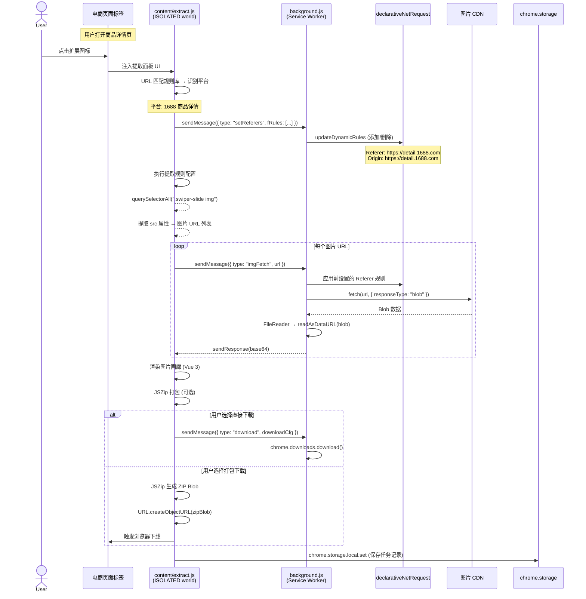
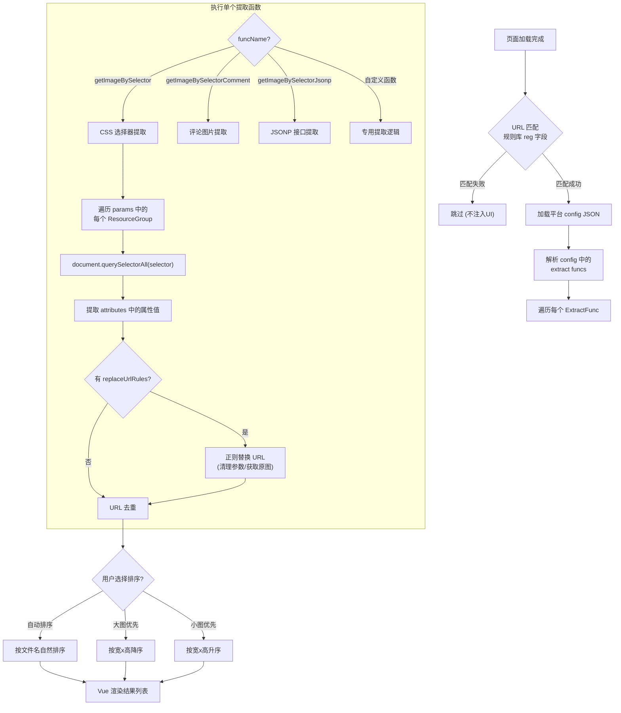
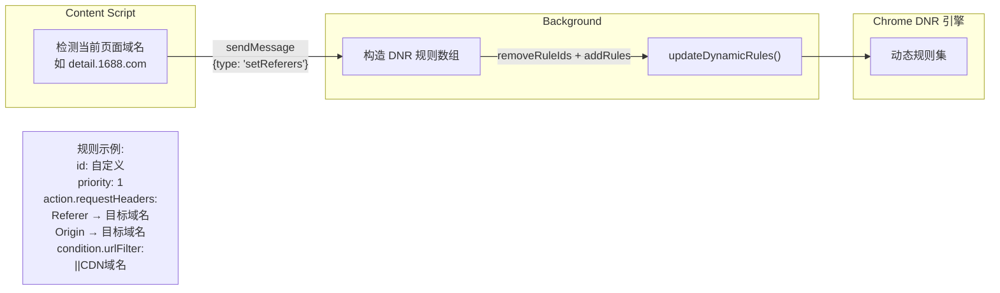
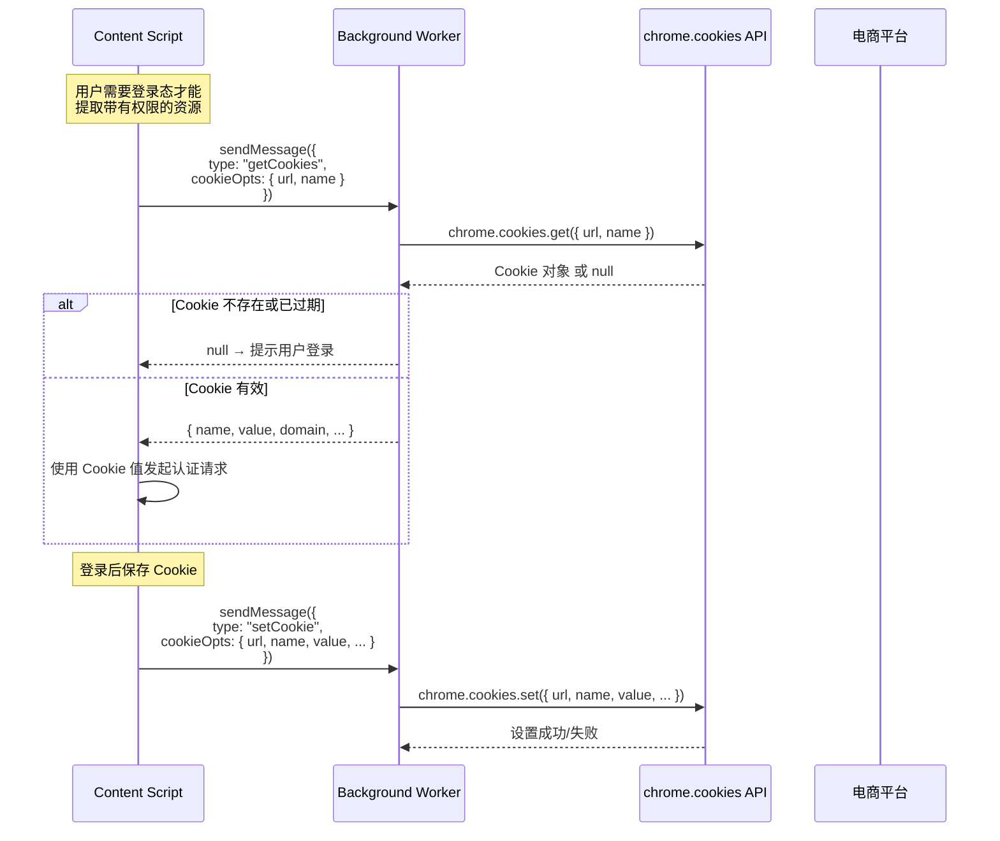
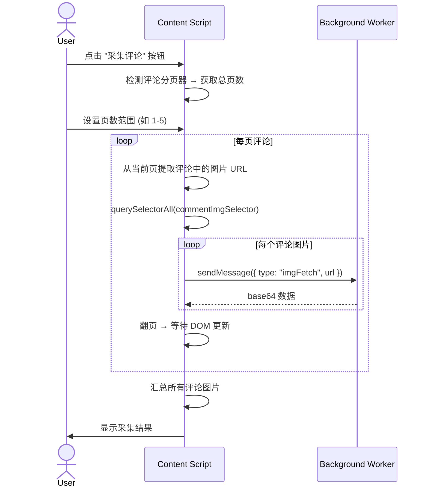
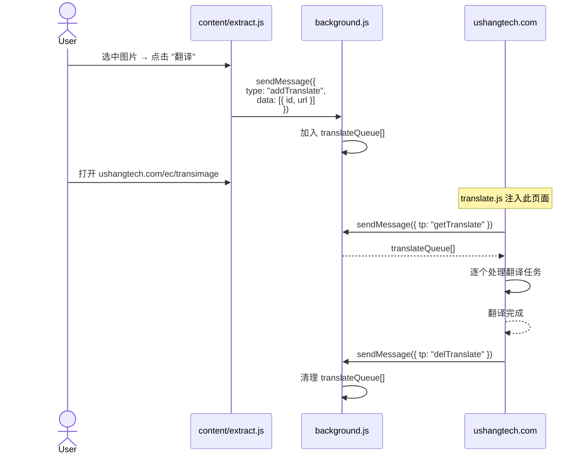
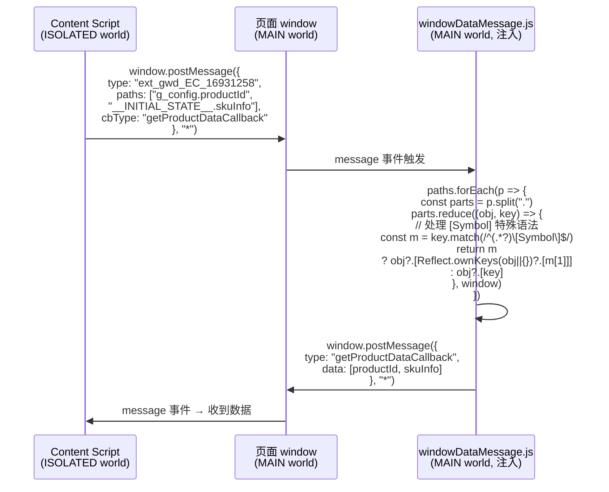
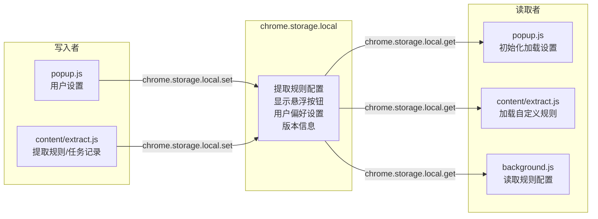
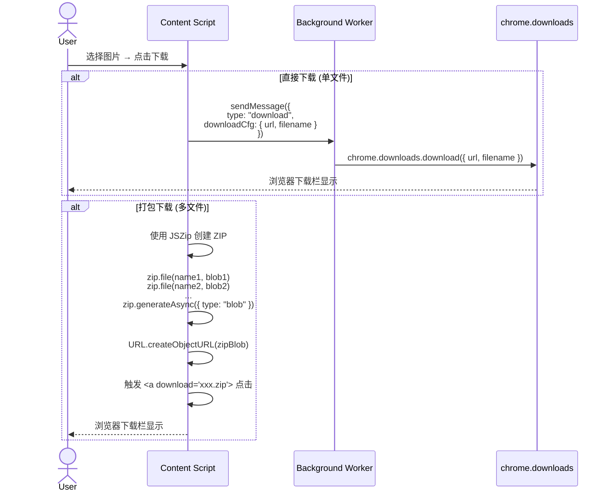

# CubeSeller 数据流文档

> **版本**: 11.1.5 | **基于**: 逆向工程静态分析

---

## 一、全局数据流总览



---

## 二、核心流程: 商品图片采集

### 2.1 完整时序



---

## 三、提取规则执行流程

### 3.1 规则结构与执行



### 3.2 规则配置示例 (1688 商品详情)

```json
{
  "mainType": "func",
  "funcName": "getImageBySelector",
  "params": [
    {
      "groupName": "主图",
      "type": "img",
      "rules": [{
        "selector": ".swiper-slide img",
        "attributes": ["src"],
        "replaceUrlRules": [{
          "reg": "\\?.*$",
          "replace": ""
        }]
      }]
    },
    {
      "groupName": "详情",
      "type": "img",
      "rules": [{
        "selector": "[alt=\"商品详情图\"]",
        "attributes": ["dataset.original", "src"],
        "replaceUrlRules": [{
          "reg": "\\?.*$",
          "replace": ""
        }]
      }]
    }
  ]
}
```

**执行逻辑**:
1. 对 "主图" 分组: `document.querySelectorAll('.swiper-slide img')` → 取 `src` 属性 → 删除 `?` 后的查询参数
2. 对 "详情" 分组: `document.querySelectorAll('[alt="商品详情图"]')` → 先尝试 `dataset.original`，回退到 `src` → 删除查询参数

---

## 四、跨域图片获取流程

CoreSeller 使用 **Background Service Worker 代理** 绕开浏览器 CORS 限制:

```mermaid
sequenceDiagram
    participant CS as content/extract.js
    participant BG as background.js
    participant DNR as declarativeNetRequest
    participant CDN as 跨域图片 CDN

    Note over CS: page origin: detail.1688.com<br/>image origin: cbu01.alicdn.com

    CS->>CS: 提取到图片 URL<br/>https://cbu01.alicdn.com/xxx.jpg

    CS->>BG: sendMessage({<br/>  type: "imgFetch",<br/>  url: "https://cbu01.alicdn.com/xxx.jpg"<br/>})

    Note over BG: 检查 DNR 规则是否已设置<br/>Referer: https://detail.1688.com

    BG->>CDN: fetch(url, {<br/>  method: "GET",<br/>  responseType: "blob"<br/>})
    Note over DNR: DNR 自动附加 Referer 头<br/>使 CDN 认为请求来自商品页

    CDN-->>BG: image/jpeg Blob

    BG->>BG: const reader = new FileReader()<br/>reader.readAsDataURL(blob)
    BG-->>CS: sendResponse("data:image/jpeg;base64,...")

    CS->>CS: 创建 <br/>或加入 JSZip 打包
```

**为什么需要 imgFetch?**
- Content Script 的 `fetch()` 受页面 CSP 限制，无法跨域加载图片
- Background Worker 具有 `*://*/*` host_permissions，可发起任意请求
- DNR 规则伪造 Referer/Origin，使 CDN 不拒绝请求

---

## 五、Referer 管理流程



**Referer 规则生命周期**:
1. 用户打开商品页 -> Content Script 向 Background 发送 `setReferers` 消息，传入该平台需要的 Referer 规则
2. Background 先删除旧规则 (`removeRuleIds`)，再添加新规则 (`addRules`)
3. 后续所有通过 Background 发起的 `fetch()` 请求自动应用新的 Referer 规则
4. 用户离开页面/关闭标签时，规则保持 (在下次 `setReferers` 调用时被覆盖)

---

## 六、Cookie 管理流程



---

## 七、评论图片提取流程



---

## 八、翻译与抠图集成流程

CubeSeller 与 `ushangtech.com` 的在线工具集成，实现图片翻译和批量抠图:



抠图流程与此相同，使用 `addCutout`/`getCutout`/`delCutout` 消息。

---

## 九、窗口数据提取 (windowDataMessage.js)

Content Script (ISOLATED world) 无法直接访问页面的 `window` 对象变量。`windowDataMessage.js` 在 MAIN world 中运行，提供安全的属性路径读取:



**安全边界**:
- 仅通过 `postMessage` 通信，不共享 JS 上下文
- 使用 `Reflect.ownKeys` 安全遍历，不调用可能被污染的 getter
- `cbType` 由调用方指定，防止消息混淆

---

## 十、存储数据流



---

## 十一、下载流程


