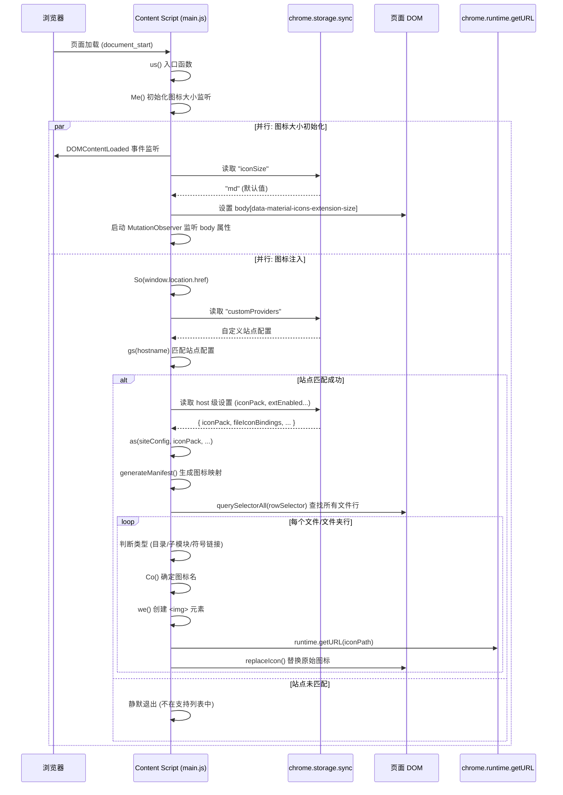
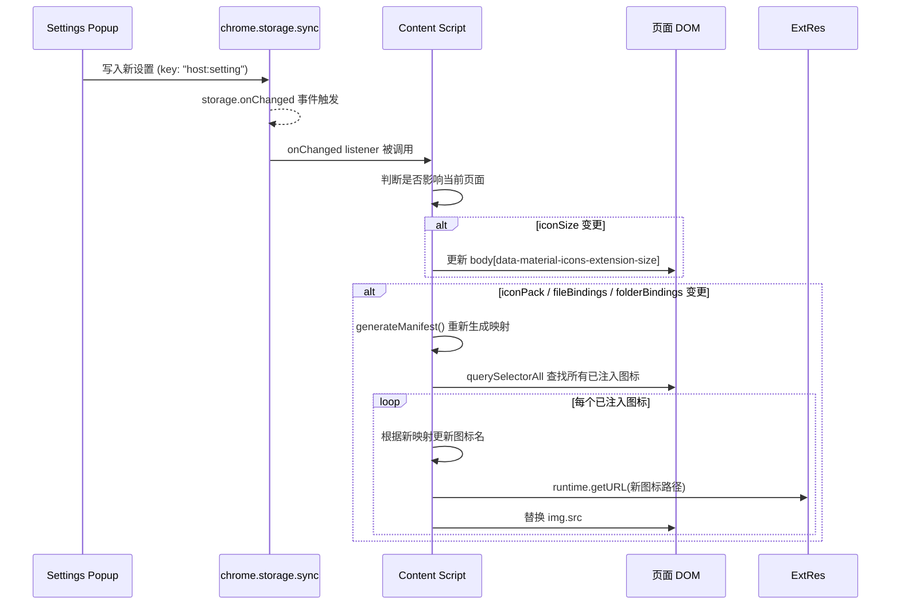
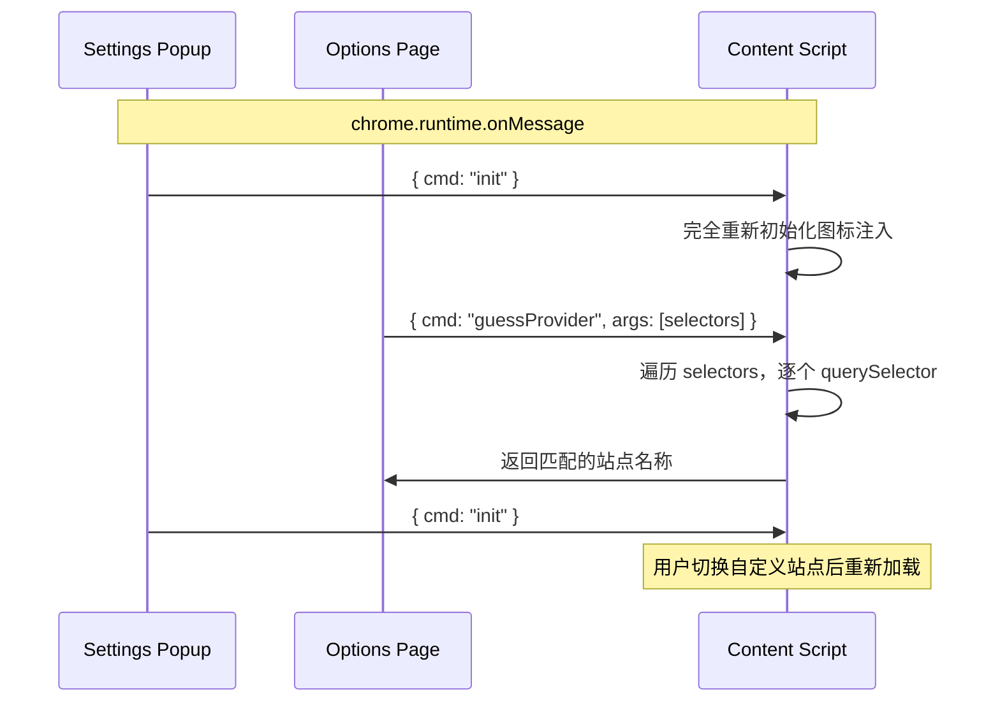

# 数据流文档 — Material Icons for GitHub (dsv4)

## 1. 初始化流程



## 2. 图标选择决策流程

```mermaid
flowchart TD
    A[文件行 DOM 元素] --> B{是子模块?}
    B -->|是| C[使用 "folder-git" 图标]
    B -->|否| D{是符号链接?}
    D -->|是| E[使用 "folder-symlink" 图标]
    D -->|否| F{是目录?}
    F -->|是| G[查找文件夹名映射]
    G --> H{精确匹配?}
    H -->|是| I[使用匹配的文件夹图标]
    H -->|否| J{展开状态?}
    J -->|是| K[使用 folder-open 变体]
    J -->|否| L[使用默认 folder.svg]
    F -->|否| M[提取文件扩展名和文件名]
    M --> N{文件名精确匹配?}
    N -->|是| O[使用匹配的文件图标]
    N -->|否| P{扩展名匹配?}
    P -->|是| O
    P -->|否| Q[使用默认 file.svg]
```

## 3. 设置变更流程



## 4. 消息通信流程



## 5. 自定义站点流程

```mermaid
flowchart TD
    A[用户输入自定义域名] --> B[调用 gs(hostname)]
    B --> C{内置站点匹配?}
    C -->|是| D[返回内置 SiteConfig]
    C -->|否| E{在 customProviders 中?}
    E -->|是| F[从 chrome.storage.sync 读取配置]
    F --> G[基于已知模板创建 SiteConfig]
    G --> H[标记 isCustom = true]
    H --> I[返回自定义 SiteConfig]
    E -->|否| J[返回 null，扩展不对此站点生效]
```

## 6. 图标路径生成流程

```mermaid
flowchart TD
    A[确定图标名 iconName] --> B{是 clone 图标?}
    B -->|是| C[后缀: ".clone.svg"]
    B -->|否| D[后缀: ".svg"]

    A --> E{设置变更导致 hash?}
    E -->|有 hash| F[计算设置 hash 值]
    F --> G[路径: ./../icons/iconName{hash}{suffix}]
    E -->|无 hash| H[路径: ./../icons/iconName{suffix}]

    G --> I[chrome.runtime.getURL(path)]
    H --> I
    I --> J[返回 chrome-extension://xxx/icons/...]
```

## 7. 关键数据转换

| 阶段 | 输入 | 输出 | 函数 |
|------|------|------|------|
| 主机名匹配 | `window.location.hostname` | `SiteConfig \| null` | `gs(host)` |
| 设置合并 | `HostSettings`, `ExtensionSettings` | 合并后的完整设置 | `$s()` / `j()` |
| 图标清单生成 | `ExtensionSettings`, `IconPack` | `IconMapping \| FolderIconMapping` | `generateManifest()` |
| 文件名规范化 | 原始文件名 `string` | 规范化后的文件名 | `transformFileName()` |
| 图标名确定 | 文件名、扩展名、类型标志 | SVG 文件名 (无扩展名) | `Co()` |
| DOM 替换 | `<svg>`, `<i>`, `<span>` 等 | `` | `replaceIcon()` |
| 设置哈希 | `ExtensionSettings` (子集) | `number` (hash) | `ue()` / `Ss()` |
