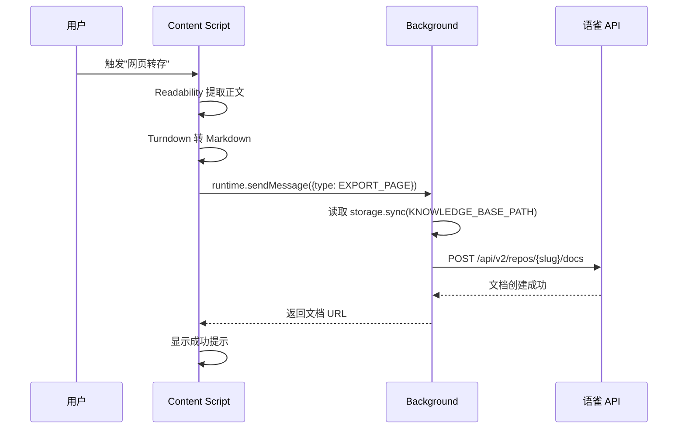
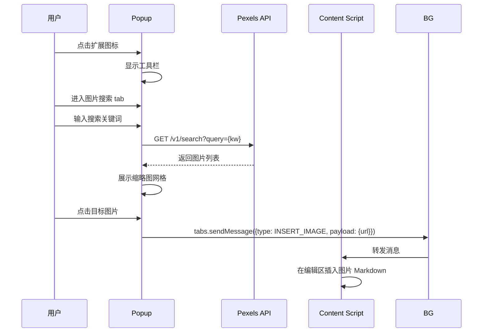
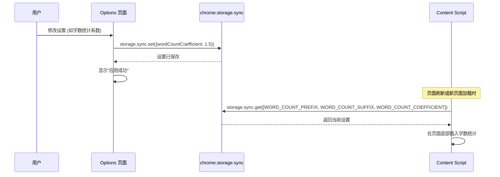
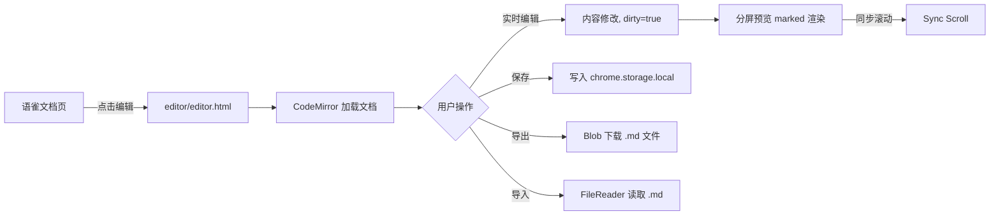
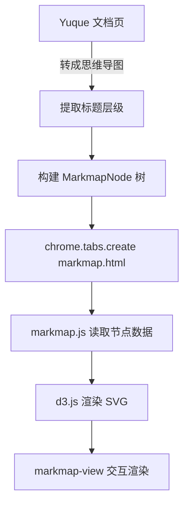

# DATA_FLOW.md — yuque-helper v1.6.0

## 数据流总览

扩展在 Yuque 页面注入 content script，通过 Chrome 消息通道与 popup/options/editor/background 通信。用户设置通过 `chrome.storage.sync` 持久化。

---

## 核心数据流

### 1. 网页转存到语雀知识库



### 2. 图片搜索与插入



### 3. 用户设置应用



### 4. Markdown 编辑器数据流



### 5. 思维导图生成



---

## 消息通道协议

所有跨组件通信通过 `chrome.runtime.sendMessage` / `chrome.tabs.sendMessage` 实现。

### Background <-> Content Script

```
// Content Script -> Background
chrome.runtime.sendMessage({
  type: 'copyContent' | 'exportPage' | 'saveToKnowledgeBase' | ...,
  payload: { ... }
}, callback)

// Background -> Content Script
chrome.tabs.sendMessage(tabId, {
  type: 'insertImage' | 'showNotification' | ...,
  payload: { ... }
})
```

### Popup <-> Content Script

Popup 不直接发送消息给 content script，通过 Background 中转：

```
Popup -> chrome.tabs.sendMessage(tabId, msg) -> Content Script
```

### Options <-> Storage

Options 页只读写 `chrome.storage.sync`，不直接与 content script 通信。Content script 在 `document_start` 时自行读取存储应用设置。

---

## 存储数据模型

### chrome.storage.sync (用户设置，跨设备同步)

```json
{
  "username": "string",
  "knowledgeBasePath": "string",
  "wordCountPrefix": "字数：",
  "wordCountSuffix": "",
  "wordCountCoefficient": 1.0,
  "fullWidthFormat": true,
  "halfWidthFormat": false,
  "fullWidthQuoteReplace": true,
  "coloredHeading": [
    { "color": "#ff4949", "text": "重点", "level": 2 }
  ],
  "fontName": "sans-serif",
  "closeNotificationDot": false,
  "codeBlockTheme": "default"
}
```

### chrome.storage.local (编辑器本地缓存)

```json
{
  "editorContent": "string (Markdown)",
  "editorTitle": "string"
}
```

---

## 外部 API 调用

### Pexels 图片搜索

- **端点**: `GET https://api.pexels.com/v1/search?query={keyword}&per_page={n}`
- **调用方**: popup.js
- **认证**: Pexels API Key (硬编码在 bundle 中)
- **响应格式**:
  ```json
  {
    "photos": [{
      "id": 123,
      "src": { "original": "url", "medium": "url", "small": "url" },
      "photographer": "name",
      "alt": "description"
    }]
  }
  ```

### 语雀 CDN (表情图片)

- **端点**: `https://cdn.nlark.com/yuque/0/2020/png/1399816/{id}.png`
- **调用方**: popup.js, content_scripts/test.js
- **用途**: 加载 16 张内置表情 PNG

### 语雀 API

- **端点**: `https://www.yuque.com/api/v2`
- **调用方**: editor.js
- **用途**: 保存/读取文档到语雀知识库
- **认证**: 用户 Cookie (浏览器自动携带)

---

## 关键业务流程

### 文章字数统计注入

1. Content script 在 `document_start` 注入
2. 监听 DOM 变化 (`MutationObserver`)
3. 检测到 `.yuque-doc-content` 容器后，提取纯文本
4. 按 `WORD_COUNT_COEFFICIENT` 系数计算字数
5. 在指定位置插入含 `WORD_COUNT_PREFIX` + 字数 + `WORD_COUNT_SUFFIX` 的 DOM 节点
6. 系数为 1.0 时一个字计为 1 字，若系数为 0.5，每两字计数 1

### 目录(TOC)提取

1. Content script 扫描页面中 `h1~h6` 元素
2. 建立 `TocEntry[]` 树形结构
3. 渲染为浮动侧边栏目录
4. 点击目录项平滑滚动到对应标题

### 日记生成

1. 用户通过 popup 触发"日记"功能
2. Content script 读取当前日期
3. 检查语雀知识库中是否已有当日日记
4. 若无，按模板生成日记标题和框架内容
5. 自动保存到指定知识库路径
